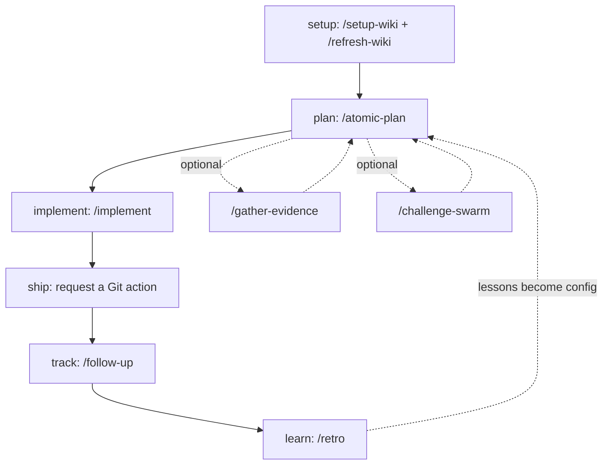
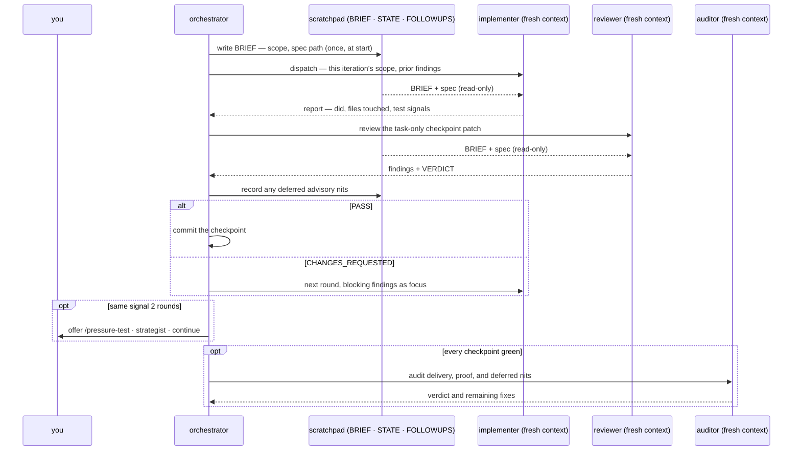

# Workflow

Atomic Claude follows a lifecycle: set up the repo, plan the work, implement it, fix what breaks, ship it, and learn from the session.

That lifecycle is a loop in the loop-engineering sense. Every stage ends at an objective gate, and `/autopilot` runs the whole circuit unattended.

The lifecycle, with the optional gates and the failure path:



`/autopilot` runs the same circuit start to finish without stopping at your approval gates.


## 0. Set up your repo

Before your first session in a new project, two commands teach Claude what it is looking at:

```
/setup-wiki
/refresh-wiki
```

`/setup-wiki` proposes missing repo setup. `/refresh-wiki` refreshes the [repo wiki](/reference/repo-wiki) on demand. Implementation uses the scan and task diff to maintain affected docs, including the repo wiki. [Realm capture buckets](/reference/realm-wiki) stay separate.


## 1. Plan

```
/atomic-plan
```

For small tasks, write the spec inline. For larger work, write the durable design in `docs/design/` and derive `SPEC.md` in the task scratchpad. Keep it available through implementation and review; discard it only after the task is accepted. Existing tracked specs stay in place.

The full spec makes the work and its proof inspectable:

| Section | What it shows |
|---------|---------------|
| `## Change tree` | every file the work creates, modifies, or removes |
| `## Outline` | the named pieces inside those files, one line each |
| `## Flows` | Links to flows in the design, plus only the flows not covered there. |
| `## End-to-end proof` | The setup, complete action, and observable result. Checkpoints have separate checks. |

Together they expose blast radius, shape, and behavior without reverse-engineering prose. The reviewer later walks the delivered work against the outline.

The end-result contract names what the user can do or observe, what is out of scope, and the check that proves the full result. Checkpoints prove individual slices.

| Main uncertainty | Method |
|---|---|
| Is a claim true? | `/gather-evidence` |
| Does a decision hold up in dialogue? | `/pressure-test` |
| What problems can independent reviewers find in a written plan? | `/challenge-swarm` |

The planner recommends the method that fits. On explicit request it can run a challenger and respondent as separate subagents; decisions that alter the user-facing contract still go to the user.


## 2. Implement

Use `/implement` with a task or an approved spec. It works directly when the context is already loaded and delegates cohesive checkpoints otherwise.

Each checkpoint goes through independent review before it can commit. Delegated work follows this sequence:



The scratchpad in that diagram is a slug-keyed work bundle — `atomic scratchpad new <slug> --purpose implement` creates or extends it, and a later phase on the same task joins it rather than opening a new one. Artifacts resolve its path, and where session reports for this project live, via `atomic where --json` rather than constructing them. → [conventions](/reference/conventions)

The reviewer blocks avoidable duplication, library drift, and speculative abstractions before the checkpoint commits. Outside Autopilot, only explicitly advisory polish can wait. Autopilot fixes every finding at the gate that reports it.

The audit runs once after the docs update. It checks the whole result, including cross-checkpoint consistency and remaining polish. Send audit fixes through checkpoint review and verification before accepting the scan. Do not rerun the audit.

Use `/implement @<scratchpad-path>/SPEC.md` with the actual path from `/atomic-plan`.


### Known-cause fixes


Use `/implement` for a straightforward fix with a known cause. It runs one checkpoint without a spec, including independent review and verification against the original failure. Use `atomic-debug` for unknown causes or `/atomic-plan` for open designs.


### Hands-off: /autopilot

```
/autopilot <task or issue number>
```

`/autopilot` follows the planning and implementation workflows without routine approvals. It consults `atomic-strategist` when stuck and stops if the blocker remains. It follows your shipping instructions or opens a PR by default. Without a remote, it keeps the verified commits locally.


### Editing directly, outside any verb

Editing outside an implementation command skips the checkpoint loop. `atomic-verify` gates a completion claim. Before a commit, an independent `atomic-reviewer` must pass the exact task-only patch unless it has already passed review.


### What the loop costs

Independent review and verification add work to each checkpoint. Agent model and effort are configurable per harness; see [Agents](agents.md). For small known-cause fixes, use a single checkpoint rather than a larger plan.


## 3. Debug separately


Use `atomic-debug` to investigate a bug or failing CI run. Once the cause is known, implement the fix and verify it against the original failure.


## 4. Ship

Ask to commit, push, open a PR, squash, or merge. A request to commit does not authorize a push or merge. `/autopilot` opens or updates a PR by default; it merges only when requested. Before committing, the shipping workflow verifies the intended change and requires an independent review of the exact task-only patch unless that patch already passed review. Ad-hoc source and prompt changes also follow `/implement`'s scan-driven documentation and baseline rules.


## 5. Track what's deferred

```
/follow-up review
```

`/follow-up review` walks through stale project follow-ups and lets you extend, close, or promote each entry.


## 6. Retrospective

```
/retro
```

`/retro` reviews the current session for friction and proposes changes for you to approve. Give it a focus to narrow the review. Ask separately to review past sessions or check whether earlier approved changes are still in place. See [Retro](retro.md).


## Lost? Start with the router

```
/atomic-help
/atomic-help tour
```

`/atomic-help` uses your request and relevant repo state to recommend one next action. If the goal is unclear, it asks one question. Use `/atomic-help tour` for a short walkthrough.


## What runs before committing


Scan and diff before updating affected docs. The final audit sees those updates. If audit fixes change scope, rescan against the original baseline and checkpoint-review the fixes without rerunning the audit. Accept the new scan only after the required docs pass review. Ad-hoc source and prompt commits use the same documentation and baseline rules.
