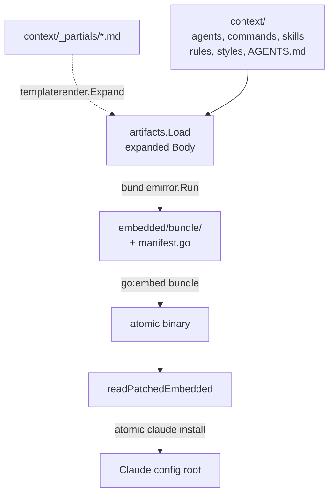
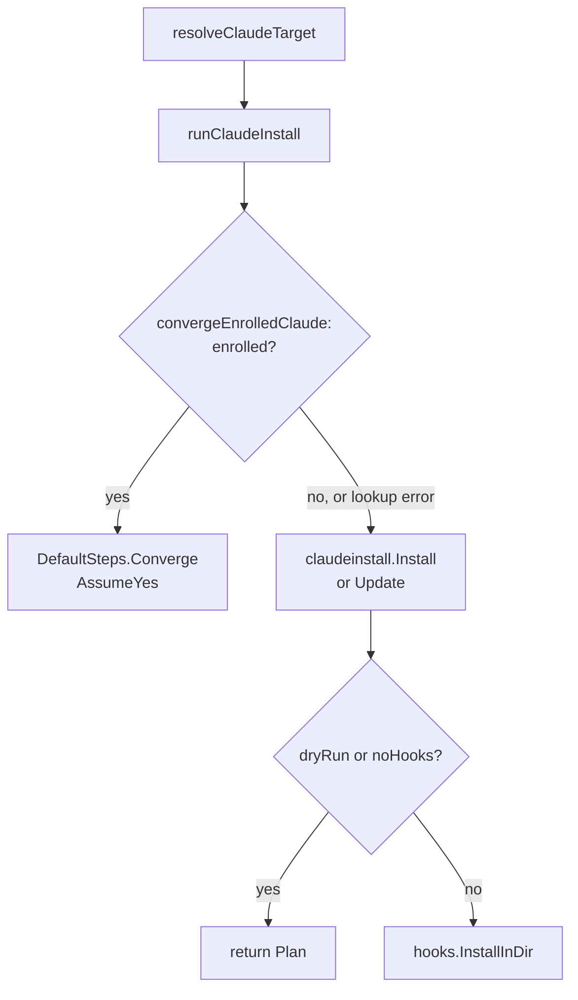
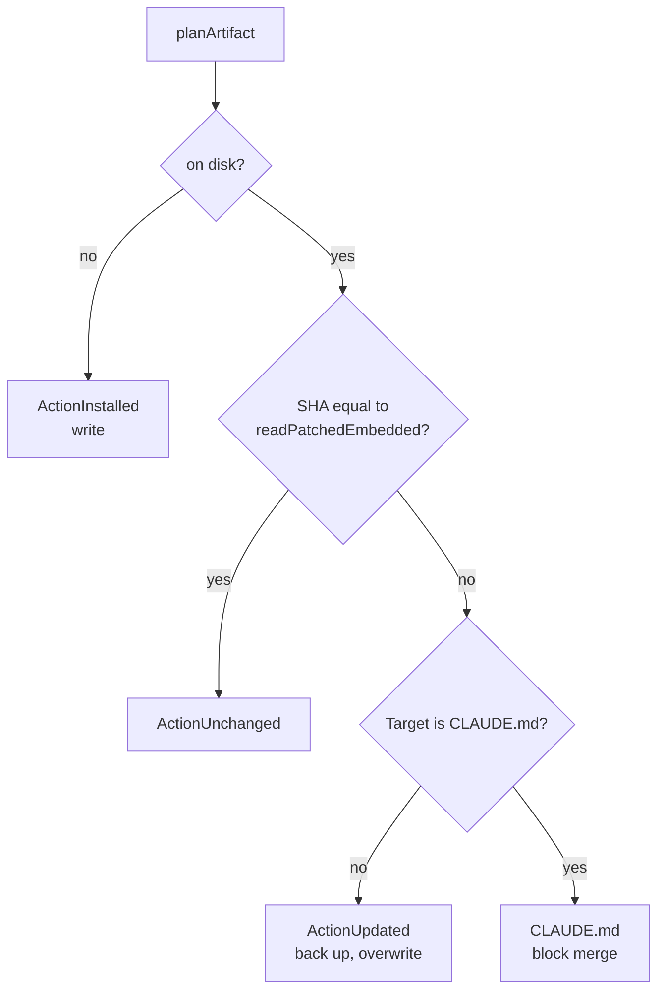
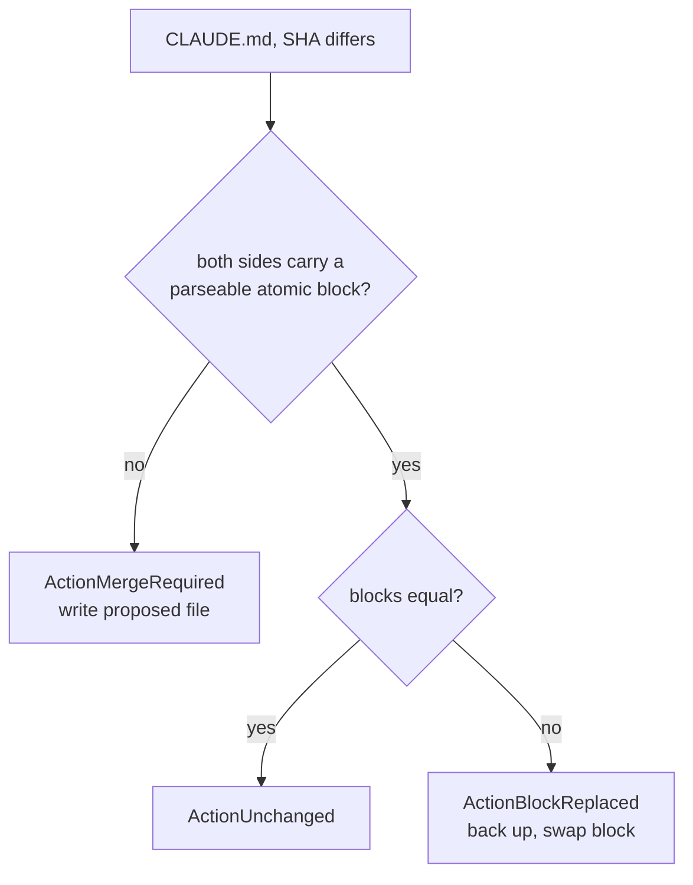
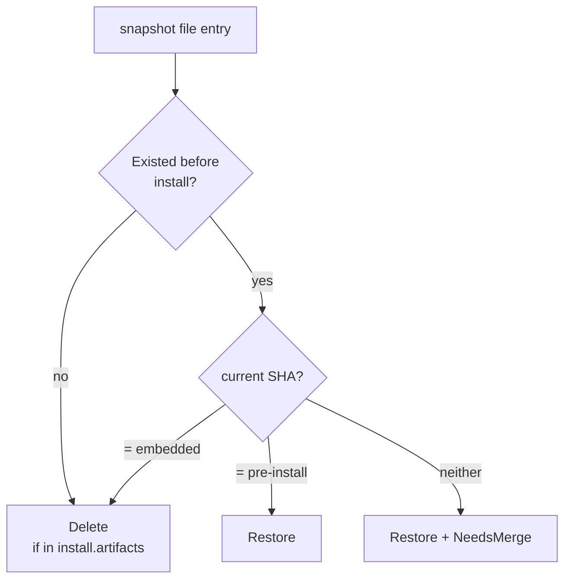

# bundle


## What it does


The markdown artifacts under [`context/`](../../context) (agents, commands, skills, output-styles, rules, and the global steering source [`context/AGENTS.md`](../../context/AGENTS.md)) are the product, and this domain is how they reach a user without a manual copy step. Without it, the [`atomic`](../../atomic) binary carries no artifacts: [`atomic/internal/embedded`](../../atomic/internal/embedded) does not compile until the mirror exists, and `atomic claude install` has nothing to write.

`make bundle` loads [`context/`](../../context) into the canonical corpus through `artifacts.Load`, which expands every `{{ template "<name>" . }}` directive against [`context/_partials/`](../../context/_partials). `bundlemirror` maps each artifact to its Claude-native path and writes it under [`atomic/internal/embedded/bundle/`](../../atomic/internal/embedded/bundle), plus a generated [`atomic/internal/embedded/manifest.go`](../../atomic/internal/embedded/manifest.go). `//go:embed bundle` in [`atomic/internal/embedded/bundle.go`](../../atomic/internal/embedded/bundle.go) compiles that tree into the binary, and `atomic claude install|update` writes the embedded copies into a Claude config root (`~/.claude`, or `CLAUDE_CONFIG_DIR` when set).

`context/commands/<verb>.md` and `context/agents/<name>.md` are committed source, not generated output: expansion happens on the way into the embedded bundle and is never written back into [`context/`](../../context), so each artifact exists once in the repo.

The domain name covers the build-time mirror ([`atomic/internal/bundlemirror/`](../../atomic/internal/bundlemirror), [`atomic/internal/tools/bundle-mirror/`](../../atomic/internal/tools/bundle-mirror), [`atomic/internal/embedded/`](../../atomic/internal/embedded)) and the legacy Claude installer ([`atomic/internal/claudeinstall/`](../../atomic/internal/claudeinstall), driven by `atomic claude`). Projecting the same corpus into Claude, OMP, and Codex targets through `atomic install`, enrollment, and the ownership ledger belongs to the harness domain ([`docs/wiki/harness.md`](harness.md)). An `atomic claude install|update` run against a ledger-enrolled root hands off to that engine instead of writing files itself.

[`atomic/internal/embedded/bundle/`](../../atomic/internal/embedded/bundle) and [`atomic/internal/embedded/manifest.go`](../../atomic/internal/embedded/manifest.go) are gitignored, and `git ls-files atomic/internal/embedded/` returns only [`atomic/internal/embedded/bundle.go`](../../atomic/internal/embedded/bundle.go). What ships to a user is fully determined by [`context/`](../../context) and the Go packages that mirror and install it.


## How it works


### The pipeline: source to installed file

Partials expand once, in `artifacts.Load`, so the embedded bundle carries rendered bytes; the only per-target rewriting left happens at install time, in `readPatchedEmbedded`.



`make bundle` runs `go run ./internal/tools/bundle-mirror -repo ../ -outdir ./internal/embedded` from [`atomic/`](../../atomic). The `test`, `build`, and `vet` targets in [`atomic/Makefile`](../../atomic/Makefile) declare `bundle` (and `frontend`) as prerequisites. CI runs `go generate ./...` in its "Generate bundle and frontend" step, which fires the `//go:generate go run ../tools/bundle-mirror -repo ../../../ -outdir .` directive in [`atomic/internal/embedded/bundle.go`](../../atomic/internal/embedded/bundle.go); goreleaser's `before` hook runs the same `go generate ./...`. `bundle-mirror` prints `bundle-mirror: wrote N artifacts to <outDir>` and renders `manifest.go` from an inline template.

`bundlemirror.Run` clears `bundle/` with `os.RemoveAll` before writing, so a source deleted from [`context/`](../../context) leaves no stale copy behind. `manifest.go` is rewritten wholesale on every run. Output sorts by kind, then target, so the result is deterministic.

Only `command`, `agent`, and `steering` artifacts pass through the template engine: `loadArtifact` in [`atomic/internal/artifacts/catalog.go`](../../atomic/internal/artifacts/catalog.go) gates on `expandedKinds`. Skills, rules, and output-styles are copied byte-for-byte, so a literal `{{` in their prose is never read as a directive.

Every kind keeps its authored path as its install target except steering. `claudeTarget` in [`atomic/internal/bundlemirror/mirror.go`](../../atomic/internal/bundlemirror/mirror.go) maps [`context/AGENTS.md`](../../context/AGENTS.md) to `bundlespec.GlobalSteering.ClaudeTarget` ([`CLAUDE.md`](../../CLAUDE.md)), and `installerKind` maps kind `steering` to `claude-md`, the kind `claudeinstall` switches on. Each manifest entry records `Kind`, `Source` (path inside the embedded FS), `Target`, `Canonical` (the [`context/`](../../context)-relative authored path, differing from `Target` only for steering), and `SHA256` of the expanded `Body`.

The manifest SHA is the SHA of the bundled bytes, not always of the installed bytes. `readPatchedEmbedded` in [`atomic/internal/claudeinstall/install.go`](../../atomic/internal/claudeinstall/install.go) rewrites these artifacts before every plan, apply, and diff:

| Artifact | Install-time rewrite |
|----------|----------------------|
| [`CLAUDE.md`](../../CLAUDE.md) | `artifacts.ClaudeSteering` inserts a `## Native tools` paragraph (the Claude tool names for agent dispatch, questions, worktrees, background listeners) just inside the closing `</atomic>` tag, so it is owned and replaced with the block. |
| `agents/*.md` | `patchAgentContent` overlays `model:` and `effort:` from `[claude.agents.<name>]` in `~/.atomic/config.toml`, through the exported `OverlayFrontmatter`. |

### What the bundle includes

Inclusion is decided by pure predicates in [`atomic/internal/bundlespec/bundlespec.go`](../../atomic/internal/bundlespec/bundlespec.go), applied by `artifacts.Load` as it walks [`context/`](../../context) (`bundlespec.SourceRoot`). A new file matching an existing rule is picked up with no Go change. A new artifact kind needs a predicate, a walk in `artifacts.Load`, and, when its target differs from its source path, a mapping in `claudeTarget`.

| Kind | Rule |
|------|------|
| agent | `context/agents/atomic-*.md`, files only (`MatchesAgent`) |
| skill | `context/skills/atomic-*/`, whole subtree; the caller requires a directory containing `SKILL.md` (`MatchesSkillDir`) |
| output-style | `context/output-styles/atomic*.md`, no dash required after [`atomic`](../../atomic) (`MatchesOutputStyle`) |
| command | `context/commands/**/*.md`, any `.md`, recursive (`MatchesCommand`) |
| rule | `context/rules/**/*.md`, recursive (`MatchesRule`) |
| steering (manifest kind `claude-md`) | [`context/AGENTS.md`](../../context/AGENTS.md), exact name (`bundlespec.GlobalSteering.Source`, `IsGlobalSteeringSource`); installs as [`CLAUDE.md`](../../CLAUDE.md) |

The shipped rules today are [`context/rules/python/style.md`](../../context/rules/python/style.md), [`context/rules/typescript/style.md`](../../context/rules/typescript/style.md), and [`context/rules/specs/spec-currency.md`](../../context/rules/specs/spec-currency.md).

`context/_partials/*.md` is never a bundle target. `templaterender.LoadPartials` reads it as a pool of `{{ define }}` blocks, and `artifacts.Load` never walks it as an artifact source.

`bundlespec` also carries the steering descriptors the harness domain uses: `GlobalSteering` (`AGENTS.md` rendered directly to [`CLAUDE.md`](../../CLAUDE.md), no loader) and `ScopeSteering` (repo or realm `AGENTS.md` with a thin [`CLAUDE.md`](../../CLAUDE.md) loader whose `LoaderBody` is `@AGENTS.md`). `LoaderWithoutImport` reports a [`CLAUDE.md`](../../CLAUDE.md) or [`claude.md`](../../claude.md) in a directory that does not import `AGENTS.md`, ignoring `@AGENTS.md` tokens inside code blocks and code spans.

`ScopeSteering` is shaped by a `SteeringMode`, the value of the `[steering] claude` config key (see [`docs/wiki/config.md`](config.md)). `SteeringModes` lists the valid values, default first:

| `SteeringMode` | Value | Scope pair Claude reads | `GuidanceFile(mode)` |
|----------------|-------|-------------------------|----------------------|
| `SteeringLoader` | `loader` | `AGENTS.md` plus a thin [`CLAUDE.md`](../../CLAUDE.md) importing it | `AGENTS.md` |
| `SteeringAgentsMD` | `agents-md` | `AGENTS.md` alone, which Claude Code 2.1.277 and later reads when no [`CLAUDE.md`](../../CLAUDE.md) sits beside it | `AGENTS.md` |
| `SteeringClaudeMD` | `claude-md` | [`CLAUDE.md`](../../CLAUDE.md) alone, guidance inline | [`CLAUDE.md`](../../CLAUDE.md) |

`OwnsLoader` reports whether a file's Atomic block is exactly `LoaderDocument()`, which is how a steering-mode conversion tells Atomic's own loader from a user's [`CLAUDE.md`](../../CLAUDE.md). The conversion itself belongs to the harness and wiki domains; `bundlespec` only names the shapes.

### Partial composition

Editing a partial reaches further than its direct consumers, because partials nest. `merge-flow-preflight`, `merge-flow-steps`, `squash-flow-preflight`, and `squash-flow-steps` are `{{ define }}` blocks inside [`context/_partials/merge-flow.md`](../../context/_partials/merge-flow.md) and [`context/_partials/squash-flow.md`](../../context/_partials/squash-flow.md), not files of their own.

```
commit-flow  ──> review-gate, doc-impact, signals-gate
doc-impact   ──> followup-sink
loop-finalize ─> followup-sink
followup-sink ─> report-issue-privacy, resolved-provider
pr-flow      ──> base-resolution
merge-flow   ──> base-resolution, signals-gate, worktree-cleanup-prompt,
                 merge-flow-preflight, merge-flow-steps
squash-flow  ──> base-resolution, review-gate, doc-impact, signals-gate,
                 squash-flow-preflight, squash-flow-steps
agent-implementer-workflow ──> agent-code-intel, agent-search-tooling,
                               agent-tdd-signals, agent-where
```

`resolved-provider` is the one partial invoked with a string argument instead of `.`: `{{ template "resolved-provider" "source-control" }}` or `"issue-tracker"`. Its body prints that preference from the `<workflow-preferences level='resolved'>` block, falling back to `atomic workflow resolve`.

| Agent source | Partials composed |
|--------------|-------------------|
| `atomic-implementer.md` | `agent-atomic-voice`, `agent-comment-discipline`, `agent-implementer-workflow`, `agent-readability`, `agent-shared-rules`, `agent-signals-output`, `agent-yagni` |
| `atomic-reviewer.md` | `agent-atomic-voice`, `agent-code-intel`, `agent-comment-discipline`, `agent-readability`, `agent-where`, `agent-yagni` |
| `atomic-investigator.md` | `agent-atomic-voice`, `agent-code-intel`, `agent-search-tooling`, `agent-where` |
| `atomic-wiki-inferrer.md` | `agent-atomic-voice`, `agent-code-intel`, `agent-where` |
| `atomic-wiki-writer.md` | `agent-atomic-voice`, `agent-code-intel` |
| `atomic-auditor.md` | `agent-atomic-voice`, `agent-code-intel`, `agent-comment-discipline`, `agent-readability`, `agent-yagni` |
| `atomic-strategist.md` | `agent-atomic-voice`, `agent-yagni` |
| `atomic-deslopper.md` | `agent-atomic-voice`, `agent-code-intel`, `agent-comment-discipline`, `agent-search-tooling`, `agent-yagni` |

| Command source | Partials composed directly |
|----------------|----------------------------|
| `commit.md` | `commit-flow`, `push-flow`, `pr-flow`, `merge-flow`, `squash-flow`, `git-safety`, `resolved-provider` |
| `implement.md`, `subagent-implementation.md` | `handoff`, `worktree-setup`, `implement-loop`, `loop-finalize` |
| `autopilot.md` | `worktree-setup`, `implement-loop`, `loop-finalize`, `resolved-provider` |
| `quick-fix.md` | `handoff`, `implement-loop`, `loop-finalize` |
| `subagent-diagnose.md` | `base-resolution`, `followup-sink`, `resolved-provider` |
| `report-issue.md` | `report-issue-privacy`, `resolved-provider` |
| `report-issue-with-atomic.md` | `report-issue-privacy` |
| `watch-ci.md` | `resolved-provider` |
| `challenge-swarm.md`, `documentation.md`, `follow-up.md`, `refresh-wiki.md` | `followup-sink` |
| `atomic-help.md`, `git-cleanup.md`, `review-branch.md` | `base-resolution` |
| `deslop.md` | `worktree-setup`, `git-safety` |

`atomic-plan.md`, `gather-evidence.md`, `pressure-test.md`, `retrospective-learning.md`, `session-report.md`, `setup-wiki.md`, and `undo-commit.md` are self-contained. [`context/AGENTS.md`](../../context/AGENTS.md) is an expanded kind but composes no partial today.

### Install routing

`runClaudeInstall` in [`atomic/cmd/atomic/cmd_claude.go`](../../atomic/cmd/atomic/cmd_claude.go) decides between the harness install engine and the legacy writer before any write, and only the legacy path honors `--no-hooks` itself.



`resolveClaudeTarget` maps an empty or `~/.claude` `--target` to `claude.DefaultConfigDir(home)`, which honors `CLAUDE_CONFIG_DIR`; any other value goes through `claudeinstall.ResolveTarget` for `~` expansion. A ledger-enrolled root converges through `install.DefaultSteps(home).Converge` with `AssumeYes` set (the verb is the user's consent) and `SkipHooks` carrying `--no-hooks`; a plan with blockers returns as an error alongside its report. `hooks.InstallInDir` returns a `skipped bool`; when it is true (a read-only `settings.json`), `runClaudeInstall` sets `HooksError` to `settings.json is read-only` and the CLI prints a non-fatal warning with `retry later with: atomic hooks install`. After a non-dry-run `install` (not `update`), `printPostInstallHint` prints one next step: run `/refresh-wiki` in each repo that wants project signals.

### The legacy install run

`Install` and `Update` share `installOrUpdate` in [`atomic/internal/claudeinstall/install.go`](../../atomic/internal/claudeinstall/install.go), and its order is fixed: the prune diff must read the old manifest before the new one is written, and the output-style seed must run after the style file is on disk.

1. `writePreInstallSnapshot`: write-once copy of every file the manifest will touch, plus `settings.json`, into `~/.atomic/pre-install/` with a `manifest.json`. A no-op when the directory exists. Skipped under `--dry-run`.
2. Read the previous `[install.artifacts]` from `~/.atomic/config.toml` and compute `PruneDiff` against the current manifest targets.
3. `Plan`, then `Apply`.
4. `seedOutputStyleForInstall`.
5. Non-dry-run only: `ensureProfileStub` creates `~/.atomic/profile.md` and prints `ProfileNudge`; `populateProfile` calls `profile.RefreshIfStale`, swallowing errors and panics.
6. Non-dry-run only: `runPrune` offers a batched confirm to remove stale targets.
7. Non-dry-run only: `writeInstallManifest` records `[install]`, sets `Adopted = false`, and lists agents, commands, skills, output-styles, and rules under `[install.artifacts]`.

`SeedUserState` exposes steps 1 and 5 (plus a default `config.toml` when absent) without planning or writing artifacts; the harness install engine calls it from [`atomic/internal/install/install.go`](../../atomic/internal/install/install.go).

### The per-artifact install decision

Every artifact other than [`CLAUDE.md`](../../CLAUDE.md) is written whole: a missing file is installed, a matching SHA is left alone, and a differing one is backed up before it is overwritten.



`Plan`, `Apply`, and `Diff` all compare against `readPatchedEmbedded`, so they agree on the expected on-disk bytes. `patchAgentContent` sets `model:` and `effort:` independently and preserves the source order of every other key; an agent with no parseable frontmatter, or no override, is left unchanged.

### The [`CLAUDE.md`](../../CLAUDE.md) block merge

A differing [`CLAUDE.md`](../../CLAUDE.md) only ever has its `<atomic>` block swapped; when either side lacks a parseable block, the install writes a proposed file and leaves the live one untouched.



Backups land in `~/.atomic/backups/<stamp>/<target>`, one `config.BackupStamp` directory per run, shared by every `ActionUpdated` and `ActionBlockReplaced` in it. The proposed file lands at `~/.atomic/proposed/CLAUDE.md`, and `Report` tells the user to run `atomic prompt claude-merge` in a Claude Code session. If the `<atomic>` block vanishes between plan and apply, `applyAction` fails with `<path> lost its parseable <atomic> block between plan and apply`. `Diff` reports [`CLAUDE.md`](../../CLAUDE.md) as `match` when the bytes differ only outside equal `<atomic>` blocks.

### Uninstall planning

`atomic claude uninstall` writes nothing: `BuildUninstallPlan` in [`atomic/internal/claudeinstall/uninstall.go`](../../atomic/internal/claudeinstall/uninstall.go) turns the pre-install snapshot into a restore and delete plan, and `GenerateUninstallPrompt` renders it as a markdown prompt for a Claude session to execute.



`profile.md` is skipped outright. An entry with an empty recorded SHA, or a file missing on disk, falls to a plain Restore. The embedded SHA for [`CLAUDE.md`](../../CLAUDE.md) is computed through `readPatchedEmbedded`; every other target uses the manifest SHA. A missing snapshot errors with `no pre-install snapshot found at <path>`.


## Where it lives


### Edit here

| Path | Role |
|------|------|
| `context/commands/*.md` | Source for each slash command. May compose `{{ template "<name>" . }}` directives. |
| `context/agents/atomic-*.md` | Source for each subagent definition. Same composition contract as commands. |
| `context/_partials/*.md` | `{{ define }}` blocks shared by commands, agents, and the steering source. A partial defined once is callable from any expanded kind. |
| `context/skills/atomic-*/` | Skill directories, whole subtree. Bundled byte-for-byte. |
| `context/output-styles/atomic*.md` | Output style definitions. Bundled byte-for-byte. |
| `context/rules/**/*.md` | Path-scoped topic rules. Bundled byte-for-byte. |
| [`context/AGENTS.md`](../../context/AGENTS.md) | The global steering source, installed as [`CLAUDE.md`](../../CLAUDE.md) in the Claude config root. An expanded kind. Carries the `<atomic>` block, a `## Workflow preferences` section pointing at the resolved `<workflow-preferences>` block, and `<state-root>` placeholders resolved by `atomic where --json`. |

### Build-time mirror

| Path | Role |
|------|------|
| [`atomic/internal/bundlespec/bundlespec.go`](../../atomic/internal/bundlespec/bundlespec.go) | Pure inclusion predicates, `SourceRoot`, the `SteeringSource` descriptors `GlobalSteering` and `ScopeSteering`, and the `SteeringMode` values with `GuidanceFile` and `OwnsLoader`. |
| [`atomic/internal/templaterender/templaterender.go`](../../atomic/internal/templaterender/templaterender.go) | `text/template` engine. `LoadPartials` pools every `*.md` under [`context/_partials/`](../../context/_partials) in sorted order; `Expand` clones the pool per file, so a `{{ define }}` in one artifact cannot leak into the next. A missing partials dir yields an empty pool. Shared with `atomic validate`, so what ships and what is linted expand the same way. |
| [`atomic/internal/artifacts/catalog.go`](../../atomic/internal/artifacts/catalog.go) | `Load`: enumerates [`context/`](../../context) into the canonical `Catalog`, steering first, and expands partials. Owned by the harness domain. |
| [`atomic/internal/bundlemirror/mirror.go`](../../atomic/internal/bundlemirror/mirror.go) | `enumerate` maps each catalog artifact through `claudeTarget` and `installerKind`; `Run` clears and rewrites `bundle/`; `Enumerate` is `Run` without the disk write. `Artifact` duplicates `embedded.Artifact` so the generator builds before `bundle/` exists. |
| [`atomic/internal/tools/bundle-mirror/main.go`](../../atomic/internal/tools/bundle-mirror/main.go) | Entrypoint for `go generate` and `make bundle`. Resolves `-repo` and `-outdir`, calls `bundlemirror.Run`, writes `manifest.go`. |
| [`atomic/internal/embedded/bundle.go`](../../atomic/internal/embedded/bundle.go) | `//go:embed bundle` into `FS`, and the `go:generate` directive. The only committed file in the package. |
| `atomic/internal/embedded/bundle/**` | Generated mirror. Gitignored. |
| [`atomic/internal/embedded/manifest.go`](../../atomic/internal/embedded/manifest.go) | Generated `Manifest() []Artifact`. Gitignored. |
| [`atomic/internal/manifestcheck/manifestcheck.go`](../../atomic/internal/manifestcheck/manifestcheck.go) | `Compare` re-runs `bundlemirror.Enumerate` against the live [`context/`](../../context) and diffs it against the binary's `embedded.Manifest()` into `Missing`, `Extra`, and `Drifted`. |

### Legacy Claude installer

| Path | Role |
|------|------|
| [`atomic/cmd/atomic/cmd_claude.go`](../../atomic/cmd/atomic/cmd_claude.go) | `atomic claude install\|update\|list\|diff\|uninstall` dispatch, `resolveClaudeTarget`, `runClaudeInstall`, `convergeEnrolledClaude`, `printPostInstallHint`. |
| [`atomic/internal/claudeinstall/install.go`](../../atomic/internal/claudeinstall/install.go) | `Plan`, `Apply`, `Install`, `Update`, `Diff`, `List`, `Report`, `ReapplyAgents`, `SeedUserState`, `OverlayFrontmatter`, `ResolveTarget`, and the output-style seed. |
| [`atomic/internal/claudeinstall/atomicblock.go`](../../atomic/internal/claudeinstall/atomicblock.go) | Line-anchored `<atomic>...</atomic>` parser: `extractAtomicBlock`, `replaceAtomicBlock`, `atomicBlocksEqual`. |
| [`atomic/internal/claudeinstall/manifest.go`](../../atomic/internal/claudeinstall/manifest.go) | `PruneDiff`, the batched `PruneConfirm` seam, and the `[install]` record writer. |
| [`atomic/internal/claudeinstall/snapshot.go`](../../atomic/internal/claudeinstall/snapshot.go) | Write-once pre-install snapshot under `~/.atomic/pre-install/`. |
| [`atomic/internal/claudeinstall/uninstall.go`](../../atomic/internal/claudeinstall/uninstall.go) | `BuildUninstallPlan`, `BuildUninstallPlanWithManifest`, `GenerateUninstallPrompt`. |
| [`atomic/internal/claudeinstall/evidence.go`](../../atomic/internal/claudeinstall/evidence.go) | Read-only views for the migration classifier in [`atomic/internal/installstate/`](../../atomic/internal/installstate): `ReadInstallRecord`, `InstallRecordOf`, `ReadSnapshot` (`SnapshotMissing`, `SnapshotValid`, `SnapshotCorrupt`), `ProposedPath`, `MergedPath` (`CLAUDE.md.atomic-merged`). Writes nothing. |

| Verb | Flags |
|------|-------|
| `atomic claude install` | `--dry-run`, `--target`, `--no-hooks` |
| `atomic claude update` | `--dry-run`, `--target`, `--no-hooks` |
| `atomic claude diff` | `--target` |
| `atomic claude list` | none |
| `atomic claude uninstall` | `--target` |

### Docs

| Path | Covers |
|------|--------|
| [`docs/spec/artifact-templates.md`](../spec/artifact-templates.md), [`docs/design/artifact-templates.md`](../design/artifact-templates.md) | Expansion contract and partial taxonomy. |
| [`docs/spec/install-workflow.md`](../spec/install-workflow.md) | `atomic claude install/update`, SHA256 idempotency, backups, the [`CLAUDE.md`](../../CLAUDE.md) merge path. |
| [`docs/spec/atomic-binary.md`](../spec/atomic-binary.md) | Master spec for the [`atomic`](../../atomic) CLI verbs, including the `claude` family. |
| [`docs/spec/uninstall.md`](../spec/uninstall.md), [`docs/design/uninstall.md`](../design/uninstall.md) | `atomic claude uninstall`: snapshot, restore plan, merge of modified files. |
| [`docs/spec/artifact-consolidation.md`](../spec/artifact-consolidation.md), [`docs/design/artifact-consolidation.md`](../design/artifact-consolidation.md) | Why the artifact surface is shaped as it is: ship-verb family collapse, cold operations moved to binary-emitted prompts. |
| [`docs/spec/output-style-seed.md`](../spec/output-style-seed.md), [`docs/design/output-style-seed.md`](../design/output-style-seed.md) | Why install seeds the user-level `outputStyle` key and its non-goals. |
| [`docs/guides/contributing.md`](../guides/contributing.md) | Contributor workflow, build pipeline, testing. |
| [`docs/guides/install.md`](../guides/install.md) | User-facing install walkthrough. |


## Constraints


**Never edit a mirrored file.** `atomic/internal/embedded/bundle/**` and `manifest.go` are deleted and rewritten on every `make bundle`, and git does not track them, so a hand edit disappears at the next build with no diff to show it existed.

**A bare `go build` or `go test` on a fresh clone fails.** Without the mirror, the build stops at `pattern bundle: no matching files found`. Run `make -C atomic bundle` (or any `make` target that depends on it) first.

**Nothing verifies bundle freshness against a commit.** CI's generation step is not a drift gate, because nothing committed exists to diff against. Staleness inside a checkout is caught only by `manifestcheck.Compare`, through `atomic doctor`'s manifest check (`RunCheckManifestWith`) and `atomic validate`'s bundle check. Both SKIP outside the atomic-claude repo, and both compare against the manifest baked into the binary that runs them.

**The manifest SHA is not the installed SHA for [`CLAUDE.md`](../../CLAUDE.md) or overridden agents.** `atomic claude list` prints manifest SHAs; the bytes on disk carry the `## Native tools` paragraph or the `model:`/`effort:` overlay. Code that compares disk bytes must go through `readPatchedEmbedded`, as `Plan`, `Apply`, and `Diff` do.

**An enrollment lookup failure falls through to the legacy writer.** `convergeEnrolledClaude` returns `(false, installResult{}, err)` when `install.TargetEnrolled` errors, and `runClaudeInstall` uses its result only when `converged` is true. The error is dropped, and the root is written by `claudeinstall.Install` or `Update` as if it were un-enrolled.

**The `<atomic>` block is the ownership boundary in [`CLAUDE.md`](../../CLAUDE.md).** Content inside the tags is atomic-owned and replaced wholesale; content outside is preserved byte for byte. Only a line whose trimmed content is exactly `<atomic>` or `</atomic>` counts, so a backticked mention in prose never matches. Duplicate blocks, an unclosed tag, or a close before an open report not-ok and route to the proposed-file path.

**Output-style seeding fires only for `home/.claude`.** `isUserLevelTarget` compares `targetDir` against `filepath.Join(home, ".claude")` with `hooks.SameDir`, and `manifestHasOutputStyle` requires `output-styles/atomic.md` in the manifest. A `--target` install, or a target resolved from `CLAUDE_CONFIG_DIR` to another directory, never seeds. A seed failure prints `warning: could not seed output style (non-fatal)` and never aborts the install; opting out is `atomic config set output_style.seed false`.

**Dev builds never record `Install.Version`.** `writeInstallManifest` skips it when `version.Version == "dev"`, because `dev` is not parseable semver and `config.Validate` would then fail every contributor's `atomic doctor`.

**`claude-md` is never tracked in `[install.artifacts]`.** Pruning and uninstall delete-scoping therefore never remove [`CLAUDE.md`](../../CLAUDE.md); it is only ever block-replaced or restored.


## Coupling


- **harness**: `artifacts.Load`, the canonical `Catalog`, and `artifacts.ClaudeSteering` live in [`atomic/internal/artifacts/`](../../atomic/internal/artifacts), owned by the harness domain; `bundlemirror` is the Claude-native projection of that corpus for the embedded bundle. `runClaudeInstall` defers to `install.DefaultSteps(home).Converge` for an enrolled root. [`atomic/internal/harness/overlay.go`](../../atomic/internal/harness/overlay.go) reuses `claudeinstall.OverlayFrontmatter`, [`atomic/internal/install/install.go`](../../atomic/internal/install/install.go) calls `SeedUserState` and `ReadInstallRecord`, and [`atomic/internal/installstate/`](../../atomic/internal/installstate) reads `evidence.go` to classify and block adoption of a legacy install. See [`docs/wiki/harness.md`](harness.md).
- **config**: every atomic-owned path resolves through [`atomic/internal/config/paths.go`](../../atomic/internal/config/paths.go) under `~/.atomic` (`config.toml`, `backups/`, `proposed/CLAUDE.md`, `profile.md`, `pre-install/`), and `config.ClaudeConfigDir` owns the `CLAUDE_CONFIG_DIR` default. The artifact root (`targetDir`) and the state root (`home`) resolve independently, so `--target` never moves `~/.atomic`. Spec: [`docs/spec/configurable-state-paths.md`](../spec/configurable-state-paths.md).
- **config**: `atomic config agents` in [`atomic/cmd/atomic/cmd_config.go`](../../atomic/cmd/atomic/cmd_config.go) calls `claudeinstall.ReapplyAgents` (through the `reapplyLegacyAgents` variable) only for an unadopted legacy Claude root at `claude.DefaultConfigDir(home)`; enrolled harnesses converge through the harness engine instead. `ReapplyAgents` re-patches agents already on disk and never installs an absent one.
- **config**: `seedOutputStyleForInstall` calls `hooks.SeedOutputStyle`, `hooks.SeedEnabled`, `hooks.ReadOutputStyle`, and `hooks.SameDir` from [`atomic/internal/hooks/`](../../atomic/internal/hooks); `runClaudeInstall` calls `hooks.InstallInDir` for the session-start hook. The hooks package owns the `settings.json` writes; this domain decides when to call them.
- **config**: [`.githooks/pre-commit`](../../.githooks/pre-commit) has no render, bundle, or frontend stage, since none of those outputs is committed; its one stage, the follow-ups `INDEX.md` render, belongs to config ([`docs/wiki/config.md`](config.md)).
- **doctor**: [`atomic/internal/doctor/checks_manifest.go`](../../atomic/internal/doctor/checks_manifest.go) and [`atomic/internal/validate/bundle.go`](../../atomic/internal/validate/bundle.go) consume `manifestcheck.Compare`, so changing a `bundlespec` predicate changes what both report. [`atomic/internal/doctor/checks_install.go`](../../atomic/internal/doctor/checks_install.go) calls `claudeinstall.Diff`: an absent artifact is FAIL, a differing one is drift unless the ledger marks it left. [`atomic/internal/doctor/checks_output_style.go`](../../atomic/internal/doctor/checks_output_style.go) reads the same `outputStyle` key the install path seeds. See [`docs/wiki/doctor.md`](doctor.md).
- **doctor, config**: install creates `~/.atomic/profile.md` through [`atomic/internal/profile`](../../atomic/internal/profile) and prints `ProfileNudge`; profile content and its freshness window belong to those domains.
- **workflow**: every ship verb and orchestrator command lives in [`context/commands/`](../../context/commands). Changing a ship-verb flow means editing [`context/_partials/commit-flow.md`](../../context/_partials/commit-flow.md) and its siblings, because the partials fan out to every command in the family. `followup-sink` and `resolved-provider` carry the follow-up sink and the workflow-preference lookup into every command that composes them.
- **docs-meta**: [`context/AGENTS.md`](../../context/AGENTS.md) installs as every user's [`CLAUDE.md`](../../CLAUDE.md), while the repo-root [`CLAUDE.md`](../../CLAUDE.md) never installs. A change to [`context/AGENTS.md`](../../context/AGENTS.md) reaches every user on their next update.
- **Lockstep contract**: [`context/_partials/agent-yagni.md`](../../context/_partials/agent-yagni.md) and the "Simplicity first (YAGNI)" ladder in the `<principles>` block of [`context/AGENTS.md`](../../context/AGENTS.md) carry the same steps verbatim. [`context/AGENTS.md`](../../context/AGENTS.md) does not compose `agent-yagni`, so nothing enforces the match. Edit both together.
- **Stale cross-references**: the generated `manifest.go` template in [`atomic/internal/tools/bundle-mirror/main.go`](../../atomic/internal/tools/bundle-mirror/main.go) says "commit the result", and `manifestcheck` names its baseline "committed", though `manifest.go` is gitignored. The Mermaid block at `docs/design/artifact-templates.md:153` draws a `templates/` tree, a `render-templates` step, and a three-stage pre-commit hook that do not exist.
