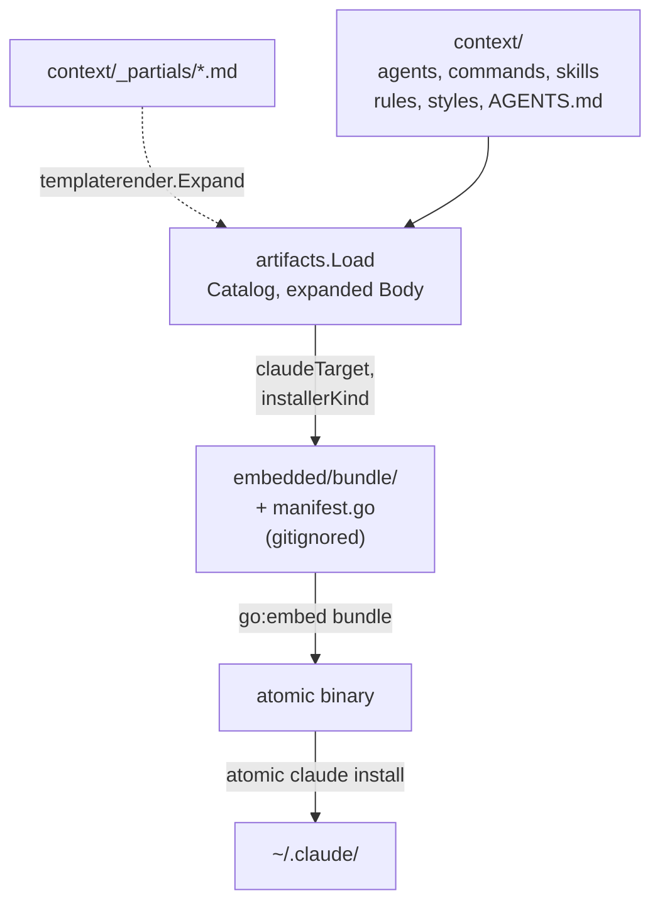
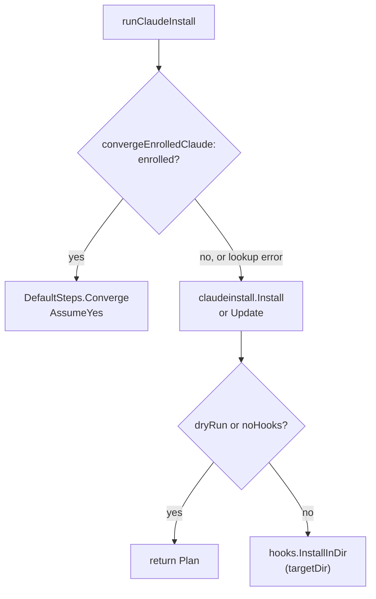
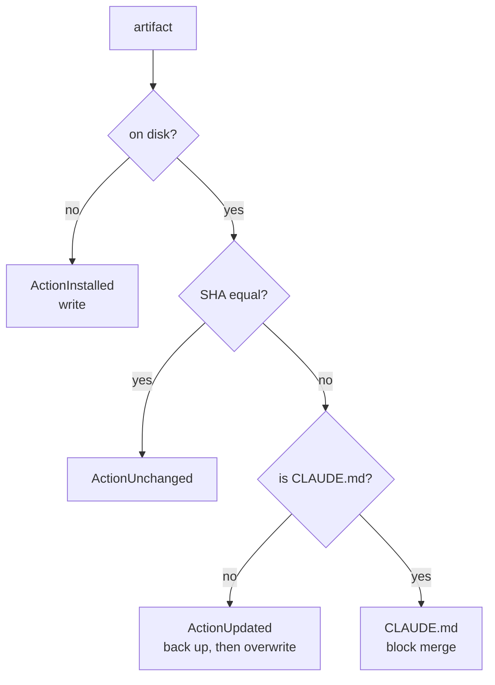
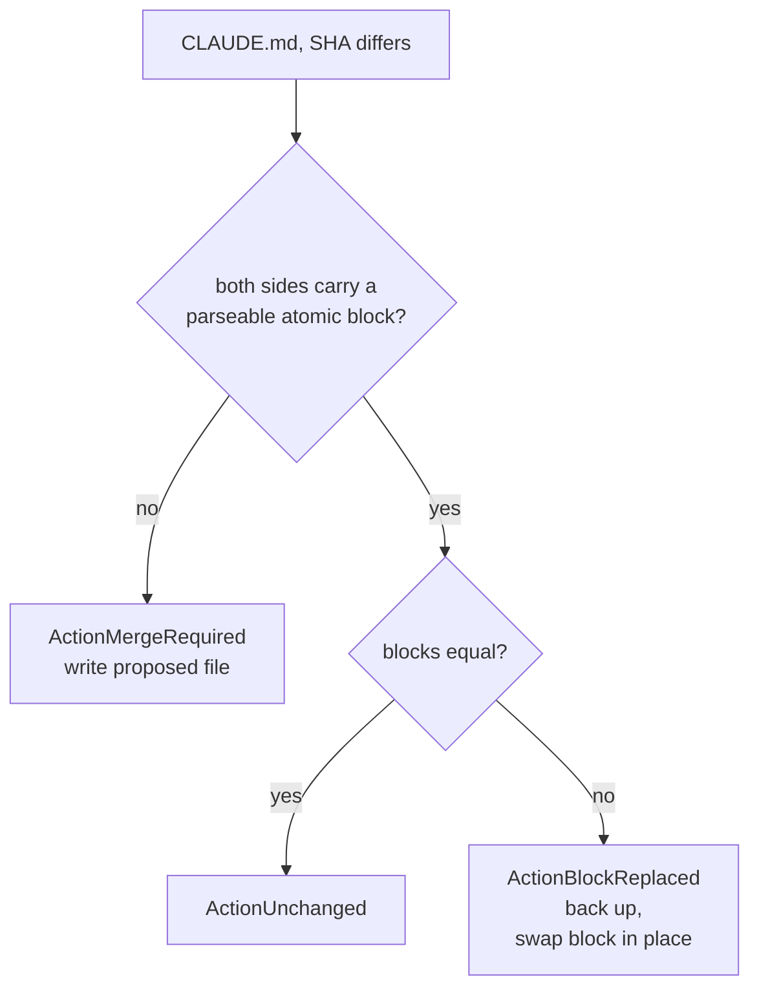

# bundle


## What it does


The markdown artifacts under [`context/`](../../context) — agents, commands, skills, output-styles, rules, and the global steering source [`context/AGENTS.md`](../../context/AGENTS.md) — are the product; this domain is how a user gets them without a manual copy step. `make bundle` loads [`context/`](../../context) into the canonical corpus (`artifacts.Load`, which expands any `{{ template "<name>" . }}` directive against [`context/_partials/`](../../context/_partials)), maps each artifact to its Claude-native path, and writes the result to [`atomic/internal/embedded/bundle/`](../../atomic/internal/embedded/bundle) plus a generated `manifest.go`. `//go:embed bundle` in [`atomic/internal/embedded/bundle.go`](../../atomic/internal/embedded/bundle.go) compiles that tree into the [`atomic`](../../atomic) binary, and `atomic claude install`/`update` writes the embedded copies to a target directory (`~/.claude` by default).

Generation happens on the way into the embedded bundle, not before it. [`context/commands/<verb>.md`](../../context/commands) and [`context/agents/<name>.md`](../../context/agents) are committed source, not generated output — no `templates/` directory and no top-level `commands/`/`agents/` directory exist in this repo. Nothing is ever written back into [`context/`](../../context), so an artifact is never duplicated between source and output.

This page covers the embedded Claude bundle and the `atomic claude` install path. Projecting the same corpus into Claude, OMP, and Codex targets through `atomic install`, enrollment, and the ownership ledger belongs to the harness domain ([`docs/wiki/harness.md`](harness.md)); an `atomic claude install|update` run against a ledger-enrolled root hands off to that engine instead of writing files itself.

Both [`atomic/internal/embedded/bundle/`](../../atomic/internal/embedded/bundle) and `manifest.go` are gitignored build outputs, confirmed by `git ls-files atomic/internal/embedded/` returning only [`bundle.go`](../../atomic/internal/embedded/bundle.go). CI's comment on the "Generate bundle" step states the reason directly: "The bundle is gitignored, so there is no drift gate here — only the generation step that makes `internal/embedded` compile." What ships to a user is fully determined by [`context/`](../../context) and the Go packages that mirror and install it.


## How it works


### The pipeline: source to installed file

Every stage after [`context/`](../../context) is regenerated from the one before, and partials expand once, in `artifacts.Load`, so the embedded bundle carries already-rendered bytes and nothing downstream is ever hand-edited.



`make bundle` runs `go run ./internal/tools/bundle-mirror -repo ../ -outdir ./internal/embedded` from [`atomic/`](../../atomic). `test`, `build`, and `vet` in [`atomic/Makefile`](../../atomic/Makefile) all declare `bundle` as a prerequisite, because [`atomic/internal/embedded`](../../atomic/internal/embedded) does not compile until the mirror exists. CI regenerates it the same way through `go generate ./...`, which fires the `//go:generate go run ../tools/bundle-mirror -repo ../../../ -outdir .` directive in [`bundle.go`](../../atomic/internal/embedded/bundle.go); goreleaser's `before` hook does the same before a release build. There is no committed rendered-artifact tree to diff, so [`.githooks/pre-commit`](../../.githooks/pre-commit) carries no render or bundle stage.

Only `command`, `agent`, and `steering` artifacts pass through the template engine (`loadArtifact` in [`atomic/internal/artifacts/catalog.go`](../../atomic/internal/artifacts/catalog.go) gates on `expandedKinds`); skills, rules, and output-styles are copied byte-for-byte, so a literal `{{` in their prose is never read as a directive. `bundlemirror.Enumerate` hashes the *expanded* `Body` for the SHA256 in `manifest.go`, because that is what actually installs — a parity check has to agree with the file the user ends up with.

Every kind keeps its authored path as its install target except steering. `claudeTarget` in [`mirror.go`](../../atomic/internal/bundlemirror/mirror.go) maps [`context/AGENTS.md`](../../context/AGENTS.md) to `bundlespec.GlobalSteering.ClaudeTarget` ([`CLAUDE.md`](../../CLAUDE.md)), and `installerKind` maps kind `steering` to `claude-md`, the kind `claudeinstall` switches on. Each manifest entry records the authored [`context/`](../../context)-relative path in `Canonical`, which differs from `Target` only for the steering file.

### What the bundle includes

Inclusion is decided by pure predicates in [`atomic/internal/bundlespec/bundlespec.go`](../../atomic/internal/bundlespec/bundlespec.go), applied by `artifacts.Load` as it walks [`context/`](../../context). A new file matching an existing rule is picked up with no Go change; a new artifact *kind* needs a new predicate plus a new walk in `artifacts.Load` and, when its target differs from its source path, a mapping in `claudeTarget`.

| Kind | Rule |
|------|------|
| agent | `context/agents/atomic-*.md`, files only |
| skill | `context/skills/atomic-*/`, whole subtree, directory must contain `SKILL.md` |
| output-style | `context/output-styles/atomic*.md`, no dash required after [`atomic`](../../atomic) |
| command | `context/commands/**/*.md`, any `.md`, no allowlist, recursive |
| rule | `context/rules/**/*.md` |
| steering (manifest kind `claude-md`) | [`context/AGENTS.md`](../../context/AGENTS.md), exact name (`bundlespec.GlobalSteering.Source`); installs as [`CLAUDE.md`](../../CLAUDE.md) |

`context/_partials/*.md` is never itself a bundle target: `templaterender.LoadPartials` reads it as a pool of `{{ define }}` blocks, and `artifacts.Load` never walks it as an artifact source. That is also why the plain `//go:embed bundle` pattern in [`bundle.go`](../../atomic/internal/embedded/bundle.go) needs no `all:` prefix today — the underscore-prefixed `_partials/` directory is a template input, not something that lands under `bundle/`.

### Partial composition

Editing a partial reaches further than its own consumers, because partials nest:

```
commit-flow  ──> review-gate, doc-impact, signals-gate
merge-flow   ──> base-resolution, signals-gate, worktree-cleanup-prompt,
                 merge-flow-preflight, merge-flow-steps
squash-flow  ──> base-resolution, review-gate, doc-impact, signals-gate,
                 squash-flow-preflight, squash-flow-steps
agent-implementer-workflow ──> agent-search-tooling, agent-tdd-signals,
                               agent-code-intel, agent-where
```

| Agent source | Partials composed |
|---------------|-------------------|
| `atomic-implementer.md` | `agent-atomic-voice`, `agent-comment-discipline`, `agent-implementer-workflow`, `agent-readability`, `agent-shared-rules`, `agent-signals-output`, `agent-yagni` |
| `atomic-reviewer.md` | `agent-atomic-voice`, `agent-code-intel`, `agent-comment-discipline`, `agent-readability`, `agent-where`, `agent-yagni` |
| `atomic-investigator.md` | `agent-atomic-voice`, `agent-code-intel`, `agent-search-tooling`, `agent-where` |
| `atomic-wiki-inferrer.md` | `agent-atomic-voice`, `agent-code-intel`, `agent-where` |
| `atomic-wiki-writer.md` | `agent-atomic-voice`, `agent-code-intel` |
| `atomic-auditor.md` | `agent-atomic-voice`, `agent-code-intel`, `agent-comment-discipline`, `agent-readability`, `agent-yagni` |
| `atomic-strategist.md` | `agent-atomic-voice`, `agent-yagni` |
| `atomic-deslopper.md` | `agent-atomic-voice`, `agent-code-intel`, `agent-comment-discipline`, `agent-search-tooling`, `agent-yagni` |

| Command source | Partials composed |
|-----------------|-------------------|
| `commit.md` | `commit-flow`, `push-flow`, `pr-flow`, `merge-flow`, `squash-flow`, `git-safety` |
| `subagent-implementation.md`, `implement.md` | `handoff`, `worktree-setup`, `implement-loop`, `loop-finalize` |
| `autopilot.md` | `worktree-setup`, `implement-loop`, `loop-finalize` |
| `quick-fix.md` | `handoff`, `implement-loop`, `loop-finalize` |
| `report-issue.md`, `report-issue-with-atomic.md` | `report-issue-privacy` |
| `deslop.md` | `worktree-setup`, `git-safety` |

Every other command source is self-contained.

### Install verbs

| Verb | Flags |
|------|-------|
| `atomic claude install` | `--dry-run`, `--target`, `--no-hooks` |
| `atomic claude update` | `--dry-run`, `--target`, `--no-hooks` |
| `atomic claude diff` | `--target` |
| `atomic claude list` | none |
| `atomic claude uninstall` | `--target` |

`install` and `update` share a code path, `installOrUpdate` in [`atomic/internal/claudeinstall/install.go`](../../atomic/internal/claudeinstall/install.go). Both take a write-once pre-install snapshot, plan, apply, create `~/.atomic/profile.md` if absent, offer to prune stale artifacts, then record what was installed in `[install.artifacts]`.

Right after `Apply` returns, `installOrUpdate` calls `seedOutputStyleForInstall(targetDir, home, manifest, dryRun, out)` (after `Apply`, so the style file the seed guard checks for is already on disk). Seeding fires only when `manifestHasOutputStyle` finds the output-style artifact in the manifest itself (not on disk, since `--dry-run` writes nothing) and `isUserLevelTarget` confirms `targetDir` is `~/.claude` via `hooks.SameDir`; a custom `--target` install never seeds. Under `--dry-run`, `planOutputStyleSeed` reports what would be seeded by checking `hooks.SeedEnabled` and the current `settings.json` state, without writing. A seed failure (malformed `settings.json`) prints as a non-fatal warning and never aborts the install.

[`atomic/cmd/atomic/cmd_claude.go`](../../atomic/cmd/atomic/cmd_claude.go)'s `runClaudeInstall` routes on enrollment before any write.



A ledger-enrolled root converges through the install engine (`install.DefaultSteps(home).Converge`, auto-approved because the verb is the user's consent), so its owned bytes move under the lifecycle lock, journal, and ledger; a blocked plan returns as an error. Only an un-enrolled root takes the legacy `claudeinstall` path, and only that path honors `--no-hooks`. `hooks.InstallInDir` returns a `skipped bool` alongside its error; when `skipped` is true (a read-only `settings.json`), `runClaudeInstall` sets `result.HooksError = fmt.Errorf("settings.json is read-only")` instead of reporting success. `printPostInstallHint` prints only the `/refresh-wiki` signals reminder, since `seedOutputStyleForInstall` selects the output style during install.

### The per-artifact install decision

`~/.claude/CLAUDE.md` is never overwritten wholesale, because a user's own content lives in the same file.

Every artifact other than [`CLAUDE.md`](../../CLAUDE.md) is written whole: a missing file is installed, a matching SHA is left alone, and a differing one is backed up before it is overwritten.



### The [`CLAUDE.md`](../../CLAUDE.md) block merge

A differing [`CLAUDE.md`](../../CLAUDE.md) only ever has its `<atomic>` block swapped; when either side lacks a parseable block, the install writes a proposed file and leaves the live one untouched.



Backups land in `~/.atomic/backups/<timestamp>/<target>`, one timestamp directory per run. The proposed file lands at `~/.atomic/proposed/CLAUDE.md`, and the install output tells the user to run `atomic prompt claude-merge` in a Claude Code session. If the `<atomic>` block vanishes between plan and apply, `applyAction` fails loud with `"<path> lost its parseable <atomic> block between plan and apply"` rather than guessing the boundary.

`Plan`, `Apply`, and `Diff` all load the `[claude.agents]` overrides and patch `model:` and `effort:` frontmatter before hashing, so all three agree on the expected on-disk bytes. `patchAgentContent` sets `model:` and `effort:` independently and preserves the source order of every other key; a file with no parseable frontmatter is left unchanged.

`ReapplyAgents(targetDir, home)` re-patches only agent files already present on disk. An absent agent is never installed by it.

### Stale-artifact pruning

Install reads the previous `[install.artifacts]` list from `~/.atomic/config.toml` *before* planning, so it compares against the old manifest rather than the one about to be written. `PruneDiff` returns the targets that left the bundle, and a batched confirm offers to remove them. A non-interactive terminal, or Ctrl+C at the prompt, skips the removal silently. `claude-md` is never tracked in `[install.artifacts]`. Dev builds (`version.Version == "dev"`) leave `Install.Version` untouched, because `dev` is not parseable semver and `config.Validate` would then fail every contributor's `atomic doctor`.


## Where it lives


### Edit here

| Path | Role |
|------|------|
| `context/commands/*.md` | Source for each slash command. May compose `{{ template "<name>" . }}` directives. |
| `context/agents/*.md` | Source for each subagent definition. Same composition contract as commands. |
| `context/_partials/*.md` | Partials composed by both kinds via `{{ template "<name>" . }}`. A partial defined once is callable from any command or agent source. |
| `context/skills/atomic-*/` | Skill directories, whole subtree. Bundled byte-for-byte, no expansion. |
| `context/output-styles/atomic*.md` | Output style definitions. Bundled byte-for-byte. |
| `context/rules/**/*.md` | Path-scoped topic rules. Bundled byte-for-byte. |
| [`context/AGENTS.md`](../../context/AGENTS.md) | The global steering source, installed as `~/.claude/CLAUDE.md`. Expanded through partials like commands and agents. |

### Generated, never edit, never committed

| Path | Written by |
|------|-----------|
| `atomic/internal/embedded/bundle/**` | `make bundle` |
| [`atomic/internal/embedded/manifest.go`](../../atomic/internal/embedded/manifest.go) | `make bundle` |

Both are gitignored; `git ls-files atomic/internal/embedded/` returns only [`bundle.go`](../../atomic/internal/embedded/bundle.go).

### Go packages

| Path | Role |
|------|------|
| [`atomic/internal/bundlespec/bundlespec.go`](../../atomic/internal/bundlespec/bundlespec.go) | Pure inclusion predicates plus the `SteeringSource` descriptors: `GlobalSteering` (`AGENTS.md` rendered directly to [`CLAUDE.md`](../../CLAUDE.md)) and `ScopeSteering` (repo or realm `AGENTS.md` with a thin [`CLAUDE.md`](../../CLAUDE.md) loader, `LoaderBody` `@AGENTS.md`). Applied by `artifacts.Load`. |
| [`atomic/internal/artifacts/catalog.go`](../../atomic/internal/artifacts/catalog.go) | `Load`: enumerates [`context/`](../../context) into the canonical `Catalog` and expands partials exactly once. Owned by the harness domain; this domain consumes its output. |
| [`atomic/internal/templaterender/templaterender.go`](../../atomic/internal/templaterender/templaterender.go) | `text/template` engine. `LoadPartials` pools every `*.md` under [`context/_partials/`](../../context/_partials) in sorted order; `Expand` clones the pool per file, so a `{{ define }}` in one artifact can never leak into the next. A missing partials dir yields an empty pool rather than an error. |
| [`atomic/internal/bundlemirror/mirror.go`](../../atomic/internal/bundlemirror/mirror.go) | Build-time projector. `enumerate` calls `artifacts.Load`, maps each artifact through `claudeTarget` and `installerKind`, and keeps the rendered bytes; `Run` writes them under `bundle/`. `Enumerate` is `Run` without the disk write, used by `manifestcheck`. Output sorts by kind then target, so the result is deterministic. |
| [`atomic/internal/embedded/bundle.go`](../../atomic/internal/embedded/bundle.go) | Holds `//go:embed bundle` and the `go:generate` directive that invokes `bundle-mirror`. |
| [`atomic/internal/embedded/manifest.go`](../../atomic/internal/embedded/manifest.go) | Generated `Manifest() []Artifact` allowlist: kind, embedded source path, install target, `Canonical` authored path, SHA256. |
| [`atomic/internal/tools/bundle-mirror/main.go`](../../atomic/internal/tools/bundle-mirror/main.go) | Entrypoint for `go generate` and `make bundle`. Prints `bundle-mirror: wrote N artifacts to <outDir>`, and writes `manifest.go` from an inline template. |
| [`atomic/internal/claudeinstall/install.go`](../../atomic/internal/claudeinstall/install.go) | `Plan`, `Apply`, `Install`, `Update`, `Diff`, `List`, `ReapplyAgents`. SHA256 idempotency, agent frontmatter patching, backups. |
| [`atomic/internal/claudeinstall/atomicblock.go`](../../atomic/internal/claudeinstall/atomicblock.go) | `<atomic>...</atomic>` parser for `~/.claude/CLAUDE.md`. Line-anchored: only a line whose trimmed content is exactly the tag counts. |
| [`atomic/internal/claudeinstall/manifest.go`](../../atomic/internal/claudeinstall/manifest.go) | Stale-artifact pruning and the `[install]` config manifest. |
| [`atomic/internal/claudeinstall/snapshot.go`](../../atomic/internal/claudeinstall/snapshot.go) | Write-once pre-install snapshot, the input to uninstall. |
| [`atomic/internal/claudeinstall/uninstall.go`](../../atomic/internal/claudeinstall/uninstall.go) | `BuildUninstallPlan`, `GenerateUninstallPrompt`. |
| [`atomic/internal/claudeinstall/evidence.go`](../../atomic/internal/claudeinstall/evidence.go) | Read-only views of the legacy installer's output for the migration classifier in [`atomic/internal/installstate/classify.go`](../../atomic/internal/installstate/classify.go): `ReadInstallRecord` (the `[install]` section), `ReadSnapshot` (`SnapshotMissing`, `SnapshotValid`, `SnapshotCorrupt`), `ProposedPath`, `MergedPath` (`CLAUDE.md.atomic-merged`). Writes nothing. |
| [`atomic/cmd/atomic/cmd_claude.go`](../../atomic/cmd/atomic/cmd_claude.go) | `atomic claude install\|update\|diff\|list\|uninstall` dispatch. `runClaudeInstall` hands an enrolled root to `convergeEnrolledClaude`, otherwise wires the session-start hook and surfaces a read-only `settings.json` as `HooksError`; `printPostInstallHint` prints the post-install next steps. |
| [`atomic/internal/manifestcheck/manifestcheck.go`](../../atomic/internal/manifestcheck/manifestcheck.go) | `Compare` re-runs `bundlemirror.Enumerate` against the live [`context/`](../../context) tree and diffs it against the binary's baked-in `embedded.Manifest()` — a staleness check, not a git-commit-drift check, since neither side is committed. |

### Docs

| Path | Covers |
|------|--------|
| [`docs/spec/artifact-templates.md`](../spec/artifact-templates.md) | Render/expansion contract, orphan rule, partial taxonomy. |
| [`docs/spec/install-workflow.md`](../spec/install-workflow.md) | `atomic claude install/update`, SHA256 idempotency, backups, the `~/.claude/CLAUDE.md` merge path. |
| [`docs/spec/atomic-binary.md`](../spec/atomic-binary.md) | Master spec for every [`atomic`](../../atomic) CLI verb, including the `claude` family. |
| [`docs/spec/uninstall.md`](../spec/uninstall.md), [`docs/design/uninstall.md`](../design/uninstall.md) | `atomic claude uninstall`: snapshot, restore plan, LLM merge of modified files. |
| [`docs/spec/artifact-consolidation.md`](../spec/artifact-consolidation.md) | Why the artifact surface is shaped as it is: ship-verb family collapse, cold ops moved to binary-emitted prompts. |
| [`docs/spec/output-style-seed.md`](../spec/output-style-seed.md), [`docs/design/output-style-seed.md`](../design/output-style-seed.md) | Why install seeds the user-level `outputStyle` key, the non-goals (never a project file, never an overwrite), and the root-cause investigation behind seeding it at all. |
| [`docs/guides/contributing.md`](../guides/contributing.md) | Contributor workflow, build pipeline, testing. |
| [`docs/guides/install.md`](../guides/install.md) | User-facing install walkthrough. |


## Constraints


**Never edit a mirrored file.** `atomic/internal/embedded/bundle/**` and `manifest.go` are overwritten on every `make bundle` run and are not tracked by git, so a hand edit disappears at the next build with no diff to reveal it happened.

**Nothing verifies bundle freshness against a commit.** Because the mirror is gitignored, CI's "Generate bundle" step is generation only, not a drift gate — there is nothing committed to diff against. Staleness inside a checkout is caught only by `atomic doctor`'s manifest check (`RunCheckManifestWith`, repo-dev only, SKIPs outside this repo), which re-enumerates [`context/`](../../context) and compares it to the binary's already-embedded `Manifest()`.

**`make bundle` never removes a file.** `Run` in [`atomic/internal/bundlemirror/mirror.go`](../../atomic/internal/bundlemirror/mirror.go) writes each enumerated artifact under `bundle/` and deletes nothing, so a source deleted from [`context/`](../../context) leaves its old copy under [`atomic/internal/embedded/bundle/`](../../atomic/internal/embedded/bundle), and `//go:embed bundle` still compiles that copy into the binary. `manifest.go` is regenerated wholesale, so the copy drops out of `Manifest()`, and install, which walks `Manifest()`, never writes it. Remove the stale copy by hand and rebuild.

**An enrollment lookup failure falls through to the legacy writer.** `convergeEnrolledClaude` returns `(false, installResult{}, err)` when `install.TargetEnrolled` errors, and `runClaudeInstall` uses its result only when `converged` is true, so the error is dropped and the root is written by `claudeinstall.Install` or `Update` as if it were un-enrolled.

**The `<atomic>` block is the ownership boundary in `~/.claude/CLAUDE.md`.** Content inside the tags is atomic-owned and replaced wholesale; content outside is preserved byte for byte. Detection is line-anchored, so only a line whose trimmed content is exactly `<atomic>` or `</atomic>` counts, and a backticked mention in prose never matches. Duplicate blocks, an unclosed tag, or a close before an open all report not-ok and route to the merge path instead.

**Output-style seeding only fires for a user-level install target, never `--target`.** `isUserLevelTarget` compares `targetDir` against `home/.claude` with `hooks.SameDir`; a project-scoped install (`atomic claude install --target ./.claude`) never seeds, because the style file it would write is committed and the choice is a personal one.


## Coupling


- **config** — install writes into separate roots that must not be confused. Artifacts go to `targetDir` (default `~/.claude`, overridable with `--target`); everything atomic owns resolves through [`atomic/internal/config/paths.go`](../../atomic/internal/config/paths.go) under `~/.atomic` (`config.toml`, `backups/`, `proposed/CLAUDE.md`, `profile.md`, `pre-install/`). The config domain owns those helpers; this domain calls them. Spec: [`docs/spec/configurable-state-paths.md`](../spec/configurable-state-paths.md).
- **config** — `atomic config agents` writes `[claude.agents.<name>]` overrides, then calls `ReapplyAgents` through the `ApplyAgentsHook` package variable. `internal/config` cannot import `internal/claudeinstall` without a cycle, so [`atomic/cmd/atomic/main.go`](../../atomic/cmd/atomic/main.go), the only package importing both, wires the hook in `init()`. `ReapplyAgents` resolves its target via `ResolveTarget("~/.claude")`, so an install made with a custom `--target` is invisible to that verb.
- **config** — `seedOutputStyleForInstall` in [`atomic/internal/claudeinstall/install.go`](../../atomic/internal/claudeinstall/install.go) calls `hooks.SeedOutputStyle` and `hooks.SameDir` from [`atomic/internal/hooks/`](../../atomic/internal/hooks), the config domain's package. `hooks.SeedOutputStyle` owns the `outputStyle` key write to `~/.claude/settings.json`; this domain only decides when to call it (manifest carries the artifact, target is user-level).
- **doctor** — [`atomic/internal/manifestcheck/manifestcheck.go`](../../atomic/internal/manifestcheck/manifestcheck.go) calls `bundlemirror.Enumerate` and compares the result against the binary's embedded `Manifest()`. Doctor's manifest check and `atomic validate` both consume it. The check is repo-dev only and SKIPs outside the atomic-claude repo. Changing a `bundlespec` predicate changes what both report.
- **doctor** — doctor's install check calls `claudeinstall.Diff` to find drift between the embedded bundle and `~/.claude`: an absent artifact is FAIL, a differing one is WARN, and `atomic doctor --fix` repairs it.
- **doctor** — doctor's category 14 check ([`atomic/internal/doctor/checks_output_style.go`](../../atomic/internal/doctor/checks_output_style.go)) reads the same `outputStyle` key this domain's install path writes via `hooks.SeedOutputStyle`, and warns when it is absent or names an uninstalled style. `atomic doctor --fix` re-seeds it through the same `hooks` primitives.
- **doctor, config** — install creates `~/.atomic/profile.md` on first run via [`atomic/internal/profile`](../../atomic/internal/profile) and prints `ProfileNudge`. Profile content and its freshness window belong to those domains.
- **config** — [`.githooks/pre-commit`](../../.githooks/pre-commit) has no render, bundle, or frontend stage, since none of those outputs is committed; its one stage, the follow-ups `INDEX.md` render, belongs to config. See [`docs/wiki/config.md`](config.md).
- **workflow** — every ship verb and orchestrator command lives in [`context/commands/`](../../context/commands). Changing a ship-verb flow means editing [`context/_partials/commit-flow.md`](../../context/_partials/commit-flow.md) and its siblings, not a single command file, because the partials fan out to every command in the family.
- **harness** — `artifacts.Load` and the canonical `Catalog` live in [`atomic/internal/artifacts/`](../../atomic/internal/artifacts), which the harness domain owns; this domain's `bundlemirror` is the Claude-native projection of that corpus for the embedded bundle. `runClaudeInstall` defers to the harness install engine for an enrolled root, and `installstate` reads `claudeinstall/evidence.go` to classify a legacy install. See [`docs/wiki/harness.md`](harness.md).
- **docs-meta** — [`context/AGENTS.md`](../../context/AGENTS.md) is both the bundle input and, per the root [`CLAUDE.md`](../../CLAUDE.md), a separate file from this repo's own project instructions: [`context/AGENTS.md`](../../context/AGENTS.md) installs as every user's `~/.claude/CLAUDE.md`, while the root [`CLAUDE.md`](../../CLAUDE.md) never installs. A change to [`context/AGENTS.md`](../../context/AGENTS.md) reaches every user on their next update.
- **Lockstep contract** — [`context/_partials/agent-yagni.md`](../../context/_partials/agent-yagni.md) and the "Simplicity first (YAGNI)" ladder in [`context/AGENTS.md`](../../context/AGENTS.md)'s `<principles>` block carry the same steps verbatim. [`context/AGENTS.md`](../../context/AGENTS.md) does not compose `agent-yagni`, so nothing enforces the match. Edit both together.
