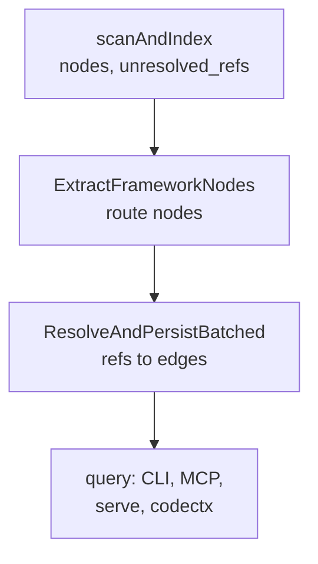
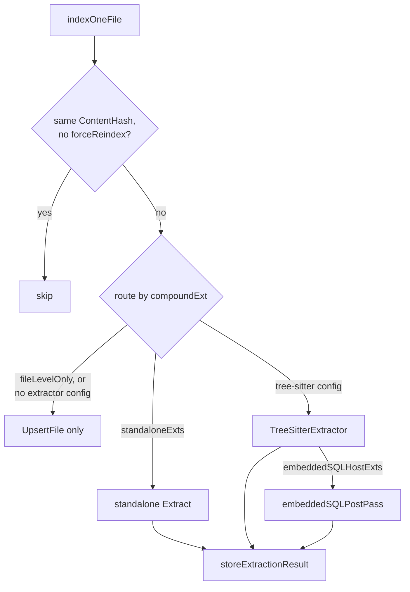
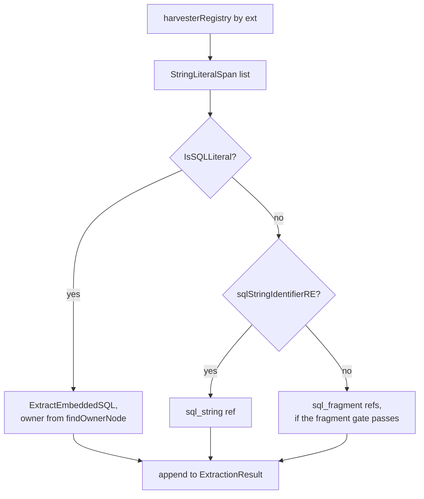
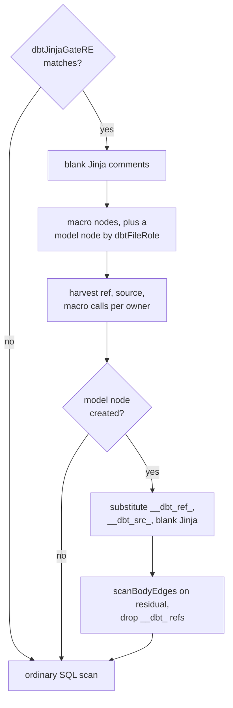
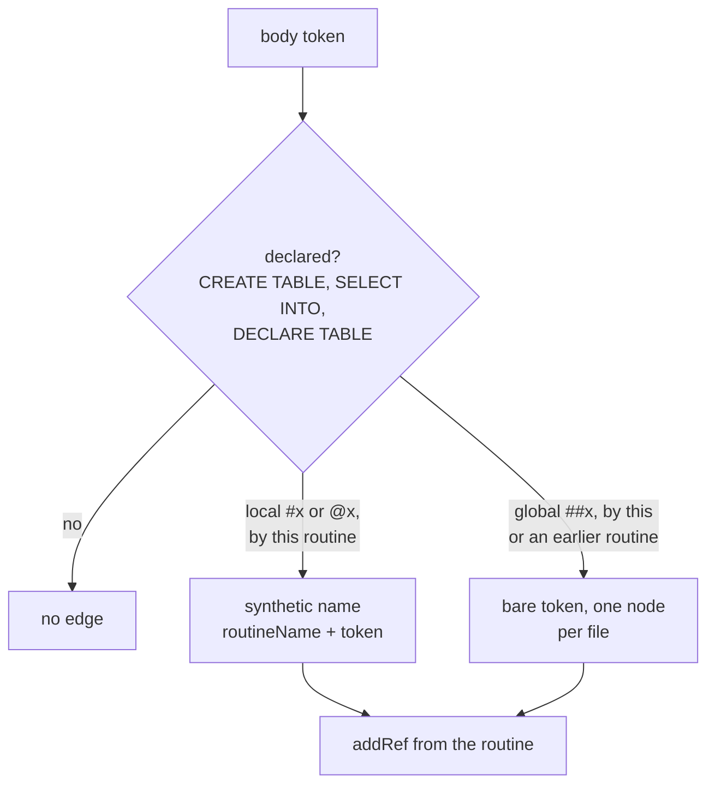
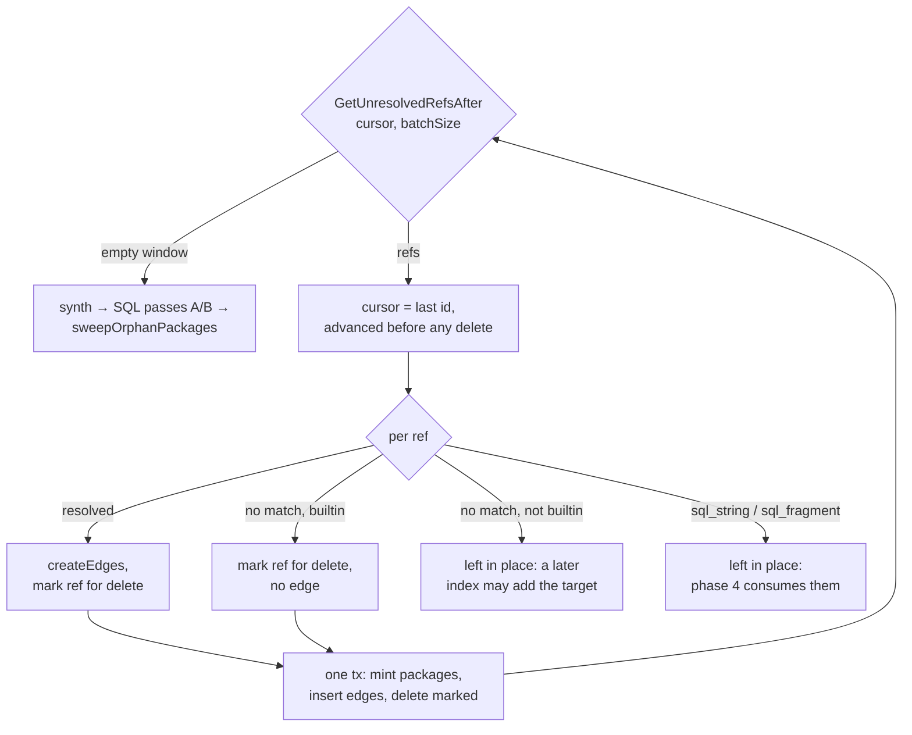
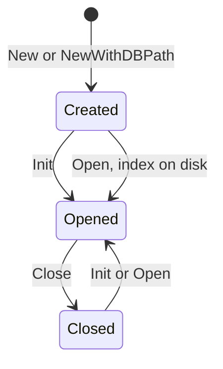
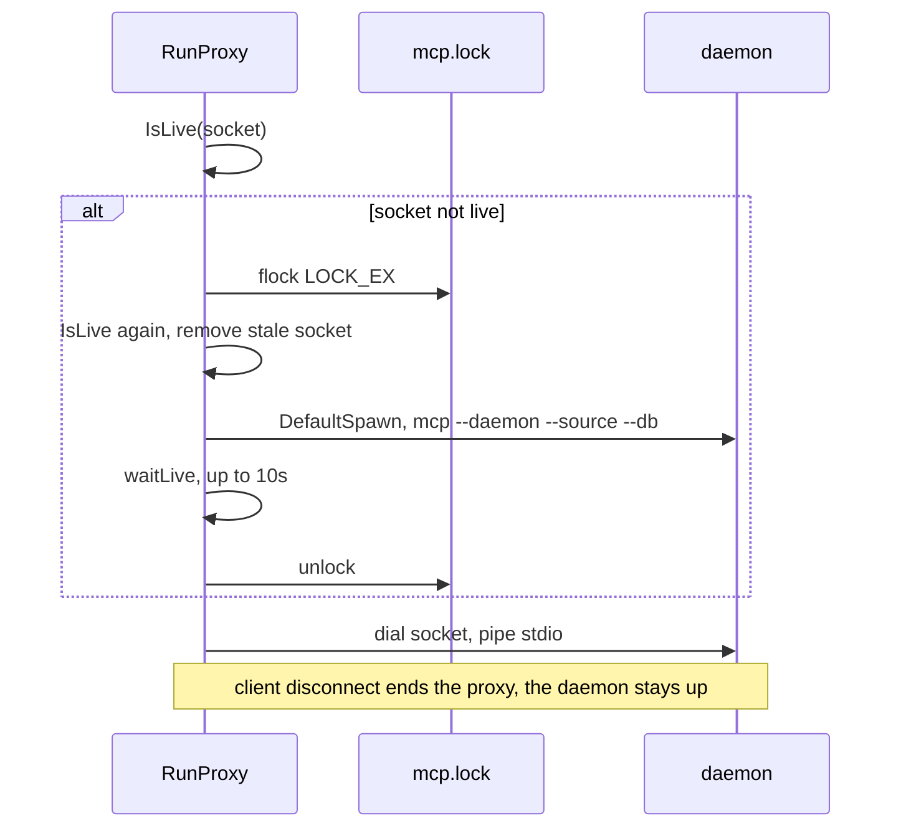
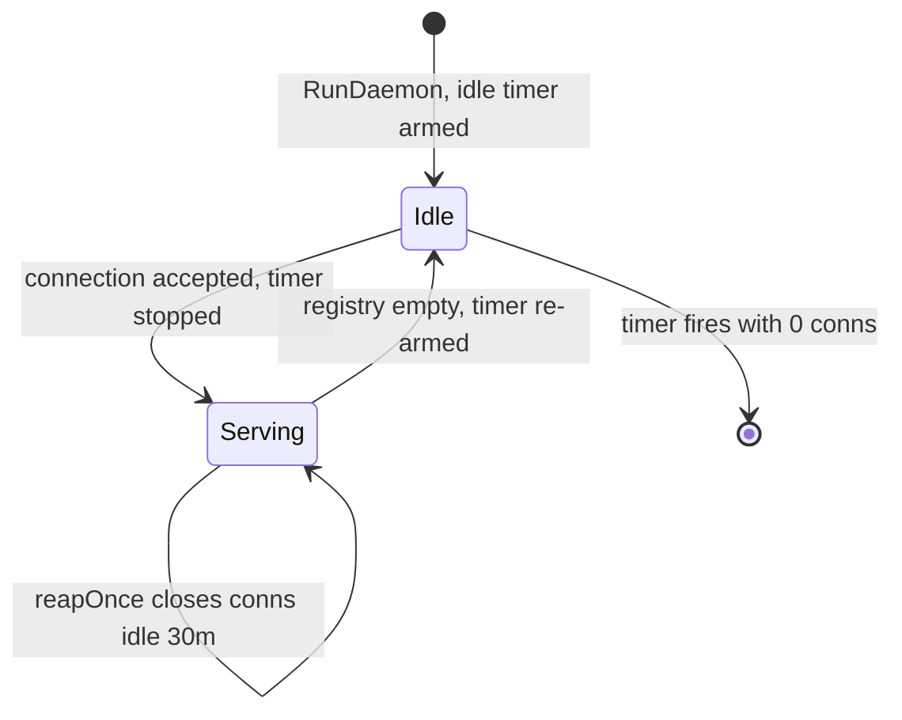
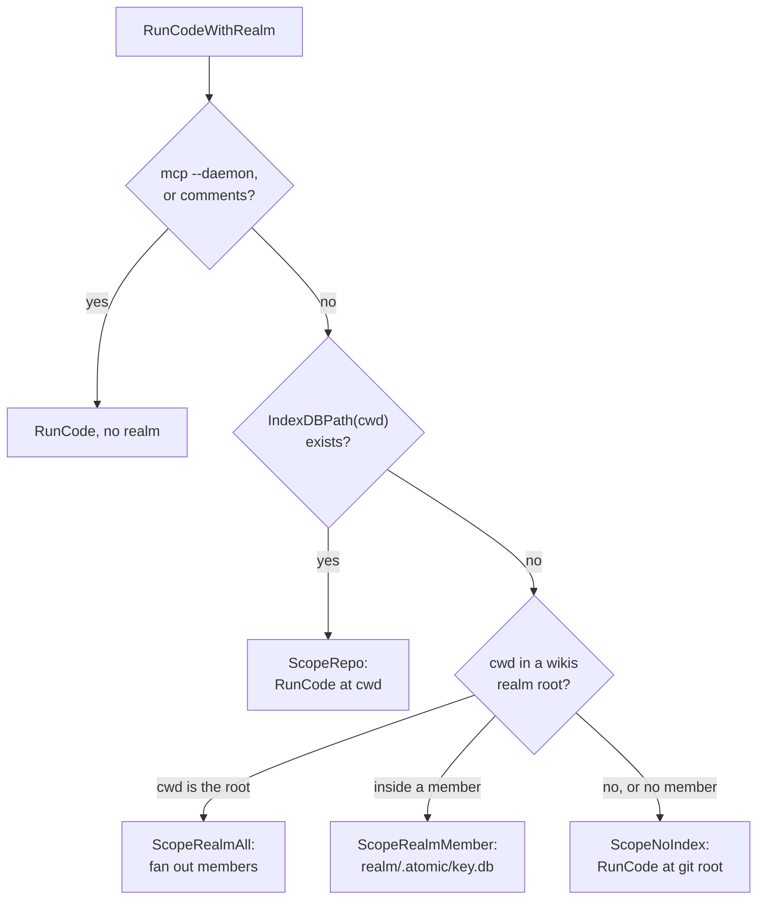

# code-intel

## What it does

Grep finds text. It cannot answer who calls this, what breaks if I change it, or where this route ends up, so an agent asking those questions reads files until it guesses.

This domain answers them from a real graph. It parses a project's source into symbols, stores them in SQLite, resolves cross-file references into edges, and serves structural queries over the result. Consumers are the `atomic code` CLI verbs, an MCP server, agents that compose the `agent-code-intel` partial, and the `serve` domain's code-graph view.

The index lives at `<projectRoot>/<harness.dir>/.atomic-index/atomic.db` (default `.claude/.atomic-index/atomic.db`), derived by `config.IndexDBPath` in [`atomic/internal/config/harness.go`](../../atomic/internal/config/harness.go).

## How it works

Extraction never creates a cross-file edge, which is why extraction and resolution can run at different times and on different file sets.

Extraction emits nodes, same-file edges, and `UnresolvedReference` rows; resolution is what turns a reference into an edge.

### Stored vocabulary

Kind strings persist in SQLite, so each slice's membership is asserted in a test, and the slice is the truth:

| Slice | Pinned by |
|-------|-----------|
| `AllNodeKinds` | `TestNodeKindCount` |
| `AllEdgeKinds` | `TestEdgeKindCount` |
| `AllLanguages` (includes `unknown`) | `TestLanguageCount` |

`stage`, `stream`, `task`, `model`, `file_format`, `macro`, and `script` are SQL-dialect only (Snowflake and dbt). No extractor produces `package`: resolution mints it.

**`ReferenceKindSQLString` and `ReferenceKindSQLFragment` are `EdgeKind` constants that are not edge kinds.** Both are valid only in `UnresolvedReference.ReferenceKind`, and are deliberately excluded from `AllEdgeKinds`. Edges built from them always carry `Kind: references`.

**Provenance marks how an edge was derived.** Empty for direct extraction and resolution, `"embedded"` for embedded SQL, `"string-match"` for SQL string-match, `"heuristic"` for synthesis. `mcp/server.go:isSynthesizedProvenance` treats `"heuristic"` and `"string-match"` alike, annotating them as inferred in tool output.

### Indexing a tree

`IndexAll` and `Sync` share one body, `scanAndIndex`, which runs in this order:

1. `checkExtractorVersion` decides whether this run must re-extract every file.
2. `scanFiles` lists files with `git ls-files --cached --others --exclude-standard`, and falls back to `walkDirFallback` (a fixed set of skipped directories) when git is unavailable.
3. `filterIgnored` drops `[code] ignore` matches.
4. `indexFiles` runs `indexOneFile` in one goroutine per file; tree-sitter parses are capped at the pool size.
5. `pruneDeleted` removes rows for files missing from the scanned list.
6. `stampExtractorVersion` writes the stamp, only when the version check asked for it.

Each parsed file reaches `storeExtractionResult` exactly once; an unchanged content hash skips the file before any parse:

A file whose read or stat fails is counted in `SkippedFiles` and never aborts the run. `storeExtractionResult` deletes the file's nodes before re-inserting them, in one transaction, because a node id embeds its line and a moved symbol gets a new id.

### Extraction

**Local variables are suppressed inside function scopes.** A `VariableTypes` match mints a node only at `scopeDepth == 0` and only when the name is a single identifier, not a destructuring pattern's rendered text (`{ a, b }`). `FunctionScopeTypes` is wired for TypeScript, TSX, and JavaScript; every other language mints a node for each `VariableTypes` match. Namespace-scoped consts and Vue/Svelte `<script setup>` top-level state survive, because those are not function scopes. A suppressed initializer is still walked, so calls and JSX inside it are harvested.

**Embedded SQL spans Shape 1 and Shape 2 grammars across the embedded-literal host languages.** Go uses a hand-written scanner, Python and TypeScript/TSX use dedicated tree-sitter harvesters, and every other language in `embeddedLiteralConfigs` goes through `HarvestEmbeddedLiterals`. Shape 1 grammars expose a content child; Shape 2 grammars require taking the node's own text, splicing `"?"` over interpolation byte ranges, and stripping the delimiter alphabet. The host extension set derives from `extToLanguage` plus the config table rather than a second hand-maintained list. `IsSQLLiteral` recognizes SQL structure only, with no stopword list; concatenated and multi-fragment queries are accepted false negatives.

**dbt and Snowflake parsing rules.** `modPat` in `sql.go` already absorbs `OR REPLACE`, `OR ALTER`, and `IF NOT EXISTS`; do not re-add them to new patterns. In `ref('pkg','model')` the package is the first positional, so a bare second string literal names a model only when two positionals are supplied, and the version is always a keyword argument. Path segment `/macros/` harvests macro definitions with no model node; `/tests/`, `/analyses/`, `/seeds/`, `/snapshots/` produce no model node. References inside a `...` byte span belong to the macro, not the model. Jinja `{# ... #}` comments are stripped before harvest.

### Embedded SQL post-pass

Every harvested literal ends in one outcome inside `embeddedSQLPostPass`: extracted as SQL, emitted as a speculative ref for the string-match passes, or dropped by the fragment gate.

`harvesterRegistry` starts with the Go, Python, TypeScript, and TSX harvesters. Its `init()` adds a generic harvester, and an `embeddedSQLHostExts` entry, for each extension whose language has an `embeddedLiteralConfigs` entry and no harvester yet, so the bespoke harvesters always win.

### dbt Jinja pre-pass

The dbt pre-pass in `SQLExtractor.Extract` reads raw source before the ordinary SQL scan, because `stripStrings` would blank the quoted arguments inside `{{ ref('x') }}`. Its placeholders let the ordinary scan attach real `FROM` and `JOIN` tables to the model without double-counting the refs the harvest already owns:

### T-SQL temp tables

A local `#x` or `@x` token produces an edge only when the enclosing routine declares it, so a stray `#tmp` from another procedure never links. A global `##x` links when this routine or one scanned before it declares it (functions before procedures, source order within each):

Local temps get one `makeTempNode` per routine, named by the synthetic name. Global temps are deduped per file through `globalTempNodes`.

### Reference resolution

An unmatched non-builtin ref is kept, because a later index may add the node it wants. A matched ref and a builtin ref are deleted; only the matched one produces an edge.

**The loop ends on an empty window, not on a barren one.** The loop starts after `warmCaches` and `warmKnownPackages`. Windows are keyset-paginated by ref id, and the cursor advances to the last id in the window *before* any delete, so every ref is visited exactly once. A window that marks nothing for delete does `continue`, never `break`, because unresolvable refs stay in the table and a later window may still hold resolvable ones. The `sql_string` and `sql_fragment` refs the loop skips are deleted after the string-match passes.

Package mints, edge inserts, and ref deletes share one transaction per window, so a crash cannot leave an edge pointing at a package node that was never persisted. `sweepOrphanPackages` runs unconditionally at the end, even when the run minted nothing, because a package's last importer may have disappeared since a prior run.

**Import classification follows Node resolution, not an allowlist.** For JS-family languages, any specifier not starting with `.`, `/`, or `#` is external. A trailing `?query` or `#fragment` is stripped first, unless the `#` is the first character (a [`package.json`](../../package.json) `"imports"` subpath). A `://` substring marks a URL-scheme specifier external ahead of any per-language branch. Import refs never reach generic name matching in `resolveOne`, because an import node is named its own specifier and the fallback would resolve the ref back to its own owner.

**External JS imports converge on one package node.** A JS-family external import with a derivable npm name resolves to a shared `package:npm/<name>` hub via an `imports` edge, so every importer of `@hapi/hapi` points at one node instead of leaving an orphan import. Hubs are minted lazily in the resolution batch loop, never by extraction, and swept when the last importer disappears. They carry no `FilePath`, which is why neither `pruneDeleted` nor `DeleteNodesByFile` can reach them. Scoped to npm; Go, Python, and Rust imports are untouched, and a `://` specifier never mints one.

**SQL string-match never mints nodes.** An identifier-shaped literal that fails `IsSQLLiteral` becomes a speculative `sql_string` ref, matched after standard resolution against already-indexed table, view, procedure, and function names (pass A), then against columns for anchored owners (pass B). More than 3 exact-name candidates produces no edge at all. Confidence lands in `Edge.Metadata`; `high` requires the ref's `CalleeExpr` to be in the `QueryBuilderCallees` vocabulary, and membership alone never creates an edge. A literal that fails both the gate and the identifier shape gets one more chance at the fragment tier, whose tokens run the same passes and then have their confidence demoted one notch to offset prose-collision risk. Every ref of both kinds is deleted after the passes, so re-indexing is idempotent and no rows accumulate.

### Freshness and lifecycle

**Engine lifecycle.** `New` then `Init` or `Open`, use, `Close`. `Init` is idempotent; `Open` errors when the index is absent. Every query and indexing method calls `requireDB()` first (indexing through `ensureIndexer`).

Only an opened engine serves queries. `requireDB()` returns `ErrNotInitialized` in every other state, and `Close` drops the pool and orchestrator, so a later `Init` or `Open` rebuilds them:

**Framework extraction ordering.** `ExtractFrameworkNodes` runs after `IndexAll` or `Sync` and before `ResolveReferences`, so route-to-handler references exist when resolution runs. `cli/code.go:runIndex` and `engine.ExtractFrameworkNodes` both encode this order.

**Watch is stubbed.** `Watch` and `StopWatch` return `ErrWatchNotImplemented`. Freshness comes from `atomic code sync` and the MCP daemon's poller. The poller runs `eng.Sync` only, with no framework extraction and no resolution, so a change it picks up stays unresolved until a CLI `sync` or `index`.

### MCP proxy start

`atomic code mcp` is a proxy. A burst of clients spawns one daemon, because the second liveness check runs under an exclusive `flock`:

`SocketPathFromDB` and `LockPathFromDB` put `<stem>.mcp.sock` and `<stem>.mcp.lock` beside the db, so a realm member's daemon files land in the realm's `.atomic/` directory, not in the member's checkout. `--source` and `--db` are accepted only with `--daemon`.

### MCP daemon lifetime

The daemon exits only after `ServerIdleTTL` (30m) with no connections. A timer fire that races a new connection is ignored:

`reapLoop` ticks every `ReapTick` (60s). `syncLoop` calls `eng.Sync` every `SyncInterval` (10s) in both states, skips a tick while a sync is still running, and is off under `--no-watch`. It neither extracts framework routes nor resolves references.

### Scope and surfaces

**Tool gating.** Repos under 500 files get `atomic_code_explore`, `atomic_code_search`, and `atomic_code_node`. `atomic_code_callers`, `callees`, `impact`, `status`, and `files` appear at 500 files and above.

**Repo-scoped ignore is exclude-only.** A committed [`.claude/atomic.toml`](../../.claude/atomic.toml) with `[code] ignore = [...]` filters files out of discovery. There is no negation syntax. A newly ignored file drops out of the list `filterIgnored` produces and is then reclaimed by the ordinary `pruneDeleted` path, so there is no separate ignore-prune step. No config fault fails the run:

| Condition | Outcome |
|-----------|---------|
| Malformed TOML | Indexing proceeds unfiltered, with the parse error on stderr (`engine.ensureIndexer`) |
| Invalid glob | That pattern is dropped with a warning; the others still apply (`config.NewIgnoreMatcher`) |
| Trailing-slash pattern (`vendor/`) | Matches nothing; exclude a directory with `dir/**` |
| Unknown key | Warned as `unknown key ... (ignored)` and skipped (`config/repo.go`) |

This repo's [`.claude/atomic.toml`](../../.claude/atomic.toml) ignores `atomic/internal/serve/frontend/dist/**`, `atomic/internal/serve/frontend/public/vendor/**`, and `scripts/code-eval/fixtures/**`.

**Flags go before or after the positional.** `search`, `callers`, `callees`, `impact`, `node`, `files`, `affected`, and `explore` parse with `cliutil.ParseInterspersed`, so `atomic code impact validateToken --depth 2` equals `atomic code impact --depth 2 validateToken`. Every non-flag word still joins into the query, symbol, or pattern (`affected` reads them as file paths), so these verbs reject no positional. A word starting with `-` parses as a flag: an undefined one exits 2 with `flag provided but not defined`, and a literal dash-leading word goes after `--`.

**Realm mode targets realm-owned databases.** At a realm root, `atomic code` fans out across members and each member's index lives at `<realm>/.atomic/<key>.db`, configured by `<realm>/.atomic/code.toml`. The member's own `.claude/.atomic-index/atomic.db` is not the destination, so an empty member-local db after a realm index is the design, not data loss.

### Realm scope routing

A local index always wins over realm membership, and a directory under a realm root but inside no member gets plain repo behavior, not an error:

`realm.Resolve` reads realm roots from the `<wikis>` block, taking the grandparent of each `wiki/index.md`. `ScopeRealmAll` skips members marked `exclude` in `code.toml` and rejects `mcp`, because a server binds to one tree; `atomic --repo <member> code mcp` serves one member. `index` on a member writes to the realm db and never calls `EnsureGitignore` in the member repo.

## Where it lives

Engine code sits under [`atomic/internal/codeintel/`](../../atomic/internal/codeintel).

| Path | Role |
|------|------|
| **Facade and surfaces** | |
| [`atomic/internal/codeintel/engine/engine.go`](../../atomic/internal/codeintel/engine/engine.go) | `Engine`, the facade CLI and MCP query through. Wraps db, pool, orchestrator, resolution pipeline, graph manager, searcher, and context builder. `New(projectRoot)` uses the default index path; `NewWithDBPath(projectRoot, dbPath)` takes an explicit one. `IndexPath(projectRoot)` delegates to `config.IndexDBPath`. |
| [`atomic/internal/codeintel/cli/code.go`](../../atomic/internal/codeintel/cli/code.go) | `RunCode` dispatches `index sync status search callers callees impact node files affected explore mcp comments`. `mcp` and `comments` are handled before the engine is built. `EnsureGitignore` appends the index dir to [`.gitignore`](../../.gitignore). |
| [`atomic/internal/codeintel/cli/realm.go`](../../atomic/internal/codeintel/cli/realm.go) | `RunCodeWithRealm` resolves scope before `repoctx.Resolve`, because a realm root need not be a git repo. `mcp --daemon` skips realm resolution because it carries explicit `--source` and `--db`. `comments` skips it and resolves the plain git root with no fan-out. |
| [`atomic/internal/codeintel/cli/comments.go`](../../atomic/internal/codeintel/cli/comments.go) | `runComments` makes one `git diff -U0` call and parses it with per-file state, classifying added lines through the per-extension `commentSyntax` table. A run of consecutive added comment lines is one entry, marked `Over: true` past `[comments] max_lines`. A `--diff` value with no `..` also scans untracked files in full. Exit 1 when any entry is over. |
| [`atomic/internal/codeintel/mcp/server.go`](../../atomic/internal/codeintel/mcp/server.go) | MCP server. `explore`, `search`, `node` always registered; `callers`, `callees`, `impact`, `status`, and `files` gated on `fileCount >= 500`. |
| [`atomic/internal/codeintel/mcp/daemon.go`](../../atomic/internal/codeintel/mcp/daemon.go), `proxy.go` | `RunDaemon` and `RunProxy`. `SocketPathFromDB` and `LockPathFromDB` key the socket and lock beside the db file, so per-repo daemons never collide. |
| [`atomic/internal/codeintel/realm/resolver.go`](../../atomic/internal/codeintel/realm/resolver.go) | `Resolve(cwd, claudeMDPath)` returns `ScopeRepo`, `ScopeRealmAll`, `ScopeRealmMember`, or `ScopeNoIndex`. Never calls `os.Exit`. |
| **Extraction** | |
| [`atomic/internal/codeintel/extraction/extractor.go`](../../atomic/internal/codeintel/extraction/extractor.go) | `TreeSitterExtractor`: a file through the grammar to `ExtractionResult{Nodes, Edges, UnresolvedReferences, Errors}`. `LanguageExtractor.FunctionScopeTypes` drives the local-variable suppression gate. |
| [`atomic/internal/codeintel/extraction/helpers.go`](../../atomic/internal/codeintel/extraction/helpers.go) | `GenerateNodeID`: `kind + ":" + hex(sha256("filePath:kind:name:line"))[:32]`. File nodes are `"file:" + filePath` and package nodes are `"package:npm/" + name`. |
| [`atomic/internal/codeintel/extraction/languages/registry.go`](../../atomic/internal/codeintel/extraction/languages/registry.go) | Maps `types.Language` values to grammar configs. `JSX` and `TSX` share the same grammar. |
| [`atomic/internal/codeintel/tsbinding/`](../../atomic/internal/codeintel/tsbinding) | wazero and tree-sitter WASM binding, its own Go module. |
| [`atomic/internal/codeintel/extraction/standalone/sql.go`](../../atomic/internal/codeintel/extraction/standalone/sql.go) | The SQL extractor. Regex-based, dialect-agnostic, no tree-sitter. Covers DDL/DML symbols, column-level foreign keys, Snowflake constructs, dbt models and macros, and T-SQL lineage. Reused for embedded SQL literals. |
| [`atomic/internal/codeintel/extraction/standalone/embedded_sql.go`](../../atomic/internal/codeintel/extraction/standalone/embedded_sql.go) | `IsSQLLiteral` admission gate and `ExtractEmbeddedSQL` entry point. Stamps `Provenance: "embedded"` on everything it produces. |
| [`atomic/internal/codeintel/extraction/standalone/exts.go`](../../atomic/internal/codeintel/extraction/standalone/exts.go) | `SQLExtensions`: `.sql`, `.ddl`, `.pgsql`, `.mysql`, `.sql.jinja`. Single source of truth for SQL routing. |
| [`atomic/internal/codeintel/extraction/standalone/standalone.go`](../../atomic/internal/codeintel/extraction/standalone/standalone.go) | Vue and Svelte SFC extractors delegate `<script>` to the TS/JS grammar, strip its `file:<path>` node, and rewire both edges and unresolved refs onto the component node. Skipping the ref half breaks the `unresolved_refs.from_node_id` foreign key. |
| [`atomic/internal/codeintel/extraction/python_literals.go`](../../atomic/internal/codeintel/extraction/python_literals.go), `typescript_literals.go` | Tree-sitter literal harvesters. Interpolations substitute to `"?"`; Python spans carry `IsDocstring`. Both set `CalleeExpr` to the nearest enclosing call's bare name. |
| [`atomic/internal/codeintel/extraction/embedded_literals.go`](../../atomic/internal/codeintel/extraction/embedded_literals.go) | `HarvestEmbeddedLiterals`: the generic harvester for every embedded-SQL host language except Go, Python, and TypeScript/TSX, driven by an `EmbeddedLiteralConfig`. |
| [`atomic/internal/codeintel/extraction/standalone/go_harvester.go`](../../atomic/internal/codeintel/extraction/standalone/go_harvester.go) | Go literal harvester. Hand-written scanner, not tree-sitter. |
| **Indexing and storage** | |
| [`atomic/internal/codeintel/indexer/orchestrator.go`](../../atomic/internal/codeintel/indexer/orchestrator.go) | `IndexAll`, `Sync`, `IndexPaths`, `ScanFiles`. Owns the ignore filter, the extractor-version migration, the store-time owner guard, and deleted-file pruning. |
| [`atomic/internal/codeintel/indexer/embedded_sql_postpass.go`](../../atomic/internal/codeintel/indexer/embedded_sql_postpass.go) | Post-pass after host extraction: harvest literals, gate on `IsSQLLiteral`, find the owner node, extract, merge. Identifier-shaped literals that fail the gate become speculative `sql_string` refs. |
| [`atomic/internal/codeintel/indexer/sql_fragment_harvest.go`](../../atomic/internal/codeintel/indexer/sql_fragment_harvest.go) | The fragment tier for builder args like `where("title LIKE ?")`. Gate: at most 160 chars, at least one identifier token, at least one discriminator. Tokenizes past a stoplist into `sql_fragment` refs. |
| [`atomic/internal/codeintel/indexer/embedded_literals_config.go`](../../atomic/internal/codeintel/indexer/embedded_literals_config.go) | Per-language grammar node kinds for the generic-harvester host languages. Probed from live grammars. |
| [`atomic/internal/codeintel/db/db.go`](../../atomic/internal/codeintel/db/db.go) | Connection setup: `SetMaxOpenConns(1)`, `SetMaxIdleConns(1)`, and `applyPragmas` in a fixed order. |
| [`atomic/internal/codeintel/db/schema.sql`](../../atomic/internal/codeintel/db/schema.sql) | Schema source of truth, embedded via `go:embed`. |
| [`atomic/internal/codeintel/db/tx.go`](../../atomic/internal/codeintel/db/tx.go) | Transaction-scoped writes. `Tx.NodeExists` backs the orchestrator's owner guard; `Tx.DeleteNodesByFile`, `DeleteUnresolvedRefsByFile`, and `DeleteFile` back pruning. |
| [`atomic/internal/codeintel/types/types.go`](../../atomic/internal/codeintel/types/types.go) | The stored vocabulary. Kind strings persist in SQLite and must never change once data exists. |
| **Resolution and query** | |
| [`atomic/internal/codeintel/resolution/pipeline.go`](../../atomic/internal/codeintel/resolution/pipeline.go) | `ResolveAndPersistBatched`. `resolveOne` runs external skip, pre-filter, JVM FQN fast path, framework resolve, import resolve, name match, then the highest-confidence pick. Import refs skip name match; `sql_string` and `sql_fragment` refs skip the loop. |
| [`atomic/internal/codeintel/resolution/resolver.go`](../../atomic/internal/codeintel/resolution/resolver.go) | `ResolveImport` classifies an import as internal, external, or unresolved, and derives `PackageName` for JS-family externals. |
| [`atomic/internal/codeintel/resolution/name_matcher.go`](../../atomic/internal/codeintel/resolution/name_matcher.go) | Name and qualified-name matching, with SQL-scoped routing for single-dot references. |
| [`atomic/internal/codeintel/resolution/sql_string_match.go`](../../atomic/internal/codeintel/resolution/sql_string_match.go) | Passes A and B for `sql_string` and `sql_fragment` refs. Never mints nodes. |
| [`atomic/internal/codeintel/resolution/frameworks/frameworks.go`](../../atomic/internal/codeintel/resolution/frameworks/frameworks.go) | Route resolvers across Express, Django, Flask, FastAPI, Gin, Echo, Fiber, Gorilla, Chi, NestJS, Koa, Hapi, Fastify, Sails, Adonis, Actix, Axum, Rocket, Spring, Rails, Laravel, Symfony, Phoenix. Insertion order is resolution priority. |
| [`atomic/internal/codeintel/resolution/synthesis/`](../../atomic/internal/codeintel/resolution/synthesis) | Indirect-pattern edges (closures, emitters, interface impls), stamped `"heuristic"`. |
| [`atomic/internal/codeintel/graph/graph.go`](../../atomic/internal/codeintel/graph/graph.go) | `Manager`: `GetCallers`, `GetCallees`, `GetImpactRadius`, `FindPath`, `GetTypeHierarchy`, `FindDeadCode`, `FindCircularDependencies`. Each method hydrates its start node into `Subgraph.Nodes`; an unresolvable `startID` is an error, not an empty result. |
| [`atomic/internal/codeintel/search/search.go`](../../atomic/internal/codeintel/search/search.go) | `Searcher.Search` falls from FTS5 to LIKE to fuzzy and returns the `Tier` that produced the hit. `TierFilter` covers metadata-only queries with no free-text term. |
| [`atomic/internal/codeintel/codectx/codectx.go`](../../atomic/internal/codeintel/codectx/codectx.go) | `FindRelevantContext` and `BuildContext`: the markdown digest `atomic code explore` returns. |
| **Agent artifacts** | |
| [`context/_partials/agent-code-intel.md`](../../context/_partials/agent-code-intel.md) | The `agent-code-intel` partial: verb guidance, the bounded-query rule, silent fallback to `sg`/grep on a missing index or a query error, and realm fan-out. |
| **Specs, docs, and eval** | |
| [`docs/reference/code-intel.md`](../reference/code-intel.md) | User-facing reference: verbs, index lifecycle, workflow integration. |
| [`docs/guides/code-intel-mcp.md`](../guides/code-intel-mcp.md) | Manual `.mcp.json` setup. `atomic claude install` never writes MCP registration. |
| [`docs/spec/code-intel-engine.md`](../spec/code-intel-engine.md) | Umbrella spec: schema, extraction contract, resolution order, MCP tools, and pragma order. |
| [`docs/spec/code-intel-substrate.md`](../spec/code-intel-substrate.md), [`docs/spec/code-intel-extraction.md`](../spec/code-intel-extraction.md), [`docs/spec/code-intel-resolution.md`](../spec/code-intel-resolution.md), [`docs/spec/code-intel-query.md`](../spec/code-intel-query.md), [`docs/spec/code-intel-surfaces.md`](../spec/code-intel-surfaces.md) | Part-specs: DB and indexer, extraction, resolution, query and context, CLI and MCP surfaces. |
| [`docs/spec/code-intel-realm.md`](../spec/code-intel-realm.md), [`docs/design/code-intel-realm.md`](../design/code-intel-realm.md), [`docs/spec/code-mcp-per-repo.md`](../spec/code-mcp-per-repo.md) | Realm scope resolution and fan-out; cwd-independent `atomic --repo <path> code mcp`. |
| [`docs/spec/code-intel-integration.md`](../spec/code-intel-integration.md), [`docs/design/code-intel-integration.md`](../design/code-intel-integration.md) | How agents consume the engine: the partial contract, composition matrix, index and sync points, degradation contract. |
| [`docs/spec/code-intel-package-nodes.md`](../spec/code-intel-package-nodes.md), [`docs/spec/code-intel-local-variable-suppression.md`](../spec/code-intel-local-variable-suppression.md), [`docs/spec/graphignore.md`](../spec/graphignore.md) | `package:npm/<name>` hubs, local-variable suppression with the `extractor_version` migration, and `[code] ignore` globs. Each has a matching [`docs/design/`](../design) page. |
| [`docs/spec/sql-language-support.md`](../spec/sql-language-support.md), [`docs/spec/sql-dbt-snowflake-v2.md`](../spec/sql-dbt-snowflake-v2.md), [`docs/spec/tsql-lineage-gaps-v2.md`](../spec/tsql-lineage-gaps-v2.md) | The standalone SQL extractor, Snowflake and dbt, and T-SQL lineage. Each v2 spec has its v1 predecessor beside it. |
| [`docs/spec/embedded-sql-extraction.md`](../spec/embedded-sql-extraction.md), [`docs/spec/embedded-sql-language-expansion.md`](../spec/embedded-sql-language-expansion.md), [`docs/spec/sql-string-match.md`](../spec/sql-string-match.md) | SQL inside host-language string literals, the probed grammar node-kind table, and matching identifier-shaped literals against indexed SQL names. |
| [`scripts/code-eval/`](../../scripts/code-eval) | Eval harness: `fetch-corpus.sh`, `run-eval.sh`, `embedded-sql-eval.sh`, and fixtures for embedded SQL, T-SQL lineage, and SQL string-match. |
| [`atomic/internal/tools/embedded-sql-admission/`](../../atomic/internal/tools/embedded-sql-admission) | Standalone eval binary that reports which literals pass `IsSQLLiteral`. Not part of the [`atomic`](../../atomic) binary. |
| [`atomic/internal/codeintel/validation/`](../../atomic/internal/codeintel/validation) | Tests only: maps acceptance criteria to the tests that cover them. |

## Constraints

**One SQLite connection, one pragma order.** `db/db.go` pins `SetMaxOpenConns(1)` and `SetMaxIdleConns(1)`. `applyPragmas` runs `busy_timeout` first, so every later pragma waits on lock contention instead of failing. `foreign_keys=ON` comes before any DML, or `CASCADE` does not hold. The pragma is per-connection, so a second connection would drop FK enforcement without an error.

**Extraction is best-effort; storage is not.** Extraction records failures in `ExtractionResult.Errors` and never aborts. Storage is stricter: `unresolved_refs.from_node_id` has a foreign key, so a ref whose owner node never made it into `result.Nodes` would fail the whole file's transaction, bubble through `indexFiles` to `IndexAll`, and skip resolution for the entire run. `storeExtractionResult` checks `Tx.NodeExists` first and, when the owner is missing from both the file and the DB, skips the ref and records the skip in the file's `errors` column.

**`IndexPaths` does not prune.** `pruneDeleted` runs after `IndexAll` and `Sync`, deleting rows for files no longer on disk, one transaction per orphan so a crash mid-run leaves the rest intact. `IndexPaths` receives an explicit subset and would wrongly delete everything outside it.

**`extractor_version` is a hand-bumped self-healing migration.** The current value is the `extractorVersion` constant in [`atomic/internal/codeintel/indexer/orchestrator.go`](../../atomic/internal/codeintel/indexer/orchestrator.go). Bump it whenever an `extraction/` change would produce different nodes, edges, or refs for a file whose content has not changed, since the content-hash dedup would otherwise hide the drift forever. A mismatch forces one full re-extraction, stamped only after the run succeeds, so a crashed migration retries instead of recording a false success.

**`.sql.jinja` is a compound extension.** `filepath.Ext("stg.sql.jinja")` returns `.jinja`, which routes nowhere. `compoundExt` in `orchestrator.go` checks the compound suffix first, and `exts.go:SQLExtensions` lists `.sql.jinja` so the admission guard and the extension map agree.

**Branding.** The reference TypeScript engine's product name must never appear in code, comments, identifiers, strings, tool names, or output. [`atomic/internal/codeintel/tsbinding/CLAUDE.md`](../../atomic/internal/codeintel/tsbinding/CLAUDE.md) states the rule, and [`atomic/internal/codeintel/validation/validation_test.go`](../../atomic/internal/codeintel/validation/validation_test.go) lists `mcp.TestInitialize_Instructions` as the test that the MCP instructions carry de-branded text. A leak into MCP instructions fails `TestInitialize_Instructions`; a leak anywhere else is caught by no test. The slug is [`atomic`](../../atomic), tools are `atomic_code_*`, and the data dir is `.atomic-index/`.

## Coupling

- **config** owns the paths. `engine.go`, `mcp/daemon.go`, `realm/resolver.go`, and `cli/code.go` resolve the index location through `config.IndexDir`, `config.IndexDBPath`, and `config.RepoConfigPath` in [`atomic/internal/config/harness.go`](../../atomic/internal/config/harness.go), so a `harness.dir` change moves the index everywhere at once. Repo-scoped ignore globs come from `config.LoadRepoConfig` and `config.NewIgnoreMatcher`, called by `engine.ensureIndexer`. `cli/comments.go` reads the same `config.LoadRepoConfig` and resolves its threshold through `config.ResolveMaxLines(cfg.Comments)`: the `[comments] max_lines` key, defaulting to 2 and warning (never failing) below 1.
- **config (`cliutil`)** supplies the positional verbs' argv parsing: `cli/code.go` calls `cliutil.ParseInterspersed` from [`atomic/internal/cliutil/args.go`](../../atomic/internal/cliutil/args.go), the same helper `atomic validate` and `atomic serve` use. Contract: [`docs/spec/cli-trailing-flags.md`](../spec/cli-trailing-flags.md).
- **serve** consumes `engine.GetAllNodes` and `engine.GetAllEdges` for its full-graph export, and `graph.Manager`'s `GetCallers`, `GetCallees`, and `GetImpactRadius` through the `CodeEngine` interface. Adding a `NodeKind` here requires a matching entry in serve's code-graph kind-to-group taxonomy, or the kind falls into the `other` bucket. See [`docs/wiki/serve.md`](serve.md).
- **doctor (index health)**: category 11 ([`atomic/internal/doctor/checks_code_index.go`](../../atomic/internal/doctor/checks_code_index.go)) reports absent as an informational PASS, stale as WARN, and fresh as PASS. It imports `engine.IndexPath`, so a path-convention change touches both.
- **doctor (CLI usage)**: [`atomic/cmd/atomic/cmd_code.go`](../../atomic/cmd/atomic/cmd_code.go) dispatches `code` into `cli.RunCodeWithRealm`. A new verb or flag is registered twice: in `buildCodeCmd`'s `addSub`, which feeds `deriveCommands`, and in the handler's `flag.NewFlagSet` in `cli/code.go`, which does the runtime parsing. The `commands` slice in [`atomic/internal/cliusage/cliusage.go`](../../atomic/internal/cliusage/cliusage.go) is the golden fixture that `TestDeriveCommandsGolden` pins against the Cobra tree.
- **workflow** commands drive the index lifecycle on one warm/cold rule: `atomic code sync` when the db exists, `atomic code index` without prompting when it does not, and a failed sync or index never blocks the run. The `implement-loop` partial ([`context/_partials/implement-loop.md`](../../context/_partials/implement-loop.md)), composed into `/implement`, `/quick-fix`, `/subagent-implementation`, and `/autopilot`, applies it at task start and re-syncs after each loop commit. `/refresh-wiki` applies it before synthesis. `/deslop` is the exception: it syncs a warm index, and on a cold one it offers `atomic code index` once instead of running it.
- **agents** compose the `agent-code-intel` partial: `atomic-investigator`, `atomic-reviewer`, `atomic-auditor`, `atomic-deslopper`, `atomic-wiki-inferrer`, `atomic-wiki-writer`, and `atomic-implementer` through [`context/_partials/agent-implementer-workflow.md`](../../context/_partials/agent-implementer-workflow.md). `atomic-strategist` carries its own narrower grounding rule instead.
- **tree-sitter binding**: [`atomic/internal/codeintel/tsbinding/`](../../atomic/internal/codeintel/tsbinding) is its own Go module. Bumping wazero or tree-sitter means running `go mod tidy` inside that directory, separately from the main module.
- **external integrators** (IDEs, agent hosts): MCP tool names are the public contract. Renaming an `atomic_code_*` tool breaks them.
- **eval**: changing extraction output invalidates [`scripts/code-eval/`](../../scripts/code-eval) corpus results.
