# config


## What it does


A conversation is not a place to keep a value that has to survive it. A preference, an install manifest, a scheduled reminder, a slug-keyed scratchpad bundle, and a record of what version is staged all need somewhere durable. The repo-local directory they live beside cannot be a constant either: a repository may already hold its state under [`.claude`](../../.claude) or `.pi`, and Atomic must resolve the same directory whichever harness (Claude Code, OMP, Codex) runs the verb.

This domain owns every value that persists between sessions and every path those values resolve to. The schema splits across `~/.atomic/config.toml` at user scope and `<repo>/<state-dir>/atomic.toml` at repo scope, where `<state-dir>` is the repository-state directory (default [`.claude`](../../.claude)) that a harness-neutral ladder resolves. It also owns that ladder and the per-clone selection record that pins it, the `~/.atomic/` path helpers the harness install engine writes through, the repo-local directory layout (`atomic repo init`), the project-keyed state home outside the repo (`~/.atomic/<project-key>/`), the `atomic scratchpad` bundle lifecycle, the session-start hook and the `settings.json` members it owns, reminders, follow-up entries, versioned migrations, self-update state, and the cold-op briefs and document skeletons compiled into the binary.


## How it works


The repo config's own path depends on user and per-clone state, because the repository-state directory that holds `atomic.toml` is resolved before the file can be read.

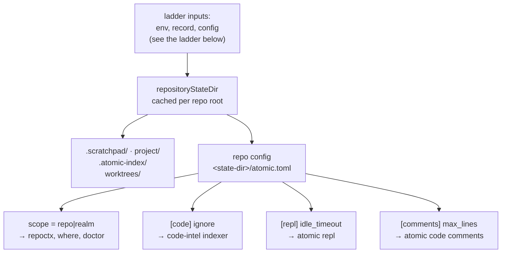

### Config schema

`atomic config list` is the only resolved-value surface. There is no rendered config file; `config.toml` is the single source of truth.

| Key | Scope | Type | Default | Controls |
|-----|-------|------|---------|----------|
| `output.signals.max_depth` | user | int | `3` | tree depth in `atomic signals scan` |
| `update.run_doctor` | user | bool | `true` | run doctor after `atomic update` |
| `update.check` | user | bool | `true` | the hourly detached background version lookup |
| `update.stage` | user | bool | `true` | once-per-version background download + checksum |
| `update.channel` | user | string | empty (resolves to `stable`) | release channel every update path reads: background check, banner, `atomic update`, doctor's binary check |
| `state.dir` | user | string | empty (displays [`.claude`](../../.claude)) | the repository-state directory name, one safe path segment; the config rung of the ladder |
| `harness.dir` | user | string | [`.claude`](../../.claude) | legacy: a non-default value names the repository-state directory only while `state.dir` is unset |
| `repl.idle_timeout` | user, repo | duration | `1h` | idle window before a REPL session self-terminates |
| `code.ignore` | repo | []string | none | glob patterns excluded from the code-intel index |
| `comments.max_lines` | repo | int (pointer) | `2` | line-count threshold above which `atomic code comments` flags an added comment run as `Over` |
| `output_style.seed` | user | bool | `true` | whether install/update/session-start seed `outputStyle: "Atomic"` into user-level `settings.json` |
| `scope` | repo | `repo`\|`realm` | none | declares this directory's own identity |
| `realm.repos` | repo | []string | none (walks the whole realm root) | paths and globs, relative to the realm root, that `atomic wiki scan`/`stale` walk for member repos; see [`docs/wiki/wiki.md`](wiki.md) |

Machine-written tables, not user-settable via `atomic config set`: `[install]` (install manifest and migration version anchor), `[claude.agents.<name>]` (per-agent model + effort override), `[pi.agents.<name>]` (Pi coding-agent override), `[bus.remotes.<name>]` (`host`, `key`, optional `ca` for one bus gateway, written by `atomic bus remote`; see [`docs/wiki/bus.md`](bus.md)). `repl.idle_timeout` is the only key present at both scopes; repo wins over user, then a built-in `1h`. The per-clone selection record `~/.atomic/<project-key>/state-location.json` is not a config key: `atomic state adopt` writes it.

### State-directory layout

```
~/.atomic/
├── config.toml            user config (only source of truth)
├── state.json             machine-managed self-update state
├── profile.md             user profile, @-ref'd from CLAUDE.md
├── wikis.md               authoritative realm registry
├── install/               lifecycle state (harness domain)
│   ├── operation.lock         advisory lock for mutating ops
│   ├── ledger.json            enrollment, last-applied authority
│   ├── journals/<op-id>.json  one per in-flight operation
│   └── transactions/<op-id>/  stage/ and backup/
├── packages/<harness>/atomic/  generated harness packages
├── backups/<ts>/          pre-write backups from claude install/update
├── pre-install/           write-once snapshot for claude uninstall
├── proposed/CLAUDE.md     merge target when installed CLAUDE.md diverges
└── <project-key>/         one entry per clone (main checkout root, flattened)
    ├── state-location.json    persisted repository-state selection
    ├── reports/<branch>/      /session-report output
    ├── reminders/             reminder files
    └── archive/<slug>/<created>/  retired scratchpad bundles

~/.cache/atomic/staged/    downloaded release archive awaiting swap

<repo>/<state-dir>/        default .claude
├── atomic.toml            repo config
├── .scratchpad/<slug>/    scratchpad bundle: meta.toml + purpose-seeded files
├── project/followups/     entries + INDEX.md + CLOSED.md
├── .atomic-index/         code-intel SQLite db
└── worktrees/
```

Every path under `~/.atomic/` derives from `config.Dir(home)` in [`atomic/internal/config/paths.go`](../../atomic/internal/config/paths.go); `MutablePathsFor(home)` in [`atomic/internal/config/statelocation.go`](../../atomic/internal/config/statelocation.go) names the mutable authorities among them (`config.toml`, `profile.md`, `wikis.md`, `install/`, `backups/`, `packages/`), each with one writer. Every repo-local path derives from `stateRoot(root)` in [`atomic/internal/config/harness.go`](../../atomic/internal/config/harness.go), a delegate to `repositoryStateDir` in [`atomic/internal/config/statelocation.go`](../../atomic/internal/config/statelocation.go). Neither `paths.go` nor `harness.go` calls `os.UserHomeDir` from a helper; the caller injects `home` so tests use a temp dir, and the resolver reads home through `projectHome()`, which `SetHomeDirForTest` overrides.

### Resolving the repository-state directory

No rung reads a harness fingerprint, so one repository resolves the same state directory under every harness, and the retired `ATOMIC_HARNESS` stops resolution instead of selecting a rung.

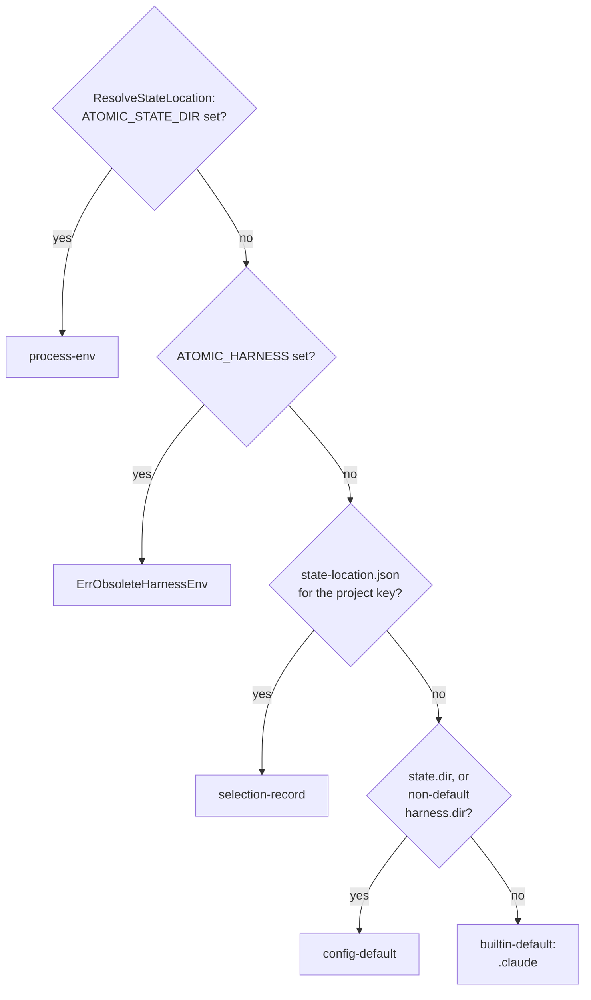

The leaf labels are the `StateSource` values a `StateLocation` carries. `resolveStateDirValue` turns a rung value into a directory: an absolute value is used as-is (the filesystem root is refused), and anything else must be one safe segment joined onto the repository root. `ATOMIC_STATE_DIR` is process-only and never rewrites the record. The record sits at `StateLocationRecordPath(repoRoot)`, under the project-keyed home below, so every worktree of a clone shares one selection.

#### Strict and quiet resolution

`ResolveStateLocation` is the strict form; the repo-local path helpers have no error channel, so they call a quiet form that degrades instead.

| | `ResolveStateLocation` | `repositoryStateDir` |
|---|---|---|
| Callers | `stateAdopt`, `AdoptStateRoot` | `ScratchpadDir`, `ProjectDir`, `FollowupsDir`, `IndexDir`, `IndexDBPath`, `WorktreesDir`, `RepoConfigPath` via `stateRoot` |
| Returns | `StateLocation{Root, Source}` or an error | a path, never an error |
| `ATOMIC_HARNESS` set | `ErrObsoleteHarnessEnv` (after the `ATOMIC_STATE_DIR` rung) | ignored; `main` refuses before any verb runs |
| Invalid env value, unreadable or newer-schema record | error | falls to the next rung |
| Extra rung | none | between the record and the config rung, exactly one populated candidate (`DiscoverStateCandidates`) resolves in place |
| Caching | none | per repo root for the process lifetime (`stateDirCached`); the configured segment is read once (`segmentCached`) |

The quiet candidate rung keeps state left under a former root such as `.pi` readable instead of a fresh [`.claude`](../../.claude) appearing beside it. Two populated candidates are ambiguous there and fall through to the configured default.

### Adopting a state root

`atomic state adopt` records a directory and never moves files, and it refuses to guess between two populated roots.

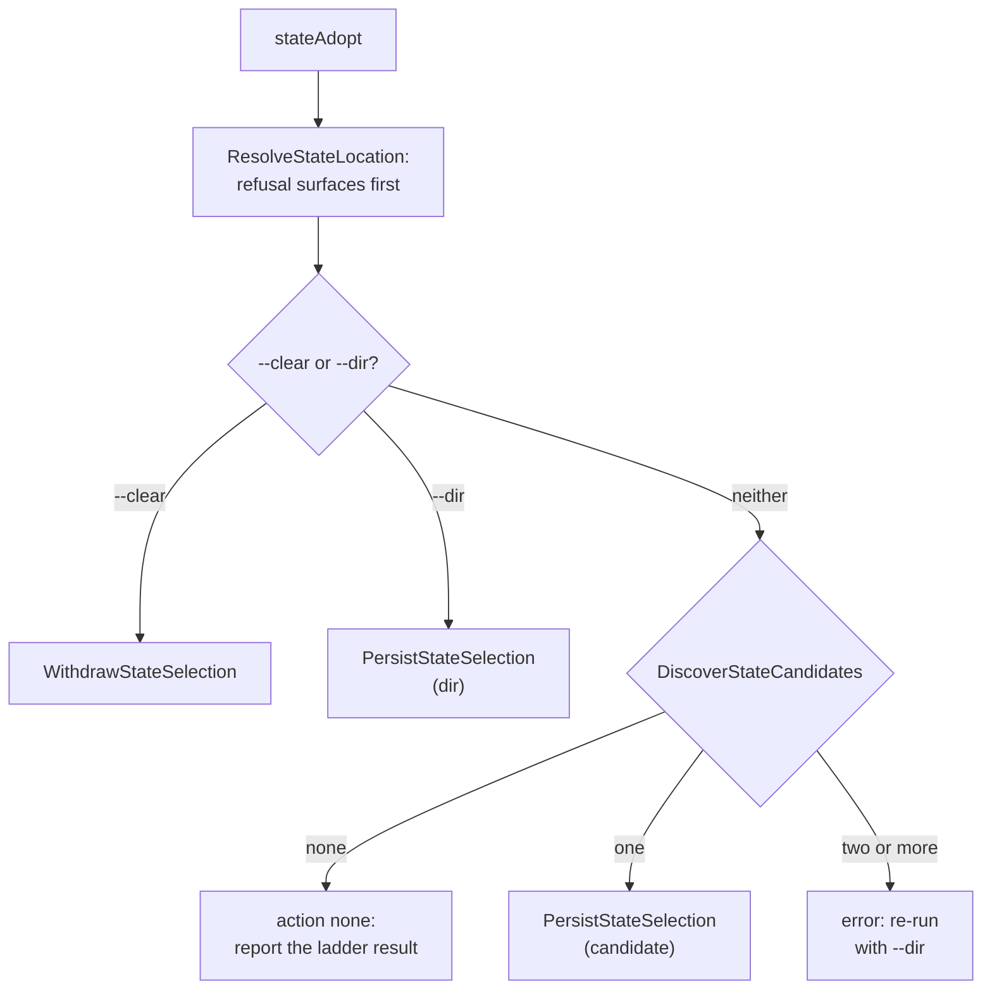

A candidate is the configured segment, [`.claude`](../../.claude), or `.pi`, holding at least one of `atomic.toml`, `.atomic-index`, `.scratchpad`, `project`, or `worktrees` (`stateSignatureEntries`). Harness-native files such as `settings.json` or `agents/` do not make a candidate, so an empty or harness-only [`.claude`](../../.claude) is not one. `--dry-run` takes the same branches and writes nothing, and `--clear` with `--dir` exits 2. `AdoptStateRoot` is the flagless form of the same decision, called by the harness domain's legacy adoption in [`atomic/internal/installstate/legacy.go`](../../atomic/internal/installstate/legacy.go); with no candidate it writes nothing and returns `ResolveStateLocation`'s answer. The verb's place in the install lifecycle is in [`docs/wiki/harness.md`](harness.md).

### Resolving the project-keyed state home

`ProjectStateDir(repoRoot)` is `~/.atomic/<project-key>/`, shared by every worktree of the same clone. The key is the flattened, symlink-resolved absolute path of the clone's **main checkout root**, found with no git subprocess — `mainCheckoutRoot` walks upward from `repoRoot` and reads `.git` directly.

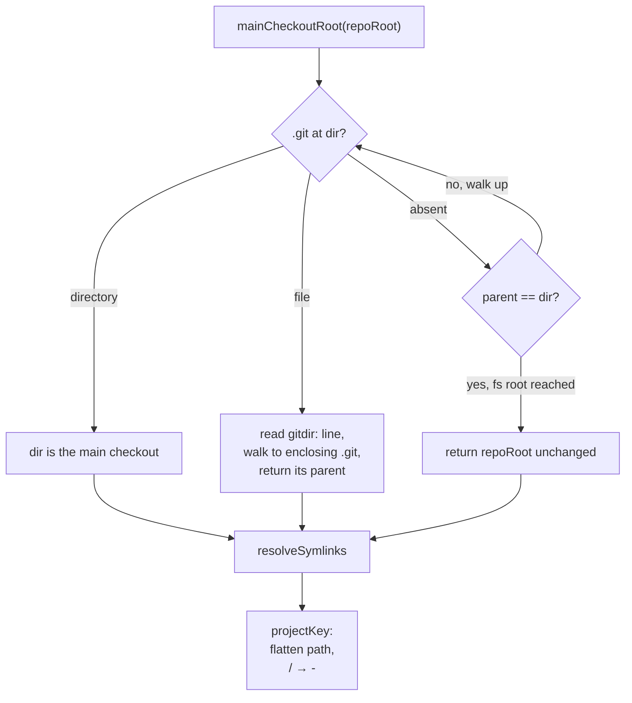

Every branch resolves through `resolveSymlinks` before it becomes the key, because git itself writes an already-resolved absolute `gitdir:` target when creating a worktree — leaving the main-checkout branch unresolved would make a main checkout and its own worktree disagree on the key whenever the clone sits under a symlinked ancestor (macOS `/tmp` and `/var` both are). `BranchFromHEAD(repoRoot)` reads `<gitdir>/HEAD` the same way, with no upward walk (a worktree's own `HEAD` can differ from the main checkout's), and validates the parsed ref name or SHA prefix against `refNamePattern` before it is trusted as a path segment.

`ReportsDir(repoRoot, branch)` prefers the project-keyed `reports/<branchSegment>/` and falls back to the pre-relocation `ScratchpadDir(repoRoot)/session-reports/<branchSegment>/` only when that legacy directory already holds a report and the new one does not — so a report written before the relocation stays readable until `atomic migrate` moves it. `RemindersDir(root)` (harness.go) is a pure delegate to `ProjectRemindersDir(root)`; the legacy union lives one layer up, in `internal/reminder` (see the reminder row under Where it lives).

### The `atomic scratchpad` bundle lifecycle

The `<scratchpad-root>/<slug>/meta.toml` bundle, plus purpose-seeded files, replaces the pre-relocation `<date>-<slug>` naming, so a task worked across several phases accumulates in a shared directory instead of a new directory per phase per date.

### `scratchpad new`

Running `scratchpad new` on an existing slug extends the bundle and seeds only the files it is missing, so a later phase never clobbers an earlier phase's notes.

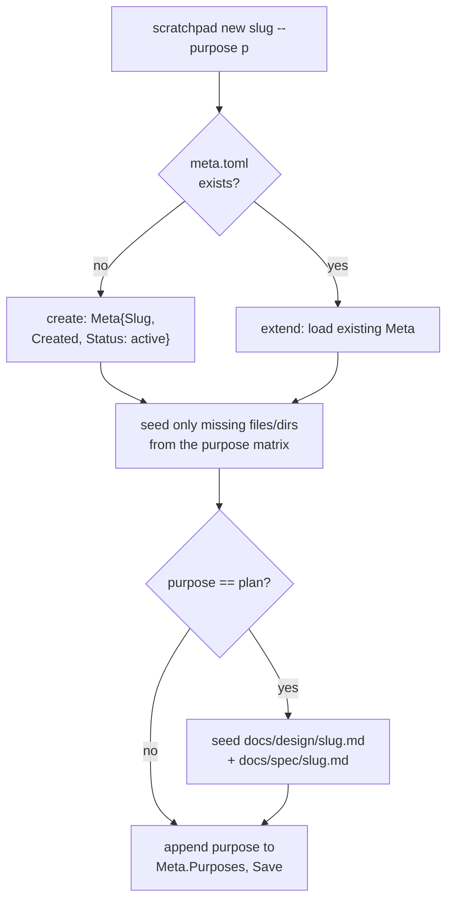

### `scratchpad archive`

Archiving keys the destination on the bundle's `Created` date and suffixes on collision, so archiving the same slug twice never overwrites the earlier archive.

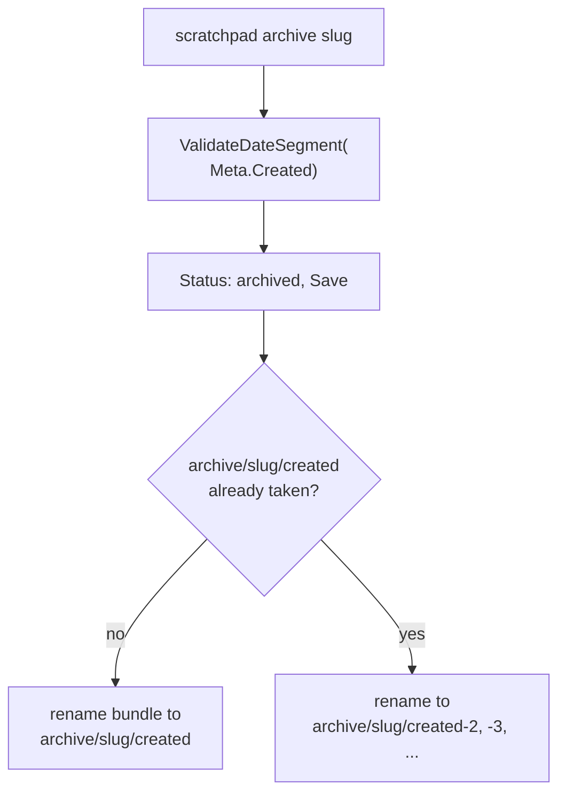

The purpose matrix (`purposeFiles`/`purposeDirs` in [`atomic/internal/scratchpad/bundle.go`](../../atomic/internal/scratchpad/bundle.go)) seeds `BRIEF.md`, `STATE.md`, `FOLLOWUPS.md` for `plan`/`implement`/`fix`, adds `CONTEXT.md` for `diagnose`, and seeds `lenses/` + `findings/` directories (no files) for `review`. `scratchpad.List` applies a recursive rule to both the live scratchpad root (`<slug>/meta.toml`) and the archive root (`<slug>/<created>/meta.toml`): it descends into a directory with no `meta.toml` of its own, and stops and emits at the first directory that does, so a pre-migration `reminders/` or `session-reports/` directory is skipped by the same content-based check rather than a name list. A corrupt `meta.toml` costs only its own entry, reported through a returned warning rather than the stdlib logger.

### Migration routing and the queryable log

`atomic migrate` picks its path from its flags, each answering a different scope question:

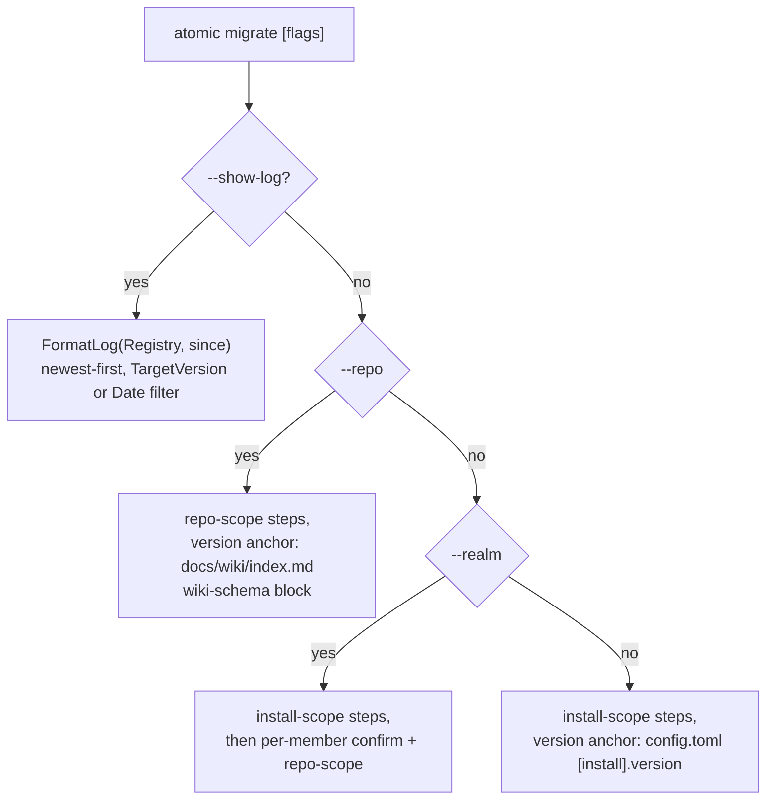

`migrate.Run` sorts the registry ascending by semver and applies every step whose `TargetVersion` exceeds the recorded version, stopping at the first error. The registered `repo`-scope step, `scratchpadRelocate`, unconditionally runs `relocateReportsAndReminders`, which moves the legacy `session-reports/` and `reminders/` trees file-by-file to the project-keyed home (a same-relative-path collision is left in place under the legacy tree and reported, never overwritten), then `redateScratchpadBundles`, which renames a `<YYYY-MM-DD>-<slug>` directory to `<slug>` only when both `docs/design/<slug>.md` and `docs/spec/<slug>.md` confirm the stripped name as a real slug — a name those two docs do not both confirm, or that a colliding dated directory also strips to, is reported and left untouched. `FormatLog` walks `migrate.Registry` directly and renders only the entries carrying a non-empty `Summary`, so the same list serves both step execution and `--show-log`; there is no parallel log registry.

### Release channels

`atomic update` moves along `ChannelStable` or `ChannelPrerelease`, both in [`atomic/internal/selfupdate/selfupdate.go`](../../atomic/internal/selfupdate/selfupdate.go), and every update path reads the same resolved channel: the background check, the banner, `atomic update` itself, and doctor's binary check (`checks_binary.go`, category 8).

`resolveUpdateChannel` (`cmd_update.go`) resolves it by precedence, `--pre` first:

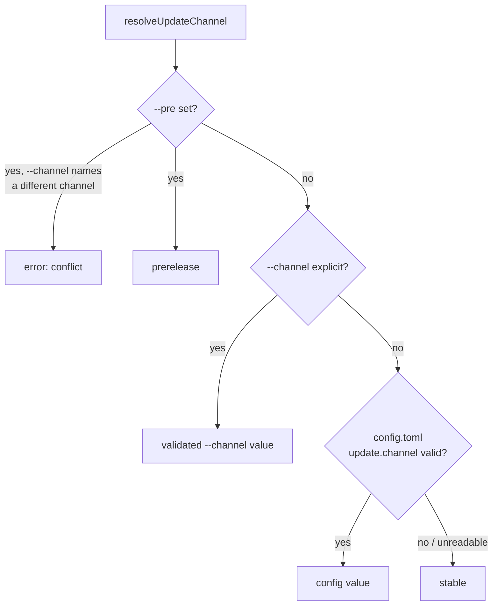

`--pre` never writes `config.toml`; it overrides the persisted channel for one invocation. `Lookup` picks a release from up to `lookupMaxPages` (5) pages of `lookupPerPage` (100) releases, one `fetchReleasePage` call per page, and paging continues past a page with no eligible entry so a run of prereleases can never bury the newest stable release out of a lower-numbered page's reach.

| Channel | Eligible releases | Selection across pages | Why |
|---------|-------------------|-------------------------|-----|
| `stable` | non-draft, non-prerelease | highest semver (`compare`) | forward-only ladder; the list endpoint orders by commit date, not version, so an interleaved hotfix published after a higher release would otherwise win |
| `prerelease` | non-draft, prerelease or full release | most recent `PublishedAt` (falls back to list order when unset or tied) | tracks the tip of the pre-release branch; a full stable release outranks every prerelease of its own core, so selecting by version would strand a prerelease user behind it |

`ShouldInstall(channel, current, latest)` carries the same split into the install decision: stable is forward-only (`IsNewer`), prerelease installs any tag whose `DisplayVersion` differs from what is running, even a semver-lower one, since a `-next.N` cut after a stable release of the same core is code-newer but semver-lower.

### The self-update fast path

No [`atomic`](../../atomic) invocation touches the network itself. `selfupdateFastPath` loads `config.toml` for `update.channel` before computing the banner decision, because `ShouldNotify` is channel-aware; an unreadable config still banners, on stable. `last_check` is stamped before the child spawns, so a crash between the stamp and the spawn skips a check rather than spawning on every later invocation.

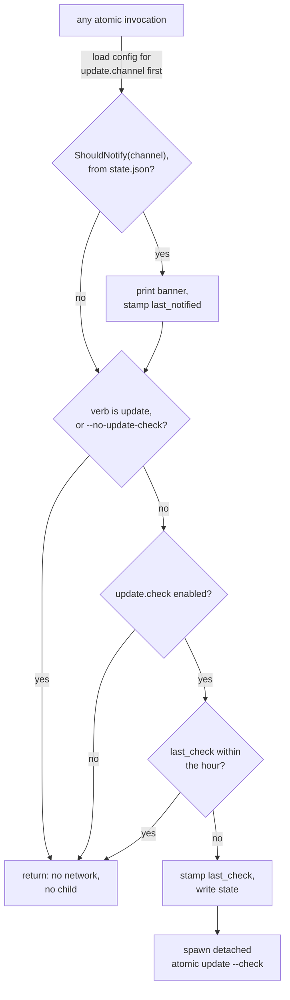

Gate 1 is what stops the child re-spawning a grandchild: the child's own invocation carries the `update` verb, so it returns before reaching the spawn.

### Download progress and stall abort

`Client.download` reads the response body in 64KiB chunks and resets a `time.AfterFunc` watchdog on every non-empty read. The watchdog fires only after `StallTimeout` (default `defaultStallTimeout`, 30s) passes with zero bytes, canceling the request's own context, so a slow-but-moving multi-minute transfer never trips it. That watchdog is the reason `downloadClient()` carries no `http.Client.Timeout` at all: the shared `httpClient()` used for `Lookup` keeps the 10s `lookupTimeout`, but that same cap applied to an archive body read used to abort any download slower than 10 seconds outright. A read that lands at least `ProgressInterval` (default `progressEmitInterval`, 100ms) after the last tick calls `onProgress(received, total)`, and the loop calls it once more after `io.EOF`, substituting `received` for `total` when the server sent no `Content-Length`. Only the archive fetch inside `Client.Apply` and `Client.Stage` forwards `c.OnProgress`; every checksum-file `download` call passes `nil` and never reports.

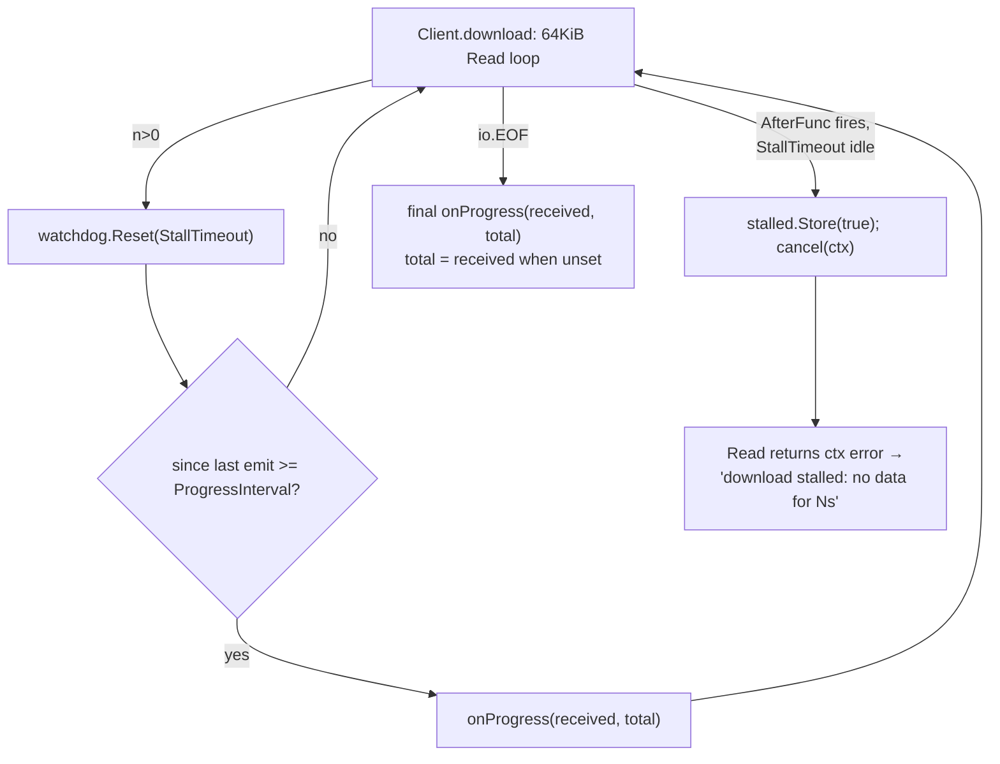

A download aborts only on sustained silence, never on total elapsed time, and the emitted progress reaches nothing unless a caller wires an observer.

`runUpdateWith` is the only caller that wires one: `deps.client.OnProgress = downloadProgressRenderer(deps.out, deps.terminal())`, assigned after the `--check` and `convergeChild` branches have returned, so the foreground apply path gets a renderer and neither the `--check` path nor the convergence child does. `defaultUpdateDeps` binds `deps.out` to `os.Stdout` and `deps.terminal` to `charmterm.IsTerminal(os.Stdout.Fd())`. `downloadProgressRenderer` itself returns `nil` off a TTY, since its `\r`-rewritten status line would otherwise print a new line on every tick into redirected output; on a TTY it rewrites one line in place, prints a trailing `\n` on the 100% tick, and goes quiet after. `runUpdateCheck`'s background staging call to `c.Stage` never assigns `OnProgress`, so an auto-spawned `atomic update --check` that also stages a release prints nothing regardless of TTY.

### After the swap: target convergence

The process that downloaded the new binary still embeds the old corpus, so it never converges harness targets itself; it re-executes the replacement to do it.

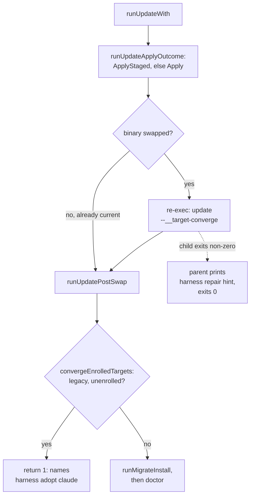

`runUpdateApplyOutcome` tries the staged archive first when `state.json`'s `staged.version` matches the fresh lookup, discards the staged record when its checksum re-verify fails, and falls back to a full `Apply`. It reports whether the binary changed, so an already-current binary converges in place. The parent forwards `--skip-claude-update` and `--no-doctor` to the child, and `--skip-claude-update` skips convergence rather than an artifact refresh.

`convergeEnrolledTargets` runs the harness install engine (`install.DefaultSteps(home)` with `AssumeYes`, then `ConvergeEnrolled`) over every enrolled target; `atomic update` is the consent. A home with no enrolled target and no legacy Claude install is a no-op. A legacy install that was never enrolled makes `runUpdatePostSwap` return 1 with an error naming `atomic harness adopt claude`, because nothing else refreshes it. `atomic update` exits 1 for it only when no swap happened. After a swap that exit belongs to the re-executed child, and the parent prints ``run `atomic harness repair` manually.`` and returns 0. Any other convergence failure prints the same repair line and leaves the update successful. Install-scope migrations and the doctor run after convergence, and migrations only when `home` resolved. The engine itself is documented in [`docs/wiki/harness.md`](harness.md).

### Scope discovery

`FindScopeRoot` walks past `.git` boundaries, because a realm root sits above its member repos, so the walk runs to the filesystem root. It takes the first marker of the *requested* kind and continues past a missing file, a parse error, an invalid value, or a marker naming the other kind. Discovery degrades; it never fails, which is why it returns no error.

`atomic where` reports independent axes: repo root and realm scope carry a `config.ScopeSource` provenance token (`none`, `marker`, `git`, `registry`, or `cwd`); repo-scope wiki presence and code-index scope report their own shape instead (`RepoScopeReport` has no `Source` field, and the code-index axis reuses `codeintel/realm`'s own scope enum). `atomic where --json` additionally reports the project-keyed state paths (`reports_root`, `reminders`, `archive`, unconditional) and, only when `report.RepoRoot.Path` itself holds a `.git` entry, `branch` and `reports` (a scope-marker root with no `.git` of its own omits both rather than guessing). `--repo <path>` relocates the whole report, branch and state paths included, to that path.

### Realm position in `atomic where`

A `scope = "realm"` marker outranks every registry, and the registry read prefers `~/.atomic/wikis.md` over the `<wikis>` block a harness install projects into [`CLAUDE.md`](../../CLAUDE.md).

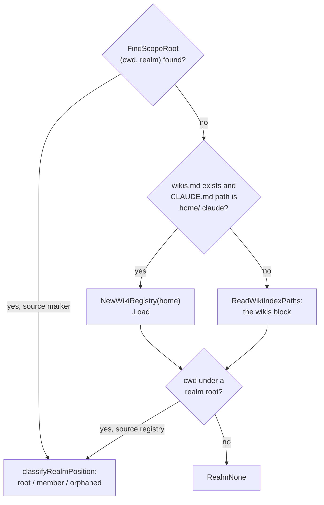

`wiki.RegisteredIndexPaths` decides between `wikis.md` and the `<wikis>` block; a [`CLAUDE.md`](../../CLAUDE.md) path outside the conventional `<home>/.claude/CLAUDE.md` shape has no derivable authority and reads the block. `classifyRealmPosition` serves both the marker and the registry path, so the two cannot classify one directory differently. A realm root is the grandparent of its registered `wiki/index.md`, and member paths come from `wiki.ReadScanMembers`, so a realm marked before its first scan classifies as orphaned. Seeding `wikis.md` from the projected block, and conflicts between the two, belong to [`docs/wiki/wiki.md`](wiki.md).

### Argument parsing: flags in any position

Every Cobra leaf sets `DisableFlagParsing` and hands raw argv to a stdlib `flag.FlagSet`, whose `Parse` stops at the first non-flag token. `cliutil.ParseInterspersed` re-parses after each positional, so a flag before, after, or between positionals reaches the `FlagSet`, and a stray positional surfaces where the verb can reject it instead of being dropped:

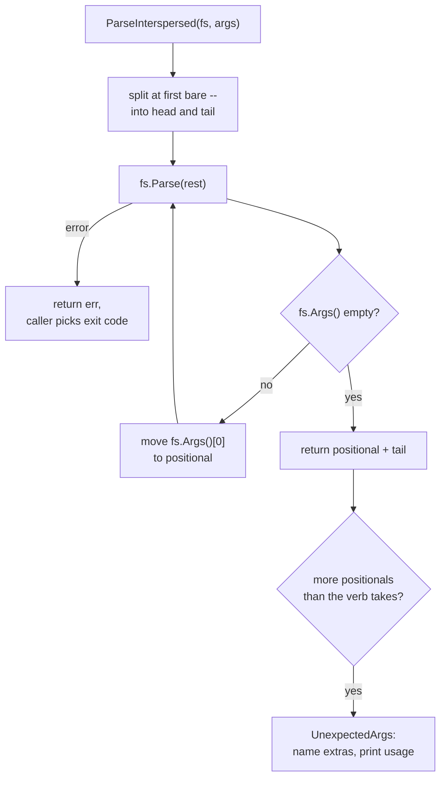

Everything after the first `--` is positional verbatim, including tokens that look like flags. Stdlib grammar is otherwise unchanged: single-dash flags still parse, `-h`/`--help` returns `flag.ErrHelp`, and a flag's value token is taken verbatim even when it starts with `-`. `UnexpectedArgs(fs, cmd, extra)` writes `atomic <cmd>: unexpected argument(s): [...]` and the usage to `fs.Output()`, then returns the error without exiting, so each caller keeps its own exit code.

| Verb | Positionals accepted | Usage-error exit |
|------|----------------------|------------------|
| `followups close` | exactly one `<id>`; `--reason` in any position | 2 |
| `followups list`, `followups add` | none; flags in any position (`rejectArgs`) | 2 |
| `followups render`, `followups path` | none, and no flags (`bareFlagSet`) | 2 |
| `migrate` | one, only as `--show-log <since>` (`parseMigrateArgs`) | 2 |
| `reminder add` | text words, joined; `--due`/`--transport` after the text (`parseReminderAddArgs`) | 1 |

`reminder add` keeps exit 1 because that is the `reminder` verb's existing usage-error code. A reminder text word starting with `-` errors as an unknown flag; words after `--` stay literal.


## Where it lives


### Artifacts

| Path | Role |
|------|------|
| [`context/commands/follow-up.md`](../../context/commands/follow-up.md) | `/follow-up [due <id> \| review]`. Reviews pending reminders; `review` triages stale follow-up entries with per-item `extend\|close\|promote\|skip`. |
| [`context/commands/git-cleanup.md`](../../context/commands/git-cleanup.md) | Runs `atomic prompt git-cleanup` through a `general-purpose` subagent (read-only scan), presents an indexed report, confirms before deleting. |
| [`context/commands/remind-me.md`](../../context/commands/remind-me.md) | Schedules a reminder file, then cron (under 1h) or Routines (1h and over). Degrades to file-only when neither scheduler is available. |
| [`context/commands/watch-ci.md`](../../context/commands/watch-ci.md) | Dispatches an isolated background subagent on the economical reasoning tier to watch CI. Provider auto-detected. |

### Schema and paths

| Path | Role |
|------|------|
| [`atomic/internal/config/config.go`](../../atomic/internal/config/config.go) | User `Config` struct, lenient `Load`, strict `Validate`, `Get`/`Set`/`Unset`, atomic write via `os.Rename`. Levenshtein typo suggestion on unknown keys. |
| [`atomic/internal/config/paths.go`](../../atomic/internal/config/paths.go) | Every `~/.atomic/` path: `Dir`, `TOMLPath`, `StatePath`, `BackupDir`, `PreInstallDir`, `ProposedCLAUDEMD`, `ProfilePath`, `ProfileRelPath`, `WikisPath`; the lifecycle paths `InstallDir`, `OperationLockPath`, `LedgerPath`, `JournalsDir`/`JournalPath`, `TransactionsDir`/`TransactionDir`/`TransactionStageDir`/`TransactionBackupDir`; `PackagesDir`/`PackageRoot`; and `BackupStampDir`, `BackupStamps`, `RemoveBackupStamp`. |
| [`atomic/internal/config/harness.go`](../../atomic/internal/config/harness.go) | `stateRoot` (a delegate to `repositoryStateDir`), the repo-local path helpers, `SetHarnessDirForTest`, `resolveHarnessDirFromHome`, and `RemindersDir` (a pure delegate to `ProjectRemindersDir`). |
| [`atomic/internal/config/statelocation.go`](../../atomic/internal/config/statelocation.go) | The repository-state ladder: `ResolveStateLocation`, `repositoryStateDir`, `CheckObsoleteHarnessEnv`, `StateSource`/`StateLocation`, the selection record (`StateSelection`, `StateLocationRecordPath`, `ReadStateSelection`, `PersistStateSelection`, `WithdrawStateSelection`), `DiscoverStateCandidates`, `AdoptStateRoot`, `ValidateStateDirSegment`, `MutablePathsFor`, and `writeFileDurable`. |
| [`atomic/internal/config/busremote.go`](../../atomic/internal/config/busremote.go) | `[bus.remotes.<name>]` validators (`ValidateBusRemoteName`/`Host`/`Key`/`CA`, `ValidateBusRemote`), `AddBusRemote`/`RemoveBusRemote` with `ErrBusRemoteExists`/`ErrBusRemoteNotFound`, and `ExpandHome` (leading `~`/`~/` against an injected `home`). |
| [`atomic/internal/config/projectstate.go`](../../atomic/internal/config/projectstate.go) | `ProjectStateDir`, `projectHome`/`SetHomeDirForTest`, `mainCheckoutRoot`, `resolveSymlinks`, `projectKey`, `ReportsRoot`/`ReportsDir`/`ReportsDirLegacy`, `ProjectRemindersDir`/`RemindersDirLegacy`, `ArchiveDir`, `BranchFromHEAD`, `validateRefName`/`parseHEAD`. |
| [`atomic/internal/config/pathsegment.go`](../../atomic/internal/config/pathsegment.go) | `ValidateSegment` and `ValidateDateSegment` — the allow-list every path-segment source (slug, branch, bundle-created date) calls before a value reaches `filepath.Join`. |
| [`atomic/internal/config/repo.go`](../../atomic/internal/config/repo.go) | `RepoConfig` (`Code`, `Comments`, `Scan`, `Scope`, `Realm`, `Repl`, `Serve`), `LoadRepoConfig`, `IgnoreMatcher`, `ValidateIdleTimeout`, `ResolveMaxLines`. |
| [`atomic/internal/config/cli.go`](../../atomic/internal/config/cli.go) | `atomic config get\|set\|unset\|list\|path\|agents\|resolve` dispatch. Holds the `ApplyAgentsHook` seam. |
| [`atomic/internal/config/render.go`](../../atomic/internal/config/render.go) | `Resolved(cfg)` flat dotted-key map, consumed by `atomic config list` and `atomic config get`. |
| [`atomic/internal/config/statemigrate.go`](../../atomic/internal/config/statemigrate.go) | `MigrateUserState(home)`: legacy `~/.claude/.atomic` to `~/.atomic`, plus the compat symlink. |
| [`atomic/internal/cliutil/args.go`](../../atomic/internal/cliutil/args.go) | `ParseInterspersed` (flags in any position, split at the first bare `--`) and `UnexpectedArgs` (names stray positionals, prints usage, returns the error for the caller's exit code). |
| [`atomic/internal/cliutil/usage.go`](../../atomic/internal/cliutil/usage.go) | `SetUsage`: double-dash flag listing for a stdlib `FlagSet`'s usage output. |

### Scratchpad bundles

| Path | Role |
|------|------|
| [`atomic/internal/scratchpad/bundle.go`](../../atomic/internal/scratchpad/bundle.go) | `Meta`, `Bundle`, `Load`/`Save` (tolerant of unknown `meta.toml` keys, replayed via `extra`), `BundleRoot`, `New` (additive purpose-matrix seeding). |
| [`atomic/internal/scratchpad/list.go`](../../atomic/internal/scratchpad/list.go) | `List(root)` — the recursive, content-based (`meta.toml` presence) rule shared by the live and archive roots; returns entries plus non-fatal warnings. |
| [`atomic/internal/scratchpad/archive.go`](../../atomic/internal/scratchpad/archive.go) | `ArchiveRoot`, `HasArchive`, `Archive` (status flip + dated move with same-day `-2`/`-3` collision suffix), `nextArchiveDest`. |
| [`atomic/cmd/atomic/cmd_scratchpad.go`](../../atomic/cmd/atomic/cmd_scratchpad.go) | `atomic scratchpad new\|path\|list\|archive` dispatch and the testable `scratchpadDispatch`/`*Action` seams. |

### Migration

| Path | Role |
|------|------|
| [`atomic/internal/migrate/migrate.go`](../../atomic/internal/migrate/migrate.go) | `Migration` type, [`Context`](../../Context), `Run` (ascending-semver step application, floor `0.0.0`). |
| [`atomic/internal/migrate/registry.go`](../../atomic/internal/migrate/registry.go) | `Registry` — the ordered slice every `init()` in this package appends to. |
| [`atomic/internal/migrate/schema.go`](../../atomic/internal/migrate/schema.go) | `<wiki-schema>N</wiki-schema>` read/write in a repo's [`docs/wiki/index.md`](index.md) — the repo-scope version anchor. |
| [`atomic/internal/migrate/steps.go`](../../atomic/internal/migrate/steps.go), `steps_scanignore.go` | Earlier registered steps: the signals→[`docs/wiki/`](.) relocation and `.signalsignore`→`atomic.toml [scan]` conversion. |
| [`atomic/internal/migrate/steps_scratchpad.go`](../../atomic/internal/migrate/steps_scratchpad.go) | The `1.2.0` repo-scope step: `scratchpadRelocate` (`relocateReportsAndReminders` + `redateScratchpadBundles`), and their helpers (`relocateTree`, `moveFileCrossDevice`, `pruneEmptyDirs`, `candidates`/`collisions`/`redateOne`). |
| [`atomic/internal/migrate/log.go`](../../atomic/internal/migrate/log.go) | `FormatLog(registry, since)` — newest-first rendering of log-carrying `Migration` entries, filtered by semver or `YYYY-MM-DD` date. |
| [`atomic/cmd/atomic/cmd_migrate.go`](../../atomic/cmd/atomic/cmd_migrate.go) | `atomic migrate [--repo <path>] [--realm <path>] [--show-log [<since>]]` routing, `parseMigrateArgs` (interspersed parse, `<since>` the only positional, exit 2 on any usage error), `migrateRepoAction`, `runMigrateRealm` (per-member confirm fan-out). |

### Agent overrides

| Path | Role |
|------|------|
| [`atomic/internal/config/agentoverride.go`](../../atomic/internal/config/agentoverride.go) | `AgentOverride{Model, Effort}`, the strict `validEfforts` enum, the lenient `validModelFormat` check. |
| [`atomic/internal/config/agents.go`](../../atomic/internal/config/agents.go) | The `huh` model-Input + effort-Select form behind `atomic config agents`, `bundledAgents()` (every `agent` entry of `embedded.Manifest()`, in manifest order), `applyAgentOverrides` merge, `AgentTierSelector` test seam. |
| [`atomic/internal/config/pi_agent.go`](../../atomic/internal/config/pi_agent.go) | `ResolvePiAgents(globalPath, repoPath)` merges `[pi.agents.<name>]` from user and repo into a diagnostics envelope. Separate schema from Claude's. |

### Identity resolution

| Path | Role |
|------|------|
| [`atomic/internal/config/scope.go`](../../atomic/internal/config/scope.go) | `ValidScope`, `FindScopeRoot` (upward by-kind walk), `EnsureScopeMarker` (byte-preserving idempotent write), `ScopeSource` provenance enum. |
| [`atomic/internal/repoctx/repoctx.go`](../../atomic/internal/repoctx/repoctx.go) | `ResolveFrom(dir, override)` returns the working root plus its provenance: override, marker, git, cwd. `Resolve` is the provenance-discarding delegate. |
| [`atomic/internal/where/where.go`](../../atomic/internal/where/where.go), `format.go` | `atomic where`: independent axes, each reporting its own provenance; the realm axis reads registries through `wiki.RegisteredIndexPaths`. |
| [`atomic/cmd/atomic/cmd_where.go`](../../atomic/cmd/atomic/cmd_where.go) | CLI dispatch, `--repo` override (relocates the whole report), `whereJSON` (additive `branch`/`reports`/`reports_root`/`reminders`/`archive` fields). |
| [`atomic/internal/repoinit/repoinit.go`](../../atomic/internal/repoinit/repoinit.go) | `Init(root)` runs idempotent layout guarantees for `atomic repo init`. |
| [`atomic/cmd/atomic/cmd_state.go`](../../atomic/cmd/atomic/cmd_state.go) | `atomic state adopt [--dir <segment\|path>] [--clear] [--dry-run] [--json]` dispatch over the testable `stateAdopt`; `stateRepoRoot` resolves the root through `repoctx.Resolve`. |

### Hooks, reminders, follow-ups

| Path | Role |
|------|------|
| [`atomic/internal/hooks/hooks.go`](../../atomic/internal/hooks/hooks.go), `hooks_hujson.go` | Session-start payload plus install/uninstall of the settings.json registration: scope-root forms (`Install`, `Uninstall`, `IsInstalled`, `SettingsPath`) over `configDirForScope`, and explicit-directory forms (`InstallInDir`, `UninstallInDir`, `IsInstalledInDir`, `SettingsPathInDir`). `hujson` parses settings leniently. |
| [`atomic/internal/hooks/outputstyle.go`](../../atomic/internal/hooks/outputstyle.go) | `SeedOutputStyle`/`SeedOutputStyleInDir`, `ReadOutputStyle`, `RemoveOutputStyleIfAtomic`/`RemoveOutputStyleIfAtomicInDir`, `StyleInstalled`, `SeedEnabled` — the `outputStyle` key seed/read/remove primitives and their guards. |
| [`atomic/internal/hooks/ownership.go`](../../atomic/internal/hooks/ownership.go) | `ObserveSettingsOwnedInDir`: one `managedfile.Observation` digesting only the Atomic-owned `settings.json` members, and `ownedSessionStartEntries`. |
| [`atomic/internal/reminder/reminder.go`](../../atomic/internal/reminder/reminder.go) | File-based reminder CRUD behind `atomic reminder add\|list\|show\|rm`; `unionEntries` reads both `config.RemindersDir` (project-keyed) and `config.RemindersDirLegacy`, adding any legacy entry whose id is absent from the project-keyed set; `findWritableByID` restricts mutation (`set-due`, `rm`) to the project-keyed directory and refuses a legacy-only id with a `run atomic migrate --repo` remedy rather than promoting it on write. |
| [`atomic/cmd/atomic/cmd_reminder.go`](../../atomic/cmd/atomic/cmd_reminder.go) | `atomic reminder` dispatch; `parseReminderAddArgs` joins the positionals into the text and honors `--due`/`--transport` in any position (exit 1 on usage error). |
| [`atomic/internal/followups/`](../../atomic/internal/followups) | YAML-frontmatter entry parser, INDEX renderer, append-only `CLOSED.md`. Serves `atomic followups path\|render\|list\|add\|close`; `cli.go` parses every verb through `cliutil.ParseInterspersed` and enforces its positional count (`rejectArgs`, `bareFlagSet`). |
| [`atomic/internal/prompt/prompt.go`](../../atomic/internal/prompt/prompt.go) | Shared TTY abstraction over `huh`: `Confirm`, `Select[T]`, `IsInteractive` (stdin and stdout both terminals), and the `ErrNonInteractive`/`ErrAborted` sentinels. |

### Self-update

| Path | Role |
|------|------|
| [`atomic/internal/selfupdate/state.go`](../../atomic/internal/selfupdate/state.go) | The `~/.atomic/state.json` shape and its atomic read/write. |
| [`atomic/internal/selfupdate/selfupdate.go`](../../atomic/internal/selfupdate/selfupdate.go) | `ChannelStable`/`ChannelPrerelease` consts, `ValidChannel`, paginated `Lookup` (`fetchReleasePage`, up to `lookupMaxPages` × `lookupPerPage`), `Apply`, `ApplyStaged`, `Stage`, `StageDir`, the lock primitives, the pure `IsNewer`/`ShouldInstall`/`ShouldNotify` decision helpers, and `download`'s stall watchdog + throttled `OnProgress` emission. |
| [`atomic/internal/selfupdate/semver.go`](../../atomic/internal/selfupdate/semver.go) | `CompareSemver`/`IsValidSemver` (shared with `migrate`), and the semver §11.4 prerelease-identifier comparison: `comparePrerelease`/`compareIdentifier`/`numericIdentifier`. |
| [`atomic/cmd/atomic/cmd_update.go`](../../atomic/cmd/atomic/cmd_update.go) | `selfupdateFastPath` (config-then-banner, stamp-before-spawn), `resolveUpdateChannel` (`--pre` > `--channel` > config > stable), `runUpdateCheck`, `runUpdate`/`runUpdateWith` over the `updateDeps` seam, `runUpdateApply`/`runUpdateApplyOutcome`, `runUpdatePostSwap`, `convergeEnrolledTargets`, `legacyUnenrolledError`, `stripTargetConvergeMarker`, `downloadProgressRenderer` (TTY-only `\r`-rewritten status line). |
| [`atomic/cmd/atomic/main.go`](../../atomic/cmd/atomic/main.go) | Before Cobra dispatch, calls `obsoleteHarnessRefusal` first (exit 2 while `ATOMIC_HARNESS` is set), then `MigrateUserState`, then `selfupdateFastPath`; also root-command registration for every verb in this domain. |

### Embedded text

| Path | Role |
|------|------|
| [`atomic/internal/coldprompt/coldprompt.go`](../../atomic/internal/coldprompt/coldprompt.go) | `//go:embed` of briefs (`git-cleanup`, `claude-merge`, `implementer`, `reviewer`), served by `atomic prompt <name>`. `implementer` and `reviewer` are the prompt source for `/subagent-implementation`, `/subagent-diagnose`, and `/quick-fix`'s implement-review loop. |
| [`atomic/internal/doctemplate/doctemplate.go`](../../atomic/internal/doctemplate/doctemplate.go) | `//go:embed templates/*.md` of the document skeletons, served by `atomic template <name>` and consumed directly by `scratchpad.New`'s purpose-matrix seeding. |
| [`atomic/internal/dockerinit/dockerinit.go`](../../atomic/internal/dockerinit/dockerinit.go) | Scaffolds the Docker eval environment for `atomic docker init`. |

### Docs

| Path | Covers |
|------|--------|
| [`docs/spec/atomic-state-and-config.md`](../spec/atomic-state-and-config.md) | Config schema, `~/.atomic/` layout including `<project-key>/`, `state.json` field table, precedence, validation policy, the repository-state ladder and `atomic state adopt`, and the `~/.atomic/wikis.md` registry authority. |
| [`docs/reference/atomic-toml.md`](../reference/atomic-toml.md) | User-facing reference for `<repo>/<state-dir>/atomic.toml`: the `scope` marker, `[code] ignore`, `[repl] idle_timeout`, `[comments] max_lines`, and `[realm] repos` key semantics. |
| [`docs/spec/output-style-seed.md`](../spec/output-style-seed.md) | The `output_style.seed` key, the install/update/session-start seed triggers, the atomic settings write, and the style-file-guarded uninstall removal. |
| [`docs/design/output-style-seed.md`](../design/output-style-seed.md) | Why the seed is user-level only, never a `--target` install, and why it carries no "seeded once" marker. |
| [`docs/spec/configurable-state-paths.md`](../spec/configurable-state-paths.md) | The `harness.dir` key, now legacy, and the consumer sweep that threads the state directory through every repo-local path. |
| [`docs/design/configurable-state-paths.md`](../design/configurable-state-paths.md) | Why `~/.atomic` is fixed (bootstrap cycle), why migration keeps a compat symlink, why `harness.dir` has no per-repo override. |
| [`docs/spec/serve-plans-page.md`](../spec/serve-plans-page.md) | Canonical spec for `atomic scratchpad`, the project-keyed state home, `mainCheckoutRoot`/`projectKey` derivation, and the migration log fields — shares scope with the (separate) `atomic serve` "Plans" surface, out of this domain. |
| [`docs/spec/atomic-migrate-framework.md`](../spec/atomic-migrate-framework.md) | The `Migration` type, registry, `--repo`/`--realm`/`--show-log` flags, and the install/repo version-anchor split. |
| [`docs/spec/selfupdate-state.md`](../spec/selfupdate-state.md) | `state.json` schema, the stamp-before-spawn detached child, once-per-version staging, the lock, the staged swap. |
| [`docs/design/selfupdate-state.md`](../design/selfupdate-state.md) | The measured root cause and the architectures considered. |
| [`docs/spec/scope-marker.md`](../spec/scope-marker.md) | The `scope` marker: schema, by-kind walk, and the checkpoints across `repoctx`, `where`, both init verbs, and doctor. |
| [`docs/design/scope-marker.md`](../design/scope-marker.md) | Why "first marker wins" alone breaks realm discovery, and the settled decisions. |
| [`docs/spec/atomic-where.md`](../spec/atomic-where.md) | `atomic where`'s axes, realm detection against the `~/.atomic/wikis.md` authority, and the `--json` field set, including the project-keyed state extensions. |
| [`docs/design/atomic-where.md`](../design/atomic-where.md) | Why the axes stay side by side instead of collapsing into one enum. |
| [`docs/spec/user-profile.md`](../spec/user-profile.md) | `~/.atomic/profile.md` as the single profile authority, its one-time legacy adoption, and which sections install and update may rewrite. |
| [`docs/spec/repo-init.md`](../spec/repo-init.md) | The `atomic repo init` guarantees and the git-check-ignore idempotency mechanism. |
| [`docs/design/repo-init.md`](../design/repo-init.md) | Effect-based idempotency over literal-line matching; the deliberately minimal managed rule set. |
| [`docs/spec/agents-effort-config.md`](../spec/agents-effort-config.md) | Current contract for `[claude.agents.<name>]`: `AgentOverride`, strict effort, lenient model, install-time patching. |
| [`docs/design/agents-effort-config.md`](../design/agents-effort-config.md) | Why the flat tier map grew into per-agent model + effort. |
| [`docs/spec/agent-model-overrides.md`](../spec/agent-model-overrides.md) | The original flat tier map. Partially superseded by `agents-effort-config.md`. |
| [`docs/spec/document-templates.md`](../spec/document-templates.md) | The `doctemplate` skeletons, the never-improvise rule for authoring commands, the `cliusage` lockstep requirement. |
| [`docs/design/document-templates.md`](../design/document-templates.md) | Why skeletons are embedded rather than shipped as `context/_partials/*.md` files. |
| [`docs/spec/cli-trailing-flags.md`](../spec/cli-trailing-flags.md) | The trailing-flag rule: `ParseInterspersed`, the per-verb positional limits, exit 2 (exit 1 for `reminder add`) on a stray argument, and the `--` terminator. |
| [`docs/spec/follow-ups-folder.md`](../spec/follow-ups-folder.md) | Folder layout, frontmatter schema, `INDEX.md` generation, `CLOSED.md` audit trail. |
| [`docs/spec/typed-followups.md`](../spec/typed-followups.md) | The `kind: finding` / `kind: plan` split and its staleness consequence. |
| [`docs/spec/cron-workflow.md`](../spec/cron-workflow.md) | `/remind-me` and `/follow-up`, the scheduling tools, 5-field cron expressions, jitter, 7-day expiry. |
| [`docs/spec/docker-eval-environment.md`](../spec/docker-eval-environment.md) | `atomic docker init`. Companion guide: [`docs/guides/evaluations.md`](../guides/evaluations.md). |
| [`docs/reference/agents.md`](../reference/agents.md) | User-facing `atomic config agents` walkthrough. The agent-roster half of this file belongs to the workflow domain. |
| [`docs/reference/conventions.md`](../reference/conventions.md) | User-facing description of the scratchpad, the project-keyed state home, and `atomic where --json`/`atomic migrate --show-log` as the resolution mechanism. |


## Constraints


**Repository-state resolution is cached, and tests go through the seams.** `repositoryStateDir` caches each repo root's answer for the process lifetime and `configuredStateDirSegment` reads `config.toml` once, so rewriting `config.toml` or the selection record mid-process does not change a root already resolved. Tests use `SetHarnessDirForTest(dir)`, which bypasses both caches and every rung of `repositoryStateDir` only and returns a restore func. `ResolveStateLocation`, `DiscoverStateCandidates`, and `AdoptStateRoot` ignore it, so tests of those use `SetHomeDirForTest` to redirect the home they read; `resetStateResolutionCacheForTest` clears both caches inside the package.

**`state.dir` and `harness.dir` are validated at both write and read, and the read path degrades.** `Set` and `Validate` reject a `state.dir` that fails `ValidateStateDirSegment` (the `ValidateSegment` allow-list), and a `harness.dir` that is empty, `.`, `..`, or contains `/`. On read, the resolver re-checks both values and skips an invalid one to the next rung instead of erroring, because an unvalidated value would otherwise reach `filepath.Join` unguarded in the repo-local helpers.

**Legacy `harness.dir` counts only when it is not [`.claude`](../../.claude).** `Load` backfills an absent `harness.dir` to [`.claude`](../../.claude), so an explicit [`.claude`](../../.claude) cannot be told apart from unset. Only a non-default value is migration evidence, and only while `state.dir` is unset; setting `state.dir` supersedes it, and the key stays in the schema.

**`ATOMIC_HARNESS` is retired and never an alias.** `main` calls `obsoleteHarnessRefusal` before any verb runs and exits 2 with `atomic: config: obsolete harness environment: ATOMIC_HARNESS="<value>" no longer selects the repository-state directory; ...` whenever the variable is set. `ResolveStateLocation` and `AdoptStateRoot` return `ErrObsoleteHarnessEnv` as well, though `ResolveStateLocation` honors a set `ATOMIC_STATE_DIR` first; the quiet resolver ignores the variable. No rung reads `PI_CODING_AGENT` or `CLAUDECODE`.

**The selection record is written durably and withdrawn only by its own bytes.** `PersistStateSelection` writes through a temp file, fsyncs the file and its parent directory, and returns the bytes written. `WithdrawStateSelection` removes the record only while its contents still equal those bytes and otherwise returns `ErrStateSelectionConflict`, so a rollback cannot discard a newer choice. `ReadStateSelection` refuses a record whose `schema_version` exceeds 1 or whose `state_dir` is empty.

**`scope` is the only top-level scalar in the repo schema.** Every other top-level key names a table, so `checkUnknownRepoKeys` carries a separate `repoKnownTopLevelLeaves` set for it. Adding another top-level scalar means adding it there, or it warns as unknown.

**`EnsureScopeMarker` inserts above the first table header when one exists, and appends at EOF only when the file has none.** Appending ahead of a table header would land the key inside that table and it would parse as `code.scope`. The insertion point is found by tracking TOML bracket depth outside quoted strings, so an interior line of a multi-line array is not mistaken for a header. Line endings match the file's dominant convention, and every other byte is preserved. A file already declaring a different scope returns `ScopeMarkerConflict` and is never rewritten.

**`atomic where` spawns zero git subprocesses.** Its repo-root axis walks for a `.git` entry with `os.Stat` rather than running `git rev-parse --show-toplevel` the way `repoctx.ResolveFrom` does, so it does not understand submodules or `GIT_DIR` overrides. `mainCheckoutRoot` and `BranchFromHEAD` in `projectstate.go` follow the same no-subprocess discipline: they read `.git`/`gitdir:`/`HEAD` bytes directly. The `atomic where` divergence disappears wherever a `scope="repo"` marker exists, since the marker wins in both packages.

**Both config loaders are lenient on read and strict on write.** A missing file yields an empty config with no error, an unknown key yields a `Warning` whose `Key` holds the dotted key it names (empty on any other warning), and malformed TOML yields an error the caller degrades on. `pi` is an opaque top-level table in both schemas: its child keys are structurally arbitrary and never warn, with semantic validation left to `ResolvePiAgents`. The user schema's `opaqueSections` also holds `claude` and `bus`.

**A user-config write keeps only what `Config` models.** `WritePersist` marshals the `Config` struct, so a table with no field is dropped on the next write: `atomic config set|unset|agents`, the install-manifest write in `claudeinstall`, install-scope migration (`atomic migrate`, and `atomic update` after its artifact refresh), and `atomic bus remote add|remove` all go through it. `Pi` (an opaque `map[string]any`) and `Bus` exist as fields for that reason; a new machine-written table needs its own field before anything writes the file.

**Agent-override namespaces share a config file.** `[claude.agents.<name>]` carries `model` + `effort`, is written by `atomic config agents`, and is patched into installed agent frontmatter. `[pi.agents.<name>]` carries `model` + `thinking`, is read-only through `atomic config resolve --repo <root> --json`, and patches nothing. The Pi repo-side file is hardcoded at `<repo>/.pi/atomic.toml`, not resolved through the repository-state ladder.

**`[claude.agents.<name>]` accepts nested tables only.** A scalar entry is a config decode error, not a lenient fallback. `effort` is a hard `Validate` failure outside `low|medium|high|xhigh|max`; `model` never blocks loading and only rejects whitespace and control characters, so a bare model id like `claude-opus-4-8` passes. An unknown agent name is a non-fatal `AgentWarnings` entry. The known set is the install manifest's `[install.artifacts].agents`, matched by basename since `claude install` records `agents/<name>.md`; with no manifest it falls back to `bundledAgents()`. The `atomic config agents` form lists `bundledAgents()` too, so a newly bundled agent appears with no code change.

**`atomic config agents` builds its own `huh` form.** It needs a multi-field form that `internal/prompt` does not expose, so it defines parallel sentinels `ErrNonInteractiveAgents` and `ErrAgentsAborted` rather than reusing `prompt.ErrNonInteractive` / `prompt.ErrAborted`. Its terminal check is `isAgentsTTY`, a test hook that defaults to `prompt.IsInteractive`. `atomic bus remote add` (`cmd_bus_remote.go`) also builds a multi-field `huh` form, gated on `prompt.IsInteractive`. Single confirms and selects route through `internal/prompt`.

**`LoadState` never returns an error.** A read or unmarshal failure yields a zero-value `State`, because a corrupt state file must not block the verb the user actually invoked.

**`ValidateSegment` (`pathsegment.go`) is the enforcement point for scratchpad-owned path segments.** It is an allow-list, not a deny-list — a value is rejected because it isn't on the list, never because it "looks" hostile — and every scratchpad-adjacent source of an untrusted path segment (a slug, a bundle's `meta.toml` `created` date via `ValidateDateSegment`) routes through it before reaching `filepath.Join`. A failing value is always an error: never a substituted default, never a sanitized-in-place rewrite. The branch label used in `ReportsDir` goes through a separate, more permissive gate: `branchSegment` (`projectstate.go`) only replaces `/` with `-`, and the branch string itself is validated upstream by `validateRefName` in `parseHEAD` — a distinct allow-list that permits `/`, which `ValidateSegment`'s pattern would reject.

**`parseHEAD` trusts only these shapes:** `ref: refs/heads/<name>` (validated against `refNamePattern`, no `..`, no leading/trailing/doubled `/`, no path component starting with `.`), a bare 40-character hex SHA (truncated to a 7-character prefix), or nothing. `HEAD` is repo-controlled state a hostile or corrupt repository can shape arbitrarily, and its content eventually becomes a path segment (`ReportsDir`), so anything outside those shapes reports `false` rather than a truncated prefix of untrusted bytes.

**`ReportsDir`'s legacy fallback only fires when the legacy directory already has a report and the new one does not.** The default has to be the new home: `ReportsDir` decides where a report is written as well as read, and preferring legacy whenever the new directory was empty would write every report to legacy and then find it there forever.

**`scratchpad.Archive` never overwrites an existing archive.** A same-day re-archive of a slug (created and archived again within the same calendar date) collides on `archive/<slug>/<created>/`; `nextArchiveDest` takes the next free `-2`, `-3` suffix instead — the archive is the audit trail, so losing one to a same-day repeat is not an option.

**`migrate.Run`'s registry copy is never mutated, and version comparison routes through a shared function.** `Run` copies the caller's `registry` slice before sorting, and both `migrate.Run` and `FormatLog` compare versions via `selfupdate.CompareSemver` — there is no separate semver implementation in `migrate`.

**`scratchpadRelocate`'s bundle-rename half only fires on a name both docs confirm.** A `<YYYY-MM-DD>-<slug>` directory whose stripped name is not confirmed by both `docs/design/<slug>.md` and `docs/spec/<slug>.md`, or that another dated directory also strips to, is reported and left untouched rather than guessed at — the migration step never renames on a name list.

**The `--__background-check` and `--__target-converge` markers are stripped from argv before any flag parser sees them**, so neither appears in `--help` or `cliusage` and `atomic validate artifacts` cannot flag a citation of either.

**Lock rules differ by caller.** Background staging uses `AcquireLock` / `ReleaseLock`, where release is fenced on the caller's own `ownedSince` token so a newer holder's lock is never clobbered. Foreground `atomic update` uses `AcquireOrTakeoverLock`: a lock younger than `StaleLockAfter` (10 minutes) is refused with its age named, older is taken over, and `--force` bypasses the age check only. `--force` never touches checksum verification. `ApplyStaged` re-derives the expected checksum from a fresh `Lookup` and never trusts the staged record's own recorded hash.

**A download times out on silence, never on duration.** `downloadClient()` sets no `http.Client.Timeout`, unlike `httpClient()`'s 10s `lookupTimeout`; only the per-read stall watchdog (`StallTimeout`, default 30s) governs abort, so a multi-minute archive transfer on a slow link is never killed by an overall deadline. Only an archive download reports progress: `Client.Apply` and `Client.Stage` pass `c.OnProgress` to `download`, but every checksum-file fetch passes `nil`.

**`Lookup` pages before it gives up.** Paging stops only when a page returns fewer than `lookupPerPage` (100) releases or an eligible release is found; a run of prereleases pushing the newest stable release past page one no longer strands the stable channel, since the loop keeps paging (up to `lookupMaxPages`, 5) instead of settling for the first page's best match. Exhausting every page with zero eligible releases errors, naming how many were skipped for an unparseable tag.

**`ShouldNotify` and `Client.Check` take an explicit `channel` argument, not just current/latest.** `resolveUpdateChannel`'s precedence is `--pre` (errors on conflict with an explicit `--channel` naming a different channel) > `--channel` > `config.toml`'s `update.channel` > `stable`. `checks_binary.go` (doctor, category 8) resolves the same channel independently via `config.Load` before calling `Client.Check`, so a machine tracking prereleases is never told it is on the latest stable release.

**Prerelease identifiers compare by semver §11.4, not raw string order.** `comparePrerelease`/`compareIdentifier`/`numericIdentifier` in [`atomic/internal/selfupdate/semver.go`](../../atomic/internal/selfupdate/semver.go) split a prerelease tag on `.` and compare each dot-identifier numerically when all-digit, lexically otherwise, so `next.10` ranks above `next.2` — a raw string compare would rank it below. `CompareSemver` (shared with `migrate`) and `IsNewer` both go through this.

**`atomic repo init` is append-only and never commits.** Its guarantees create the `.scratchpad/` and [`.claude/project/`](../../.claude/project) directories (no git involved), confirm ignore coverage for the harness-scoped paths by running `git check-ignore -q` against a nonexistent probe path per path (falling back to a literal line scan when git is absent or the root is not a work tree), and write the scope marker. Existing ignore content is never rewritten or reordered. The root `tmp/` guarantee is the only ignore rule not nested under the repository-state directory. The scope-marker guarantee returns an error rather than an `Action` on a conflicting existing value, so `Init` fails and the caller surfaces it.

**Follow-up plans are exempt from staleness.** `kind` defaults to `finding` when absent. `--severity` is required for findings and optional for plans, `isStale` returns false unconditionally for plans, and `ListEntries --stale` excludes them. `INDEX.md` renders the plans bucket first, then severity buckets. The pre-commit hook re-renders `INDEX.md` when entry files are staged.

**The session-start hook is an inline command, not a script.** `Install` registers the literal string `atomic hooks session-start` in `settings.json`; nothing is written to disk. `IsInstalled(scopeRoot)` returns `(installed, drifted, err)` where `drifted` is true when a legacy wrapper-script registration is still present, alone or alongside the inline one. Best-effort ride-alongs run inside the hook and are individually silent on failure: profile refresh, wiki staleness (30-day threshold), and an `atomic where` orientation nudge that stays quiet in the plain no-wiki, no-realm case.

**Settings-file writes are atomic and skip a read-only target rather than failing it.** `writeSettingsHujson` resolves the path through `filepath.EvalSymlinks`, writes a temp file in the resolved target's directory, and `os.Rename`s over it, so a concurrent reader never observes a partial file; a probed-unwritable target returns `skipped=true` with a nil error instead of erroring, and `Install`/`Uninstall` propagate that bool to their own callers. `SeedOutputStyle` layers independent gates on top of the same write path: it writes `outputStyle: "Atomic"` only when `output-styles/atomic.md` is installed under the target dir (`StyleInstalled`), `output_style.seed` is enabled (`SeedEnabled`, default `true`), and the `outputStyle` key is absent — every one of those is a silent no-op (`wrote=false, err=nil`), and only a malformed `settings.json` errors.

**An `...InDir` hook primitive reaches only the directory it is given.** `SettingsPath(scopeRoot)` appends `.claude/settings.json` to a scope root; `SettingsPathInDir(configDir)` appends only `settings.json`, so a `CLAUDE_CONFIG_DIR` or `--instance` target whose name is not [`.claude`](../../.claude) resolves its own settings file, never a sibling [`.claude`](../../.claude). The scope-root forms delegate to the `InDir` forms through `configDirForScope`. `ObserveSettingsOwnedInDir` digests a canonical JSON projection of the Atomic-owned members alone (`SessionStart` entries carrying `atomic hooks session-start`, and `outputStyle` when it names the shipped style), so a user's unrelated `settings.json` edit never reads as drift; a file with neither member is an absent observation, and one that will not parse is `ConflictMalformedSettings`.

**Neither `coldprompt` nor `doctemplate` is an install artifact.** Both are compiled into the binary and never written to `~/.claude`, so Claude Code cannot surface them as invocable commands. Adding a brief means editing `coldprompt.go`, not `bundlemirror/mirror.go`.

**A `TestRootCmdExact<N>Verbs` test in [`atomic/cmd/atomic/main_test.go`](../../atomic/cmd/atomic/main_test.go) pins the exact top-level verb count.** Adding a verb from this domain means updating that test and the matching `cliusage` entry together.

### Known-stale cross-references

- [`docs/spec/atomic-binary.md`](../spec/atomic-binary.md) (bundle domain) still describes self-update as an in-process goroutine writing `~/.cache/atomic/update.json`, checked by the main thread on exit. The current mechanism is the detached child plus `~/.atomic/state.json`. [`docs/spec/selfupdate-state.md`](../spec/selfupdate-state.md) and [`docs/spec/atomic-state-and-config.md`](../spec/atomic-state-and-config.md) are current truth.
- [`docs/spec/configurable-state-paths.md`](../spec/configurable-state-paths.md) still describes `harnessDir` as a once-per-process resolver over the `ATOMIC_HARNESS` → `PI_CODING_AGENT` → `CLAUDECODE` → `harness.dir` → [`.claude`](../../.claude) ladder. [`docs/spec/atomic-state-and-config.md`](../spec/atomic-state-and-config.md) (§Repository-state resolution) is current truth.
- [`docs/spec/agent-model-overrides.md`](../spec/agent-model-overrides.md)'s superseded banner names the override table `[agents.<name>]`. The live key is `[claude.agents.<name>]`.


## Coupling


| Direction | Contract |
|-----------|----------|
| → doctor | `checks_config.go` (category 9) imports both `config` and `selfupdate`: it validates `config.toml` and folds a non-empty `state.json` `last_result` into the same Result as a chronic-failure warning. A schema change to `Config` or to `UpdateState` lands here. |
| → doctor | `checks_binary.go` (category 8) resolves the configured `update.channel` via `config.Load` before calling `Client.Check` (`binaryChannelFn`), so the binary self-check reports against the channel the user is tracking; an unreadable or invalid config falls back to stable. |
| → doctor | `checks_repo_config.go` (category 13) imports `LoadRepoConfig`, `RepoConfigPath`, `ValidScope`, `NewIgnoreMatcher`, `ValidateIdleTimeout`, and `ResolveMaxLines` (warns on `comments.max_lines < 1`, same non-fatal contract as the other repo-config checks). It also reads `wiki.RegisteredIndexPaths` to warn when `scope = "repo"` contradicts a `<wikis>`-registered realm root at the same path. |
| → doctor | `checks_followups.go` and `checks_profile.go` resolve their targets through `config.FollowupsDir` / `config.ProfilePath`, so their detail strings stay correct under any resolved repository-state directory. |
| → doctor | `updatedoctor` reads `update.run_doctor`. Doctor also nudges "run `atomic migrate`" when the binary version exceeds `config.toml [install].version`. |
| → doctor | [`atomic/internal/cliusage/cliusage.go`](../../atomic/internal/cliusage/cliusage.go) is the CLI-surface source of truth that `atomic validate artifacts` rule A1 lints against. This domain adds entries for `config resolve`, `repo init`, `prompt <name>`, `migrate` (with `--repo`/`--realm`/`--show-log`), `scratchpad new\|path\|list\|archive`, `state adopt`, and one `template <name>` row per `doctemplate.Names()` entry. Renaming or adding a skeleton or a verb requires editing both in lockstep. |
| → bundle | `claudeinstall.loadAgentOverrides` / `readPatchedEmbedded` read `Config.Claude.Agents` and patch `model:` and `effort:` frontmatter independently at install time. New `AgentOverride` fields propagate straight into install-time patching. |
| → bundle | `agents.go` imports `internal/embedded` and reads `embedded.Manifest()` for the agent list, so the form and the `AgentWarnings` fallback follow whatever `make bundle` embedded. |
| → bundle | `ApplyAgentsHook` (this domain, `cli.go`) is nil by default and satisfied at runtime by `claudeinstall.ReapplyAgents`. `main.go`'s `init()` closes the wiring, because `config` cannot import `claudeinstall` without a cycle. |
| → harness | `atomic update` (`cmd_update.go:runUpdatePostSwap`) converges enrolled targets through `install.DefaultSteps(home).ConvergeEnrolled`, then auto-runs install-scope migration steps in semver order, before exiting. `legacyUnenrolledError` classifies the default Claude root through `installstate.Classify`. |
| → harness | The install engine writes through this domain's lifecycle paths (`InstallDir`, `OperationLockPath`, `LedgerPath`, `JournalPath`, `TransactionStageDir`, `TransactionBackupDir`, `PackageRoot`). `harness/claude/lifecycle.go` calls `hooks.InstallInDir`, `hooks.SeedOutputStyleInDir`, and `hooks.ObserveSettingsOwnedInDir`; `installstate/classify.go` calls `hooks.ObserveSettingsOwnedInDir`, `SettingsPathInDir`, and `IsInstalledInDir`; `installstate/legacy.go` calls `config.AdoptStateRoot` and journals `StateLocationRecordPath` as a selection dependency. See [`docs/wiki/harness.md`](harness.md). |
| → bundle | `claudeinstall.installOrUpdate` calls `seedOutputStyleForInstall` after `Apply`, which calls `hooks.SeedOutputStyle(home, targetDir, home)` gated on the install being user-level (`targetDir` resolving to `~/.claude`) and the manifest carrying `output-styles/atomic.md`; `--dry-run` reports the intended write via `manifestHasOutputStyle`/`planOutputStyleSeed` instead of performing it. |
| → doctor | Config-to-installed-agent drift is caught by the existing category-1 install check via `claudeinstall.Diff`, and repaired by `atomic doctor --fix`. There is no dedicated drift check. |
| → doctor | `fix_impls.go` seeds through `hooks.SeedOutputStyleInDir(target, target, home)`. `checks_output_style.go` (category 14) reads the user-level `outputStyle` key via `hooks.ReadOutputStyle`, warns when absent or when it names an uninstalled style, and reports any project-level `outputStyle` in `<repoRoot>/.claude/settings.json`/`settings.local.json` as a possible override (skipped when the repo root resolves to the install target). `Repairer.OutputStyleFn` / `defaultOutputStyleRepair` seed the user level on `--fix`, honoring `output_style.seed`. |
| → code-intel | `LoadRepoConfig` and `NewIgnoreMatcher` are called by `engine.ensureIndexer` to filter indexer discovery. `codeintel/engine`, `mcp/daemon`, `realm/resolver`, and `cli/code` all derive the index path from `config.IndexDBPath` / `config.IndexDir`. |
| → repl | This domain owns the `[repl] idle_timeout` schema at both scopes and the shared `ValidateIdleTimeout`. `internal/repl`'s `resolveIdleTimeout` consumes both and resolves repo, then user, then `1h`. |
| → signals | `signals/tree.go` reads `output.signals.max_depth`, and derives its skip prefixes from `config.ScratchpadDir("")` / `config.ProjectDir("")` so the scan skips the repository-state directory under any configured segment. |
| → serve | `serve/code_members.go` resolves member db paths via `config.IndexDBPath`. `atomic serve`'s "Plans" surface ([`docs/spec/serve-plans-page.md`](../spec/serve-plans-page.md)) reads `scratchpad.List`, `config.ArchiveDir`, and the doctemplate-seeded `docs/design/<slug>.md`/`docs/spec/<slug>.md` pair this domain writes, across every git worktree of a repo. |
| → docs-meta | `docs/docs.go` writes the doc-surfaces cache under `config.ProjectDir(root)`. |
| → wiki | `wikiInitAction` calls `config.EnsureScopeMarker(absRoot, scope)` with its validated `--scope` value; a `ScopeMarkerConflict` exits 1 without touching either file. Outcome-enum changes in `scope.go` land there. `wiki.declaredRoots` reads `RepoConfig.Realm.Repos` through `config.RepoConfigPath` and `LoadRepoConfig` and keeps only the warnings whose `Warning.Key` starts with `realm.`; discovery behavior is in [`docs/wiki/wiki.md`](wiki.md). The `<wiki-schema>N</wiki-schema>` block `migrate/schema.go` reads and writes is the same block [`docs/wiki/index.md`](index.md)'s frontmatter carries. |
| → workflow | `/subagent-implementation` Phase 3 shells out to `atomic followups add`. Command templates seed structure via `atomic scratchpad new <slug> --purpose <p>` and `atomic template <name>`; skeletons come from the verb and are never improvised. |
| → workflow | `atomic repo init` runs unguarded at these call sites, before the scratchpad or worktree they create: in [`context/_partials/worktree-setup.md`](../../context/_partials/worktree-setup.md) before `git worktree add`, in [`context/_partials/implement-loop.md`](../../context/_partials/implement-loop.md) and [`context/commands/deslop.md`](../../context/commands/deslop.md) before `atomic scratchpad new`, and in [`context/commands/subagent-diagnose.md`](../../context/commands/subagent-diagnose.md)'s create-scratchpad step. [`context/commands/setup-wiki.md`](../../context/commands/setup-wiki.md) proposes it as the single action covering missing [`.gitignore`](../../.gitignore) coverage for `tmp/`, [`.claude/.scratchpad/`](../../.claude/.scratchpad), and `.claude/worktrees/`. |
| → bus | `bus/remote.Remotes` reads `[bus.remotes]` through `config.Load` and resolves `ca` with `config.ExpandHome`; `cmd_bus_remote.go` validates and writes entries through the `busremote.go` helpers and `WritePersist`, and `cmd_bus_gateway.go` checks enroll names with `ValidateBusRemoteName`. The CLI itself is documented in [`docs/wiki/bus.md`](bus.md). |
| → doctor, code-intel, serve | `internal/cliutil` (this domain) is also called by `validate/validate.go` (`atomic validate` top-level parse), `codeintel/cli/code.go` (the `atomic code` positional verbs), and `serve/serve.go` (`parseFlags`, at most one `dir`). A change to `ParseInterspersed`'s grammar or `UnexpectedArgs`'s message lands in each of them. |
