# config

## What it does

A conversation cannot hold a value that has to outlive it. A user preference, the resolved place a repository keeps its state, a scratchpad bundle that spans several phases of one task, a follow-up finding, and the record of which release is staged all need a durable home that every [`atomic`](../../atomic) verb agrees on. Without this domain, two verbs run from the same repository could write to different directories, and a session could start with no idea which source-control host, issue tracker, or worktree folder the user works with.

The domain owns every persistent value and the path each one resolves to. User config lives in `~/.atomic/config.toml`. Repository state lives under a state root that a harness-neutral ladder resolves, `<repo>/.atomic` by default, with `atomic.toml` as the repo config inside it. Per-clone state that must not be committed lives under `~/.atomic/<project-key>/`. Workflow preferences resolve from the repository, realm, and profile levels into one block that the session-start hook injects into context. The `[steering] claude` key picks the shape of the steering files Claude reads in a repository or realm, and a Codex `PreToolUse` hook hands a session the wiki cards for the files an edit touches.

The name is narrower than the domain. `config` covers more packages than [`atomic/internal/config/`](../../atomic/internal/config): `workflow`, `hooks`, `followups`, `scratchpad`, `migrate`, `selfupdate`, `repoctx`, `where`, `repoinit`, and the embedded-text packages `coldprompt`, `doctemplate`, and `dockerinit`. Its verbs are `atomic config`, `workflow`, `where`, `hooks`, `followups`, `scratchpad`, `migrate`, `update`, `repo init`, `prompt`, `template`, and `docker init`.

## How it works

### Before any verb runs

`main` in [`atomic/cmd/atomic/main.go`](../../atomic/cmd/atomic/main.go) runs the same steps on every invocation, so a stale layout or an update banner never depends on which verb the user typed:

1. `scanNoUpdateCheck` strips `--no-update-check` from any argv position.
2. `--version` / `-v` prints and exits.
3. `scanRepoOverride` reads the global `--repo` from raw argv, except for `atomic migrate`, whose own `--repo` is a target path (`repoFlagExempt`). Every leaf sets `DisableFlagParsing`, so this scan is the only reader of `--repo`.
4. `config.MigrateUserState` moves a legacy `~/.claude/.atomic/` directory to `~/.atomic/` and leaves a compat symlink at the old path. A failure warns and the verb continues.
5. `selfupdateFastPath` prints the update banner from `state.json` and may spawn the background check (see Self-update: background check below).
6. Cobra executes. The root `PersistentPreRunE` calls `config.ValidateStateDirEnv`, which refuses an unusable `ATOMIC_STATE_DIR` before any verb resolves a path through it.

### Resolving the repository-state root

Every rung is harness-neutral, so one repository resolves to the same state root under Claude Code, OMP, and Codex. An `ATOMIC_STATE_DIR` override wins, and a persisted per-clone selection outranks anything found on disk.

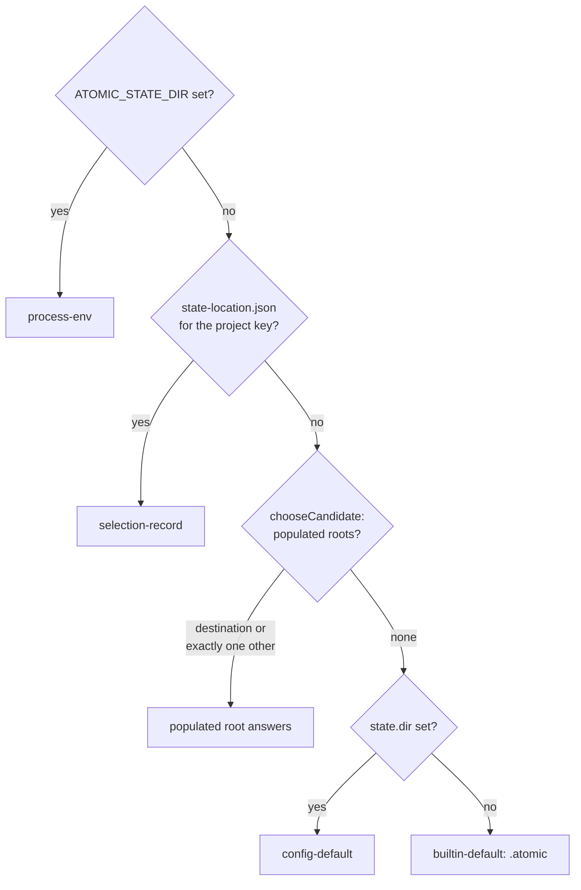

The leaf labels are the `StateSource` values a `StateLocation` carries. Details the diagram does not hold:

| Condition | Result |
|-----------|--------|
| A populated destination (the configured `state.dir`, else [`.atomic`](../../.atomic)) | Answers as `config-default` or `builtin-default`; every other populated root gets a one-time stderr warning naming it as leftover state |
| No populated destination, one other populated candidate | Answers in place as `populated-candidate` |
| Two or more populated non-destination candidates | `ErrAmbiguousStateRoot`, whose message points at `atomic state adopt --dir <path>` |
| A record or override value | `resolveStateDirValue`: an absolute path is used as-is (the filesystem root refused); a relative value must pass `ValidateStateDirPath` and is joined onto the repository root |
| A record with a newer `schema_version` or an empty `state_dir` | Error |

A candidate is the configured `state.dir`, [`.atomic`](../../.atomic), or [`.claude`](../../.claude), holding at least one `stateSignatureEntries` entry: `atomic.toml`, `.atomic-index`, `.scratchpad`, `project`, or `rules/wiki`. `worktrees` is deliberately not a signature, because Claude keeps linked worktrees in [`.claude`](../../.claude).

`ResolveStateLocation` returns errors; `repositoryStateDir` caches the answer per repository root for the process lifetime and backs every repo-local path helper; those helpers have no error channel, so `stateRoot` calls `stateRefusalExit`, which prints and exits 1. `repoctx.ResolveFrom` checks `RepositoryStateDir` first, so a refusal normally stops a verb before any helper runs. `QuietStateDir` and `QuietStateRoots` resolve a visited directory without warning or caching; on a refusal `QuietStateRoots` returns every populated candidate instead of none, which is how scope-marker discovery still reads them.

The selection record is written by `PersistStateSelection` (temp file, fsync, rename, fsync of the parent) and removed by `WithdrawStateSelection` only while its bytes match what the caller recorded. `atomic state adopt` drives both. With no flag it calls `SelectStateCandidate` and persists the single populated candidate through `PersistStateSelection`; when more than one candidate is populated it fails with `more than one populated state root; re-run with --dir <path>`. `--dir` persists any value `resolveStateDirValue` accepts, `--clear` calls `WithdrawStateSelection`, and the two flags are mutually exclusive. `--dry-run` reports without writing, and `--json` prints the report as JSON.

### Moving state out of [`.claude`](../../.claude)

`MigrateRepositoryState` moves Atomic's entries out of a legacy [`.claude`](../../.claude) root into the resolved destination. It refuses rather than merge two populated roots.

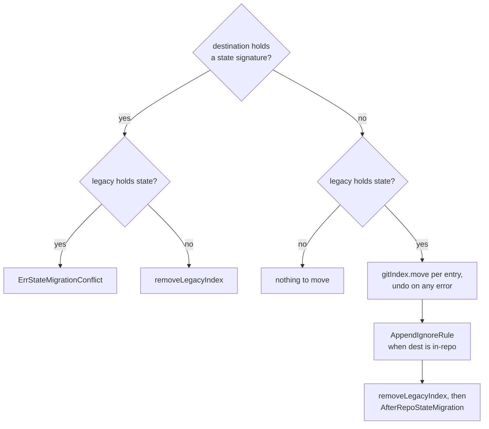

`migrationRoots` picks the destination from the selection record, then `state.dir`, then [`.atomic`](../../.atomic); it never reads `ATOMIC_STATE_DIR`. A repository root equal to the home directory is refused with `ErrHomeStateRoot` when its [`.claude`](../../.claude) holds state, because that [`.claude`](../../.claude) is Claude's own configuration. The moved entries are `migratedEntries`: `atomic.toml`, `workflow-preferences.md`, `project`, `rules/wiki`, and `.scratchpad`. Tracked files are renamed in the git index as well as on disk, and the report lists each staged rename. The legacy `.atomic-index` is never moved: `removeLegacyIndex` deletes it unless `IndexInUse` reports a live MCP daemon, and the code index rebuilds in the new root. When the destination is not `<repo>/.atomic`, `pendingMoves` also moves `.atomic/code.toml` and any `*.db`, `*.db-wal`, and `*.db-shm` files from [`.atomic`](../../.atomic) into it. `AfterRepoStateMigration` re-projects wiki cards after the move, except when the destination's `atomic.toml` declares `scope = "realm"`. The report also names hand-wired references to the old paths in [`CLAUDE.md`](../../CLAUDE.md), `CLAUDE.local.md`, `AGENTS.md`, `.claude/settings*.json`, `.claude/hooks/`, and [`.githooks/`](../../.githooks).

`atomic state migrate` runs it directly; `atomic repo init` and `atomic update` run it through `migrateStateIfPending`, which runs only when `RepoStateMigrationPending` reports legacy state and an empty destination.

### The project-keyed home

`ProjectStateDir(repoRoot)` is `~/.atomic/<project-key>/`, shared by every worktree of one clone. It holds the selection record, `reports/<branch>/`, and `archive/`. The key comes from the clone's main checkout, found without a git subprocess, so a worktree and its main checkout always agree.

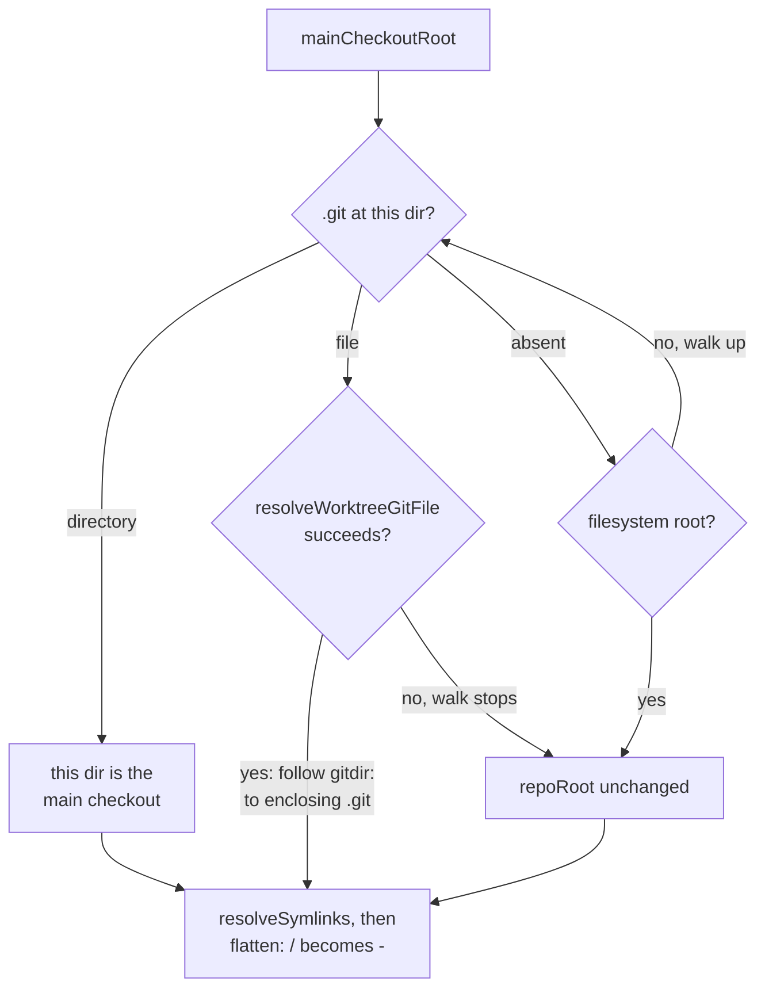

Every branch passes through `resolveSymlinks` because git writes an already-resolved `gitdir:` target when it creates a worktree; an unresolved main-checkout path under a symlinked ancestor (macOS `/tmp`, `/var`) would key differently from its own worktree. `BranchFromHEAD` reads `<gitdir>/HEAD` for the checkout itself, with no upward walk, and validates the ref against `refNamePattern` before it becomes a path segment. `ReportsDir` prefers `reports/<branch>/` and falls back to the legacy `<state-root>/.scratchpad/session-reports/<branch>/` only when the legacy directory already holds a report and the new one does not.

### Workflow preferences

The keys `source-control`, `source-control-host`, `issue-tracker`, `issue-tracker-project`, and `worktrees` tell a session how the user works. Each level stores them in one `<workflow-preferences level='...'>` block, and `workflow.Resolve` merges the levels with the git origin into a single `level='resolved'` block.

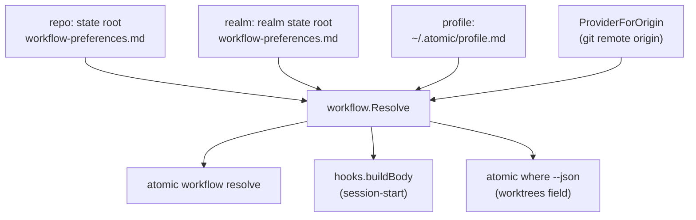

Levels are read in the order repo, realm, profile, and the first level holding a key wins. An explicit line beats a `# detected` (soft) line at any level. Per key:

| Key | Precedence | Fallback |
|-----|-----------|----------|
| `source-control` | explicit, then origin provider, then soft | `github` |
| `source-control-host` | explicit, then the origin host when its provider matches the resolved `source-control`, then soft | the provider's default host (`github.com`, `gitlab.com`, `bitbucket.org`, `codeberg.org`) |
| `issue-tracker` | explicit, then soft | `derived`: the source-control value for `github`, `gitlab`, or `codeberg`, else `filesystem` |
| `issue-tracker-project` | explicit, then soft | none |
| `worktrees` | explicit, then soft | `auto`, rendered as a path through `config.WorktreeDir` |

`config.WorktreeDir` returns `off` verbatim, uses an absolute preference as-is, joins a relative one onto the repository root, and otherwise picks `.claude/worktrees` under Claude and `<state-root>/worktrees` elsewhere. The resolved block ends with a `Read:` line naming the `atomic-git-discipline` references for the resolved source control and issue tracker plus `references/worktrees.md`.

`Resolve` fails only when its directory is unreadable. A malformed block, a level attribute naming the wrong level, an origin host that maps to no provider, or an explicit provider that disagrees with the origin each becomes a `warning:` line. When the repo and realm resolve to the same file, one block serves both and its `level` attribute decides which it is.

`atomic workflow set <key> <value> [--level profile|realm|repo]` writes one explicit line with `workflow.SetValue`, defaulting to the profile level. The profile write holds `profile.LockProfile` and ensures the `## Workflow preferences` section exists first.

### Session-start hook

The hook is how resolved preferences and orientation reach a session without the model running a command. A failing section is dropped rather than blocking the session.

The command resolves the session root before the hooks package runs, and the workflow block is resolved inside the payload build, so one harness call returns everything the session needs. With `--format text` the command calls `SessionStartText` instead of `SessionStart`.

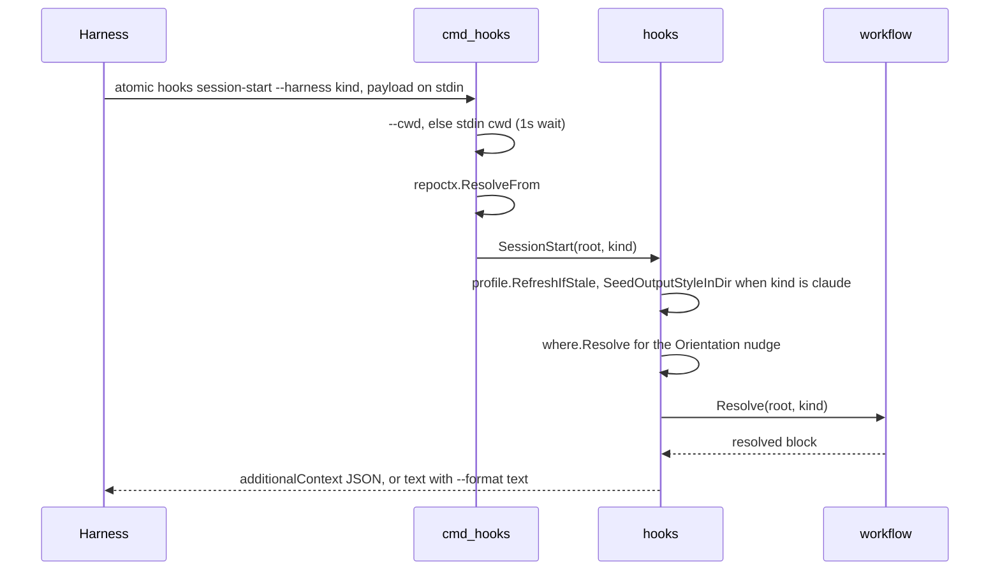

`hooks.Install` registers the inline command `atomic hooks session-start --harness claude` as a `SessionStart` member of the scope's `.claude/settings.json` (`--scope user|project`), and `InstallInDir` targets a `CLAUDE_CONFIG_DIR` root. Codex gets owned `SessionStart` and `PreToolUse` members in `$CODEX_HOME/hooks.json` (`codexMembers`): `atomic hooks session-start --harness codex` under `SessionStart` with matcher `startup|resume`, and `atomic hooks pre-tool-use` under `PreToolUse` with matcher `apply_patch` (see the next section). `InstallCodex` adds whichever member the file lacks; `ReplaceCodex` strips each member's handlers and re-registers it in one canonical group, keeping user handlers beside it. Settings are edited on the parsed JWCC AST, so comments and formatting survive. Uninstall removes only Atomic's handlers and any legacy `session-start-reminders.sh` wrapper; the unflagged `atomic hooks session-start` command still counts as Atomic's. `ObserveSettingsOwnedInDir` and `ObserveCodexHooksOwned` digest only the owned members, which is what the install ledger records. `CodexCanonicalDigest` covers both Codex members; `CodexLegacyDigest` covers the `SessionStart` member alone, the form a file written before the `PreToolUse` member carries. For a Codex `hooks.json`, `shapeError` requires `SessionStart` and `PreToolUse` to be arrays when present.

`SeedOutputStyleInDir` writes `"outputStyle": "Atomic"` only when `output-styles/atomic.md` exists in the target and `output_style.seed` is true, and never overwrites a present `outputStyle`. It has no seeded-once marker, so a deleted key returns the next session.

### Codex PreToolUse: wiki cards on edit

Codex has no path-scoped rule loading, so the `PreToolUse` hook delivers the wiki pointer cards whose scope covers the files an `apply_patch` call is about to write. Each card reaches a session once, and every failure prints nothing, so a card never blocks the edit it precedes.

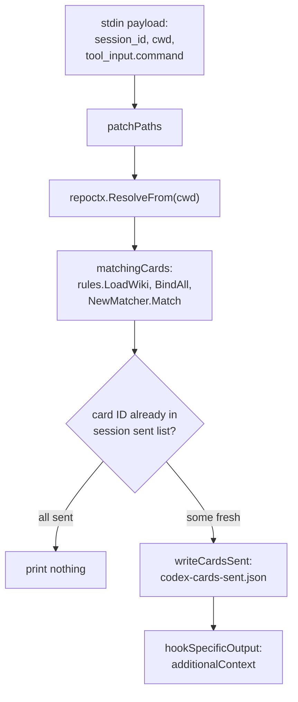

| Step | Detail |
|------|--------|
| Payload | Decoded from at most 1 MiB of stdin. An empty `session_id` or `cwd` returns nothing. |
| `patchPaths` | Reads the patch text for `*** Add File: `, `*** Update File: `, and `*** Move to: ` lines. |
| `matchingCards` | Loads cards from `<state-root>/rules/wiki` for the project key, resolves a relative path against `cwd` and an absolute one through `realPath`, and skips paths outside the repository root. `cwd` and the root both pass through `filepath.EvalSymlinks` because Codex may hand over a symlinked `cwd` while Git reports the real path. Matches are deduplicated and sorted by card ID. |
| Sent state | `config.CodexCardsSentPath` is `~/.atomic/codex-cards-sent.json`, keyed by session with `last_seen` and `cards`. Sessions unseen for more than `sentRetention` (7 days) are pruned on write. A missing or corrupt file reads as empty, so the worst case is a card sent twice. The write is a temp file and rename; a failed write returns nothing. |
| Output | One JSON object, `hookEventName: "PreToolUse"`, with the fresh card bodies joined by blank lines as `additionalContext`. |

`runPreToolUse` in [`atomic/cmd/atomic/cmd_hooks.go`](../../atomic/cmd/atomic/cmd_hooks.go) recovers any panic and always exits 0. The `pre-tool-use` subcommand replaces the root's state-dir `PersistentPreRunE` preflight with a no-op, since a preflight refusal would fail the edit.

### Claude steering mode

`[steering] claude` sets the shape of the repository and realm steering files Claude reads. The values are `bundlespec.SteeringModes`: `loader` (`AGENTS.md` plus a thin [`CLAUDE.md`](../../CLAUDE.md) importing it), `agents-md` (`AGENTS.md` alone), and `claude-md` ([`CLAUDE.md`](../../CLAUDE.md) alone, guidance inline). A repository overrides the user default, and the first config holding a value wins. `agents-md` relies on Claude Code 2.1.277 or later reading `AGENTS.md` when no [`CLAUDE.md`](../../CLAUDE.md) sits beside it.

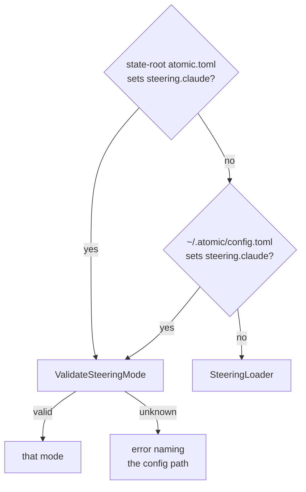

`ResolveSteeringMode(home, root)` also errors when either config cannot be read; an empty `home` skips the user rung. `atomic config set steering.claude ""` is refused in favor of `unset`, and `Resolved` shows `loader` when the key is unset. Callers include doctor, the wiki and realm code-index writers, the Claude migration, and `convergeSteeringMode` in [`atomic/cmd/atomic/cmd_steering.go`](../../atomic/cmd/atomic/cmd_steering.go), which `atomic repo init` runs on its root (an error fails the verb) and `atomic update` runs after a swap. Converting the files on disk from one mode to another belongs to the harness domain; see [`docs/wiki/harness.md`](harness.md).

### Scratchpad bundles

One bundle per slug carries a task's state across commands. `scratchpad new` is additive, so a later phase extends the bundle instead of creating a dated sibling.

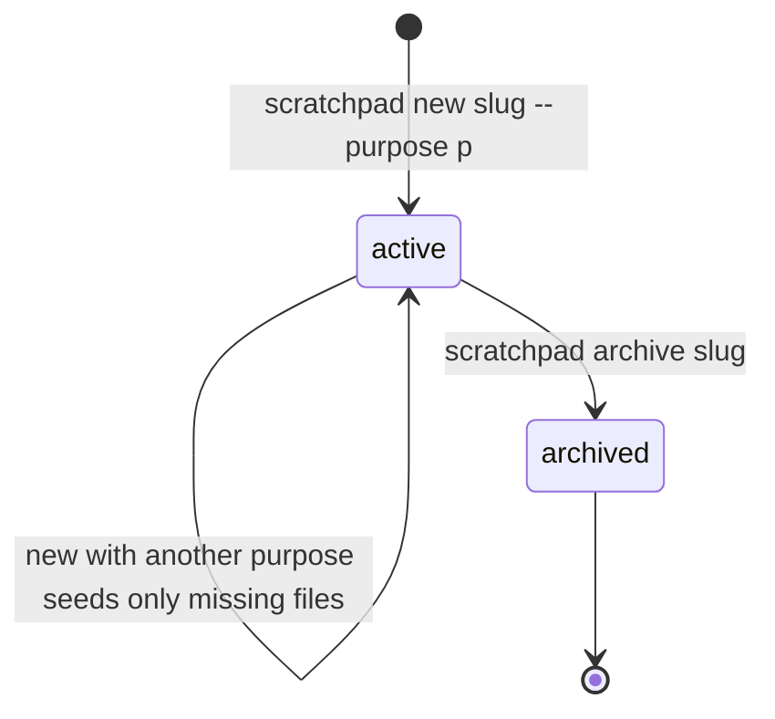

A bundle is `<state-root>/.scratchpad/<slug>/` with a `meta.toml` (`slug`, `purposes`, `created`, `updated`, `status`, `description`). Unknown `meta.toml` keys survive a rewrite. Purposes seed files from `doctemplate`:

| Purpose | Seeds |
|---------|-------|
| `plan` | `BRIEF.md`, `STATE.md`, `FOLLOWUPS.md`, plus `docs/design/<slug>.md` and `docs/spec/<slug>.md` in the repository |
| `implement`, `fix` | `BRIEF.md`, `STATE.md`, `FOLLOWUPS.md` |
| `diagnose` | the above plus `CONTEXT.md` |
| `review` | `lenses/` and `findings/` directories |

`Archive` sets `status = "archived"` and renames the bundle to `~/.atomic/<project-key>/archive/<slug>/<created-date>/`, taking a `-2`, `-3` suffix on a same-day collision. `List` walks to the first directory holding `meta.toml`, so the live root and the two-level archive share one walker, and a corrupt `meta.toml` costs only its own entry.

### Follow-up entries

The follow-ups ledger is the `filesystem` issue tracker: one markdown file per entry under `<state-root>/project/followups/`, with `INDEX.md` and `CLOSED.md` beside them. The binary knows nothing about trackers. The `atomic-git-discipline` skill reads the resolved `issue-tracker` and, for `filesystem`, maps its operations onto `atomic followups` verbs in [`context/skills/atomic-git-discipline/references/issue-tracking/filesystem.md`](../../context/skills/atomic-git-discipline/references/issue-tracking/filesystem.md).

An entry is open until closed; stale is computed at render time, never stored, and a `plan` is never stale.

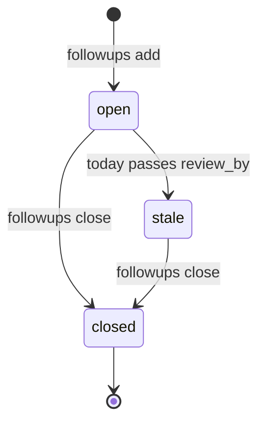

`Add` requires a kebab-case id, a title, an origin, and a severity (`risk`, `nit`, `question`) unless `--kind plan`. It sets `review_by` to the creation date plus 60 days and regenerates `INDEX.md`. `CloseEntry` appends a line to `CLOSED.md`, deletes the entry file, and regenerates `INDEX.md`.

### Self-update: background check

No invocation does network I/O in-line. The parent process reads `state.json`, and a detached child does the GitHub lookup and staging.

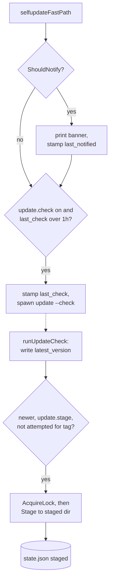

The spawn is skipped for the `update` verb itself and under `--no-update-check`. `last_check` is stamped before the spawn, so a crash or a racing invocation cannot spend the hourly budget twice. `stage_attempted_for` is stamped only on a real download attempt, never on lock contention. The banner repeats at most once per `BannerWindow` (24h).

### Self-update: foreground swap

`atomic update` swaps the binary, then hands every post-swap step to the new binary, because the old process still embeds the old corpus.

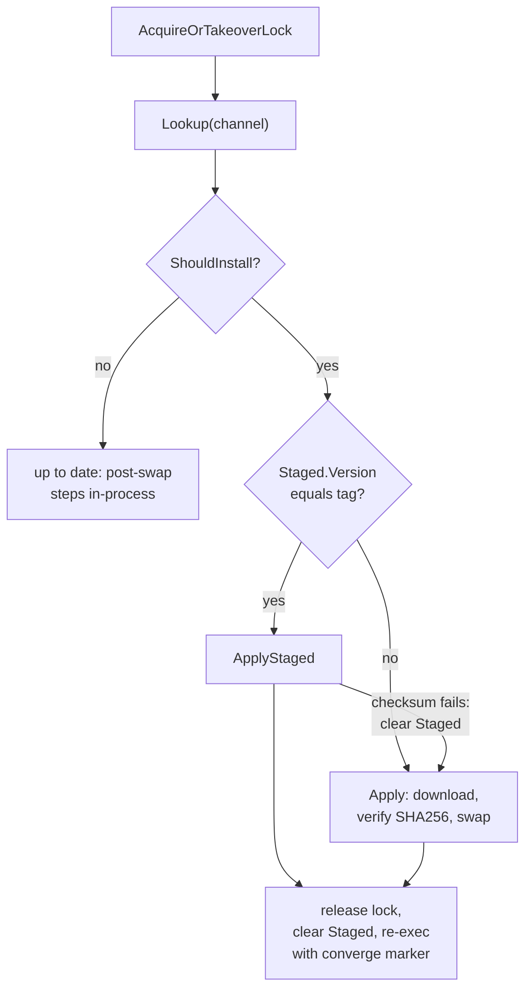

`runUpdatePostSwap` then runs, in order:

1. `convergeEnrolledTargets` over every enrolled harness target (skipped by `--skip-claude-update`).
2. `migrateStateIfPending` for the repository holding the working directory.
3. Unless `--skip-claude-update`, `convergeSteeringMode` on `cwdSteeringRoot` (that repository, else the realm root above the working directory, which need not be a Git repository), then `convergeCwdRepoCards`. A steering failure prints `atomic update: skipped steering conversion: ...` and the steps continue.
4. `runMigrateInstall` (install-scope migrations).
5. Doctor, unless `--no-doctor` or `update.run_doctor = false`.

`runUpdatePostSwap` returns 1 when the steering conversion failed, after doctor has run.

The channel resolves from `--pre` or `--channel`, then `update.channel`, then `stable`. `stable` takes the highest version and only moves forward. `prerelease` takes the most recently published release and accepts a semver-lower tag, because a prerelease cut after a stable release of the same core carries newer code with a lower version. `atomic update --check` exits 1 when an update is available and 2 on a lookup error. A lock older than `StaleLockAfter` (10 minutes) can be taken over, and `--force` bypasses the lock without weakening checksum verification.

### Versioned migrations

`atomic migrate` applies registered steps above a recorded version, in ascending semver order, stopping at the first error.

The flags route to a scope: `--realm` runs the install scope, then each confirmed member's repo scope.

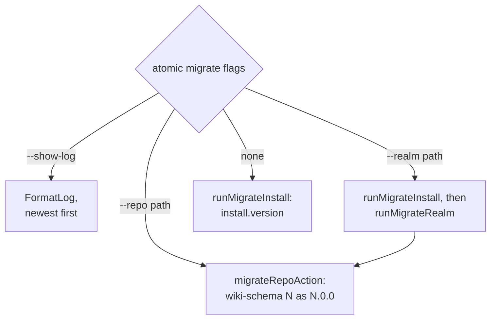

| Target | Scope | Step |
|--------|-------|------|
| `1.0.0` | repo | `relocateSignalsToWiki`: `.claude/project/` signals to [`docs/wiki/`](.), rewiring the `@`-ref |
| `1.1.0` | repo | `scanIgnoreToRepoConfig`: `.signalsignore` folded into `[scan]` of the repo config, then deleted |
| `1.2.0` | repo | `scratchpadRelocate`: `session-reports/` to `~/.atomic/<project-key>/reports/`, and dated `<YYYY-MM-DD>-<slug>` bundles renamed to `<slug>` |

Repo scope records progress as the `<wiki-schema>` major in [`docs/wiki/index.md`](index.md). Install scope records `[install].version` in `config.toml` and runs only when a legacy Claude install record is present, with `Context.Root` set to `~/.claude`. `--realm` fans out over immediate subdirectories that hold [`docs/wiki/index.md`](index.md) or `.claude/project/signals.md`, asks one `prompt.Confirm` per member, and skips members already at schema 1 or higher.

### User config keys

`atomic config set` accepts only these keys; machine-written tables are edited by their own verbs.

| Key | Default | Controls |
|-----|---------|----------|
| `output.signals.max_depth` | `3` | tree depth in `atomic signals scan` |
| `update.run_doctor` | `true` | doctor after `atomic update` |
| `update.check` | `true` | hourly background version lookup |
| `update.stage` | `true` | once-per-version background download |
| `update.channel` | unset, resolves to `stable` | `stable` or `prerelease` for every update path |
| `state.dir` | unset, displays [`.atomic`](../../.atomic) | the configured rung of the state-root ladder |
| `repl.idle_timeout` | `1h` | REPL idle window; a repo-config value wins |
| `output_style.seed` | `true` | `outputStyle` seeding into Claude `settings.json` |
| `steering.claude` | unset, resolves to `loader` | user default for the Claude steering mode; a repo-config value wins |

Machine-written: `[install]` (version and artifact manifest), `[claude.agents.<name>]`, `[omp.agents.<name>]`, `[codex.agents.<name>]` (`atomic config agents`), and `[bus.remotes.<name>]` (`atomic bus remote`).

## Where it lives

### User config and paths

| Path | Role |
|------|------|
| [`atomic/internal/config/config.go`](../../atomic/internal/config/config.go) | `Config` schema, lenient `Load` (unknown keys warn), `Validate`, `Get`/`Set`/`Unset`, `WritePersist`. Retired `[harness]` and `[pi]` tables load silently and drop on the next write. |
| [`atomic/internal/config/render.go`](../../atomic/internal/config/render.go) | `Resolved`: the flat map `atomic config list` prints, defaults filled in. |
| [`atomic/internal/config/cli.go`](../../atomic/internal/config/cli.go) | `config.Run`: `get`, `set`, `unset`, `list [--json]`, `path`. |
| [`atomic/internal/config/agentoverride.go`](../../atomic/internal/config/agentoverride.go) | `[<harness>.agents.<name>]` tables (`model`, `effort`) for `claude`, `omp`, `codex`; `AgentHarnesses`; Claude effort enum. |
| [`atomic/internal/config/agents.go`](../../atomic/internal/config/agents.go) | `AgentFormFor`, `EditAgents`: the interactive `atomic config agents` form. |
| [`atomic/cmd/atomic/cmd_config.go`](../../atomic/cmd/atomic/cmd_config.go) | `atomic config` wiring; `runConfigAgents` picks harnesses, then converges enrolled ones through `install`. |
| [`atomic/internal/config/busremote.go`](../../atomic/internal/config/busremote.go) | `[bus.remotes.<name>]` validation and edits for `atomic bus remote`. |
| [`atomic/internal/config/paths.go`](../../atomic/internal/config/paths.go) | Every `~/.atomic/` path (`Dir`, `TOMLPath`, `StatePath`, `ProfilePath`, `WikisPath`, `InstallDir`, ledger, journals, transactions, backups, packages, `CodexCardsSentPath`); `ClaudeConfigDir` honors `CLAUDE_CONFIG_DIR`. |
| [`atomic/internal/config/statemigrate.go`](../../atomic/internal/config/statemigrate.go) | `MigrateUserState`: `~/.claude/.atomic` to `~/.atomic`, copy fallback staged in `~/.atomic.migrating`. |

### Repository state

| Path | Role |
|------|------|
| [`atomic/internal/config/statelocation.go`](../../atomic/internal/config/statelocation.go) | The ladder, the selection record, candidate discovery, `MutablePathsFor`. |
| [`atomic/internal/config/harness.go`](../../atomic/internal/config/harness.go) | Repo-local path helpers on `stateRoot`: `ScratchpadDir`, `ProjectDir`, `FollowupsDir`, `IndexDir`, `IndexDBPath`, `WorktreeDir`, `RepoConfigPath`, `WorkflowPrefsPath`; `SetStateDirForTest`. |
| [`atomic/internal/config/pathsegment.go`](../../atomic/internal/config/pathsegment.go) | `ValidateSegment`, `ValidateStateDirPath`, `ValidateDateSegment`: the allow-list for any value that becomes a path segment. |
| [`atomic/internal/config/repostate_migrate.go`](../../atomic/internal/config/repostate_migrate.go) | `MigrateRepositoryState`, `RepoStateMigrationPending`. |
| [`atomic/internal/config/projectstate.go`](../../atomic/internal/config/projectstate.go) | Project key, `ProjectStateDir`, `ReportsDir`, `ArchiveDir`, `BranchFromHEAD`. |
| [`atomic/internal/config/repo.go`](../../atomic/internal/config/repo.go) | `RepoConfig` (`[code]`, `[comments]`, `[scan]`, `scope`, `[realm]`, `[repl]`, `[serve]`, `[steering]`), `LoadRepoConfig`, `IgnoreMatcher`, `ResolveMaxLines`; `steeringSection` (shared with `Config`), `ValidateSteeringMode`, `ResolveSteeringMode`. |
| [`atomic/internal/config/scope.go`](../../atomic/internal/config/scope.go) | `scope = "repo"\|"realm"` marker: `FindScopeRoot`, `EnsureScopeMarker`. |
| [`atomic/internal/config/scanignore.go`](../../atomic/internal/config/scanignore.go) | `ScanGlobs`: `[scan]` wins whole over a legacy `.signalsignore`. |
| [`atomic/internal/config/ignore.go`](../../atomic/internal/config/ignore.go) | `git check-ignore` probes and `AppendIgnoreRule`. |
| [`atomic/internal/repoctx/repoctx.go`](../../atomic/internal/repoctx/repoctx.go) | Working root: `--repo`, then a `scope="repo"` marker, then `git rev-parse --show-toplevel`, then the directory itself. |
| [`atomic/internal/repoinit/repoinit.go`](../../atomic/internal/repoinit/repoinit.go), [`atomic/cmd/atomic/cmd_repo.go`](../../atomic/cmd/atomic/cmd_repo.go) | `atomic repo init`: state-root dirs, nested [`.gitignore`](../../.gitignore) rules, `tmp/` rule, `.claude/worktrees/` rule when Claude is enrolled or [`.claude`](../../.claude) exists, the scope marker, and `convergeSteeringMode` on the root. Never rewrites a config or rule, never commits. |
| [`atomic/internal/where/`](../../atomic/internal/where), [`atomic/cmd/atomic/cmd_where.go`](../../atomic/cmd/atomic/cmd_where.go) | `atomic where`: repo root, repo-scope wiki, realm position, code-index scope, without git subprocesses; `--json` adds `state_root`, `worktrees`, `branch`, `reports`, `reports_root`, `archive`; `--harness claude\|omp\|codex` decides the `worktrees` field. |

### Workflow and session start

| Path | Role |
|------|------|
| [`atomic/internal/workflow/block.go`](../../atomic/internal/workflow/block.go) | Block parser, key and value validation, profile-section lookup. |
| [`atomic/internal/workflow/resolve.go`](../../atomic/internal/workflow/resolve.go) | Level loading and per-key precedence; `Worktrees`. |
| [`atomic/internal/workflow/origin.go`](../../atomic/internal/workflow/origin.go) | Origin URL to host and provider. |
| [`atomic/internal/workflow/render.go`](../../atomic/internal/workflow/render.go), `set.go` | Resolved-block text and JSON; `SetValue`, `TargetPath`. |
| [`atomic/cmd/atomic/cmd_workflow.go`](../../atomic/cmd/atomic/cmd_workflow.go) | `atomic workflow resolve [--cwd] [--harness] [--json]` and `set`. |
| [`atomic/internal/hooks/hooks.go`](../../atomic/internal/hooks/hooks.go), `hooks_hujson.go`, `ownership.go` | Session-start payload, Claude `settings.json` registration, owned-member digests. |
| [`atomic/internal/hooks/codex.go`](../../atomic/internal/hooks/codex.go) | Codex `hooks.json` registration of the `SessionStart` and `PreToolUse` members, owned digests, `CodexSessionStartPosition` and `CodexPreToolUsePosition`. |
| [`atomic/internal/hooks/pretooluse.go`](../../atomic/internal/hooks/pretooluse.go) | `PreToolUse`: patch paths to matching wiki cards, the per-session sent list. |
| [`atomic/internal/hooks/outputstyle.go`](../../atomic/internal/hooks/outputstyle.go) | `outputStyle` seeding and removal. |
| [`atomic/cmd/atomic/cmd_hooks.go`](../../atomic/cmd/atomic/cmd_hooks.go) | `atomic hooks session-start\|pre-tool-use\|install\|uninstall`; `runPreToolUse` drops every failure and exits 0. |

### Task state

| Path | Role |
|------|------|
| [`atomic/internal/scratchpad/`](../../atomic/internal/scratchpad), [`atomic/cmd/atomic/cmd_scratchpad.go`](../../atomic/cmd/atomic/cmd_scratchpad.go) | `atomic scratchpad new\|path\|list [--archived] [--json]\|archive`. |
| [`atomic/internal/followups/`](../../atomic/internal/followups), [`atomic/cmd/atomic/cmd_followups.go`](../../atomic/cmd/atomic/cmd_followups.go) | `atomic followups list\|add\|close\|render\|path`. |

### Update and migration

| Path | Role |
|------|------|
| [`atomic/internal/selfupdate/selfupdate.go`](../../atomic/internal/selfupdate/selfupdate.go) | Channels, `Lookup`, `Stage`, `Apply`, `ApplyStaged`, lock helpers, `ShouldInstall`, `ShouldNotify`. |
| [`atomic/internal/selfupdate/state.go`](../../atomic/internal/selfupdate/state.go), `semver.go`, `cache.go` | `state.json` shape and atomic write, semver compare, legacy cache path. |
| [`atomic/cmd/atomic/cmd_update.go`](../../atomic/cmd/atomic/cmd_update.go) | Fast path, background check, foreground swap, post-swap steps. |
| [`atomic/internal/migrate/`](../../atomic/internal/migrate) | `Run`, `Registry`, the registered steps, `<wiki-schema>` read and write, `FormatLog`. |
| [`atomic/cmd/atomic/cmd_migrate.go`](../../atomic/cmd/atomic/cmd_migrate.go) | `atomic migrate` routing. |

### Embedded text and CLI plumbing

| Path | Role |
|------|------|
| [`atomic/internal/coldprompt/`](../../atomic/internal/coldprompt), [`atomic/cmd/atomic/cmd_prompt.go`](../../atomic/cmd/atomic/cmd_prompt.go) | `atomic prompt git-cleanup\|claude-merge\|implementer\|reviewer`: briefs for a subagent starting cold, embedded and never installed. |
| [`atomic/internal/doctemplate/`](../../atomic/internal/doctemplate), [`atomic/cmd/atomic/cmd_template.go`](../../atomic/cmd/atomic/cmd_template.go) | `atomic template <name>`: document skeletons (`brief`, `design-doc`, `diagnose-context`, `followups`, `implementation-log`, `session-report`, `spec`, `state`), also the seed source for scratchpad bundles. |
| [`atomic/internal/dockerinit/`](../../atomic/internal/dockerinit), [`atomic/cmd/atomic/cmd_docker.go`](../../atomic/cmd/atomic/cmd_docker.go) | `atomic docker init [--target ./atomic-docker] [--force]`: Docker eval scaffolding. |
| [`atomic/internal/prompt/prompt.go`](../../atomic/internal/prompt/prompt.go) | `Confirm` and `Select` over `huh`; `ErrNonInteractive` off a TTY, `ErrAborted` on Ctrl+C. |
| [`atomic/internal/cliutil/`](../../atomic/internal/cliutil) | `ParseInterspersed`, `UnexpectedArgs`, `SetUsage`. |
| [`atomic/cmd/atomic/main.go`](../../atomic/cmd/atomic/main.go), `rootflags.go` | Pre-dispatch steps and root argv scanning. |

## Constraints

- **`ATOMIC_STATE_DIR` is process-only.** It never writes the selection record and never feeds `migrationRoots`. A verb run under it reads and writes a different root from the next run without it.
- **The repo-local helpers exit on a refused root.** `stateRoot` calls `stateRefusalExit`. A new verb that skips `repoctx.Resolve` (or `ResolveFrom`) and calls `config.ScratchpadDir` directly turns an ambiguous state root into an unexplained exit 1 instead of the adopt hint.
- **The resolution cache lives for the process.** `repositoryStateDir` and `configuredStateDir` cache their answers; code that writes a record or `config.toml` mid-process must go through `PersistStateSelection` / `WithdrawStateSelection` / `MigrateRepositoryState`, which call `invalidateStateCache`. Tests use `SetStateDirForTest` and `SetHomeDirForTest` so they never resolve against the real home.
- **A new state-root entry needs two lists.** `stateSignatureEntries` decides what counts as populated, and `migratedEntries` decides what moves out of [`.claude`](../../.claude). An entry in one list and not the other is either invisible to resolution or stranded in [`.claude`](../../.claude).
- **`state.dir` must be safe segments.** `ValidateStateDirPath` rejects absolute, empty, and `..` values, and `segmentFromConfig` silently falls back to [`.atomic`](../../.atomic) on an invalid or unreadable config. Only the selection record and `ATOMIC_STATE_DIR` accept an absolute path.
- **The project key depends on the main checkout path.** Moving or renaming a clone changes its key, so the selection record, reports, and archives under the old `~/.atomic/<project-key>/` stop resolving.
- **Booleans and `max_depth` use explicit-presence backfill.** `Load` reads the raw TOML map to tell an absent key from an explicit `false` or `0`. A new boolean key added without that check silently becomes `false` whenever its section is missing.
- **`repl.idle_timeout`'s default is duplicated.** `replIdleTimeoutDefault` in `config.go` mirrors `repl.DefaultIdleTimeout` by hand because `repl` imports `config`. Changing one leaves `atomic config list` showing the wrong value.
- **Migration steps must be idempotent.** `Run` replays a step after a crash, and repo scope records only the `<wiki-schema>` major, so any repo step whose target is above `1.0.0` reruns on every `atomic migrate --repo`.
- **The banner path never touches the network.** `selfupdateFastPath` reads `state.json` alone; any lookup belongs in the detached `update --check` child. `LoadState` returns a zero state on any read or parse error so a broken file never blocks a verb.
- **Post-swap work must run in the new binary.** `runUpdateWith` re-execs with the converge marker after a swap. Running convergence or migrations in the old process publishes the old embedded corpus.
- **`workflow set` refuses a level mismatch in a shared file.** When the repo and realm resolve to one `workflow-preferences.md`, writing the other level's key returns an error instead of rewriting the block's `level`.
- **The `PreToolUse` hook must never fail an edit.** `PreToolUse` returns an empty string on every error and `runPreToolUse` recovers panics; a new step that exits non-zero or writes to stdout on failure breaks that contract.
- **A card is marked sent before it is printed.** `writeCardsSent` runs before the output is built, so a failed write sends nothing, and a corrupt `codex-cards-sent.json` resends cards rather than blocking.
- **An invalid `steering.claude` stops conversion, not every verb.** `ResolveSteeringMode` errors on an unknown value or an unreadable config. `atomic repo init` returns that error; `atomic update` skips conversion, finishes its other post-swap steps, and exits 1.
- **`repo init` and `EnsureScopeMarker` never rewrite.** A repo config that already declares a different `scope` is an error. A rule already present but negated or tracked by git is reported (`negated`, `tracked`), not fixed.

## Coupling

- **harness** owns `atomic state adopt` and `atomic state migrate` ([`atomic/cmd/atomic/cmd_state.go`](../../atomic/cmd/atomic/cmd_state.go)), the enrollment ledger and install lifecycle whose paths `config/paths.go` defines, `runConfigAgents` convergence, and `convergeEnrolledTargets` after an update. It also owns the steering-mode conversion that `convergeSteeringMode` drives (`claude.ConvertScope`, `wiki.ConvertSteeringPair`, `realm.MoveCodeIndexBlock`) and the Codex hook trust records located through `CodexSessionStartPosition` and `CodexPreToolUsePosition`; see [`docs/wiki/harness.md`](harness.md). `AfterRepoStateMigration` is set by the wiki-card projection in [`atomic/cmd/atomic/cmd_cards.go`](../../atomic/cmd/atomic/cmd_cards.go) to re-project cards after a state move.
- **code-intel** resolves its index through `config.IndexDir` / `IndexDBPath`, reads `[code] ignore` and `[comments] max_lines` from the repo config, and supplies `IndexInUse` for `removeLegacyIndex`; see [`docs/wiki/code-intel.md`](code-intel.md).
- **signals** reads `output.signals.max_depth`, `config.ScanGlobs`, and the scratchpad and project directories as scan skip prefixes; see [`docs/wiki/signals.md`](signals.md).
- **wiki** supplies `wiki.FindRealm` for the realm workflow level and `[realm] repos` consumption; `where` reads the realm registry `~/.atomic/wikis.md`; see [`docs/wiki/wiki.md`](wiki.md).
- **rules**: the `PreToolUse` hook reads pointer cards through `rules.LoadWiki`, `BindAll`, and `NewMatcher`, the same cards `/refresh-wiki` writes under `<state-root>/rules/wiki/`.
- **repl**, **bus**, and **serve** read `repl.idle_timeout`, `[bus.remotes]`, and `[serve] schema` respectively.
- **docs-meta** writes its doc-surfaces cache under `config.ProjectDir`, which `repo init` and `MigrateRepositoryState` ignore through `DocSurfacesIgnoreRule`; see [`docs/wiki/docs-meta.md`](docs-meta.md).
- **doctor** reports agent overrides through `config.AgentWarnings` and runs after `atomic update`; see [`docs/wiki/doctor.md`](doctor.md). The `profile` package (`profile.RefreshIfStale`, `LockProfile`, `EnsureWorkflowBlock`) is called from here but documented with its owners.
- **Artifacts that drive this domain**: [`context/AGENTS.md`](../../context/AGENTS.md) tells every session to read the resolved `<workflow-preferences>` block and fall back to `atomic workflow resolve`; [`context/_partials/base-resolution.md`](../../context/_partials/base-resolution.md) and `resolved-provider.md` and the `atomic-git-discipline` references (`resolution.md`, `worktrees.md`, `issue-tracking/*.md`) consume the resolved keys. `/atomic-plan`, `/challenge-swarm`, `/subagent-diagnose`, `/deslop`, and [`context/_partials/implement-loop.md`](../../context/_partials/implement-loop.md) create bundles with `atomic scratchpad new`. `/follow-up` and `issue-tracking/filesystem.md` drive `atomic followups`. `implement-loop.md`, `/git-cleanup`, and `/subagent-diagnose` emit briefs with `atomic prompt`; `/atomic-plan`, `/session-report`, `/subagent-diagnose`, `implement-loop.md`, and `loop-finalize.md` use `atomic template`.
- **Lockstep contracts**: [`.githooks/pre-commit`](../../.githooks/pre-commit) resolves the followups folder with `atomic followups path` and falls back to [`.atomic/project/followups`](../../.atomic/project/followups) only when the binary is absent or the path resolves outside the repository. That fallback must track the default state root. The workflow precedence is specified in [`docs/spec/workflow-preferences.md`](../spec/workflow-preferences.md) and the self-update state machine in [`docs/spec/selfupdate-state.md`](../spec/selfupdate-state.md); `apply` and `selfupdateFastPath` cite them.
