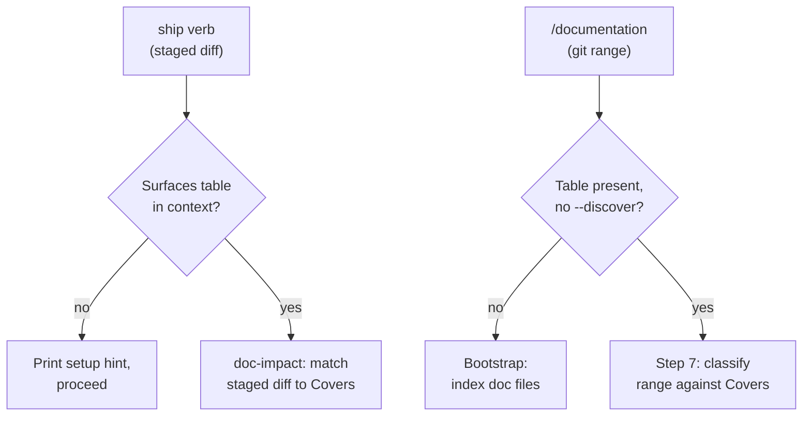
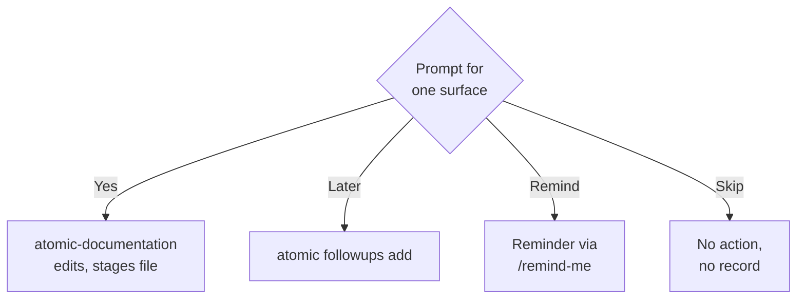
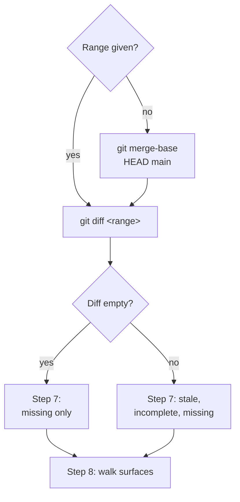
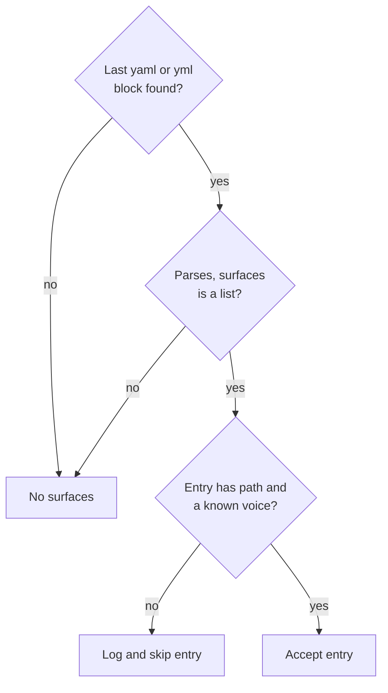
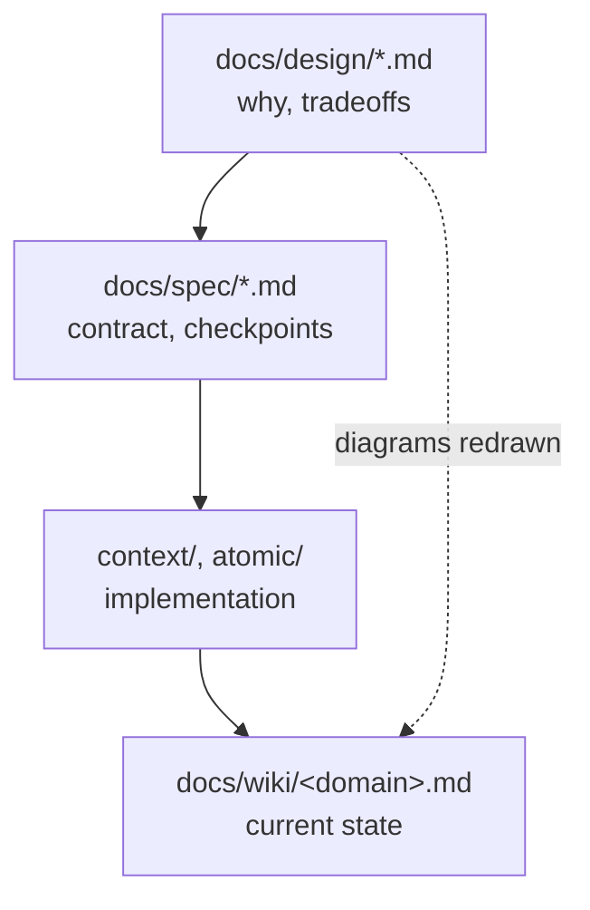

# docs-meta

## What it does

Documentation drifts silently: nothing fails when a page stops matching the code, so the gap is only found by the reader it misleads. And a repo with no stated voice grows one dialect per surface, so a spec, a README, and an agent prompt end up reading as if three people wrote them.

This domain answers both. It defines the voice for every file the repo ships and a separate one for Claude's terminal replies. It also routes each diff to the pages that diff invalidates, at the moment the diff is committed.

The name `docs-meta` matches no path in the repo. It maps to `/documentation`, `atomic docs`, the `atomic-writing` and `atomic-documentation` skills, and [`context/output-styles/atomic.md`](../../context/output-styles/atomic.md).

## How it works

### Reply voice and file voice

There is no third voice. A spec and a README differ in length and structure, not in voice.

| | Atomic output style | atomic-writing |
|---|---|---|
| Governs | how Claude talks | what Claude writes into files |
| Applies to | main-agent TUI replies | every `.md` file the repo ships, prompt artifacts included |
| Form | fragments in labels, list items, and status lines; full sentences in explanations; ASCII only | full sentences where prose fits, Mermaid where a picture fits |
| Defined in | [`context/output-styles/atomic.md`](../../context/output-styles/atomic.md) | [`context/skills/atomic-writing/SKILL.md`](../../context/skills/atomic-writing/SKILL.md) |
| Reaches subagents | no | only agents that list it in `skills:` |

Output styles attach to the main agent only, so a subagent never sees the atomic reply style. Each agent source composes [`context/_partials/agent-atomic-voice.md`](../../context/_partials/agent-atomic-voice.md) instead, which is why a subagent still answers tersely.

### Diagram form and layout

`SKILL.md` rule 1 sets the per-diagram node budgets: 9 nodes for a flowchart, 6 participants for a sequence, 8 entities for an ER or class diagram. It points at the layout table in [`references/mermaid.md`](../../context/skills/atomic-writing/references/mermaid.md) for direction, width, density, and color limits. Over any limit, the rule is to split by abstraction level: one overview diagram with a node per stage, then one diagram per stage under its own `###` heading.

In [`docs/`](..), sequence, flowchart, ER, and state diagrams are Mermaid. Prompt artifacts mix Mermaid, numbered steps, and crow's-foot ASCII; rule 1's form table in [`context/skills/atomic-writing/SKILL.md`](../../context/skills/atomic-writing/SKILL.md) sets which shape takes which form.

### Routing a diff to a page

Only a ship verb prints the setup hint; `/documentation` with no surfaces table bootstraps one instead. Each entry classifies the diff against the table's `Covers` column on its own: the ship verb in [`context/_partials/doc-impact.md`](../../context/_partials/doc-impact.md), `/documentation` in its Step 7.

### Answering per surface

Every page edit waits on the user's answer for that surface, and only `Yes` touches the file, so nothing here writes a page unprompted.

Matching is LLM judgment inside the current turn. No Go code parses the surfaces table, and no doctor check validates it.

### Authoring mode

`/documentation` on a project with a surfaces table runs the authoring pipeline. Step 5 runs `atomic docs scan` and offers to index doc files missing from the table. Steps 6 through 8 then resolve a range, classify surfaces, and walk them one at a time.

Authoring mode always diffs a range: with no `<range>` argument, Step 6 resolves the merge-base with `main`, and an empty diff narrows Step 7 to missing pages only.

When `git merge-base` fails, the base falls back to the literal `main`, and the range is `<base>..HEAD`. An empty diff prints `no changes in range; skipping stale detection.`

A non-zero exit from `atomic docs scan` prints its stderr and stops the run. A missing surface gets an `[n] New` choice, which writes a full page draft and offers to add it to the surfaces table.

### Reading the handoff block

`atomic-documentation` ends its output with a fenced `yaml` handoff block and documents how a caller should read it: a malformed or absent block means "no surfaces", and a bad entry is skipped without aborting the rest.

An empty `surfaces: []` is valid and means "explicitly nothing to update". This is the skill's documented contract; neither `doc-impact` nor `/documentation` has a step that parses the block.

### The cache and its exit codes

`atomic docs stale` returns 0 fresh, 1 stale, 2 error. Mtime drift and set drift each mark the cache stale on their own. Mtime drift catches new and edited docs. Set drift compares the paths on disk against those the cache lists, which is the only thing that catches a deletion, because deleting a file bumps no surviving file's mtime. A missing cache is exit 2, not exit 1: `docs stale: cache not found at <path> — run scan first`. The stale sentinel reads `docs stale: doc files are newer than doc-surfaces cache`.

Scan scope is fixed: [`docs/`](..), `doc/`, `documentation/`, `wiki/`, `ADR/`, `adr/`, `decisions/`, plus [`README.md`](../../README.md) at the repo root only. A doc tree outside that list is invisible to `atomic docs scan`, though `[scan] ignore` globs in [`.claude/atomic.toml`](../../.claude/atomic.toml) (or a legacy `.signalsignore`) can still exclude paths inside it.

### Where each document kind sits

A design doc reaches its domain's wiki page only through redrawn diagrams; purpose and vocabulary still cross by link alone.

## Where it lives

### Voice

| Path | Role |
|------|------|
| [`context/output-styles/atomic.md`](../../context/output-styles/atomic.md) | Atomic TUI reply style: drop-list, the `# Keep parseable` table, the verbatim mannered-prose rule, the phrases-readers-hate list, the `[thing] [action] [reason]` pattern, a 120-word default length, the `# Format routing` block of shape-to-format routes, the Auto-Clarity escape hatch, and the `# Boundaries` voice split. |
| [`context/skills/atomic-writing/SKILL.md`](../../context/skills/atomic-writing/SKILL.md) | The voice for files. A `## Structure before sentences` section fixing the page reading order and the opening contract, numbered sentence-level rules (rule 17 bans counting things in the repo on a wiki page), a `## Structural tells` check for prose surfaces, an avoid/use replacement table, a per-surface length table, and a pre-save checklist; rule 1 and the checklist both point at `references/mermaid.md`'s layout table. |
| [`context/skills/atomic-writing/references/mermaid.md`](../../context/skills/atomic-writing/references/mermaid.md) | Loaded on demand before a Mermaid block goes into a [`docs/`](..) file or a prompt artifact: type selection from the reader's question, a layout section (direction, width, density, color; see above), and the label and syntax rules that decide whether a block renders or ships as a raw fence. |
| [`context/skills/atomic-writing/references/exemplar-reference-page.md`](../../context/skills/atomic-writing/references/exemplar-reference-page.md) | The finished shape of a [`docs/reference/`](../reference) page for a config file, format, or subsystem a reader looks things up in. |
| [`context/skills/atomic-writing/references/exemplar-tool-page.md`](../../context/skills/atomic-writing/references/exemplar-tool-page.md) | The finished shape of a reference page for a CLI, daemon, or protocol: worked example first, then the model, then per-verb lookup. |
| [`context/_partials/agent-atomic-voice.md`](../../context/_partials/agent-atomic-voice.md) | Response-voice rule for subagents replying to an orchestrator. Composed by every agent source under [`context/agents/`](../../context/agents). |
| [`docs/spec/legible-output.md`](../spec/legible-output.md) | Format-routing contract for [`context/output-styles/atomic.md`](../../context/output-styles/atomic.md) and [`docs/reference/output-style.md`](../reference/output-style.md). |
| [`docs/design/legible-output.md`](../design/legible-output.md) | The pattern-verdict table folding the candidate patterns down to the kept routes, plus the out-of-scope rejection of rendered-HTML reply surfaces. |
| [`docs/reference/output-style.md`](../reference/output-style.md) | Human-facing output-style reference. Carries `## Format routing vocabulary` and `## Two surfaces, one file voice`. |

### Diagram legibility

| Path | Role |
|------|------|
| [`docs/design/diagram-legibility.md`](../design/diagram-legibility.md) | Design doc for the gaps where `references/mermaid.md` had no rule for direction, width, density, or dark-mode color, and where a domain's design-doc diagrams never reached its wiki page. Weighs where the layout rules should live (mermaid.md reference, chosen, over `SKILL.md` body or a Go/`atomic validate` parser) and how a design diagram reaches the wiki (redrawn against source by the writer, chosen, over a code copy step or a link-only pointer). |
| [`docs/spec/diagram-legibility.md`](../spec/diagram-legibility.md) | The contract: `references/mermaid.md`'s layout table and type-ban shape it (checkpoint 1, in this domain, shipped), plus [`context/skills/atomic-wiki/references/repo.md`](../../context/skills/atomic-wiki/references/repo.md), `realm.md`, and [`context/agents/atomic-wiki-writer.md`](../../context/agents/atomic-wiki-writer.md) gaining a design-doc-to-wiki diagram-carry-over step (checkpoints 2-3, wiki domain, shipped), and reference-doc rows plus a [`docs/design/doc-consolidation.md`](../design/doc-consolidation.md) change-log entry (checkpoint 4, shipped). Non-goals: no Mermaid-parsing `atomic validate` rule, no new diagram-trigger floor, no purpose-or-vocabulary role for design docs in wiki pages yet, no backfill of existing diagrams outside this change's own design doc edits. |

### Diff routing and the doc-surfaces cache

| Path | Role |
|------|------|
| [`context/skills/atomic-documentation/SKILL.md`](../../context/skills/atomic-documentation/SKILL.md) | Diff-to-surface classifier and content generator. Maintenance and authoring modes; emits the YAML handoff block. |
| [`context/commands/documentation.md`](../../context/commands/documentation.md) | `/documentation`. Bootstrap mode indexes surfaces into CLAUDE instructions; authoring mode walks stale, incomplete, and missing surfaces. Single source file. There is no separate template, since `make bundle` embeds it directly. |
| [`context/_partials/doc-impact.md`](../../context/_partials/doc-impact.md) | The ship-verb maintenance-mode partial, pulled in via `{{ template "doc-impact" . }}`. Composed by `commit-flow` and `squash-flow`. |
| [`atomic/internal/docs/docs.go`](../../atomic/internal/docs/docs.go) | `Scan` walks the doc directories and writes the doc-surfaces cache; `Stale` reports freshness by mtime and by set drift. |
| [`atomic/cmd/atomic/cmd_docs.go`](../../atomic/cmd/atomic/cmd_docs.go) (`docsAction`) | Maps `Scan`/`Stale` results to the exit codes above. Also dispatches `atomic docs index`, which calls `wiki.IndexDir` and belongs to the **wiki** domain. |
| [`atomic/internal/cliusage/cliusage.go`](../../atomic/internal/cliusage/cliusage.go) | `docs scan`, `docs stale`, and `docs index` entries in the CLI surface table. |
| [`docs/spec/documentation-as-maintenance.md`](../spec/documentation-as-maintenance.md) | The mode contract: binary verbs, bootstrap, authoring, maintenance, the ship-verb partial. |
| [`docs/design/documentation-as-maintenance.md`](../design/documentation-as-maintenance.md) | Goals and non-goals for replacing hardcoded surface-index updates with discovery. |
| [`docs/spec/documentation-skill-split.md`](../spec/documentation-skill-split.md) | The skill-versus-command boundary: the skill classifies and routes, the command orchestrates. Its "terse technical prose" voice language is superseded; the split it defines is current. |

### Frontmatter contract

| Path | Role |
|------|------|
| [`docs/spec/doc-frontmatter.md`](../spec/doc-frontmatter.md) | The frontmatter contract (`type`, `description`, `domain`, `parent`, `status`) for [`docs/spec/`](../spec) and [`docs/design/`](../design) files, the `atomic validate spec` S7 rule and 1.3.0 backfill migration step it specifies, and its explicit non-goals. |
| [`docs/design/doc-consolidation.md`](../design/doc-consolidation.md) | `status: draft`. The phased plan the frontmatter contract belongs to: frontmatter and validation (phase 1), a wiki-inference role for design/spec files (phase 2, diagram-carry-over slice shipped via [`docs/design/diagram-legibility.md`](../design/diagram-legibility.md), purpose-and-vocabulary role still open), and a consolidation verb that folds shipped-spec families into a design doc, with a lineage table for retired files (phase 3). |

### Authoring rules

Under [`.claude/rules/authoring/`](../../.claude/rules/authoring). Each carries `paths:` frontmatter globbing `context/**`, so it loads only when an artifact source under [`context/`](../../context) is open, in the main agent and in subagents alike.

| Path | Role |
|------|------|
| [`.claude/rules/authoring/axioms.md`](../../.claude/rules/authoring/axioms.md) | Design axioms: cohesion-bounded scope; memory before config before code; destructive ops confirm per item; plain-text indexed selection over multi-select UI; skills auto-fire, commands are explicit-only. |
| [`.claude/rules/authoring/agent-config.md`](../../.claude/rules/authoring/agent-config.md) | Claude Code agent and subagent configuration: frontmatter fields, discovery, override order, memory scopes, output-style composition. |
| [`.claude/rules/authoring/prompting.md`](../../.claude/rules/authoring/prompting.md) | Anthropic prompting patterns and the per-model behavioral notes. |
| [`.claude/rules/authoring/claude-code-refs.md`](../../.claude/rules/authoring/claude-code-refs.md) | URL index for upstream Claude Code documentation. Fetch on demand; these are not snapshots. |

## Constraints

**The `voice` column is always `atomic-writing`.** It names the skill that governs the edit. It is not a choice between alternatives, and a surfaces table offering other values is stale.

**Maintenance mode drops missing-page suggestions.** `doc-impact` ignores every entry whose `impact_type` is `missing` ([`context/_partials/doc-impact.md`](../../context/_partials/doc-impact.md)), so a new-page suggestion raised during a ship verb never reaches the user. Only authoring mode, reached through `/documentation`, suggests new pages, and only for a signals domain with 5 or more files and no surface within two directory levels.

**`atomic-documentation` is the only skill that emits a machine-readable block.** Its final fenced `yaml` block lists affected surfaces so ship verbs can prompt per surface. No code and no caller step parses it, so a change to the block's shape breaks nothing deterministic, and nothing flags the drift.

**The surfaces table belongs in the committed [`CLAUDE.md`](../../CLAUDE.md),** so the whole team shares it. Search order is `claude.local.md` or `CLAUDE.local.md`, then [`CLAUDE.md`](../../CLAUDE.md); the first file containing the heading wins. This repo carries the table directly in the committed root [`CLAUDE.md`](../../CLAUDE.md), since [`context/CLAUDE.md`](../../context/CLAUDE.md) is the bundle source and the root filename is otherwise free. When no file has the heading, the ship-verb partial prints `no documentation surfaces indexed. run /documentation to set up.` and skips without blocking.

**A diagram over a [`references/mermaid.md`](../../context/skills/atomic-writing/references/mermaid.md) layout limit renders but is illegible in at least one theme.** The same holds for any `style`, `classDef`, `linkStyle`, `fill:`, or `%%{init` line. No Go code or `atomic validate` rule parses Mermaid. The `atomic-writing` pre-save checklist and the wiki-pipeline reviewer are what catch it.

**The doc-frontmatter contract is planned, not running.** [`docs/spec/doc-frontmatter.md`](../spec/doc-frontmatter.md) specifies a frontmatter block (`type`, `description`, `domain`, `parent`, `status`) for [`docs/design/`](../design) and [`docs/spec/`](../spec) files, and an `atomic validate spec` S7 rule that checks it. [`atomic/internal/doctemplate/templates/spec.md`](../../atomic/internal/doctemplate/templates/spec.md) and `design-doc.md` carry no frontmatter block, [`atomic/internal/validate/spec.go`](../../atomic/internal/validate/spec.go) has no S7 rule and no gating by `type`, and [`atomic/internal/migrate`](../../atomic/internal/migrate) has no backfill step. `atomic validate spec` does not check the block.

## Coupling

**workflow** drives this domain. Ship verbs compose `doc-impact` before `signals-gate` in [`context/_partials/commit-flow.md`](../../context/_partials/commit-flow.md) (steps 5 and 6) and `squash-flow.md`. That order is fixed: doc edits must be staged before the signals scan reads the tree. The loop commands share [`context/_partials/loop-finalize.md`](../../context/_partials/loop-finalize.md). Its Docs step invokes `/documentation` in authoring mode scoped to `<loop-base>..HEAD`. Its Audit step passes the surfaces table to `atomic-auditor` alongside `spec`, `range`, `state`, and `scratch`. `/subagent-implementation`, `/implement`, and `/autopilot` name the docs step in their Finalize policy row. The Report step in [`context/_partials/loop-finalize.md`](../../context/_partials/loop-finalize.md) closes with a one-line advisory ("N doc surfaces may be stale"). It fires only when the loop's finalize policy omitted the docs step and a touched file matches a surfaces-table row. `/quick-fix` is the command whose policy omits it, so the advisory can fire only there. [`docs/spec/doc-frontmatter.md`](../spec/doc-frontmatter.md) also names `/subagent-implementation` and `/autopilot`'s finalize phase as the future stamper of `status: shipped` and `shipped_sha`, in the same commit as the signals refresh. That stamping is not implemented. Spec body sections and change-log rules belong to **workflow**, through [`context/rules/specs/spec-currency.md`](../../context/rules/specs/spec-currency.md).

**bundle** ships the artifacts. `make bundle` walks [`context/`](../../context) directly and embeds it via `go:embed`. There is no separate render step, so a change to `/documentation` is a single-file edit to [`context/commands/documentation.md`](../../context/commands/documentation.md). Skills install under the `context/skills/atomic-*/` rule, which is a full directory walk, so `references/` subdirectories install alongside their `SKILL.md`. The output style installs under `context/output-styles/atomic*.md`. The authoring rules live under [`.claude/rules/`](../../.claude/rules), outside the bundled [`context/rules/`](../../context/rules) tree, and never install.

**config** owns the cache location. [`atomic/internal/docs/docs.go`](../../atomic/internal/docs/docs.go) writes to `config.ProjectDir(root)` plus `doc-surfaces.md`, so a `harness.dir` change moves where `atomic docs scan` and `atomic docs stale` read and write.

**config** also seeds the reply voice through `SeedOutputStyle` in [`atomic/internal/hooks/outputstyle.go`](../../atomic/internal/hooks/outputstyle.go); the seeding rules and opt-out live on the config page. The constant `OutputStyleName` must equal the `name:` frontmatter of [`context/output-styles/atomic.md`](../../context/output-styles/atomic.md), so renaming the style without changing the constant points every seeded session at a style that does not exist.

**wiki** pages are files, so they follow `atomic-writing` like every other surface. The domain-page shape in [`context/skills/atomic-wiki/references/repo.md`](../../context/skills/atomic-wiki/references/repo.md) is that skill's `## Structure before sentences` order applied to one surface, so changing either one without the other forks the contract. [`docs/design/doc-consolidation.md`](../design/doc-consolidation.md) phase 2 proposed editing that same reference file's Steps 3-5 to give design and spec files a contracted role in wiki inference. Its diagram-carry-over slice shipped as [`docs/design/diagram-legibility.md`](../design/diagram-legibility.md) and [`docs/spec/diagram-legibility.md`](../spec/diagram-legibility.md). As a result, `references/mermaid.md`'s layout table also governs the diagrams [`context/agents/atomic-wiki-writer.md`](../../context/agents/atomic-wiki-writer.md) redraws from a domain's design docs into its wiki page. That is a second contract this domain shares with **wiki**, beside the page shape. A purpose-and-vocabulary role for design docs in wiki pages stays open.

**Stale cross-references.** These references disagree with each other or with the repo:

- The `Later` choice records a different follow-up origin per file: [`context/_partials/doc-impact.md`](../../context/_partials/doc-impact.md) passes `ship-verb doc-impact`, [`context/skills/atomic-documentation/SKILL.md`](../../context/skills/atomic-documentation/SKILL.md) documents `/commit-only doc-impact`, and [`context/commands/documentation.md`](../../context/commands/documentation.md) passes `/documentation authoring`.
- `/commit-only` does not exist under [`context/commands/`](../../context/commands). The `Later` line in [`context/skills/atomic-documentation/SKILL.md`](../../context/skills/atomic-documentation/SKILL.md) and passages in [`.claude/rules/authoring/axioms.md`](../../.claude/rules/authoring/axioms.md) (axiom 5) still cite it.
- [`context/commands/documentation.md`](../../context/commands/documentation.md) names atomic-claude as a repo that may keep its surfaces table in `claude.local.md`. This repo keeps the table in the committed root [`CLAUDE.md`](../../CLAUDE.md).
- `atomic-documentation` documents a caller-side parser contract that no caller implements.
- [`context/skills/atomic-documentation/SKILL.md`](../../context/skills/atomic-documentation/SKILL.md) says authoring-mode diff classification runs only when a range is given. [`context/commands/documentation.md`](../../context/commands/documentation.md) Step 6 resolves a merge-base range when none is given and always diffs.

Contracts change in lockstep:

- The `# Format routing` section in [`context/output-styles/atomic.md`](../../context/output-styles/atomic.md) and the `## Format routing vocabulary` section in [`docs/reference/output-style.md`](../reference/output-style.md), which documents the same routes for human readers.
