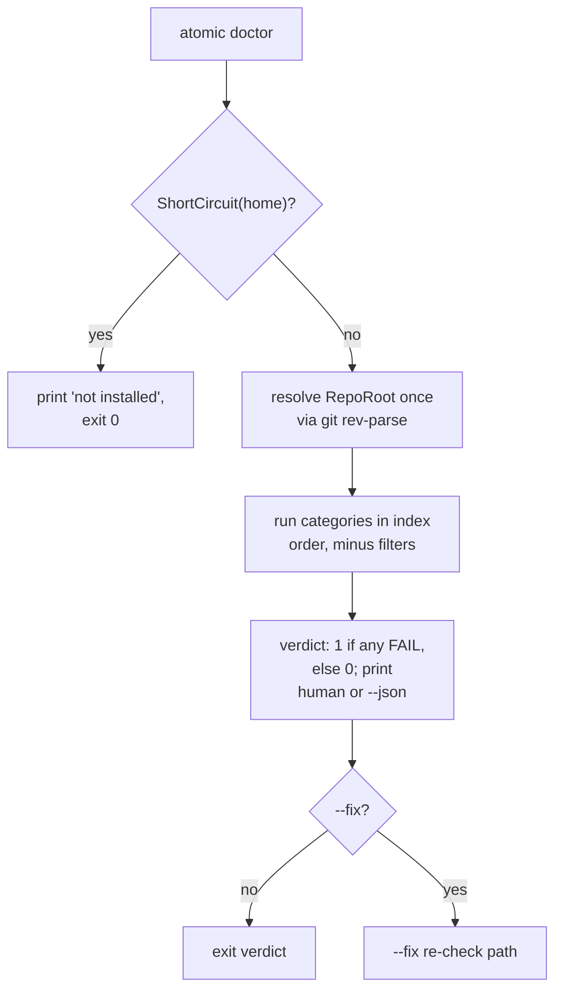
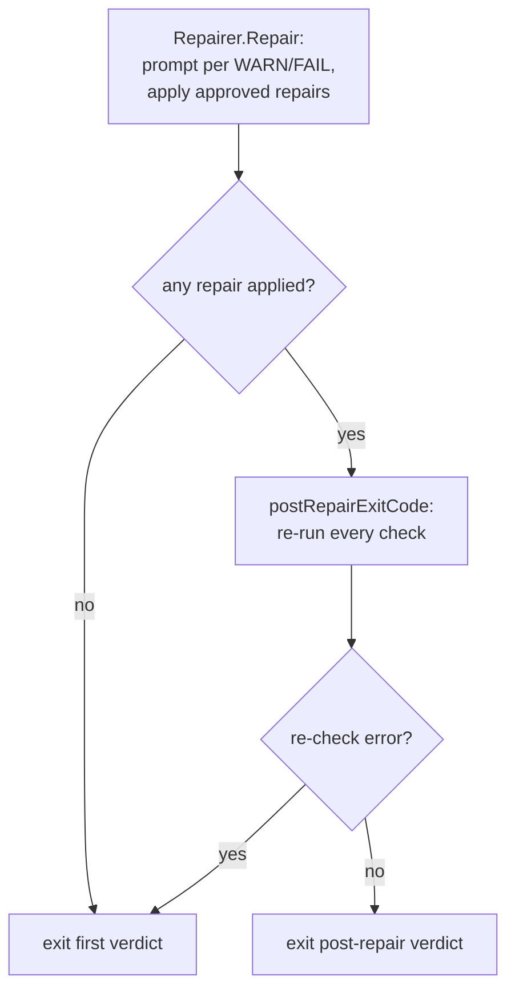
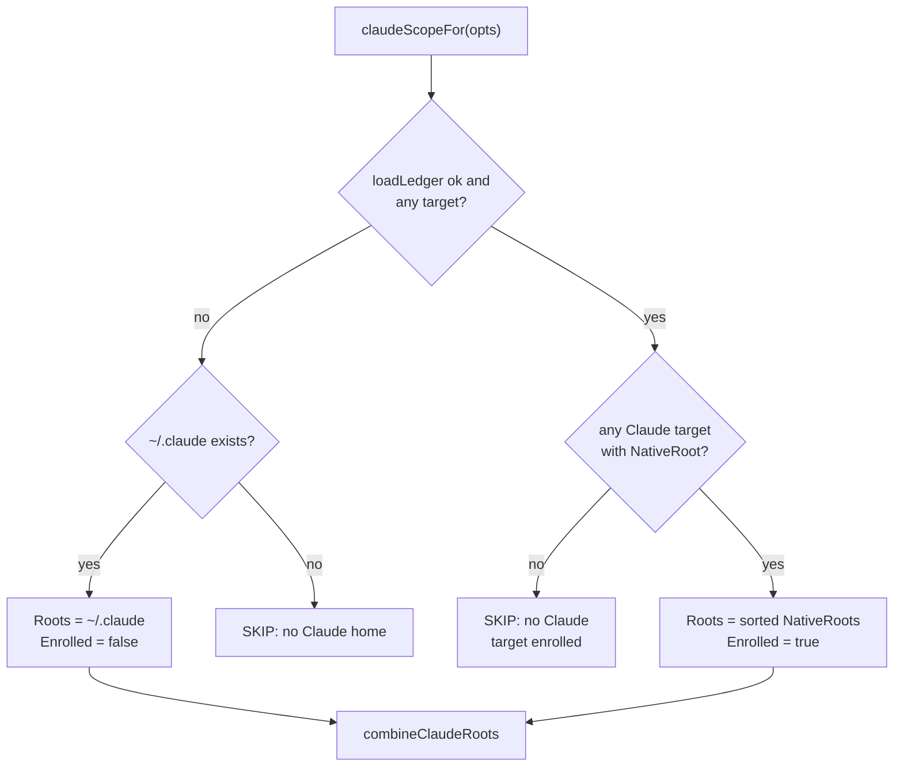
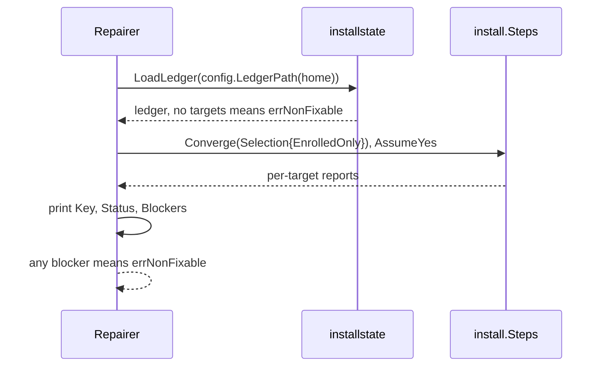

# doctor

## What it does

Most of what this system depends on fails quietly. An installed artifact drifts from the bundle, an `@`-ref goes missing so a session loses its project map, a spec loses the section a subagent reads. Nothing errors; the next run is just worse, and nobody knows why.

This domain makes those failures loud on demand. `atomic doctor` runs a fixed registry of checks over the installed Claude bundle, every harness target the install ledger (`~/.atomic/install/ledger.json`) enrolls, the user's `~/.atomic` state, and the current repo, then exits non-zero if any check FAILs. `atomic validate` is the static half: it lints spec structure, cross-reference integrity, bundle parity, CLI verb/flag citations in artifacts, and (in this repo only) the per-harness projections of the canonical corpus, with the same exit-code contract. Neither writes anything unless you pass `atomic doctor --fix`.

## How it works

The exit code is decided twice under `--fix`: once from the checks, then again after repairs, which is why a run can print a FAIL and still exit 0.

### The run and its first verdict

A plain run prints exactly what the checks found and exits on it; only an empty ledger with no `~/.claude` skips the checks entirely.



The category filters are `--only`, `--skip`, and the repo-dev-only gate. The printed report is always the pre-repair state.

`ShortCircuit` is true only when `~/.claude` is absent **and** `HasEnrolledTargets` finds nothing in the ledger. A ledger that cannot be read counts as enrolled, so the multi-harness categories run and report the read failure instead of doctor claiming nothing is installed.

### The `--fix` re-check

Under `--fix` the exit code reflects what the checks see after repairs, but only when a repair ran and the re-check itself succeeded.



### Where a Claude-scoped check looks

The ledger, not `~/.claude`, decides which Claude config directories the install, hooks, profile, output-style, and trust checks read, so a relocated or adopted Claude target is inspected where it lives and an OMP-only machine gets SKIP rather than a false finding.



`combineClaudeRoots` runs the per-root check once per root and merges: the worst severity wins, every root's detail is kept (prefixed with the root when there is more than one), and an enrolled scope sets `Result.Scopes`. A WARN or FAIL on an enrolled scope replaces the per-root remediation hint with `claudeConvergePlan`. For install, hooks, and output-style the printed hint matches what `--fix` runs. Profile also combines through `combineClaudeRoots` and so prints the converge hint, but `scopedRepair` excludes profile and `repairPlan` reports it non-fixable, so `--fix` never runs that converge.

### The check registry

Indices are stable and never renumbered.

| # | Name | File | Verifies | Fires as | `--fix` |
|---|------|------|----------|----------|---------|
| 1 | install | `checks_install.go` | Each embedded artifact against its installed copy in every Claude scope root, via `claudeinstall.Diff`. | FAIL if any missing, WARN if any drifted, SKIP if the target directory is absent or no Claude target is enrolled | `atomic claude install`; converge when `Scopes` is set |
| 2 | hooks | `checks_hooks.go` | Session-start hook registered in each Claude scope root's `settings.json` (`hooks.IsInstalledInDir`); legacy wrapper-script form reported as drift. | WARN, SKIP with no Claude scope | `atomic hooks install`; converge when `Scopes` is set |
| 3 | signals | `checks_signals.go` | Scan age against `--stale-days`, source-tree change since the scan, then router integrity: [`docs/wiki/index.md`](index.md) present, `@`-ref'd, every domain file in its table on disk, no orphan domain file. `index.md`, `scan.md`, and the steering pair [`CLAUDE.md`](../../CLAUDE.md)/`AGENTS.md` are never orphans. | WARN | no |
| 4 | refs | `checks_refs.go` | `@docs/wiki/index.md` present in one of the candidate names `claude.local.md`, `CLAUDE.local.md`, [`CLAUDE.md`](../../CLAUDE.md), [`claude.md`](../../claude.md). | FAIL | appends the ref block to a chosen candidate |
| 5 | manifest | `checks_manifest.go` | Bundle mirror regenerated from the working tree against the binary's embedded `Manifest()`. Repo-dev only. | FAIL | `make -C atomic bundle` |
| 6 | followups | `checks_followups.go` | Every entry's frontmatter parses, no entry past its `review_by`, `INDEX.md` byte-matches a fresh render. | WARN, SKIP when the folder is absent | INDEX drift only |
| 7 | memory | `checks_memory.go` | Every relative markdown link in this project's `MEMORY.md` resolves inside the memory dir. | WARN | no |
| 8 | binary | `checks_binary.go` | Running version against the latest release on the configured channel (`update.channel` in `~/.atomic/config.toml`, default `stable`), 5s timeout. On the `prerelease` channel, a tip that is not semver-newer is worded as available on that channel rather than misstated with `<`. A lookup error is WARN, never FAIL, so an offline machine does not break doctor. | WARN | no |
| 9 | config | `checks_config.go` | `~/.atomic/config.toml` parses, keys are known, values validate. Folds in a chronic background-update failure read from `~/.atomic/state.json`. | FAIL on parse error or invalid value, WARN on unknown key or chronic failure | no |
| 10 | profile | `checks_profile.go` | `~/.atomic/profile.md` exists and is readable; `@~/.atomic/profile.md` is wired in each Claude scope root's [`CLAUDE.md`](../../CLAUDE.md) family; its `lastcheck` stamp is under 30 days old; no candidate file still carries the legacy `@~/.claude/.atomic/profile.md` ref. | WARN, SKIP with no Claude scope | no |
| 11 | code-index | `checks_code_index.go` | Code-index DB mtime against `--stale-days`. At a wiki realm root, aggregates across every non-excluded member DB instead. | WARN; absence is an informational PASS | no |
| 12 | migrate | `checks_migrate.go` | Binary version against `[install].version`; and whether `~/.claude/.atomic` is still a real directory. | WARN | no |
| 13 | repo-config | `checks_repo_config.go` | `<root>/.claude/atomic.toml`: parses, keys known, `[code] ignore` globs valid, `scope` valid, `[repl] idle_timeout` parses. Dispatcher also flags `scope = "repo"` at a root the wiki registry lists as a realm: `wiki.RegisteredIndexPaths` reads `~/.atomic/wikis.md` and falls back to the installed `<wikis>` block only when that file is absent. | WARN; absence is an informational PASS | no |
| 14 | output-style | `checks_output_style.go` | User-level `outputStyle` key in each Claude scope root's `settings.json`: whether set, and to what value, never a computed effective style, since Claude Code's per-repo file-placement precedence isn't documented well enough to replicate. Appends a note to `Detail` when the repo's own `settings.json`/`settings.local.json` sets `outputStyle`, naming the file, as a possible override; skipped when `RepoRoot` is empty or the repo's own [`.claude`](../../.claude) dir resolves to the install target. | WARN when absent, or set to `"Atomic"` without the style file installed; SKIP with no Claude scope; PASS otherwise | for the not-installed / seeding-disabled qualifiers, message only (`outputStyleNonFixable`, decided before the scoped route); unqualified absence: converge when `Scopes` is set, otherwise `defaultOutputStyleRepair` -> `hooks.SeedOutputStyleInDir` |
| 15 | targets | `checks_targets.go` | Each enrolled target against read-only discovery: a target whose `NativeRoot` is absent, or that discovery does not report, is the defect. Project-keyed targets (empty `NativeRoot`) are never expected in discovery. | WARN | converge |
| 16 | resources | `checks_resources.go` | Every ledger-owned shared resource with its owner, consumers, and the unenrolled instances that can only see it. An owned resource with no consumer, or a consumer the ledger does not enroll, is the defect. | WARN | no |
| 17 | journals | `checks_journals.go` | Unfinished lifecycle journals, previewed with `installstate.SimulateRecoveries` (in memory, no lock, no write). Any unfinished journal WARNs; a conflicting one names its unit. | WARN; PASS when none | converge |
| 18 | capabilities | `checks_capabilities.go` | Each registered adapter's capability record, every role reported as supported, partial, or unproven. A role without a retained observation is never read as proven. | WARN when an adapter is unavailable or reports another harness's record | no |
| 19 | rules | `checks_rules.go` | Each enrolled target's rule surface from `RulesStatus`: tier, owned rule resources with applied and observed digests, uncovered rule-delivery roles. | WARN on a conflicting or missing rule resource | converge |
| 20 | trust | `checks_trust.go` | Session-start hook state per Claude scope root, each adapter's skill-disablement role, and the OMP runtime-disablement gap (`omp.RuntimeDisablementGap`). | WARN on an unreadable or drifted hook | no |
| 21 | staleness | `checks_staleness.go` | Every owned resource's state: behind the selected generation (`RowStale`), not on disk (`RowMissing`), or with no applied digest to compare (`RowUnverifiable`). | WARN | converge |
| 22 | conflicts | `checks_conflicts.go` | Owned resources whose native bytes match neither the recorded generation nor the selected projection (`RowConflict`), plus per-target blockers. | WARN | no |
| 23 | shadowing | `checks_shadowing.go` | The same observed digest delivered at two paths with one file name, and a native `AGENTS.md` beside a Claude target's projected [`CLAUDE.md`](../../CLAUDE.md). | WARN | no |
| 24 | codex | `checks_codex.go` | Every discovered or enrolled Codex home's native runtime surfaces, its native registration row, the disablement gap, and the unproven rule-delivery roles, each with its evidence. | PASS (report only); WARN only when status is unreadable | never: `cannot auto-fix — Codex native surfaces are reported, never repaired` |

Categories 11, 12, 13, 16, 18, 20, 22, and 23 have no `repairPlan` case, so `--fix` prints `cannot auto-fix — unknown category` for them rather than a category-specific line.

Categories 15 through 24 read lifecycle state through `statusCache`, which loads each of the install engine's `Status`, `RulesStatus`, adapter registry, and ledger at most once per run (`sync.Once`), so independent categories report one consistent observation. A load error renders as `multi-harness state unavailable: <err>` at WARN, with two exceptions. `checkJournals` (17) calls `installstate.SimulateRecoveries` directly, and its error reads `could not preview unfinished journals: <err>`. `checkTrust` (20) puts a `loadRegistry` error into its findings only (`harness registry unavailable: <err>`), so it can still PASS.

### How `--fix` picks a repair

`repairPlan` and `applyRepair` share their predicates, so the plan the user approves is the repair that runs.

```mermaid
flowchart TD
    %% source: atomic/internal/doctor/fix.go (repairPlan, applyRepair, scopedRepair, outputStyleNonFixable)
    A["WARN/FAIL Result"] --> B{"outputStyleNonFixable?"}
    B -->|yes| C["cannot auto-fix,<br/>message only"]
    B -->|no| D{"scopedRepair?<br/>Scopes set and install,<br/>hooks, or output-style"}
    D -->|yes| E["ConvergeFn"]
    D -->|no| F{"r.Name"}
    F -->|"targets, rules,<br/>staleness, journals"| E
    F -->|"install, hooks, refs,<br/>manifest, followups,<br/>output-style"| G["InstallFn, HooksFn,<br/>OutputStyleFn, and<br/>per-name helpers"]
    F -->|"signals, memory, binary,<br/>config, profile, codex"| C
    F -->|"no case"| U["cannot auto-fix —<br/>unknown category"]
```



The per-name helpers are `applyRefsRepair` for refs, `applyManifestRepairWithGuard` (which calls `ManifestFn`) for manifest, and `applyFollowupsRepair` (which calls `FollowupsRenderFn`) for followups. `followups` reaches its repair only for INDEX drift; any other followups finding is non-fixable.

The legacy verbs resolve their own default `~/.claude`, so on a relocated or adopted target they would write somewhere the check never inspected. The scoped route sends those results through the converge instead.

### The converge repair

`defaultConvergeRepair` in `fix_impls.go` delegates every ledger-managed repair to the install engine owned by the harness domain ([`docs/wiki/harness.md`](harness.md)), passing the consent the fix loop already collected.



The adapter behind `Converge` takes the advisory lifecycle lock (`~/.atomic/install/operation.lock`) and recovers unresolved journals oldest-first before planning. `AssumeYes` stops the planner from prompting a second time, because the per-item `Confirm` in the doctor loop is the consent. A blocked target counts as non-fixable, not fixed.

### The static lint

`atomic validate` takes a mode, or runs every mode when given none:

```
atomic validate                    -> spec + config + [bundle, repo-dev only] + artifacts + [projections, repo-dev only]
atomic validate spec [paths...]    -> S0 S1 S5 S6 over docs/spec/*.md
atomic validate config             -> C3 C5 C7 C9, whole-repo only
atomic validate bundle             -> manifest parity
atomic validate artifacts [paths]  -> A1 over the artifacts.Load catalog
atomic validate projections        -> P0-P6 over the canonical corpus, whole-repo only
atomic validate <path>...          -> routes docs/spec/*.md to the spec rules, WARNs on anything else
```

`RunWithOutput` parses the whole argv once with `cliutil.ParseInterspersed`, so `--json` and `--suggest` are honored before or after the subcommand and its paths, and `-h` on a subcommand prints usage and exits 0. The first positional picks the mode and the rest are its paths. `config`, `bundle`, and `projections` take no paths: a path given to any of them is reported through `cliutil.UnexpectedArgs` (`atomic validate config: unexpected argument(s): [...]` plus usage) and exits 2 before any validator runs.

| Rule | Mode | Checks | Severity |
|------|------|--------|----------|
| S0 | spec | ATX headings only. A Setext heading stops S1/S5/S6 for that file, because section parsing is unreliable past it. | FAIL |
| S1 | spec | File starts with `# <title>` at line 1. | FAIL |
| S5 | spec | A `## Checkpoints` section whose table header carries `#`, `Checkpoint`, `Files/areas`, `Verifies` as an ordered subsequence. Extra columns are allowed. | FAIL |
| S6 | spec | A `## Change log` section exists. Body may be empty. | FAIL |
| C3 | config | Every `subagent_type: "name"` in `context/commands/*.md` prose resolves to `context/agents/<name>.md`, or is one of the built-ins `general-purpose`, `Explore`, `Plan`. | FAIL |
| C5 | config | Every `@`-ref in the authored global contract [`context/AGENTS.md`](../../context/AGENTS.md) (`bundlespec.GlobalSteering.Source`, which installs as Claude's [`CLAUDE.md`](../../CLAUDE.md)) resolves to a file. | FAIL |
| C7 | config | No duplicate `name:` across `context/agents/*.md` frontmatter. | FAIL |
| C9 | config | [`context/agents/`](../../context/agents), [`context/skills/`](../../context/skills), [`context/output-styles/`](../../context/output-styles) entries carry the [`atomic`](../../atomic) prefix. Without it they never bundle. | WARN |
| A1 | artifacts | Every `atomic <verb>` path cited in an artifact's code spans and code blocks (fenced or indented, including under list items) is a command or namespace in the `cliusage` surface, and every `--flag` beside a resolved verb exists on it. | FAIL |
| bundle | bundle | Generated mirror against the binary's embedded `Manifest()`. Capped at 5 findings plus an overflow line. | FAIL |
| P0 | projections | An adapter could not render an artifact at all; the finding names the artifact and the reason instead of skipping it. | FAIL |
| P1 | projections | Every declared `Semantics.Requires` dependency resolves to an artifact ID in the corpus. | FAIL |
| P2 | projections | Canonical IDs are unique and every projection carries its own artifact's ID. | FAIL |
| P3 | projections | No user-policy metadata key (model, effort, tool policy) leaks into projected native metadata. | FAIL; WARN when the metadata cannot be parsed |
| P4 | projections | Rendering twice is byte-identical, and the digest matches `artifacts.ProjectionDigest` of the bytes. | FAIL |
| P5 | projections | No projection claims an enforcement tier stronger than every capability role it stands on proves; dropped artifacts are reported. | FAIL |
| P6 | projections | No unclassified Claude-only wire token reaches a non-Claude target's projected bytes. | FAIL |

The projection gate audits each artifact's projection against the capability records. Agents and skills render through the real Claude, OMP, and Codex adapters. Rules project for Claude and OMP only. Commands render through `commandProjection`, local to `projection.go`, for Claude only (`checkCommands`). A P finding means the corpus, an adapter, or that command projection broke a projection invariant.

## Where it lives

### Orchestration

| Path | Role |
|------|------|
| [`atomic/internal/doctor/doctor.go`](../../atomic/internal/doctor/doctor.go) | Category registry (`categories`, `Categories()`), `Run` / `RunWith`, `--only`/`--skip`/repo-dev filtering. Resolves `Opts.RepoRoot` once per run and seeds the per-run `statusCache`. `Result.Scopes` carries the enrolled roots a result covers; `Opts.Home` is the home the lifecycle state lives under. |
| [`atomic/internal/doctor/flags.go`](../../atomic/internal/doctor/flags.go) | Parses `--fix --json --only --skip --stale-days --verbose`. Accepts category indices or names. |
| [`atomic/internal/doctor/exit.go`](../../atomic/internal/doctor/exit.go) | `ExitCode`: 1 if any result is FAIL, else 0. WARN and SKIP never fail the run. |
| [`atomic/internal/doctor/format.go`](../../atomic/internal/doctor/format.go) | `FormatHuman`, `FormatJSON`, `FormatJSONMissingHome`, and `FormatResultLine` (shared with `updatedoctor`). |
| [`atomic/internal/doctor/fix.go`](../../atomic/internal/doctor/fix.go) | `Repairer` with injectable repair funcs (`ConvergeFn` among them), `repairPlan` (the per-category fixability table), `scopedRepair`, `outputStyleNonFixable`, `claudeConvergePlan`, the interactive y/N/a/q loop, `RepairSummary`. |
| [`atomic/internal/doctor/fix_impls.go`](../../atomic/internal/doctor/fix_impls.go) | Production repair implementations, including `defaultConvergeRepair` and its `convergeStepsFn` test seam. Streams subprocess output straight to the writer, no buffering. |
| [`atomic/internal/doctor/stdin_prompter.go`](../../atomic/internal/doctor/stdin_prompter.go) | `Prompter` implementation. Maps `prompt.ErrAborted` to `DecisionAbort`, `prompt.ErrNonInteractive` to `DecisionSkip`. |
| [`atomic/internal/doctor/shortcircuit.go`](../../atomic/internal/doctor/shortcircuit.go) | `ShortCircuit` (`ClaudeHomeMissing && !HasEnrolledTargets`), `claudeScopeFor`, `combineClaudeRoots`, `severityRank`, plus the canonical message ``"atomic-claude not installed; run `atomic claude install`."`` |
| [`atomic/internal/doctor/checks_multiharness.go`](../../atomic/internal/doctor/checks_multiharness.go) | `statusCache` and its loaders (`loadStatus`, `loadRules`, `loadRegistry`, `loadLedger`), the `statusStepsFn` test seam, and the shared `unavailability` / `resultFor` result builders for categories 15 through 24. |
| [`atomic/internal/doctor/repodev.go`](../../atomic/internal/doctor/repodev.go) | `IsRepoDev` / `gitToplevelFn`. Repo-dev marker is [`atomic/internal/bundlemirror/mirror.go`](../../atomic/internal/bundlemirror/mirror.go). |
| [`atomic/internal/doctor/inode_unix.go`](../../atomic/internal/doctor/inode_unix.go) | Inode comparison, so a case-insensitive filesystem does not report [`CLAUDE.md`](../../CLAUDE.md) and [`claude.md`](../../claude.md) as distinct files. |

### Static lint

| Path | Role |
|------|------|
| [`atomic/internal/validate/validate.go`](../../atomic/internal/validate/validate.go) | Flag parse (`cliutil.ParseInterspersed`, flags in any position) and subcommand dispatch; rejects paths on `config`, `bundle`, and `projections`. Exit 0 pass or warn, 1 any FAIL, 2 bad invocation, stray argument, or internal error. |
| [`atomic/internal/validate/spec.go`](../../atomic/internal/validate/spec.go) | `RunSpecRules(path, src)` — pure, no filesystem access. |
| [`atomic/internal/validate/config.go`](../../atomic/internal/validate/config.go) | `RunConfigRules(repoRoot)`, the `reAtRef` / `reSubagentType` grammars, and `isEmailLocalChar`. |
| [`atomic/internal/validate/artifacts.go`](../../atomic/internal/validate/artifacts.go) | A1: code-span extraction, `longestMatch` verb-path resolution, flag comparison. `ScanArtifactText` is the pure seam. The corpus is `artifacts.Load(repoRoot).Artifacts`, read at each artifact's `Source`. |
| [`atomic/internal/validate/projection.go`](../../atomic/internal/validate/projection.go) | P0-P6: `RunProjectionRules`, the `projGate` audit per adapter, `runProjectionsAt` (repo-dev gate) and `runProjectionsCollect` (for the bare form). |
| [`atomic/internal/validate/bundle.go`](../../atomic/internal/validate/bundle.go) | Wraps `manifestcheck.Compare` into findings. |
| [`atomic/internal/validate/dispatch.go`](../../atomic/internal/validate/dispatch.go) | Path-aware routing and `runWholeRepo`. |
| [`atomic/internal/validate/finding.go`](../../atomic/internal/validate/finding.go) | `Finding`, deterministic sort by (path, line, rule), `summarize`, `exitCode`. |
| [`atomic/internal/validate/output.go`](../../atomic/internal/validate/output.go) | Human and JSON formatters. JSON envelope is `schema_version: 1`. `--suggest` templates exist for S5 and S6 only. |

### Supporting packages

| Path | Role |
|------|------|
| [`atomic/internal/cliusage/`](../../atomic/internal/cliusage) | The [`atomic`](../../atomic) command surface as structured data. `SetRoot` derives it from the live Cobra tree; `TopLevelVerbs` and `LookupByPath` serve A1. |
| [`atomic/internal/mdparse/`](../../atomic/internal/mdparse) | Goldmark-backed markdown reads shared by the validators. `InlineRefs` and `CodeBlockLines` (fenced and indented blocks, list- and blockquote-nested included, each line tagged with its fence language so A1 can skip `mermaid`) feed A1's citation extraction; `Sections`, `IsATXOnly`, and the table finders serve the spec rules. |
| [`atomic/internal/manifestcheck/`](../../atomic/internal/manifestcheck) | `Compare(repoRoot, committed)` — walks the tree with `bundlemirror.Enumerate` and diffs SHA256 against the binary's embedded `Manifest()`. Writes nothing, spawns nothing. Used by check 5 and by `validate bundle`. |
| [`atomic/internal/updatedoctor/`](../../atomic/internal/updatedoctor) | Post-update adapter. Calls `doctor.Run(Opts{Skip: []int{3, 8}})`, prints FAIL lines only, recovers panics, never changes the update exit code. |
| [`atomic/internal/profile/`](../../atomic/internal/profile) | Detection registry and `DetectAll`, `RenderEnvironmentSection`, `Refresh` / `RefreshIfStale`, `ParseLastcheck` / `IsStale`. Check 10 reads it; `claudeinstall` and the session-start hook write through it. `conflict.go` holds `DetectNativeConflict`, which reports a harness-native profile copy whose bytes differ from `~/.atomic/profile.md` and writes neither file; the Claude adapter's adoption path ([`atomic/internal/harness/claude/migration.go`](../../atomic/internal/harness/claude/migration.go)) calls it. |
| [`atomic/internal/followups/`](../../atomic/internal/followups) | `LoadEntriesWithErrors` is check 6's parse boundary; `Render` is what the INDEX byte-comparison compares against. |

### Docs

| Path | Role |
|------|------|
| [`docs/spec/atomic-doctor.md`](../spec/atomic-doctor.md) | Canonical contract: every check category, fix functions, exit codes, `--fix` behavior, the conditional short-circuit, and the converge repair. |
| [`docs/design/atomic-doctor.md`](../design/atomic-doctor.md) | Design rationale for the check-registry architecture. |
| [`docs/spec/atomic-validate.md`](../spec/atomic-validate.md) | `atomic validate` contract: the S, C, A, and P rule sets and their severities. |
| [`docs/design/atomic-validate.md`](../design/atomic-validate.md) | Design rationale for the validate subcommand. |
| [`docs/spec/validate-artifact-cli-flags.md`](../spec/validate-artifact-cli-flags.md) | A1 contract: the `cliusage` surface, scanner rules, known scope limits. Design at [`docs/design/validate-artifact-cli-flags.md`](../design/validate-artifact-cli-flags.md). |
| [`docs/spec/verify-gate-validate.md`](../spec/verify-gate-validate.md) | How the `atomic-verify` skill gates on validate output. Design at [`docs/design/verify-gate-validate.md`](../design/verify-gate-validate.md). |
| [`docs/spec/atomic-update-doctor.md`](../spec/atomic-update-doctor.md) | Post-update auto-fire contract: skip set `[3, 8]`, panic recovery, exit-code preservation, artifact auto-refresh. |
| [`docs/spec/user-profile.md`](../spec/user-profile.md) | Profile schema, the `<stable>`/`<volatile>`/`<deterministic>` tags, install-time stub generation. Design at [`docs/design/user-profile.md`](../design/user-profile.md). |
| [`docs/spec/scope-marker.md`](../spec/scope-marker.md) | Config-domain spec. Cross-listed for check 13's `scope` validation and the `<wikis>` contradiction sub-check. |

## Constraints

- **`--fix` exits on the post-repair state, not the one it printed.** `postRepairExitCode` in [`atomic/cmd/atomic/cmd_doctor.go`](../../atomic/cmd/atomic/cmd_doctor.go) re-runs every check after the repair pass, so CI can gate on `atomic doctor --fix` in one run. The second pass is skipped when no repair was applied, and a re-check that errors keeps the pre-repair verdict rather than reporting health nobody observed. The printed report always reflects the state before repairs.
- **`--fix` and `--json` are mutually exclusive**, rejected at flag-parse time with exit 2. So are a non-positive `--stale-days` and an unknown `--only`/`--skip` token.
- **A missing `~/.claude` short-circuits the whole run only when the ledger enrolls nothing.** Then it prints ``atomic-claude not installed; run `atomic claude install`.`` and exits 0 without running a single check. A green doctor is not proof of a healthy install; it can mean no install at all. With any enrolled target (an OMP-only home included), or an unreadable ledger, every category runs and the Claude-scoped ones SKIP.
- **Claude-scoped checks read `~/.claude` only when the ledger is missing, empty, or unreadable.** `claudeScopeFor` falls back to the legacy root on `err != nil || len(ledger.Targets) == 0`. Otherwise checks 1, 2, 10, 14, and the hook leg of 20 read only the `NativeRoot` of each enrolled Claude target, and a ledger with no Claude target makes them SKIP even if `~/.claude` exists. An unreadable ledger is read two ways: `ShortCircuit` treats it as enrolled, so the run proceeds, while the Claude-scoped checks treat it as not enrolled and inspect `~/.claude`.
- **A scoped result never repairs through a legacy verb.** `atomic claude install`, `atomic hooks install`, and the output-style seed resolve their own default root, so on an enrolled result `--fix` converges instead.
- **Most multi-harness categories report and never repair.** Of categories 15 through 24, only `targets`, `journals`, `rules`, and `staleness` converge. `codex` refuses by name, and the rest fall through to `cannot auto-fix — unknown category`. A conflict or a shadowing native copy is never overwritten by `--fix`.
- **`codex` is PASS even with every surface unproven.** It passes no problem lines to `resultFor`, so its findings appear only under `--verbose`.
- **Repo-dev-only checks vanish outside this repo.** Check 5 is omitted entirely, not even reported as SKIP, unless you ask for it with `--only 5`. Same for `validate bundle` and `validate projections` inside a bare `atomic validate`; explicit `atomic validate projections` outside this repo prints `SKIP — not in atomic-claude repo (no canonical corpus to render)` and exits 0. Users running in their own projects never see bundle noise.
- **One git subprocess per run.** `Run` resolves `Opts.RepoRoot` once and every check reads that field. A new check that shells out to `git rev-parse` on its own breaks the invariant pinned by `gitcallcount_internal_test.go`.
- **`validate`'s PASS is a count of inspected files with no finding.** A file with any WARN or FAIL is not a PASS, and the bare-form aggregate is the sum of the groups. The unit differs per group: spec counts each `docs/spec/*.md` read; config counts the files C3, C5, and C7 read (commands, [`context/AGENTS.md`](../../context/AGENTS.md), agents), not the skills/ and output-styles/ entries C9 only names; artifacts counts each scanned artifact; bundle counts compared manifest entries, taken before the five-diff cap so a hidden diff never counts; projections counts each canonical artifact in the `artifacts.Load` catalog. Path dispatch counts only spec paths, so a path with no validator is never a PASS.
- **A check can combine independent findings into one Result.** Check 9 appends a chronic update-failure detail to whatever the config-validity leg found, capped at WARN on its own. Check 12 concatenates version drift and legacy-state-dir details and takes the worse severity. Check 14 appends a project-override note to whatever the user-level leg found, without changing the severity. Reading only the severity loses half the signal; read `Detail`.
- **C5 scans [`context/AGENTS.md`](../../context/AGENTS.md) only** (the bundle source that installs as every user's global contract), not the project-local root [`CLAUDE.md`](../../CLAUDE.md). The local overlays are deliberately excluded: they are user-owned and routinely contain backtick spans that look like `@`-refs, such as scoped npm package paths. C5 also skips any `@` preceded by an email local-part character, since RE2 has no lookbehind and `reAtRef` is loose on the right of the `@`.
- **A1 does not check flags on an unresolved citation.** A namespace reference (`atomic code`) or an alternation (`atomic code index|sync`) passes with whatever flags follow it. Prose inside a non-`mermaid` fence is read as code, so a file-tree line that puts a prose word after a namespace such as `code` FAILs. Citation boundaries and placeholders: [`docs/spec/validate-artifact-cli-flags.md`](../spec/validate-artifact-cli-flags.md).
- **`cliusage`'s hardcoded slice is a fixture, not the runtime source.** `main` calls `SetRoot(rootCmd)` at startup, so production reads the live Cobra tree. Tests that never call `SetRoot` read the static slice, which is why the golden test is the thing keeping A1 honest.

## Coupling

**bundle.** Check 1, check 5, `validate bundle`, A1, the projection gate, and check 14 all read bundle-domain inclusion rules. Check 1 uses `claudeinstall.Diff`; check 5 and `validate bundle` both go through `manifestcheck.Compare`, which calls `bundlemirror.Enumerate`; A1 and the projection gate both read the `artifacts.Load` catalog; C5 reads `bundlespec.GlobalSteering.Source`; check 14 uses `hooks.StyleInstalled` to confirm `output-styles/atomic.md` landed in each scope root, and its unscoped repair still locates the target with `claudeinstall.ResolveTarget`. Change what bundles and these surfaces change with it.

**harness.** The install ledger, discovery, and the converge planner belong to [`docs/wiki/harness.md`](harness.md). Doctor reads them through `installstate.LoadLedger`, `installstate.SimulateRecoveries`, `install.DefaultSteps(home).Status` / `.RulesStatus`, `install.DefaultRegistry`, and the `codex` and `omp` adapters' read-only gap reporters, and repairs through `install.Steps.Converge`. A change to `harness.ResourceStatus` states (`RowStale`, `RowMissing`, `RowConflict`, `RowUnverifiable`) or to the ledger's `Harness` / `NativeRoot` fields changes what these categories report. The projection gate renders through the same adapters and capability records.

**signals and wiki.** Checks 3 and 4 own the `@docs/wiki/index.md` contract. `signalsRef` in `checks_refs.go` and `routerRef` in `checks_signals.go` are the constants; the signals domain's wiring convention must move with them. Check 3 additionally parses the router's Domains table, so a change to that table's shape breaks orphan and missing-file detection. Check 13's contradiction sub-check calls `wiki.RegisteredIndexPaths`.

**config.** Check 9 validates the user schema through `config.Load` and `config.Validate`; check 13 validates the repo schema through `config.LoadRepoConfig`, `config.NewIgnoreMatcher`, and `config.ValidScope`; check 10 resolves paths through `config.ProfilePath`; check 12 detects whether `config.MigrateUserState` completed; check 14 reads `output_style.seed` through `hooks.SeedEnabled`, which calls `config.Load` in turn. A new config key is not covered until one of these learns about it.

**config (`cliutil`).** `validate.go` parses through `cliutil.ParseInterspersed` and reports stray paths through `cliutil.UnexpectedArgs`, both in [`atomic/internal/cliutil/args.go`](../../atomic/internal/cliutil/args.go). The trailing-flag grammar is shared with `atomic code` and `atomic serve`; its contract is [`docs/spec/cli-trailing-flags.md`](../spec/cli-trailing-flags.md).

**repl.** Checks 9 and 13 both call `config.ValidateIdleTimeout`, the same validator `atomic repl` uses at spawn time, so an invalid `[repl] idle_timeout` surfaces in doctor before a session silently falls through a tier.

**code-intel.** Check 11 locates the DB with `engine.IndexPath` and detects realm scope with `realm.Resolve` / `realm.LoadConfig`. If the engine's index-path convention changes, this check breaks silently.

**workflow.** The `atomic-verify` skill is the consumer that matters: it runs `atomic validate spec` + `config` + `artifacts` when a spec or bundled artifact changed, and treats a FAIL as a gate failure equal to a failing test. `/subagent-implementation` and `/autopilot` invoke that gate at their finish line. `/retrospective-learning` runs `atomic doctor --json --skip signals,binary` and `atomic validate --json` into its scratchpad, each with stderr discarded and `|| true`, then turns every doctor `FAIL`/`WARN` and every validate `FAIL` into a candidate finding. These artifacts call the binary unconditionally; none checks whether it is installed.

**Lockstep contracts.**

| Change | Must change with it |
|--------|---------------------|
| Add or renumber a doctor category | `updatedoctor.go`'s hardcoded skip set `[3, 8]` |
| Add a doctor category | Nothing forces it: without a `repairPlan` case in `fix.go`, `--fix` prints `cannot auto-fix — unknown category` for it. Add a case to give it a repair or a category-specific message |
| Add a Claude-scoped check | Read roots through `claudeScopeFor` and merge with `combineClaudeRoots`; add its name to `scopedRepair` if a legacy verb repairs it |
| Register or remove a Cobra flag | `TestDeriveCommandsGolden` in [`atomic/cmd/atomic/main_test.go`](../../atomic/cmd/atomic/main_test.go), which pins the derived surface against the hardcoded `cliusage` slice, and therefore what A1 accepts |
| `FormatResultLine` output shape | Both `FormatHuman` and `updatedoctor`'s FAIL-only lines |
