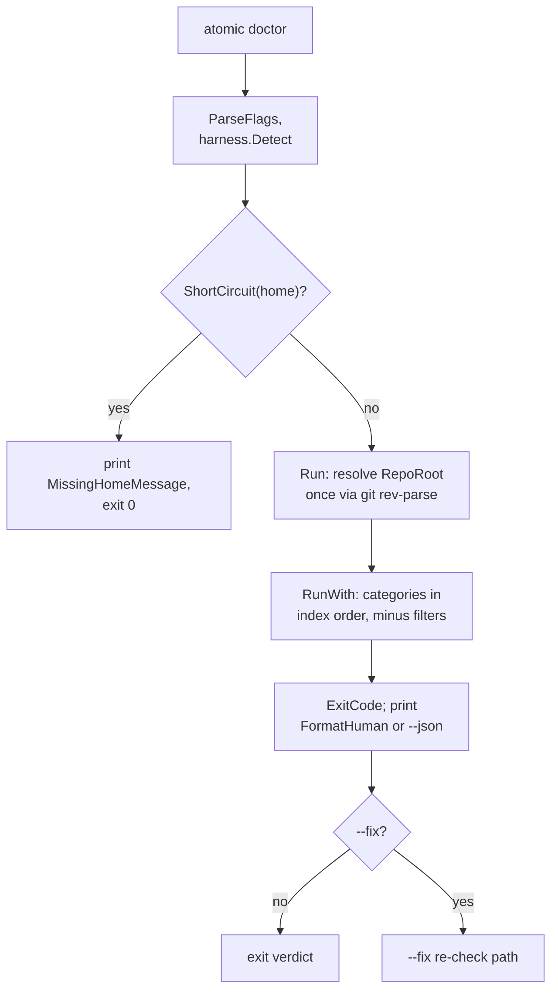
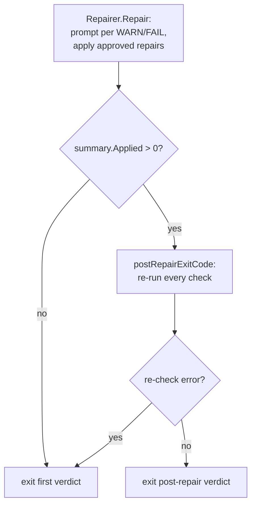
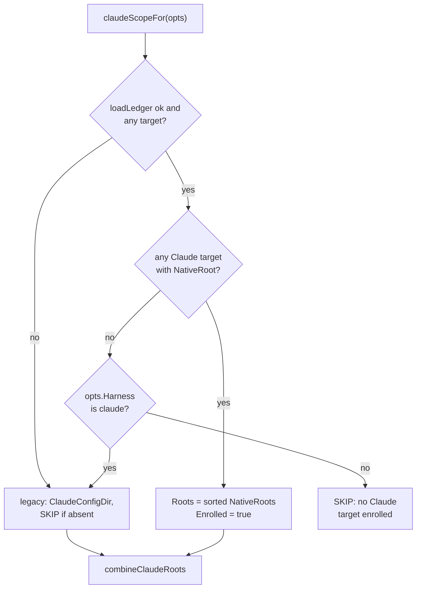
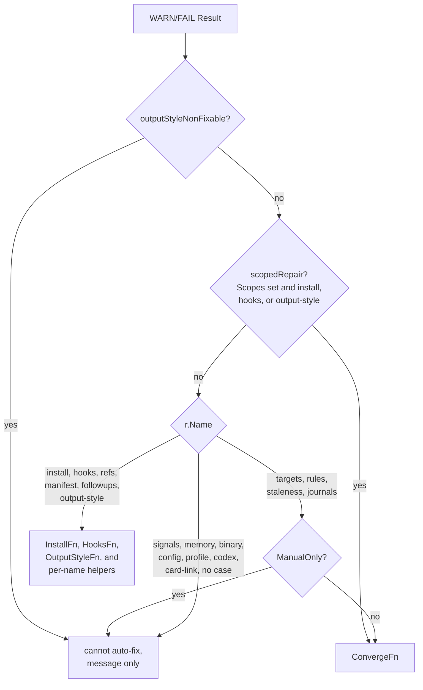
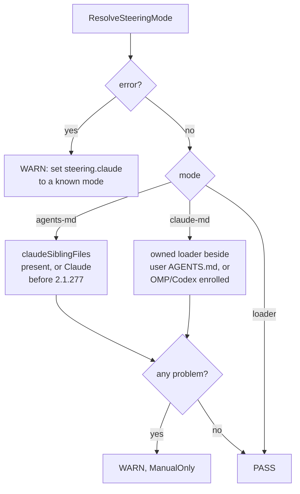
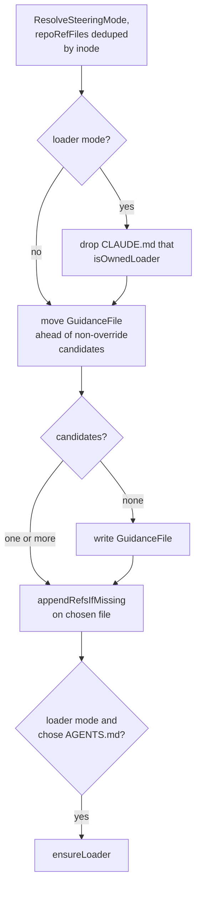
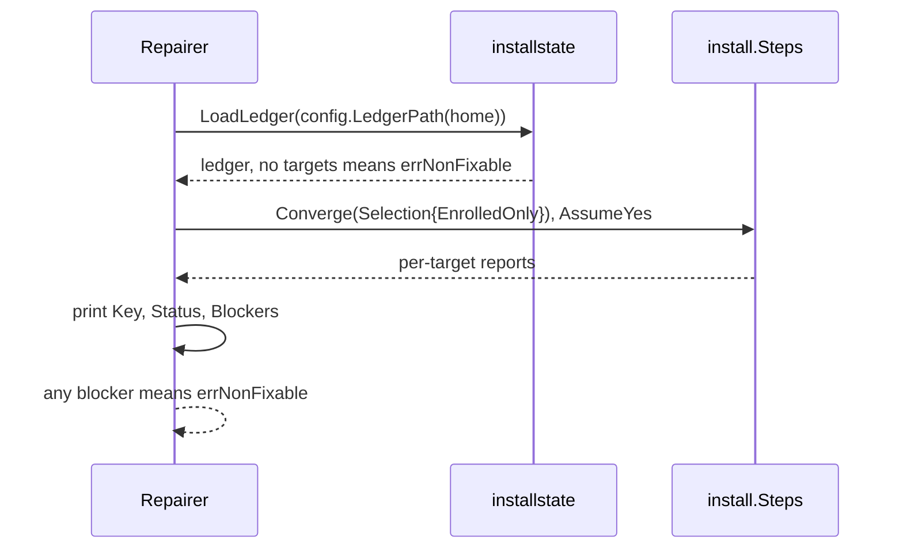
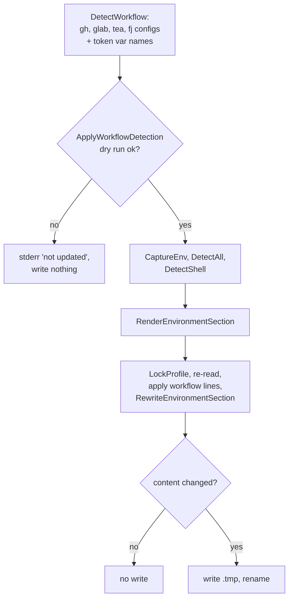
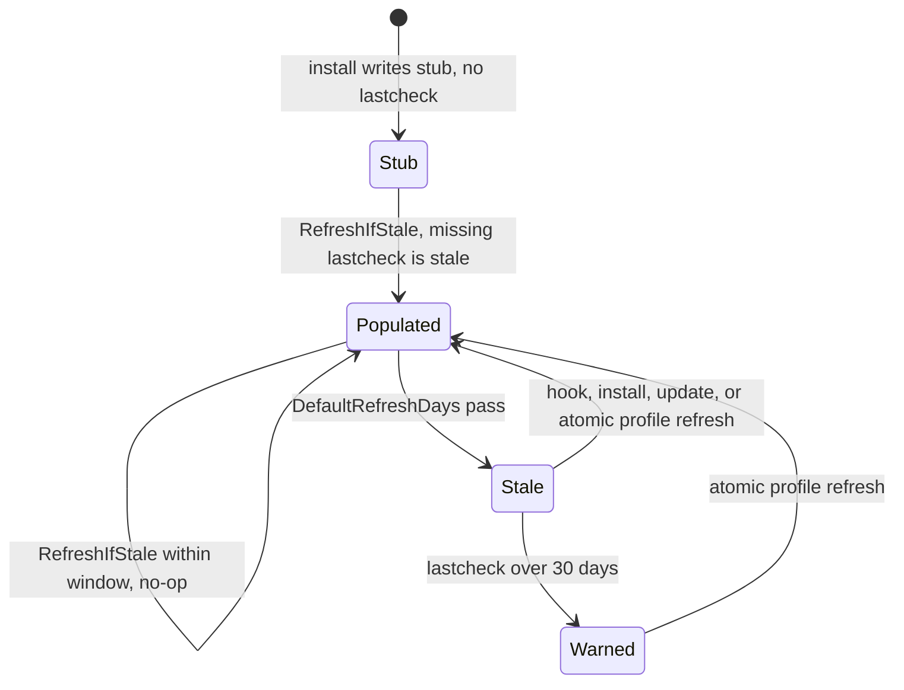

# doctor

## What it does

Most of what this system depends on fails quietly. An installed artifact drifts from the bundle, an `@`-ref goes missing so a session loses its project map, a projected skill leaks a Claude-only token into an OMP install, a repo's steering mode leaves a [`CLAUDE.md`](../../CLAUDE.md) beside the `AGENTS.md` Claude was meant to read, a spec loses the section a subagent reads. Nothing errors; the next run is worse, and nobody knows why.

This domain makes those failures loud on demand. `atomic doctor` runs a fixed registry of check categories over every Claude config directory the install ledger (`~/.atomic/install/ledger.json`) enrolls, every other enrolled harness target, the user's `~/.atomic` state, and the current repo, then exits non-zero if any category FAILs. `atomic validate` is the static half: it lints spec structure, cross-reference integrity, CLI verb and flag citations in artifacts, and (in this repo only) bundle parity and the per-harness projections of the canonical corpus, with the same exit-code contract. Neither writes anything unless you pass `atomic doctor --fix`.

The domain also owns the user profile at `~/.atomic/profile.md`: `atomic profile refresh` rewrites its `## Environment` block and its detected workflow-preference lines, and doctor category 10 checks that it exists, is wired, and is fresh. The name "doctor" covers all three because each is a read-mostly health surface over state other domains write.

## How it works

The exit code is decided twice under `--fix`: once from the checks, then again after repairs, which is why a run can print a FAIL and still exit 0.

### The run and its first verdict

A plain run prints what the checks found and exits on it; only a machine with no Claude home and an empty ledger skips the checks entirely.



The category filters are `--only`, `--skip`, and the repo-dev-only gate. The printed report is always the pre-repair state.

`ShortCircuit` is true only when the Claude home (`config.ClaudeConfigDir`, which honors `CLAUDE_CONFIG_DIR`) is absent **and** `HasEnrolledTargets` finds nothing in the ledger. A ledger that cannot be read counts as enrolled, so the harness categories run and report the read failure. `MissingHomeMessage` words the exit for the detected harness: OMP and Codex sessions get ``atomic not installed for <kind>; run `atomic install --harness <kind>`.``, everything else the Claude message.

### The `--fix` re-check

Under `--fix` the exit code reflects what the checks see after repairs, but only when a repair ran and the re-check itself succeeded.



The prompt per item is `apply? [y/N/a/q]: `. `NewStdinPrompter` asks through the `prompt` package first. Ctrl+C (`prompt.ErrAborted`) becomes `DecisionAbort` and stops the loop. On `prompt.ErrNonInteractive` it prints the prompt and reads one line from stdin, so a piped `y` or `a` still answers; empty or unrecognized input is No.

### Where a Claude-scoped check looks

The ledger, not `~/.claude`, decides which Claude config directories the install, hooks, profile, output-style, and trust checks read, so a relocated or adopted Claude target is inspected where it lives and an OMP-only machine gets SKIP rather than a false finding.



`combineClaudeRoots` runs the per-root check once per root and merges: the worst severity wins, every root's detail is kept (prefixed with the root when there is more than one), and an enrolled scope sets `Result.Scopes`. A WARN or FAIL on an enrolled scope replaces the per-root remediation hint with `claudeConvergePlan` (``converge the enrolled Claude target via `atomic harness repair --all --yes` ``). For install, hooks, and output-style the printed hint matches what `--fix` runs. Profile also combines through `combineClaudeRoots` and so prints the converge hint, but `scopedRepair` excludes profile and `repairPlan` reports it non-fixable, so `--fix` never runs that converge.

The memory check (7) is not Claude-scoped this way: it resolves `~/.claude` through `claudeinstall.ResolveTarget` and reads `projects/<slug>/memory/MEMORY.md` there.

### The check registry

Indices are stable: categories are only appended, never renumbered. `<state-root>` is the repo's state directory from `config.RepositoryStateDir`, [`.atomic`](../../.atomic) by default.

| # | Name | File | Verifies | Fires as | `--fix` |
|---|------|------|----------|----------|---------|
| 1 | install | `checks_install.go` | Each embedded artifact against its installed copy in every Claude scope root, via `claudeinstall.Diff`. A differing file the ledger records as deliberately left (`ledger.IsLeft`) is not drift. | FAIL if any missing, WARN if any drifted, SKIP if the target directory is absent or no Claude target is enrolled | `atomic claude install`; converge when `Scopes` is set |
| 2 | hooks | `checks_hooks.go` | Session-start hook registered in each Claude scope root's `settings.json` (`hooks.IsInstalledInDir`); the legacy wrapper-script form is reported as drift. | WARN; SKIP with no Claude scope | `atomic hooks install`; converge when `Scopes` is set |
| 3 | signals | `checks_signals.go` | Scan age against `--stale-days`, source-tree change since the scan (`signals.Stale`), then router integrity: [`docs/wiki/index.md`](index.md) present, `@`-ref'd in a loaded steering file, every domain file in its Domains table on disk, no orphan domain file. `index.md`, `scan.md`, [`CLAUDE.md`](../../CLAUDE.md), and `AGENTS.md` are never orphans. | WARN | no |
| 4 | refs | `checks_refs.go` | `@docs/wiki/index.md` present in the first of `claude.local.md`, `CLAUDE.local.md`, `AGENTS.md`, [`CLAUDE.md`](../../CLAUDE.md), [`claude.md`](../../claude.md) that carries it and that Claude loads. `AGENTS.md` counts only when `bundlespec.ScopeSteering.LoaderWithoutImport` finds no loader missing its import. | FAIL | appends the `## Project wiki (auto-loaded)` ref block to a candidate chosen by steering mode (see below) |
| 5 | manifest | `checks_manifest.go` | Bundle mirror regenerated from the working tree against the binary's embedded `Manifest()`. Repo-dev only. | FAIL | `make -C atomic bundle` |
| 6 | followups | `checks_followups.go` | Under `config.FollowupsDir`: every entry's frontmatter parses, no entry past its `review_by`, `INDEX.md` byte-matches a fresh render. | WARN; SKIP when the folder is absent | INDEX drift only |
| 7 | memory | `checks_memory.go` | Every relative markdown link in this project's `MEMORY.md` resolves inside the memory dir. | WARN; PASS with no memory file | no |
| 8 | binary | `checks_binary.go` | Running version against the latest release on the configured channel (`update.channel` in `~/.atomic/config.toml`, default `stable`), 5s timeout. On the `prerelease` channel, a tip that is not semver-newer is worded as available on that channel rather than misstated with `<`. A lookup error is WARN, so an offline machine does not break doctor. | WARN | no |
| 9 | config | `checks_config.go` | `~/.atomic/config.toml` parses, values validate, keys are known. Also reports stored per-harness agent overrides that would not take effect (harness not enrolled, or OMP/Codex agent delivery still unproven), Claude env vars that mask them (`CLAUDE_CODE_EFFORT_LEVEL`, `CLAUDE_CODE_SUBAGENT_MODEL`), and a chronic background-update failure read from `~/.atomic/state.json`. | FAIL on parse error or invalid value; WARN otherwise | no |
| 10 | profile | `checks_profile.go` | `~/.atomic/profile.md` exists and is readable; `@~/.atomic/profile.md` is wired in each Claude scope root's [`CLAUDE.md`](../../CLAUDE.md) family; its `lastcheck` stamp is under 30 days old; no candidate file still carries the legacy `@~/.claude/.atomic/profile.md` ref. | WARN; SKIP with no Claude scope | no |
| 11 | code-index | `checks_code_index.go` | Code-index DB mtime (`engine.IndexPath`) against `--stale-days`. At a wiki realm root or inside a realm member, aggregates across every non-excluded member DB instead. | WARN; absence is an informational PASS | no |
| 12 | migrate | `checks_migrate.go` | Binary version against `[install].version`, and whether `~/.claude/.atomic` is still a real directory. | WARN | no |
| 13 | repo-config | `checks_repo_config.go` | `<state-root>/atomic.toml`: parses, keys known, `[code] ignore` globs valid, `scope` valid, `[steering] claude` is empty or a known mode (`config.ValidateSteeringMode`), `[repl] idle_timeout` parses, `[comments] max_lines` resolves. Also flags `scope = "repo"` at a root the wiki registry lists as a realm: `wiki.RegisteredIndexPaths` reads `~/.atomic/wikis.md` and falls back to the installed `<wikis>` block only when that file is absent. | WARN; absence is an informational PASS | no |
| 14 | output-style | `checks_output_style.go` | User-level `outputStyle` key in each Claude scope root's `settings.json`: whether set, and to what value, never a computed effective style. Appends a note when the repo's own `.claude/settings.json` or `settings.local.json` sets `outputStyle`; skipped when `RepoRoot` is empty or the repo's [`.claude`](../../.claude) dir is the install target. | WARN when absent, or set to `"Atomic"` without the style file installed; SKIP with no Claude scope; PASS otherwise | not-installed and seeding-disabled cases: message only (`outputStyleNonFixable`); plain absence: converge when `Scopes` is set, otherwise `defaultOutputStyleRepair` -> `hooks.SeedOutputStyleInDir` |
| 15 | targets | `checks_targets.go` | Each enrolled target against read-only discovery: a target whose `NativeRoot` is absent, or that discovery does not report, is the defect. Project-keyed targets (empty `NativeRoot`) are never expected in discovery. When the session runs in OMP or Codex and that harness is not enrolled, `withDetectedLeg` adds ``detected <kind>, not enrolled; run `atomic install --harness <kind>` ``. | WARN | converge; a WARN raised only by the detected-harness leg is `ManualOnly` and never repaired |
| 16 | resources | `checks_resources.go` | Every ledger-owned shared resource with its owner, consumers, and the unenrolled instances that can only see it. An owned resource with no consumer, or a consumer the ledger does not enroll, is the defect. A project card row's target (`omp.ProjectRuleTarget`) counts as enrolled whenever any OMP target is enrolled. | WARN | no |
| 17 | journals | `checks_journals.go` | Unfinished lifecycle journals, previewed with `installstate.SimulateRecoveries` (in memory, no lock, no write). Recoverable journals WARN with a count; a blocked preview lists each conflicting unit. | WARN; PASS when none | converge |
| 18 | capabilities | `checks_capabilities.go` | Each registered adapter's capability record, every role reported as supported, partial, or unproven. A role without a retained observation is never read as proven. | WARN when an adapter is unavailable, reports another harness's record, or an enrolled non-Claude harness has partial or unproven rows; also when the ledger is unreadable | no |
| 19 | rules | `checks_rules.go` | Each enrolled target's rule surface from `RulesStatus`: tier, owned rule resources with applied and observed digests, uncovered rule-delivery roles. | WARN on a conflicting or missing rule resource, or any uncovered or unsupported role on a non-Claude target | converge |
| 20 | trust | `checks_trust.go` | Session-start hook state per Claude scope root, each adapter's skill-disablement role, and the OMP runtime-disablement gap (`omp.RuntimeDisablementGap`). | WARN on an unreadable or drifted hook | no |
| 21 | staleness | `checks_staleness.go` | Every owned resource's state: behind the selected generation (`RowStale`), not on disk (`RowMissing`), or with no applied digest to compare (`RowUnverifiable`). | WARN | converge |
| 22 | conflicts | `checks_conflicts.go` | Owned resources whose native bytes match neither the recorded generation nor the selected projection (`RowConflict`), plus per-target blockers. | WARN | no |
| 23 | shadowing | `checks_shadowing.go` | The same observed digest delivered at two paths with one file name, and a native `AGENTS.md` beside a Claude target's projected [`CLAUDE.md`](../../CLAUDE.md). | WARN | no |
| 24 | codex | `checks_codex.go` | Every discovered or enrolled Codex home: its runtime surfaces and registration row with evidence and a per-surface fix line, the disablement gap, the hook trust Codex records for the session-start hook (`codex.ObserveSessionHookTrust`) and for the PreToolUse hook that delivers wiki cards (`codex.ObservePreToolUseHookTrust`), each with a `/hooks` re-trust fix line when modified, and the unproven rule-delivery roles. | WARN when an enrolled Codex home has an unsupported surface; PASS otherwise | never: `cannot auto-fix — Codex native surfaces are reported, never repaired` |
| 25 | card-link | `checks_cardlink.go` | Whether [`.claude/rules/atomic`](../../.claude/rules/atomic) is a symlink resolving to the existing `<state-root>/rules`, written in the relative form `atomic repo init` writes. A link that serves the cards PASSes with a note that a Claude session started in a subdirectory loads them only after the user approves the link. | WARN on an unreadable, misdirected, or non-relative link; PASS with no link or no repository | never: `cannot auto-fix — the link is a tracked repository file` plus ``remove the link and run `atomic repo init` `` |
| 26 | steering | `checks_steering.go` | The repo's Claude steering mode (`config.ResolveSteeringMode`; resolution order in [`docs/wiki/config.md`](config.md)) against the files and harnesses that read it. The root, plus [`docs/wiki`](.) and `wiki` when they hold an `AGENTS.md`, are the pair directories it inspects. With no git repository it falls back to a realm root. | WARN on an unresolvable mode; WARN with `ManualOnly` set on any conflict; PASS otherwise, with `steering.claude = <mode>` | no: falls through to `cannot auto-fix — unknown category` |

Categories 11, 12, 13, 16, 18, 20, 22, 23, and 26 have no `repairPlan` case, so `--fix` prints `cannot auto-fix — unknown category` for them rather than a category-specific line.

Categories 15 through 24 read lifecycle state through `statusCache`, which loads the install engine's `Status`, `RulesStatus`, adapter registry, and ledger at most once per run each (`sync.Once`), so independent categories report one consistent observation. A load error renders as `multi-harness state unavailable: <err>` at WARN, with two exceptions. `checkJournals` (17) calls `installstate.SimulateRecoveries` directly, and its error reads `could not preview unfinished journals: <err>`. `checkTrust` (20) puts a `loadRegistry` error into its findings only (`harness registry unavailable: <err>`), so it can still PASS. `claudeScopeFor` reads the same cached ledger.

### How `--fix` picks a repair

`repairPlan` and `applyRepair` share their predicates (`outputStyleNonFixable`, `scopedRepair`, `ManualOnly`), so the plan the user approves is the repair that runs.



The per-name helpers are `applyRefsRepair` for refs, `applyManifestRepairWithGuard` (which calls `ManifestFn`) for manifest, and `applyFollowupsRepair` (which calls `FollowupsRenderFn`) for followups. `followups` reaches its repair only for INDEX drift; any other followups finding is non-fixable. `applyRefsRepair` dedupes the candidate files by inode and prompts with `Indexed` only when more than one exists; which candidates it offers, and what it writes when none exists, depend on the steering mode (next section).

The legacy verbs resolve their own default `~/.claude`, so on a relocated or adopted target they would write somewhere the check never inspected. The scoped route sends those results through the converge instead.

### What the steering check flags per mode

Each steering mode fails in its own way, so `RunCheckSteeringWith` checks a different condition per mode, and every conflict it finds is left for the user to resolve.



- **agents-md**: Claude skips `AGENTS.md` when [`CLAUDE.md`](../../CLAUDE.md), `.claude/CLAUDE.md`, or `CLAUDE.local.md` sits beside it, and versions before 2.1.277 (`agentsMDMinClaude`) ignore it. An absent or unparseable `claude --version` is not a problem; the PASS detail carries an `info:` note instead.
- **claude-md**: a pair directory whose [`CLAUDE.md`](../../CLAUDE.md) is still the owned loader (`bundlespec.ScopeSteering.OwnsLoader`) next to an `AGENTS.md` means conversion kept the loader because `AGENTS.md` holds user text. An enrolled OMP or Codex harness (`harness.EnrolledKinds`) is a conflict because that mode writes no `AGENTS.md`, which those harnesses read.
- The remediation is `set steering.claude to loader in <state-root>/atomic.toml, or remove the conflict`.

### How the refs repair follows the steering mode

`applyRefsRepair` puts the ref in the file that carries guidance in the resolved mode (`bundlespec.ScopeSteering.GuidanceFile`: [`CLAUDE.md`](../../CLAUDE.md) for `claude-md`, `AGENTS.md` otherwise), so a repaired ref reaches the session in every mode.



`claude.local.md` and `CLAUDE.local.md` stay first among the candidates because the wiki pipeline prefers them. In loader mode the thin [`CLAUDE.md`](../../CLAUDE.md) loader is never offered, since it is Atomic's own file. `ensureLoader` writes `LoaderDocument()` as [`CLAUDE.md`](../../CLAUDE.md) when no loader exists, appends `LoaderBody()` to a loader that lacks the import (`LoaderWithoutImport`), and leaves a loader that is a symlink alone. A mode that cannot be resolved makes the repair fail rather than guess a file.

### The converge repair

`defaultConvergeRepair` in `fix_impls.go` delegates every ledger-managed repair to the install engine owned by the harness domain ([`docs/wiki/harness.md`](harness.md)), passing the consent the fix loop already collected.



The adapter behind `Converge` takes the advisory lifecycle lock (`~/.atomic/install/operation.lock`) and recovers unresolved journals before planning. `AssumeYes` stops the planner from prompting a second time, because the per-item `Confirm` in the doctor loop is the consent. A blocked target counts as non-fixable, not fixed.

### The static lint

`atomic validate` takes a mode, or runs every mode when given none:

```
atomic validate                    -> spec + config + [bundle, repo-dev only] + artifacts + [projections, repo-dev only]
atomic validate spec [paths...]    -> S0 S1 S5 S6 over docs/spec/*.md
atomic validate config             -> C3 C5 C7 C9, whole-repo only
atomic validate bundle             -> manifest parity
atomic validate artifacts [paths]  -> A1 over the artifacts.Load catalog
atomic validate projections        -> P0-P6 over the canonical corpus, whole-repo only
atomic validate <path>...          -> routes docs/spec/*.md to the spec rules, WARNs on anything else
```

`RunWithOutput` parses the whole argv once with `cliutil.ParseInterspersed`, so `--json` and `--suggest` are honored before or after the subcommand and its paths, and `-h` prints usage and exits 0. A first positional containing a path separator or a `.` in its base name switches to path dispatch (`isPathArg`); otherwise it names the mode and the rest are its paths. `config`, `bundle`, and `projections` take no paths: a path given to any of them is reported through `cliutil.UnexpectedArgs` (`atomic validate config: unexpected argument(s): [...]` plus usage) and exits 2 before any validator runs. The repo root is the nearest ancestor holding a `.git` file or directory (`findRepoRoot`), so a worktree resolves to itself.

| Rule | Mode | Checks | Severity |
|------|------|--------|----------|
| S0 | spec | ATX headings only. A Setext heading stops S1/S5/S6 for that file, because section parsing is unreliable past it. | FAIL |
| S1 | spec | File starts with `# <title>` at line 1. | FAIL |
| S5 | spec | A `## Checkpoints` section whose table header carries `#`, `Checkpoint`, `Files/areas`, `Verifies` as an ordered subsequence. Extra columns are allowed. | FAIL |
| S6 | spec | A `## Change log` section exists. Body may be empty. | FAIL |
| C3 | config | Every `subagent_type: "name"` in `context/commands/*.md` prose, read after partial expansion (`templaterender.Expand`), resolves to `context/agents/<name>.md` or is one of the built-ins `general-purpose`, `Explore`, `Plan`. Code blocks are skipped; inline code spans are not. | FAIL |
| C5 | config | Every `@`-ref in the authored global contract [`context/AGENTS.md`](../../context/AGENTS.md) (`bundlespec.GlobalSteering.Source`) resolves to a file. | FAIL |
| C7 | config | No duplicate `name:` across `context/agents/*.md` frontmatter. | FAIL |
| C9 | config | [`context/agents/`](../../context/agents), [`context/skills/`](../../context/skills), and [`context/output-styles/`](../../context/output-styles) entries carry the `atomic-` prefix. Without it they never bundle. | WARN |
| A1 | artifacts | Every `atomic <verb>` path cited in an artifact's code spans and code blocks (fenced or indented, including under list items, `mermaid` fences excluded) is a command or namespace in the `cliusage` surface, and every `--flag` beside a resolved verb exists on it. | FAIL |
| bundle | bundle | Generated mirror against the binary's embedded `Manifest()`. Capped at 5 findings plus an overflow line. | FAIL |
| P0 | projections | An adapter or the rule and runtime planners could not render at all; the finding names the artifact and the reason instead of skipping it. An empty shipped rule corpus is also P0. | FAIL |
| P1 | projections | Every declared `Semantics.Requires` dependency resolves to an artifact ID in the corpus. | FAIL |
| P2 | projections | Canonical IDs are unique, every projection carries its own artifact's ID, a projected rule's bytes digest matches its source digest, and each OMP runtime-index entry carries its source's digest. | FAIL |
| P3 | projections | No user-policy metadata key (`harness.UserPolicyKeys`: model, effort, tool policy) leaks into projected native metadata, read as frontmatter or, for Codex agents, as TOML. Also: the OMP runtime module registers exactly the events its delivery plans, each event carries evidence, every index pattern has an expression, no rule falls outside the runtime dialect, and the index stays under its bound. | FAIL; WARN when the metadata cannot be parsed |
| P4 | projections | Rendering twice is byte-identical, and the digest matches `artifacts.ProjectionDigest` of the bytes. Covers agents, skills, commands, Claude and OMP rules, and the OMP runtime module. | FAIL |
| P5 | projections | No projection claims an enforcement tier stronger than every capability role it stands on proves (`tierRoles`); an OMP or Codex agent or skill projection reports every field it drops in `Unsupported`; an OMP runtime event rests on a supported role and its index tier matches the projected tier. | FAIL |
| P6 | projections | No unclassified Claude-only wire token reaches a non-Claude target's projected bytes, and canonical steering carries none at all. | FAIL |

The projection gate (`projGate`) re-renders the corpus through the real adapters and audits each projection against the capability records, duplicating no adapter logic. Agents and skills render for Claude, OMP, and Codex. Rules project for Claude and OMP, and `checkOMPRuntime` plans the OMP session delivery from the shipped rules and renders its extension module. Commands render through `commandProjection`, local to `projection.go`, for Claude only: the authored bytes are the native bytes.

### The profile refresh

`atomic profile refresh` rewrites two parts of `~/.atomic/profile.md` from deterministic probes; nothing a person wrote outside them changes.



`DetectWorkflow` reads each forge CLI's host file and checks only whether credential variables are set (`EnvSet` returns no value), so a token never enters a finding. `ApplyWorkflowDetection` rewrites only the `source-control` and `issue-tracker` lines inside the `<workflow-preferences level='profile'>` block under `## Workflow preferences` that are absent or carry `# detected`. One finding writes `- <key>: <value>  # detected: <reason>`; several findings drop a detected line. A duplicate, unpaired, or misplaced block aborts the refresh. `DetectAll` runs the `DefaultRegistry` probes with a concurrency of 8, each version command capped at 3s. The second read under the `profile.lock` flock picks up a concurrent `atomic workflow set`.

### When the Environment block refreshes

Install, update, and the session-start hook all call `RefreshIfStale` with `DefaultRefreshDays` (1 day); doctor only reports.



`IsStale` treats a malformed date as stale. `atomic profile refresh --if-stale <Nd>` accepts only a positive `<N>d`; without the flag it refreshes unconditionally. Doctor's 30-day threshold (`profileStaleDays`) is deliberately separate from the refresh window.

## Where it lives

### Orchestration

| Path | Role |
|------|------|
| [`atomic/cmd/atomic/cmd_doctor.go`](../../atomic/cmd/atomic/cmd_doctor.go) | Cobra wrapper (flag parsing disabled; flags registered as metadata only), `harness.Detect`, short-circuit, `postRepairExitCode`, project name from `repoctx.Resolve`. |
| [`atomic/internal/doctor/doctor.go`](../../atomic/internal/doctor/doctor.go) | `Result` (with `Scopes` and `ManualOnly`), `Opts` (with `Home` and `Harness`), the `categories` registry, `Run` / `RunWith`, `--only`/`--skip`/repo-dev filtering. Resolves `Opts.RepoRoot` once per run and seeds the per-run `statusCache`. |
| [`atomic/internal/doctor/flags.go`](../../atomic/internal/doctor/flags.go) | Parses `--fix --json --only --skip --stale-days --verbose`. Accepts category indices or names. |
| [`atomic/internal/doctor/exit.go`](../../atomic/internal/doctor/exit.go) | `ExitCode`: 1 if any result is FAIL, else 0. WARN and SKIP never fail the run. |
| [`atomic/internal/doctor/format.go`](../../atomic/internal/doctor/format.go) | `FormatHuman` (remediation on every WARN/FAIL, findings under `--verbose`), `FormatJSON`, `FormatJSONMissingHome`, and `FormatResultLine` (shared with `updatedoctor`). |
| [`atomic/internal/doctor/fix.go`](../../atomic/internal/doctor/fix.go) | `Repairer` with injectable repair funcs (`ConvergeFn` among them), `repairPlan`, `scopedRepair`, `outputStyleNonFixable`, `claudeConvergePlan`, the y/N/a/q loop, `RepairSummary`, and the steering-aware refs repair (`applyRefsRepair`, `isOwnedLoader`, `ensureLoader`). |
| [`atomic/internal/doctor/fix_impls.go`](../../atomic/internal/doctor/fix_impls.go) | Production repair implementations, including `defaultConvergeRepair` and its `convergeStepsFn` test seam. Streams subprocess output straight to the writer. |
| [`atomic/internal/doctor/stdin_prompter.go`](../../atomic/internal/doctor/stdin_prompter.go) | `Prompter` implementation over the `prompt` package, with a line-reading fallback for non-interactive input. |
| [`atomic/internal/doctor/shortcircuit.go`](../../atomic/internal/doctor/shortcircuit.go) | `ShortCircuit`, `HasEnrolledTargets`, `MissingHomeMessage`, `claudeScopeFor`, `combineClaudeRoots`, `severityRank`. |
| [`atomic/internal/doctor/checks_multiharness.go`](../../atomic/internal/doctor/checks_multiharness.go) | `statusCache` and its loaders (`loadStatus`, `loadRules`, `loadRegistry`, `loadLedger`), the `statusStepsFn` test seam, and the shared `unavailability` / `resultFor` builders. |
| [`atomic/internal/doctor/repodev.go`](../../atomic/internal/doctor/repodev.go) | `IsRepoDev` / `gitToplevelFn`. The repo-dev marker is [`atomic/internal/bundlemirror/mirror.go`](../../atomic/internal/bundlemirror/mirror.go). |
| [`atomic/internal/doctor/inode_unix.go`](../../atomic/internal/doctor/inode_unix.go), `inode_windows.go` | Inode key, so a case-insensitive filesystem does not report [`CLAUDE.md`](../../CLAUDE.md) and [`claude.md`](../../claude.md) as distinct files. |
| `atomic/internal/doctor/checks_*.go` | One file per category; the registry table above maps each. `checks_steering.go` carries the `claudeCLIVersionFn` seam and the `agentsMDMinClaude` floor. |
| [`atomic/internal/updatedoctor/`](../../atomic/internal/updatedoctor) | Post-update adapter called from `cmd_update.go`. Runs `doctor.Run(Opts{Skip: []int{3, 8}})`, prints FAIL lines only, recovers panics, never changes the update exit code. |
| [`docs/spec/atomic-doctor.md`](../spec/atomic-doctor.md) | Canonical contract: check categories, fix functions, exit codes, `--fix` behavior, the conditional short-circuit, and the converge repair. |
| [`docs/design/atomic-doctor.md`](../design/atomic-doctor.md) | Design rationale for the check-registry architecture. |
| [`docs/spec/atomic-update-doctor.md`](../spec/atomic-update-doctor.md) | Post-update contract: skip set `[3, 8]`, panic recovery, exit-code preservation. |
| [`docs/spec/scope-marker.md`](../spec/scope-marker.md) | Config-domain spec, cross-listed for check 13's `scope` validation and the registry contradiction sub-check. |

### Static lint

| Path | Role |
|------|------|
| [`atomic/cmd/atomic/cmd_validate.go`](../../atomic/cmd/atomic/cmd_validate.go) | Cobra wrapper; `os.Exit(validate.Run(args))`. |
| [`atomic/internal/validate/validate.go`](../../atomic/internal/validate/validate.go) | Flag parse and subcommand dispatch; rejects paths on `config`, `bundle`, and `projections`. Exit 0 pass or warn, 1 any FAIL, 2 bad invocation, stray argument, or internal error. |
| [`atomic/internal/validate/dispatch.go`](../../atomic/internal/validate/dispatch.go) | `isPathArg`, path-aware routing, and `runWholeRepo`. |
| [`atomic/internal/validate/repo.go`](../../atomic/internal/validate/repo.go) | `findRepoRoot` and the `repoDev` marker check, mirrored from doctor without importing it. |
| [`atomic/internal/validate/spec.go`](../../atomic/internal/validate/spec.go) | `RunSpecRules(path, src)`, pure, no filesystem access. |
| [`atomic/internal/validate/config.go`](../../atomic/internal/validate/config.go) | `RunConfigRules(repoRoot)`, the `reAtRef` / `reSubagentType` grammars, `builtinSubagents`, and `isEmailLocalChar`. |
| [`atomic/internal/validate/artifacts.go`](../../atomic/internal/validate/artifacts.go) | A1: citation extraction, `longestMatch` verb-path resolution, flag comparison. `ScanArtifactText` is the pure seam. The corpus is `artifacts.Load(repoRoot).Artifacts`. |
| [`atomic/internal/validate/projection.go`](../../atomic/internal/validate/projection.go) | P0-P6: `RunProjectionRules`, `projGate`, `tierRoles`, `checkOMPRuntime`, `commandProjection`, `runProjectionsAt` (repo-dev gate) and `runProjectionsCollect` (for the bare form). |
| [`atomic/internal/validate/bundle.go`](../../atomic/internal/validate/bundle.go) | Wraps `manifestcheck.Compare` into findings, with the five-finding cap. |
| [`atomic/internal/validate/finding.go`](../../atomic/internal/validate/finding.go) | `Finding`, deterministic sort by (path, line, rule), `summarize`, `exitCode`. |
| [`atomic/internal/validate/output.go`](../../atomic/internal/validate/output.go) | Human and JSON formatters. The JSON envelope is `schema_version: 1`. `--suggest` templates exist for S5 and S6 only. |
| [`atomic/internal/cliusage/`](../../atomic/internal/cliusage) | The [`atomic`](../../atomic) command surface as data. `SetRoot` points it at the live Cobra tree; `DeriveCommands`, `TopLevelVerbs`, and `LookupByPath` serve A1. |
| [`atomic/internal/mdparse/`](../../atomic/internal/mdparse) | Goldmark-backed markdown reads. `InlineRefs`, `CodeBlockLines` (each line tagged with its fence language), and `TextSegments` feed A1 and C3/C5; `Sections`, `IsATXOnly`, and the table finders serve the spec rules. |
| [`docs/spec/atomic-validate.md`](../spec/atomic-validate.md) | `atomic validate` contract: the S, C, A, and P rule sets and their severities. |
| [`docs/design/atomic-validate.md`](../design/atomic-validate.md) | Design rationale for the validate subcommand. |
| [`docs/spec/validate-artifact-cli-flags.md`](../spec/validate-artifact-cli-flags.md) | A1 contract: the `cliusage` surface, scanner rules, known scope limits. Design at [`docs/design/validate-artifact-cli-flags.md`](../design/validate-artifact-cli-flags.md). |
| [`docs/spec/verify-gate-validate.md`](../spec/verify-gate-validate.md) | How the `atomic-verify` skill gates on validate output. Design at [`docs/design/verify-gate-validate.md`](../design/verify-gate-validate.md). |

### User profile

| Path | Role |
|------|------|
| [`atomic/cmd/atomic/cmd_profile.go`](../../atomic/cmd/atomic/cmd_profile.go) | `atomic profile refresh [--if-stale <Nd>]`; today's date is UTC. Exit 2 on usage error, 1 on refresh error. |
| [`atomic/internal/profile/profile.go`](../../atomic/internal/profile/profile.go) | `CaptureEnv` (git identity, OS, arch, CPU) and `RenderStub`. |
| [`atomic/internal/profile/detect.go`](../../atomic/internal/profile/detect.go) | `DefaultRegistry` (the only source of detected tools), `DetectAll`, `CaptureVersion`, `ClassifySource` (version-manager provenance), `DetectShell`. |
| [`atomic/internal/profile/render.go`](../../atomic/internal/profile/render.go) | `RenderEnvironmentSection` (the `<deterministic lastcheck=...>` block) and `RewriteEnvironmentSection`, which preserves every byte outside the `## Environment` span. |
| [`atomic/internal/profile/refresh.go`](../../atomic/internal/profile/refresh.go) | `Refresh`, `RefreshIfStale`, `DefaultRefreshDays`, `ParseLastcheck`, `IsStale`, `ParseDuration`, `LockProfile`. |
| [`atomic/internal/profile/workflow.go`](../../atomic/internal/profile/workflow.go) | `DetectWorkflow`, `ApplyWorkflowDetection`, `EnsureWorkflowBlock`, `WorkflowEnvVars`. |
| [`atomic/internal/profile/conflict.go`](../../atomic/internal/profile/conflict.go) | `DetectNativeConflict`, which reports a harness-native profile copy whose bytes differ from `~/.atomic/profile.md` and writes neither file; `LegacyProfilePath`. |
| [`docs/spec/user-profile.md`](../spec/user-profile.md) | Profile schema, the `<stable>`/`<volatile>`/`<deterministic>` tags, stub generation. Design at [`docs/design/user-profile.md`](../design/user-profile.md). |
| [`docs/spec/workflow-preferences.md`](../spec/workflow-preferences.md) | The preference block the profile refresh writes detected lines into. |


## Constraints

- **`--fix` exits on the post-repair state, not the one it printed.** `postRepairExitCode` re-runs every check after the repair pass, so CI can gate on `atomic doctor --fix` in one run. The second pass is skipped when no repair was applied, and a re-check that errors keeps the pre-repair verdict rather than reporting health nobody observed.
- **`--fix` and `--json` are mutually exclusive**, rejected at flag-parse time with exit 2. A CI step that passes both exits 2 before any check runs, so it reports neither health nor repairs. A non-positive `--stale-days` and an unknown `--only`/`--skip` token fail the same way.
- **A missing Claude home short-circuits the whole run only when the ledger enrolls nothing.** Then doctor prints the harness-specific not-installed message and exits 0 without running a check. A green doctor is not proof of a healthy install; it can mean no install at all. With any enrolled target, or an unreadable ledger, every category runs.
- **Claude-scoped checks read the default Claude home only on the legacy path.** `claudeScopeFor` uses `config.ClaudeConfigDir` when the ledger is missing, empty, or unreadable, or when it enrolls no Claude target and the detected harness is Claude. Otherwise checks 1, 2, 10, 14, and the hook leg of 20 read only each enrolled Claude target's `NativeRoot`, and they SKIP when the ledger enrolls only other harnesses. An unreadable ledger is read two ways: `ShortCircuit` treats it as enrolled, while the Claude-scoped checks fall back to the legacy root.
- **A scoped result never repairs through a legacy verb.** `atomic claude install`, `atomic hooks install`, and the output-style seed resolve their own default root, so on an enrolled result `--fix` converges instead.
- **Most multi-harness categories report and never repair.** Of categories 15 through 26, only `targets`, `journals`, `rules`, and `staleness` converge, and not when the result is `ManualOnly`. `codex` and `card-link` refuse by name; the rest fall through to `cannot auto-fix — unknown category`. A conflict or a shadowing native copy is never overwritten by `--fix`.
- **`steering` WARNs but never edits a steering file.** Its conflict WARN is `ManualOnly`, and the category has no `repairPlan` case, so `--fix` reports either WARN as non-fixable. The refs repair is where steering mode changes what `--fix` writes.
- **`steering` shells out to `claude --version` in `agents-md` mode.** A missing or unparseable version never WARNs, so a PASS in that mode does not prove the installed Claude reads `AGENTS.md`.
- **`codex` WARNs only for enrolled homes.** A discovered but unenrolled Codex home with unsupported surfaces still PASSes; its detail lines appear only under `--verbose`.
- **Repo-dev-only checks vanish outside this repo.** Check 5 is omitted entirely, not even reported as SKIP, unless you ask for it with `--only 5`. A bare `atomic validate` likewise drops `bundle` and `projections`; an explicit `atomic validate projections` or `bundle` outside this repo prints a `SKIP — not in atomic-claude repo` line and exits 0.
- **One git subprocess per run.** `Run` resolves `Opts.RepoRoot` once and every check reads that field. A new check that shells out to `git rev-parse` on its own breaks the invariant pinned by `gitcallcount_internal_test.go`.
- **Repo-relative checks follow the state root.** Checks 6, 11, 13, 25, and 26 locate their files through `config` helpers (`FollowupsDir`, `RepoConfigPath`, `RepositoryStateDir`) and `engine.IndexPath`, not a hardcoded [`.claude/`](../../.claude) or [`.atomic/`](../../.atomic). A check that joins a literal state directory reads the wrong place when the state root is configured elsewhere.
- **`validate`'s PASS is a count of inspected files with no finding.** A file with any WARN or FAIL is not a PASS, and the bare-form aggregate is the sum of the groups. The unit differs per group: spec counts each `docs/spec/*.md` read; config counts the files C3, C5, and C7 read, not the entries C9 only names; artifacts counts each scanned artifact; bundle counts compared manifest entries, taken before the five-finding cap; projections counts each canonical artifact in the `artifacts.Load` catalog. Path dispatch counts only spec paths, so a path with no validator is never a PASS: a PASS from `atomic validate <path>...` does not mean every path given was clean, only that the spec paths among them were.
- **A check can combine independent findings into one Result.** Check 9 folds inert-override and chronic-update details into whatever the validity leg found, never escalating them past WARN. Check 12 concatenates version drift and legacy-state-dir details. Check 14 appends a project-override note without changing the severity. Check 15 appends the detected-harness leg to an existing WARN. Reading only the severity loses half the signal; read `Detail`.
- **C5 scans [`context/AGENTS.md`](../../context/AGENTS.md) only**, not the project-local root [`CLAUDE.md`](../../CLAUDE.md). The local overlays are user-owned and routinely contain backtick spans that look like `@`-refs, such as scoped npm package paths. C5 also skips any `@` preceded by an email local-part character, since RE2 has no lookbehind and `reAtRef` is loose on the right of the `@`.
- **C3 reads commands expanded.** A `subagent_type` that lives in a [`context/_partials/`](../../context/_partials) block is checked where it lands; a partial that fails to expand is a validator error (exit 2), not a finding.
- **A1 does not check flags on an unresolved citation.** A namespace reference (`atomic code`) or an alternation (`atomic code index|sync`) passes with whatever flags follow it. Prose inside a non-`mermaid` fence is read as code, so a file-tree line that puts a prose word after a namespace such as `code` FAILs. Citation boundaries and placeholders: [`docs/spec/validate-artifact-cli-flags.md`](../spec/validate-artifact-cli-flags.md).
- **`cliusage`'s hardcoded slice is a fixture, not the runtime source.** `main` calls `SetRoot(rootCmd)` at startup, so production reads the live Cobra tree. Tests that never call `SetRoot` read the static slice, which is why `TestDeriveCommandsGolden` keeps A1 honest.
- **The profile refresh never reads a token value and never clobbers a hand-set preference.** `DetectWorkflow` checks variable presence only, and `ApplyWorkflowDetection` leaves any preference line without `# detected` untouched. A malformed preference block makes the refresh print to stderr and write nothing, which also leaves `lastcheck` stale, so every later session-start probe retries.
- **Every profile read-modify-write runs under `LockProfile`.** The lock is a separate `profile.lock` file, never `profile.md` itself, because writers replace `profile.md` by rename and a lock on it would land on a stale inode.

## Coupling

**bundle.** Check 1, check 5, `validate bundle`, A1, C3, C5, the projection gate, and check 14 all read bundle-domain inclusion rules. Check 1 uses `claudeinstall.Diff`. Check 5 and `validate bundle` both go through [`atomic/internal/manifestcheck/`](../../atomic/internal/manifestcheck) (`Compare`, which calls `bundlemirror.Enumerate`). A1 and the projection gate read the `artifacts.Load` catalog; C3 expands partials with `templaterender`; C5 reads `bundlespec.GlobalSteering.Source`; check 14 uses `hooks.StyleInstalled`, and its unscoped repair locates the target with `claudeinstall.ResolveTarget`. Change what bundles and these surfaces change with it.

**harness.** The install ledger, discovery, the converge planner, and the adapters belong to [`docs/wiki/harness.md`](harness.md). Doctor reads them through `installstate.LoadLedger`, `installstate.SimulateRecoveries`, `install.DefaultSteps(home).Status` / `.RulesStatus`, `install.DefaultRegistry`, `harness.Detect`, and the `codex` and `omp` adapters' read-only gap reporters, and repairs through `install.Steps.Converge`. A change to `harness.ResourceStatus` states (`RowStale`, `RowMissing`, `RowConflict`, `RowUnverifiable`) or to the ledger's `Harness` / `NativeRoot` fields changes what these categories report. The projection gate renders through the same adapters (`harness.ClaudeAgent`, `OMPAgent`, `CodexAgent`, the skill projectors, `omp.ProjectShippedRules`, `omp.BuildSessionDelivery`) and the same capability records. The Claude adapter's adoption path ([`atomic/internal/harness/claude/migration.go`](../../atomic/internal/harness/claude/migration.go)) calls `profile.DetectNativeConflict`.

**signals and wiki.** Checks 3 and 4 own the `@docs/wiki/index.md` contract: `signalsRef` in `checks_refs.go` and `routerRef` in `checks_signals.go` are the constants, and `repoRefFiles` mirrors the wiki pipeline's candidate order. Check 3 parses the router's `## Domains` table, taking the last column as the Detail path, so a change to that table's shape breaks orphan and missing-file detection. Check 25 checks the [`.claude/rules/atomic`](../../.claude/rules/atomic) symlink that `atomic repo init` writes for the wiki pointer cards. Check 13's contradiction sub-check calls `wiki.RegisteredIndexPaths`.

**config.** Check 9 validates the user schema through `config.Load`, `config.Validate`, and `config.AgentWarnings`; check 13 validates the repo schema through `config.LoadRepoConfig`, `config.NewIgnoreMatcher`, `config.ValidScope`, `config.ValidateSteeringMode`, `config.ValidateIdleTimeout`, and `config.ResolveMaxLines`; check 10 and the profile package resolve paths through `config.ProfilePath`; check 12 detects whether `config.MigrateUserState` completed; check 14 reads `output_style.seed` through `hooks.SeedEnabled`. A new config key is not covered until one of these learns about it. `validate.go` parses through `cliutil.ParseInterspersed` and `cliutil.UnexpectedArgs` in [`atomic/internal/cliutil/args.go`](../../atomic/internal/cliutil/args.go), the trailing-flag grammar shared with `atomic code` and `atomic serve` ([`docs/spec/cli-trailing-flags.md`](../spec/cli-trailing-flags.md)). The session-start hook and `claudeinstall` call `profile.RefreshIfStale`; `atomic workflow` calls `profile.EnsureWorkflowBlock`, and `profile` imports [`atomic/internal/workflow`](../../atomic/internal/workflow) for the block parser.

**steering.** Check 26 and the refs repair resolve the mode through `config.ResolveSteeringMode` and read the pair shape from `bundlespec.ScopeSteering` (`GuidanceFile`, `OwnsLoader`, `LoaderWithoutImport`, `LoaderBody`, `LoaderDocument`, `ClaudeTarget`) and `bundlespec.SteeringModes`. A new mode, or a change to what the loader looks like, changes what both report and write. Check 26 also reads `harness.EnrolledKinds`.

**repl.** Check 13 calls `config.ValidateIdleTimeout`, the same validator `atomic repl` uses at spawn time, so an invalid `[repl] idle_timeout` surfaces in doctor before a session silently falls through a tier.

**code-intel.** Check 11 locates the DB with `engine.IndexPath` and detects realm scope with `realm.Resolve`, `realm.LoadConfig`, and `realm.ForRealm`. If the engine's index-path convention changes, this check breaks silently.

**workflow.** The `atomic-verify` skill runs `atomic validate spec` + `config` + `artifacts` when a spec or bundled artifact changed and treats a FAIL as a gate failure equal to a failing test; the `loop-finalize` partial runs `spec` and `config` under the same condition at its Verify step, in every loop that composes `loop-finalize` (`/subagent-implementation`, `/implement`, `/quick-fix`, and `/autopilot`, whose Finalize policy rows all include verify). `/retrospective-learning` runs `atomic doctor --json --skip signals,binary` and `atomic validate --json` into its scratchpad, each with stderr discarded and `|| true`, then turns every doctor `FAIL`/`WARN` and every validate `FAIL` into a candidate finding. These artifacts call the binary unconditionally; none checks whether it is installed.

**Lockstep contracts.**

| Change | Must change with it |
|--------|---------------------|
| Add or renumber a doctor category | `updatedoctor.go`'s hardcoded skip set `[3, 8]` |
| Add a doctor category | Nothing forces it: without a `repairPlan` case in `fix.go`, `--fix` prints `cannot auto-fix — unknown category` for it. Add a case to give it a repair or a category-specific message |
| Add a Claude-scoped check | Read roots through `claudeScopeFor` and merge with `combineClaudeRoots`; add its name to `scopedRepair` if a legacy verb repairs it |
| Register or remove a Cobra command or flag (such as `atomic hooks pre-tool-use`) | `TestDeriveCommandsGolden` in [`atomic/cmd/atomic/main_test.go`](../../atomic/cmd/atomic/main_test.go), which pins the derived surface against the hardcoded `cliusage` slice, and therefore what A1 accepts |
| `FormatResultLine` output shape | Both `FormatHuman` and `updatedoctor`'s FAIL-only lines |
| The wiki pipeline's ref candidate order or ref block | `repoRefFiles` and `refsBlock` in the doctor package |
| A new `bundlespec.SteeringMode` | The per-mode branches in `RunCheckSteeringWith` and the loader handling in `applyRefsRepair` |
| `atomic repo init`'s card-link target | `cardLinkPath` and the relative-target comparison in `checks_cardlink.go` |
