# harness

## What it does

Atomic authors one corpus under [`context/`](../../context), but a user runs it inside Claude Code, OMP, or Codex, and each reads a different file layout. This domain writes that corpus into each harness's native files and records which bytes Atomic wrote. Without that record, an update could not tell Atomic's stale file from a user's edit: it would either overwrite user bytes or refuse forever. The ledger at `~/.atomic/install/ledger.json` keeps the digest Atomic last applied to each resource, so a later edit becomes a named conflict instead of silent loss.

An interrupted install must be recoverable and a refused one must leave native files untouched, so every mutating verb plans before it writes and records ownership only for bytes it has verified. Each adapter owns its native envelope; `installstate` owns the durable ordering.

The domain name matches no single directory. The adapter contract is [`atomic/internal/harness/`](../../atomic/internal/harness), with one adapter package per harness under it. Command-level ordering is [`atomic/internal/install/`](../../atomic/internal/install), durable state is [`atomic/internal/installstate/`](../../atomic/internal/installstate), write and ownership primitives are [`atomic/internal/managedfile/`](../../atomic/internal/managedfile), the rule model is [`atomic/internal/rules/`](../../atomic/internal/rules), and the corpus model is [`atomic/internal/artifacts/`](../../atomic/internal/artifacts). The user-facing verbs are `atomic install`, `atomic harness list|status|enroll|adopt|repair|diff|uninstall|recover|rules`, `atomic state adopt|migrate`, and the legacy `atomic claude install|update|list|diff|uninstall`. `atomic repo init` and `atomic update` also reshape the working directory's repository or realm steering pair to the `[steering] claude` mode.

## How it works

### Convergence pipeline

Discovery never enrolls, and the ledger records a resource only after its native bytes verify, so an interrupted operation leaves a journal to recover from rather than a half-recorded install.

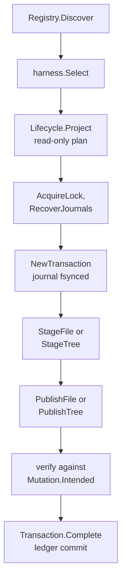

`Registry.Discover` skips a kind whose adapter answers `ErrUnsupported`, so Codex without `CODEX_HOME` contributes nothing to a broad walk; `Registry.Select` probes only the requested kind and reports the refusal. `harness.Select` returns `ErrNoInstance` on an empty match and `AmbiguousSelectionError` on more than one, rather than picking a native root. The adapter takes the lifecycle lock at `~/.atomic/install/operation.lock`, recovers unresolved journals oldest-first, and refuses on a recovery `conflict`. It then re-observes every resource under the lock, so a file that changed after projection refuses instead of being written around.

A resource whose observed digest already equals the intended digest skips the transaction: the observation is the verification, and its row rides along in the one ledger write. The OMP and Codex adapters run this sequence in their own `Enroll`. The Claude adapter runs it through `claude.Migrate`, which delegates to `installstate.Adopt`, then applies its owned `settings.json` members in `ApplyOwnedSettings` in a second acquisition of the lifecycle lock.

### One target through `install.Steps.Converge`

A blocker on any target becomes the `conflicted` status before consent is asked, and an already-converged target still converges without a prompt, because the adapter's no-op path is where the enrollment record is written.

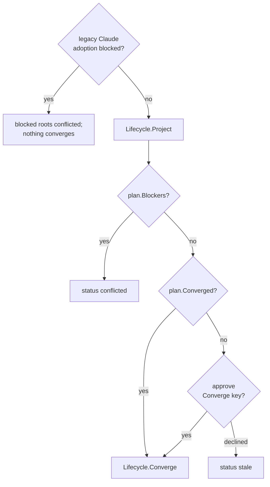

- **legacy Claude adoption blocked?**: `atomic install` sets `AdoptLegacy` unless `--all`. `adoptionPlans` plans adoption for each selected, unenrolled Claude root carrying legacy evidence. A `blocked` or `blocked_on_recovery` plan stops the whole install before any consent, and `atomic install` exits 1.
- **per-adoption consent**: each adoptable root gets its own `Adopt <key>?` prompt through `Steps.Adopt` before its convergence, skipped when the adoption plan is already converged. `atomic update` adopts with `AssumeYes`. A declined adoption reports `stale` with blocker `declined`. Install-time adoption defaults the batch decision to `replace` and keeps recovery copies under `~/.atomic/backups/`.
- **approve**: a non-interactive caller without `--yes` is refused with `refusing to mutate without explicit consent; re-run with --yes`. The prompt shows `planSummary`: the claim count, the short generation, and every `Plan.Notices` line, such as the Codex `codex plugin` commands that edit `config.toml`.
- **dry run**: `--dry-run` reports `converged` or `enrolled` per target and opens no lock.
- **status vocabulary**: `harness.Status` is `enrolled`, `converged`, `stale`, or `conflicted`. `printConvergeReports` treats any blocker or `conflicted` status as a failure, so a refused install exits 1 even under `--json`.

`ConvergeEnrolled` (run by `atomic update`) and `RulesSync` (run by `atomic harness rules sync`) resolve targets from the ledger with `Selection.EnrolledOnly`, so they never enroll a newly discovered instance. `atomic claude install|update` routes an enrolled Claude root through the same engine with `AssumeYes` set, and an unenrolled one through the legacy `claudeinstall` writer.

### Commit unit lifecycle

Progress in the journal is append-only, so an interruption between two states is observable afterwards and recovery decides each unit from its last recorded state and the bytes on disk.

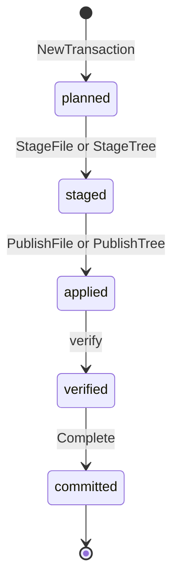

`Complete` journals each verified unit as `committed` before the ledger write, so a rollback never restores bytes a ledger row records. `PublishFile` splices a block into freshly observed bytes, so user prose changed since the plan survives, and an ambiguous or lost block fails loud. `installstate.Recovery` maps each unresolved unit to one decision:

| Decision | When |
|---|---|
| `skip-committed` | the unit already committed; a completed generation is never rolled back implicitly |
| `commit-applied` | applied bytes verify against the intended digest; the row is written without re-applying |
| `discard-staging` | the unit was never published, so its staging is provably unused |
| `complete-publication` | a tree rename was interrupted and the staged tree still digests to the intended value |
| `restore-backup` | applied bytes are unchanged since publication, and a transaction backup restores them |
| `noop` | the operation never reached the unit |
| `conflict` | native bytes no longer match what the journal describes; recovery never overwrites them |

`atomic harness recover` rolls every unresolved journal forward; `--rollback` restores the digest-verified backups instead, and `--dry-run` simulates either in memory. A journal written with `LeftSnapshot` also carries the target's whole left-unowned set, and recovery replaces the ledger's left set for each committed target with that snapshot. An older journal without the flag leaves the ledger's left set alone.

### Ledger model

A shared package carries one row per consumer target; unenrolled visibility is computed at status time, never stored.

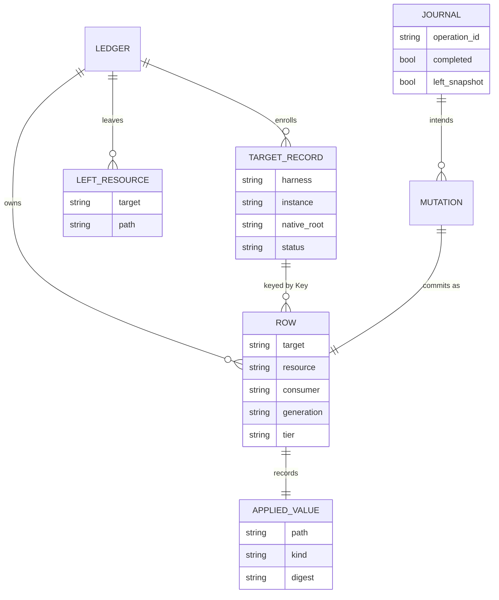

A target's key is `harness:instance`, spelled once in `installstate.TargetRecord.Key` and delegated to by `harness.Target.Key`. `APPLIED_VALUE.kind` is a `managedfile.Kind`: `file`, `block` (only the `<atomic>...</atomic>` block is owned), `tree`, `settings` (only Atomic's named members are owned), or `symlink`. A `LEFT_RESOURCE` records a file the user chose to keep with `--leave-unowned`, so a later run with no decision does not refuse it again.

The ledger and every journal carry a `Header` with `SchemaVersion` 1 and `MinimumReader` 1. A binary refuses state written by a newer schema before it mutates anything. The state tree is:

```text
~/.atomic/
├── backups/                            recovery copies from adoption and --discard-changed
├── install/
│   ├── operation.lock                  advisory flock; the file alone means nothing
│   ├── ledger.json                     targets, rows, left-unowned set
│   ├── journals/<operation-id>.json    one per in-flight operation
│   └── transactions/<operation-id>/    stage/ and backup/
└── packages/<harness>/atomic/          generated OMP package or Codex plugin tree
```

`installstate.Classify` reads an observed Claude installation into one of `absent`, `legacy-complete`, `legacy-partial`, `v2-clean`, `v2-in-flight`, `v2-orphaned`, or `mixed`, which the adoption planner uses to decide between adopting, recreating, replacing, leaving unowned, and conflicting.

### Ownership evidence

Atomic owns a resource only on evidence it can verify now; a file name, a legacy config path, or a version string proves nothing.

| `managedfile.Evidence` | Meaning | Owned |
|---|---|---|
| `selection-bytes` | bytes equal the selected generation's | yes |
| `managed-block` | exactly one parseable `<atomic>` block | yes |
| `ledger-applied` | bytes equal the digest the ledger recorded Atomic writing | yes |
| `no-managed-block` | a block file holding user bytes that never carried Atomic tags; Atomic appends a block | no |
| `missing` | listed but absent; recreated after accepted convergence | no |
| `unowned` | nothing verifiable; needs `--replace` or `--leave-unowned` | no |
| `conflict` | ambiguous or malformed; blocks automatic adoption | no |

`harness.PlanAgents` applies this per directory for whole-file resources (agent files, OMP native kinds, the OMP extension). An unowned file follows the batch decision. An owned file edited since Atomic wrote it blocks regardless of the decision, with `<path> was edited outside Atomic; restore or remove it to converge`. A ledger-owned file whose agent the corpus no longer ships is retired when its bytes still verify, and blocks when they do not.

### Global steering: one source, a native shape per harness

The authored contract [`context/AGENTS.md`](../../context/AGENTS.md) reaches each harness in the shape its capability record proves: Claude gets it with a tool-vocabulary paragraph, OMP keeps its `@` imports because OMP expands them, and Codex has them stripped because Codex leaves them literal.

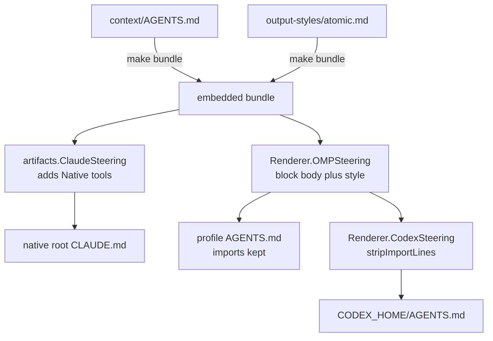

- **Claude**: `claude.GlobalArtifacts` reads the steering artifact from the embedded manifest and passes it through `artifacts.ClaudeSteering`, which inserts the `## Native tools` paragraph inside the `<atomic>` block so it is owned and replaced with it. The file is a `block` resource; every byte outside the block stays the user's. `GlobalArtifacts` refuses a manifest that maps anything to `GlobalLoaderPath`, the user-level `AGENTS.md` a Claude install never creates.
- **OMP**: `OMPSteering` takes the content inside the contract's `<atomic>` block, appends one newline, then the `output-styles/atomic.md` body with its frontmatter excluded. Whole-line `@` imports such as `@~/.atomic/profile.md` stay, because the `steering-imports` row is supported for OMP. `omp.SteeringBlock` wraps the result in one managed block for `<profile agent root>/AGENTS.md`, and `SteeringDigest` covers the block alone.
- **Codex**: `CodexSteering` is the OMP composition with `stripImportLines` applied, which drops whole-line `@` imports outside code fences. The Codex adapter writes it as one managed block in `$CODEX_HOME/AGENTS.md`, the `global-steering` surface the capability record proves.

The global [`CLAUDE.md`](../../CLAUDE.md) never changes shape; only repository and realm pairs follow a steering mode.

### Scope steering modes

The `[steering] claude` key picks which of `AGENTS.md` and [`CLAUDE.md`](../../CLAUDE.md) holds a scope's Atomic block, so a repository can drop the thin loader once its Claude Code reads `AGENTS.md` directly, without hand-moving the block.

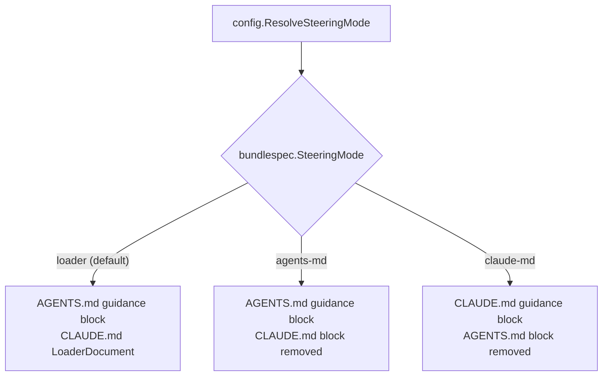

- **resolution**: `config.ResolveSteeringMode` picks the mode; its lookup order, its errors, and the Claude Code version `agents-md` needs belong to [`docs/wiki/config.md`](config.md).
- **planning**: `planPair` classifies each file as absent, one parseable block, or plain; tags that do not parse as one block refuse with `carries an ambiguous <atomic> block`. `settleFile` writes the wanted block through `ReplaceBlock` or `AppendBlock`, or strips a retired one with `managedfile.RemoveBlock`, keeping every byte outside it.
- **emptied files**: a file left empty by stripping is removed only when a ledger row owns it; otherwise it keeps its block and the result carries the note `keeps its Atomic block: stripping it would leave an empty file Atomic cannot prove it wrote`.
- **writes**: block writes for a scope with a Claude target in the ledger go through `installstate.NewTransaction` as `block` rows under the lifecycle lock. Block-less writes and removals are direct, and `Ledger.RemoveRows` drops the rows of files that no longer carry a block. `pairPlan.verify` re-reads both files and fails when a wanted block is missing or a retired one remains.
- **refusals**: `runScope` refuses a scope that resolves to the configured Claude root or an enrolled Claude native root.

### Converting a scope on a mode change

A mode change reaches existing files through `convergeSteeringMode`, which moves the block already on disk rather than rendering fresh guidance, and through `atomic wiki init`, whose `initScopePair` converts the wiki pair alone through `initSteeringPair`.

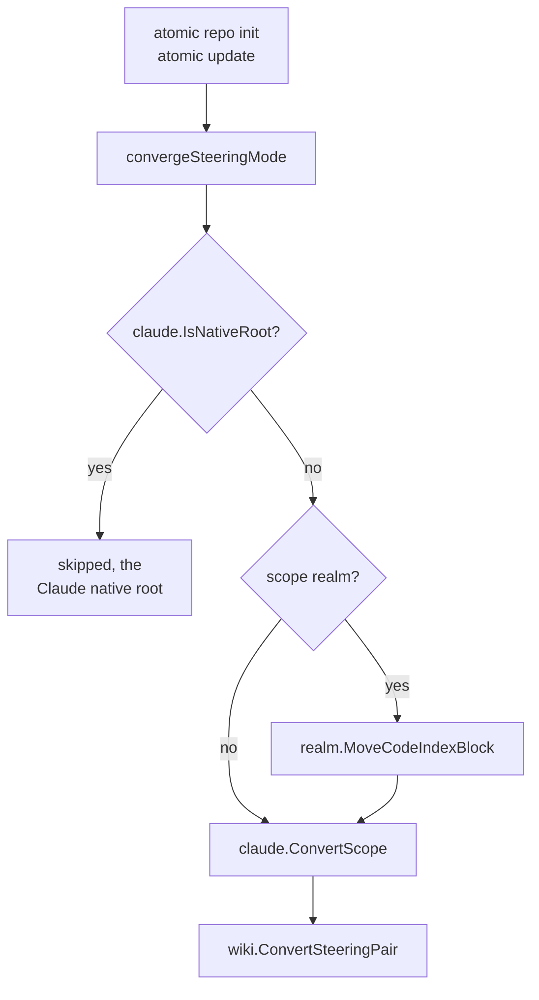

- **callers**: `atomic repo init` converts the repository root. `atomic update` converts `cwdSteeringRoot`, the repository holding the working directory or else the realm root above it, and reports `skipped steering conversion` on failure.
- **code-index block**: in a realm, `MoveCodeIndexBlock` moves the code-index block to the mode's realm file first, so the pair converters see the root files without it.
- **pairs converted**: `ConvertScope` reshapes the root pair through `runScope` with the on-disk block reused. `wiki.ConvertSteeringPair` then visits [`docs/wiki/`](.) (or `wiki/` in a realm) and the root, skipping a pair with neither file and never creating a loader beside a bare root `AGENTS.md`.
- **reported lines**: each changed path prints `steering (<mode>): updated <path>`, and each kept file prints its note.

`Renderer.LoaderPair` and `MigrationRequest.Scopes` have no production caller. `claude.Migrate` resolves each requested scope's mode before `MigrateScope`, and `wiki.InitRepoScope` and `wiki.InitRealmScope` write a new scope pair.

### What each harness receives

Each adapter publishes only the artifact kinds its capability row proves, and reports every other kind as an unproven surface on the plan, the convergence report, and doctor.

| Surface | Claude | OMP | Codex |
|---|---|---|---|
| Native root | `CLAUDE_CONFIG_DIR`, else `~/.claude`; a distinct existing `~/.claude` is a second instance | `omp config path --json` per profile (`OMP_PROFILE` selects a named one); `~/.omp/agent` only when the `omp` binary is absent | `CODEX_HOME`; unset is `ErrUnsupported`, never a guess at `~/.codex` |
| Steering | `<atomic>` block in [`CLAUDE.md`](../../CLAUDE.md) | `<atomic>` block in profile `AGENTS.md`, style always on | `<atomic>` block in `$CODEX_HOME/AGENTS.md`, imports stripped, style always on |
| Shared package | none | `~/.atomic/packages/omp/atomic`: commands, skills, shipped rules, `extensions/atomic.ts` | `~/.atomic/packages/codex/atomic`: marketplace, plugin manifest, skills, rules, `rules/index.json`, `matcher.mjs` |
| Commands | `commands/` from the manifest | copied to `<profile>/commands/` | unproven; reported |
| Skills | `skills/` from the manifest | copied to `<profile>/skills/` | in the registered plugin, listed as `atomic:<name>` |
| Agents | `agents/<file>.md`, ledger-owned | `<profile>/agents/<file>.md`, ledger-owned | `$CODEX_HOME/agents/<name>.toml`, ledger-owned |
| Session context | `settings.json` `SessionStart` member | extension module calls `atomic hooks session-start` | `hooks.json` `SessionStart` member, trust left to the user |
| Repository wiki cards | [`.claude/rules/atomic`](../../.claude/rules/atomic) link to `<state-root>/rules` | `.omp/rules/atomic-wiki-<domain>.md` per-file links | `hooks.json` `PreToolUse` member on `apply_patch`, trust left to the user |
| Shipped rules | `rules/` | package tree only, indexed by the extension baseline | plugin tree only, indexed for the matcher |
| Native registration | none | none | `codex plugin marketplace add` and `codex plugin add` |

OMP's `nativeFiles` copies a package subtree into the profile root only when its role is supported (`commands` needs `command-delivery`, `skills` needs `skill-discovery`). Each copied file is its own ledger-owned `file` row, planned through `planNative` so a nested skill reference gets the same conflict, leave, and retire handling as an agent file.

### Agent projection and user overrides

A canonical agent reaches each harness with only the metadata that harness carries, then the user's model and effort override is written under that harness's native keys; the overlaid bytes are what the ledger claims, so a changed override converges and a hand edit conflicts.

| | Claude | OMP | Codex |
|---|---|---|---|
| Projection | `ClaudeAgent`: bytes unchanged | `OMPAgent`: `name`, `description` re-emitted | `CodexAgent`: TOML `name`, `description`, `developer_instructions` |
| `skills:` | carried | dropped, reported in `Unsupported` | dropped, reported in `Unsupported` |
| Override keys from `config.toml` | `model`, `effort` | `model`, `thinking` | `model`, `model_reasoning_effort` |
| Written by | `claude.GlobalArtifacts` | `harness.AgentFiles` in `omp.Enroll` | `harness.AgentFiles` in `codex.Enroll` |

`checkedAgent` refuses an agent that declares any of `UserPolicyKeys` (`model`, `effort`, `tools`, `disallowedTools`, `mcpServers`), lacks a name, or names a skill the catalog cannot resolve. `harness.Overlay` writes no key for an empty override field, so no default is ever supplied. The agent-delivery row is unsupported for both OMP and Codex, so each plan reports `agent delivery` as unproven even though the files are written.

### OMP session runtime

OMP has no session-start hook file, so the generated extension module `extensions/atomic.ts` under the profile agent root delivers both the rule baseline and the session context, and re-supplies both on every `before_agent_start` turn.

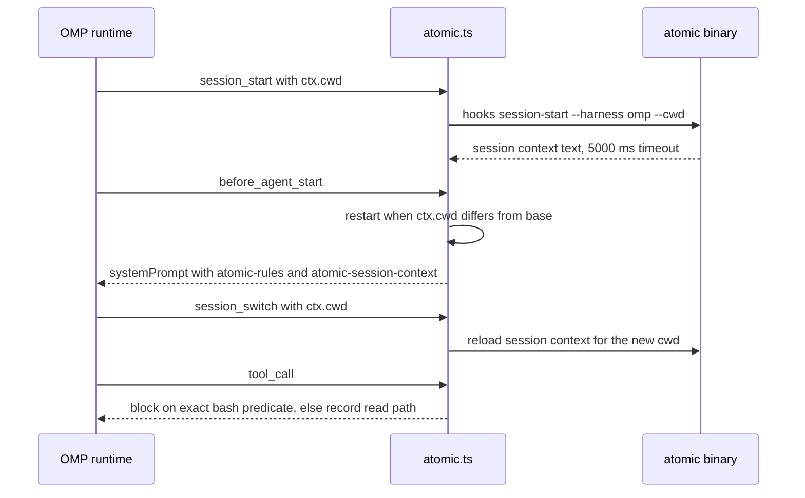

- **session context**: `loadSessionContext` runs `atomic hooks session-start --format text --harness omp --cwd <cwd>`. A missing binary, a non-zero exit, or the timeout yields empty text, and the session still starts.
- **reload**: `session_switch` calls `restart`. `/move` fires no event, so `before_agent_start` compares `ctx.cwd` with the loaded base through `sameDirectory` (resolved paths) and restarts on a difference.
- **dedupe**: each turn removes prompt parts whose first line carries Atomic's tag and marker (`atomic-omp-runtime` for rules, `atomic-omp-session-context` for context), then appends fresh copies, so blocks are replaced, never stacked.
- **baseline bound**: `BuildSessionDelivery` measures the static rule index in UTF-16 code units. An index over `BaselineByteBound` (8192) is suppressed whole, never truncated.
- **wired events**: `before_agent_start`, `session_switch`, and `tool_call` are wired only when their role is supported; the other three are always wired and marked observation-only in the plan, though `session_start` also starts the context load. `RegisteredEvents` reads the rendered bytes, so an audit catches a template registering an unplanned event.
- **observation log**: with `ATOMIC_OMP_RUNTIME_LOG` set, the module appends JSON lines that `ReadRuntimeLog` parses; unset disables observation, not delivery.

The extension is a ledger-owned `file` row per profile and takes the same replace-or-leave-unowned decision as an agent file.

### Codex `hooks.json` members and trust

Atomic owns the `SessionStart` member (matcher `startup|resume`, command `atomic hooks session-start --harness codex`) and the `PreToolUse` member (matcher `apply_patch`, command `atomic hooks pre-tool-use`) in `$CODEX_HOME/hooks.json`. Codex runs each only after the user trusts it, and Atomic never writes trust.

`planSessionHook` digests both owned members as one `settings` resource and decides their fate before any write:

| Observed members | Decision | Result |
|---|---|---|
| `hooks.json` does not parse | any | blocker naming the file |
| absent | any | write the members |
| `CodexLegacyDigest`: `SessionStart` alone, as written before `PreToolUse` existed | any | write, which adds `PreToolUse` |
| recorded row, same digest | any | converged |
| recorded row, digest changed, row is canonical or legacy | `--replace` | rewrite |
| recorded row, digest changed | otherwise | blocker: changed after Atomic wrote it |
| unrecorded, canonical form | any | write and record |
| unrecorded, other form | `--replace` | rewrite |
| unrecorded, other form | `--leave-unowned`, or recorded as left | leave it, record left |
| unrecorded, other form | none | blocker |

`applySessionHook` saves the member's `settings` row to the ledger before the write, so a crash leaves a claim that repair, status, and uninstall can reach. A first enrollment saves the target record with it. A skipped or failed write undoes the row.

`ObserveSessionHookTrust` and `ObservePreToolUseHookTrust` read `config.toml` `[hooks.state]` under the key `<hooks.json path>:<event>:<group>:<handler>` (`session_start` or `pre_tool_use`) and compare `trusted_hash` with `trustedMember.identityHash`, which mirrors Codex's own hook hash with the 600-second default timeout. The result is `trusted`, `untrusted`, `modified` (a stale trusted hash that Codex will not run), or `unknown` (including a member left unowned). The `session-context` row stays unsupported, so every Codex plan reports `session-context delivery` as unproven.

### Codex edit-time cards

Codex has no rule surface, so wiki cards reach a Codex session only through the `PreToolUse` member on `apply_patch`. The hook's payload handling, patch-path matching, once-per-session sent list, and fail-open exit belong to [`docs/wiki/config.md`](config.md).

- **trust**: the member runs only after the user trusts it in `/hooks`; `ObservePreToolUseHookTrust` reports its state as described under the `hooks.json` members above.
- **capability**: the `wiki-card-delivery` row is `partial` on `$CODEX_HOME/hooks.json PreToolUse apply_patch`: edits only, no observed model turn, and the member needs `/hooks` trust review. Every Codex plan therefore still reports `repository wiki pointer cards` as unproven. `RulesStatus` reports a Codex target with no recorded tier as `harness.WikiCardTier`, which is `hook-required` for any row status other than `unsupported`.

### Codex plugin registration

Codex owns its registry format, so `Enroll` writes files only and `DefaultRegister` drives the Codex CLI, verifying the result through `plugin list` and the filesystem rather than exit status.

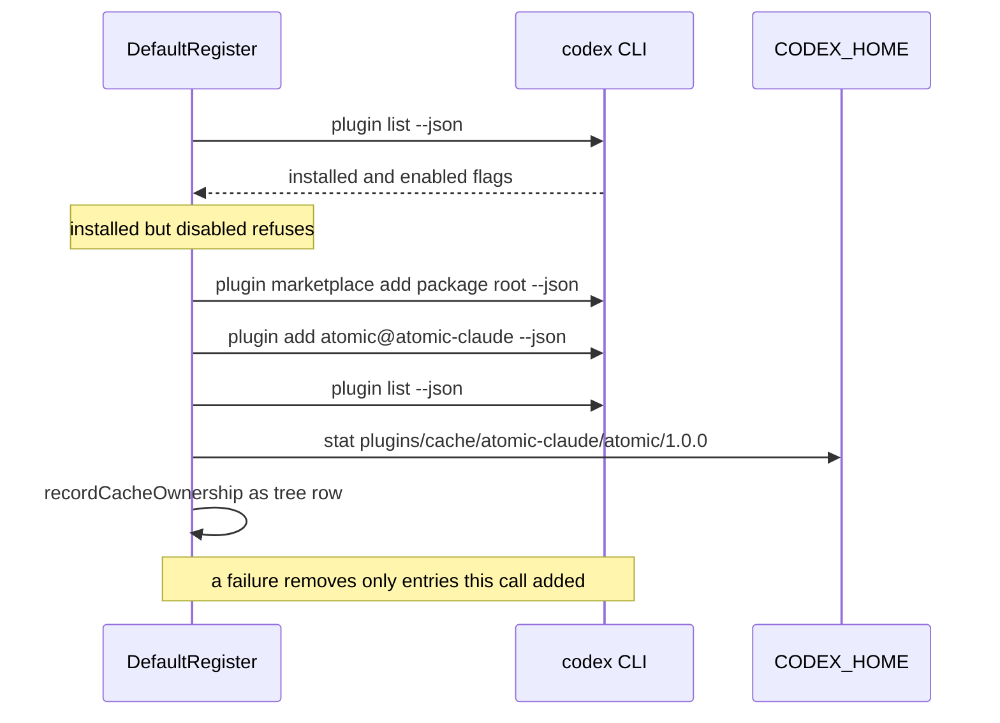

`codex.converge` skips registration when `registrationCurrent` finds the marketplace, the plugin, and a cache whose tree digest matches the published plugin, and only refreshes the cache row's digest. A plugin the user removed after Atomic registered it (cache row present, plugin entry and cache gone) is reported as unproven and re-registered only under `--replace`. `config.toml` is never a ledger resource, because uninstall would then delete user configuration. At target uninstall, `RemovedFn` unregisters when the cache row was removed or discarded; a failure becomes a `Removal.Notices` line naming the `codex plugin remove` commands. `CODEX_BIN` overrides the executable.

### Repository wiki pointer cards

Canonical cards live once at `<state-root>/rules/wiki/<domain>.md` and are committed. Claude reads them through one directory link and OMP through one committed link per card, so every clone carries the same cards and no harness needs a second authored copy.

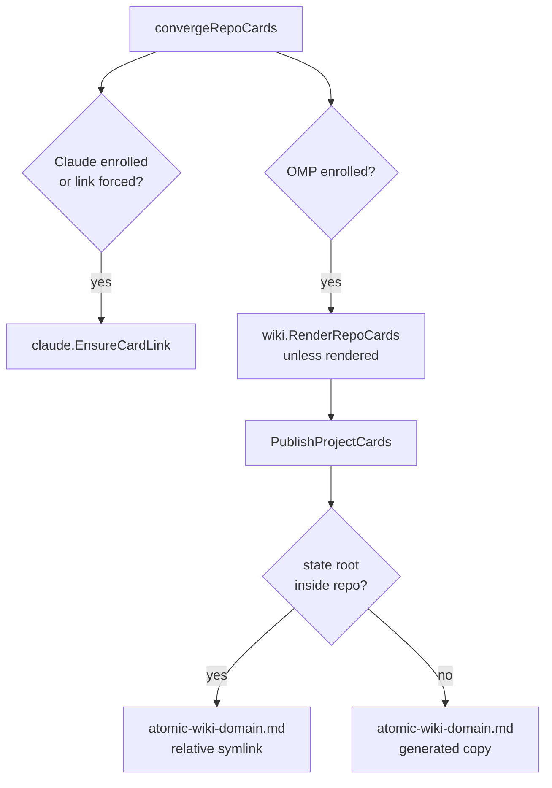

- **Claude link**: `EnsureCardLink` writes `.claude/rules/atomic -> ../../<state-root>/rules` as a `symlink` row. A link with the expected target and no row is `adopted` (a teammate's clone); anything else at that path is `ErrCardLinkConflict`. No link is written when the state root is [`.claude`](../../.claude). When a repository ignore rule hides the link, `exposeLink` appends a negation; an ignore file outside the repository is only reported.
- **Claude copy**: a state root outside the repository gets a `tree` copy at [`.claude/rules/atomic/wiki/`](../../.claude/rules/atomic/wiki), staged outside [`.claude/rules/`](../../.claude/rules) and renamed in, with `/rules/atomic/` appended to [`.claude/.gitignore`](../../.claude/.gitignore).
- **canonical frontmatter**: OMP lists a card only by `description` and `globs`, so `wiki.renderPointerCard` writes `description`, `globs`, and `paths` into the canonical card. `rules.CardDescription` supplies the description: the first non-blank body line with heading marks stripped, else `Atomic wiki card for <domain>`. `rules.parse` skips `description` and `globs` on a wiki card, and `paths` stays the scope Atomic reads. `convergeRepoCards` re-renders older cards through `wiki.RenderRepoCards` before publishing, unless the caller has already refreshed them.
- **OMP links**: when the resolved state root is inside the repository, `LoadProjectCards` gives each card the `LinkTarget` `../../<state-root>/rules/wiki/<domain>.md`. `PublishProjectCards` writes `.omp/rules/atomic-wiki-<domain>.md` as a relative symlink, created under a fresh random temporary name beside the entry (`symlinkTemp`, never reusing an existing entry) and renamed over it, recorded as a `symlink` row whose digest covers the link text. A link with the expected target and no row is adopted, as the Claude link is.
- **OMP copy**: a state root outside the repository gets a generated flat file instead, with frontmatter `# generated by atomic; do not hand-edit` plus `description` and `globs`, published through the journaled transaction as a `file` row.
- **staging and ignore rules**: inside a Git repository, `exposeLinks` asks `config.GitIgnoreSource` about each link path and reports an ignored one as `<path> is ignored by <source>, so Git will not track it and OMP will skip it`. With `Stage` set, each visible link is added to the Git index together with the canonical card it points to.
- **OMP conflicts**: an existing entry that is neither the projection, a ledger-recorded write, nor the previously generated copy (`CopyDigest`) fails with `hold bytes Atomic did not record writing` and status `conflicted`. A generated copy from an earlier version is replaced by the link without a conflict.
- **pruning**: a dropped card's entry is removed when its row matches. An unrecorded link is removed only when it dangles and holds exactly the target Atomic would write for its name (`linkTarget`, `../../<state-root>/rules/wiki/<domain>.md`); anything else is kept and reported.
- **legacy trees**: `.omp/rules/atomic/wiki`, `.omp/rules/atomic-wiki`, and `.claude/rules/atomic-wiki` are removed through `harness.RetireTree` only when a ledger row matches their bytes.
- **callers**: `atomic install` and `atomic update` (working-directory repository only), `atomic repo init`, `wiki.ProjectRepoCards` after a wiki refresh, and `config.AfterRepoStateMigration`, which also forces the Claude link and stages the links and cards. Session start writes no card. `ProjectRuleStatus` reports the card surface without writing.

### Rule enforcement tiers

A rule's tier comes from the target's capability evidence, not from intent, and a partial row counts as unproven.

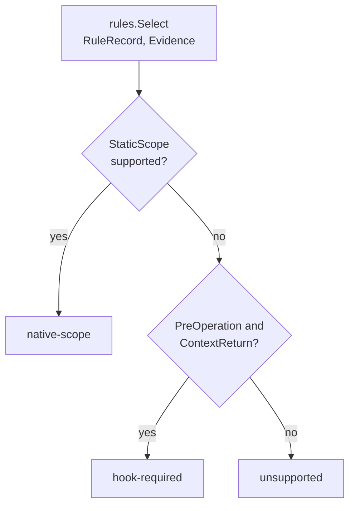

`harness.RuleEvidence` sets each `rules.Evidence` field from `CapabilityMatrix.Supports`, so a `partial` row is false. `deny-enforced` exists in `artifacts.EnforcementTier` but `Select` never returns it, because a prose record carries no machine predicate. The rule corpus parses into checkout-independent `RuleRecord`s with a producer-qualified identity (`shipped` or `wiki`), and `rules.CompileGlob` translates each glob into a regex that Go and JavaScript read alike, refusing anything it cannot translate exactly. A rule whose glob does not translate is listed as undeliverable rather than approximated. A Codex wiki card's tier comes from `harness.WikiCardTier`, not `Select`, because its delivery is the `PreToolUse` hook rather than a rule surface.

### Removal

A target uninstall deletes only resources whose bytes still verify, so one changed file skips itself and the rest of the target still uninstalls.

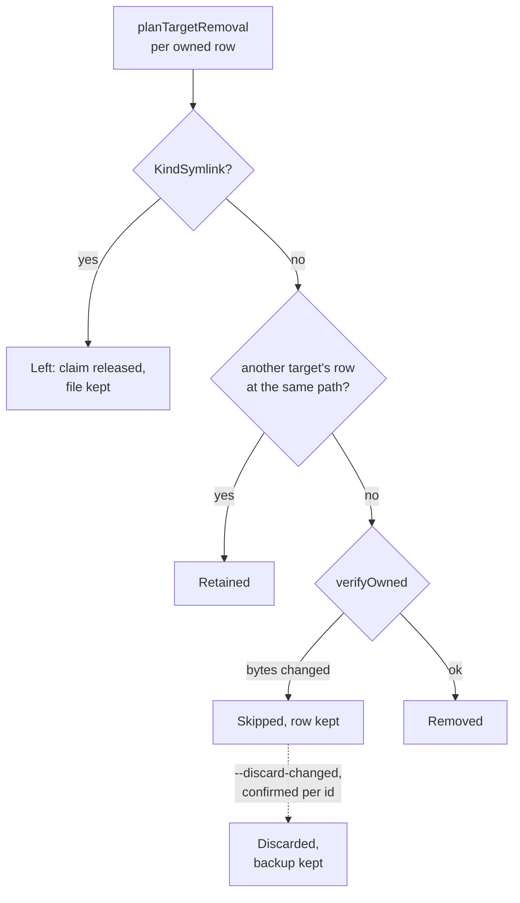

`--discard-changed` asks once per skipped resource and refuses the whole removal when a resource changed after the printed plan. Discarded bytes are backed up under `~/.atomic/backups/discard-<stamp>/`. `settings` rows go last, because the `outputStyle` member is dropped only after the style file it names is gone. A target keeps its enrollment record while any resource stays skipped. `atomic harness uninstall --all` recovers journals, removes every target, then runs `installstate.Cleanup`, preserving `config.toml`, `profile.md`, `wikis.md`, backups, and anything an unresolved journal still references.

## Where it lives

### Adapter contract and shared projection

| Path | Role |
|---|---|
| [`atomic/internal/harness/harness.go`](../../atomic/internal/harness/harness.go) | `Instance`, the `Adapter` interface (`Kind`, `Discover`, `Capabilities`, `Lifecycle`), and the shared errors `ErrUnsupported`, `ErrPlanNotApproved`, `ErrEvidenceConflict`, `ErrSharedResource`, `ErrNoInstance`, `ErrAmbiguousSelection`, `ErrNotInstalled`. |
| [`atomic/internal/harness/kind/kind.go`](../../atomic/internal/harness/kind/kind.go) | `Kind` leaf package (`claude`, `omp`, `codex`) so packages harness imports can name a kind. |
| [`atomic/internal/harness/registry.go`](../../atomic/internal/harness/registry.go), `selection.go`, `target.go` | `Registry`, `Selector`/`Select`, `Target` with `ParseKey` and the `Status` vocabulary. |
| [`atomic/internal/harness/lifecycle.go`](../../atomic/internal/harness/lifecycle.go) | `Lifecycle` hooks (`ProjectFn`, `ConvergeFn`, `VerifyFn`, `RemoveFn`, `RemovedFn`) and `Plan`, `Convergence`, `Removal`. A nil hook returns `ErrUnsupported`. |
| [`atomic/internal/harness/capability.go`](../../atomic/internal/harness/capability.go) | `CapabilityMatrix`, the `Role` vocabulary, and `ClaudeCapabilities` (2.1.273), `OMPCapabilities` (18.1.18, some rows 18.18.3), `CodexCapabilities` (0.147.0). |
| [`atomic/internal/harness/agent.go`](../../atomic/internal/harness/agent.go), `overlay.go` | Agent projections, `UserPolicyKeys`, `AgentFiles`, `AgentClaims`, `PlanAgents`, `RetireAgents`, and `Overlay`. |
| [`atomic/internal/harness/skill.go`](../../atomic/internal/harness/skill.go), `rule.go` | `ProjectSkills` with collision and reference checks; `ShippedRuleSources`, `ProjectClaudeRules`, `RuleGaps`, `RuleEvidence`, `WikiCardTier`. |
| [`atomic/internal/harness/generation.go`](../../atomic/internal/harness/generation.go), `resource.go` | `EnsureSharedGeneration`, `AssertSharedConsumers`; `Resource` with `Consumers` (enrolled) kept apart from `VisibleTo` (unenrolled). |
| [`atomic/internal/harness/enrollment.go`](../../atomic/internal/harness/enrollment.go), `evidence.go` | `Enroll` for an approved target, `EnrolledKinds`; re-exported ownership evidence. |
| [`atomic/internal/harness/status.go`](../../atomic/internal/harness/status.go), `uninstall.go`, `retire.go` | `RowStatus` (`applied`, `stale`, `missing`, `conflict`, `unverifiable`); removal planning and application; `RetireTree` and the legacy card paths. |
| [`atomic/internal/harness/detect.go`](../../atomic/internal/harness/detect.go), `provider.go` | `Detect` (environment markers, graded `strong`/`weak`), `SelectAgentsHarness`; `ProviderID` rejects concrete provider or model tokens in generated bytes. |

### Adapters

| Path | Role |
|---|---|
| [`atomic/internal/harness/claude/claude.go`](../../atomic/internal/harness/claude/claude.go), `lifecycle.go` | Discovery of `CLAUDE_CONFIG_DIR` plus a distinct `~/.claude`; `Generation` digest over the embedded manifest; `ApplyOwnedSettings`. |
| [`atomic/internal/harness/claude/artifacts.go`](../../atomic/internal/harness/claude/artifacts.go), `evidence.go` | `GlobalArtifacts` (manifest, steering block, agent overlays) and the claims that mirror it. |
| [`atomic/internal/harness/claude/migration.go`](../../atomic/internal/harness/claude/migration.go), `steering.go` | `PlanMigration`, `Migrate`, `ImportMutable`, `Verify`; `MigrateScope`, `ConvertScope`, `IsNativeRoot`, and the mode-shaped `planPair`. |
| [`atomic/internal/harness/claude/cards.go`](../../atomic/internal/harness/claude/cards.go) | `EnsureCardLink`: link, copy, adoption, ignore-rule negation. |
| [`atomic/internal/harness/omp/omp.go`](../../atomic/internal/harness/omp/omp.go), `lifecycle.go`, `enroll.go` | Profile discovery through `omp config path --json`; plan, `Enroll`, `Claims`, `Resources`. |
| [`atomic/internal/harness/omp/package.go`](../../atomic/internal/harness/omp/package.go), `kinds.go`, `gaps.go`, `models.go` | `BuildPackage`, native-kind copies, unproven kinds, semantic model roles with no provider IDs. |
| [`atomic/internal/harness/omp/steering.go`](../../atomic/internal/harness/omp/steering.go) | `SteeringBlock` and `SteeringDigest`. |
| [`atomic/internal/harness/omp/session.go`](../../atomic/internal/harness/omp/session.go), `extension.go` | `BuildSessionDelivery`, deny predicates, runtime log parsing; `RenderExtension` and the module template. |
| [`atomic/internal/harness/omp/rules.go`](../../atomic/internal/harness/omp/rules.go) | Shipped-rule projection, `BuildProjectCards`, `LoadProjectCards` (link targets), `PublishProjectCards`, `exposeLinks`, `ProjectRuleStatus`. |
| [`atomic/internal/harness/codex/codex.go`](../../atomic/internal/harness/codex/codex.go), `lifecycle.go`, `enroll.go` | `CODEX_HOME` discovery; plan, converge with registration, `Enroll`, `Claims`, unregister at removal. |
| [`atomic/internal/harness/codex/plugin.go`](../../atomic/internal/harness/codex/plugin.go), `matcher.go`, `steering.go` | `BuildPlugin` (marketplace, manifest without hooks, skills, rules, index, matcher), `CodexSteering` block. |
| [`atomic/internal/harness/codex/hooks.go`](../../atomic/internal/harness/codex/hooks.go), `register.go`, `status.go` | Owned `hooks.json` member plan and write, `ObserveSessionHookTrust`, `ObservePreToolUseHookTrust`; `DefaultRegister`, `DefaultUnregister`, `ObserveRegistration`; doctor surface rows. |

### Orchestration and CLI

| Path | Role |
|---|---|
| [`atomic/internal/install/install.go`](../../atomic/internal/install/install.go) | `Steps`, `DefaultRegistry`, `Resolve` (with installed-harness detection), `Converge`, `ConvergeEnrolled`, `Adopt`, `AdoptLegacyClaude`. |
| [`atomic/internal/install/report.go`](../../atomic/internal/install/report.go), `rules.go` | `List`, `Status`, `Diff`; `RulesStatus`, `RulesSync`. |
| [`atomic/internal/install/uninstall.go`](../../atomic/internal/install/uninstall.go) | `UninstallTarget` (raw unparseable keys included), `UninstallAll`, dry-run plans, `Recover`, `PreviewRecovery`. |
| [`atomic/cmd/atomic/cmd_install.go`](../../atomic/cmd/atomic/cmd_install.go) | `atomic install` flags: `--harness`, `--instance`, `--all`, `--replace`, `--leave-unowned`, `--dry-run`, `--yes`, `--json`. |
| [`atomic/cmd/atomic/cmd_harness.go`](../../atomic/cmd/atomic/cmd_harness.go) | `atomic harness` verbs, including `adopt --acknowledge-snapshot`, `uninstall --all --discard-changed`, `recover --rollback`. |
| [`atomic/cmd/atomic/cmd_state.go`](../../atomic/cmd/atomic/cmd_state.go) | `atomic state adopt` (`--dir`, `--clear`, `--dry-run`, `--json`) and `atomic state migrate`; behavior in [`docs/wiki/config.md`](config.md). |
| [`atomic/cmd/atomic/cmd_cards.go`](../../atomic/cmd/atomic/cmd_cards.go) | `convergeRepoCards` (`cardWrite` fields `link`, `stage`, `rendered`) and the hooks it installs into `config` and `wiki`. |
| [`atomic/cmd/atomic/cmd_steering.go`](../../atomic/cmd/atomic/cmd_steering.go) | `convergeSteeringMode` and `cwdSteeringRoot`, called from `atomic repo init` and `atomic update`. |
| [`atomic/cmd/atomic/cmd_claude.go`](../../atomic/cmd/atomic/cmd_claude.go) | Legacy `atomic claude` verbs; enrolled roots route through the install engine. |

### Durable state, primitives, and corpus

| Path | Role |
|---|---|
| [`atomic/internal/installstate/schema.go`](../../atomic/internal/installstate/schema.go), `lock.go`, `flock.go` | `Header` refusal of newer state; `AcquireLock` with writer identity. |
| [`atomic/internal/installstate/ledger.go`](../../atomic/internal/installstate/ledger.go), `target.go` | `Ledger` (`Upsert`, `Find`, `RemoveRows`), `Row`, `AppliedValue`, `LeftResource`, `TargetRecord`. |
| [`atomic/internal/installstate/journal.go`](../../atomic/internal/installstate/journal.go), `transaction.go` | `Journal`, `Mutation`, unit states; `Transaction` ordering. |
| [`atomic/internal/installstate/recovery.go`](../../atomic/internal/installstate/recovery.go), `legacy.go` | Recovery decisions and rollback; `PlanAdoption`, `Adopt`, `RecoverJournals`, `RollbackJournals`, simulations. |
| [`atomic/internal/installstate/classify.go`](../../atomic/internal/installstate/classify.go), `retention.go` | Installation-state classifier; `ComputeRetention` and `Cleanup` for full uninstall. |
| [`atomic/internal/managedfile/managedfile.go`](../../atomic/internal/managedfile/managedfile.go), `observe.go`, `evidence.go` | `<atomic>` block boundaries, `ReplaceBlock`, `AppendBlock`, `RemoveBlock`; `Observe`, `TreeDigest`, resource kinds; `Claim`, `Assess`. |
| [`atomic/internal/managedfile/publish.go`](../../atomic/internal/managedfile/publish.go), `backup.go` | Atomic file writes, journaled tree publication, durable backups. |
| [`atomic/internal/rules/`](../../atomic/internal/rules) | `RuleRecord` parsing, `Bind`, `CompileGlob`, `Matcher`, `Select`; `card.go` holds `CardDescription` and `YAMLString`, shared by the canonical card and the OMP copy. |
| [`atomic/internal/artifacts/`](../../atomic/internal/artifacts) | `Catalog` (`Load` from [`context/`](../../context), `NewCatalog`), artifact kinds, delivery and tier constants, `Renderer`. |
| [`atomic/internal/embeddedcorpus/embeddedcorpus.go`](../../atomic/internal/embeddedcorpus/embeddedcorpus.go) | `Load` builds the catalog from the embedded bundle, the source both OMP and Codex adapters publish from. |
| [`atomic/internal/runtimeproof/`](../../atomic/internal/runtimeproof) | Bounded launches of real harness binaries against isolated homes; OMP scenarios enroll through the production adapter. Imported by its tests only. |
| [`atomic/internal/ids/ids.go`](../../atomic/internal/ids/ids.go) | `Slug` and `ShortID` helpers; imported by [`atomic/internal/bus/room.go`](../../atomic/internal/bus/room.go). |

## Constraints

- **Never hand-edit an Atomic-owned file.** An owned agent, extension, or native-kind file edited outside Atomic blocks convergence for that target under every decision until it is restored or removed; a changed Codex hook member blocks until restored, removed, or `--replace`.
- **Never guess a block boundary.** A file with `<atomic>` tags that do not parse as exactly one block refuses with `carries an ambiguous <atomic> block`. Fixing the tags by hand is the only path forward; Atomic appends a block only to a file that never carried tags.
- **Codex needs `CODEX_HOME`.** With it unset, discovery returns `ErrUnsupported` and a broad `atomic install --all` silently has no Codex target; `--harness codex` reports the refusal.
- **Do not ignore `.omp/rules/atomic-wiki-*.md`.** OMP's rule scan skips files any Git ignore source covers, judged on the link path, so an ignore rule hides every card from OMP. The links are committed beside the cards they point to; Atomic reports an ignored link and does not stage it.
- **Codex cards need trust.** An untrusted `PreToolUse` member never runs, so Codex sessions get no cards until the user trusts it in `/hooks`. Cards reach the model only on `apply_patch` edits, not on reads or shell edits.
- **A mode change converts only the working directory's scope.** `atomic update` reshapes the pairs at `cwdSteeringRoot`; other repositories keep their old shape until `atomic repo init` or `atomic update` runs there, or `atomic wiki init` reshapes their wiki pair alone.
- **Agents carry no user policy.** An agent declaring `model`, `effort`, `tools`, `disallowedTools`, or `mcpServers` fails projection, which fails `BuildPackage`, `BuildPlugin`, and every install. Model choice belongs in `config.toml` overrides.
- **No concrete provider or model IDs in generated bytes.** `BuildPackage` and `BuildPlugin` refuse any file matching `harness.ProviderID` (for example `openai/` or `claude-` followed by a digit).
- **One generation per shared package.** A row for a target the ledger does not enroll, whose key still parses, pins the OMP package or Codex plugin tree; `EnsureSharedGeneration` then refuses before mutation. Enrolled consumers are rewritten in the same commit, never treated as pins.
- **A disabled Codex plugin stays disabled.** `DefaultRegister` refuses to re-enable it, and a plugin the user removed is re-registered only with `--replace`.
- **Capability rows decide what ships.** Flipping a row in `capability.go` changes which OMP kinds are copied, which extension events are wired, and which rules get a tier. [`docs/research/harness-capability-matrix.md`](../research/harness-capability-matrix.md) holds the evidence each row cites.
- **Bounds suppress, never truncate.** An OMP baseline index over 8192 UTF-16 units ships no baseline block; a Codex index over `InstructionByteBound` (32 KiB) is refused. A truncated index would misreport rules.
- **Consent is explicit.** Without a terminal and without `--yes`, every mutating verb refuses. `--replace` and `--leave-unowned` are mutually exclusive, and `--all` with `--harness` or `--instance` is refused so a named harness is never dropped.
- **Newer state is read-only to an older binary.** A ledger or journal with a higher `SchemaVersion` or `MinimumReader` refuses before any mutation; downgrading the binary after an upgrade blocks installs until the newer binary is back.

## Coupling

- **bundle**: the Claude adapter and `embeddedcorpus.Load` read `embedded.Manifest()`, which `make bundle` writes from [`context/`](../../context). `claude.Generation` digests that manifest, so any corpus change makes every Claude row `stale`. `bundlespec.GlobalSteering` and `bundlespec.ScopeSteering` name the steering paths `Renderer` writes.
- **config**: owns `~/.atomic` path helpers (`config.LedgerPath`, `config.PackageRoot`, `config.TransactionDir`), the per-harness agent overrides (`AgentOverrides`) that `atomic config agents` edits after `harness.SelectAgentsHarness`, the repository state ladder behind `atomic state adopt|migrate`, `config.ResolveSteeringMode` behind the `[steering] claude` key, `config.CodexCardsSentPath`, the `hooks` package that owns the Claude `settings.json` and Codex `hooks.json` members and the `atomic hooks pre-tool-use` verb ([`docs/wiki/config.md`](config.md)), and `atomic update`, which calls `AdoptLegacyClaude` then `ConvergeEnrolled`. The legacy `claudeinstall` writer serves unenrolled Claude roots.
- **wiki** and **signals**: `/refresh-wiki` and the `atomic-wiki-inferrer` agent write the canonical cards under `<state-root>/rules/wiki/`; `wiki.ProjectRepoCards`, wired in `cmd_cards.go`, projects them after a refresh. The steering pair is written by `wiki.InitRepoScope` and `wiki.InitRealmScope` and reshaped by `wiki.ConvertSteeringPair`; `wiki.RenderRepoCards` re-renders canonical cards with `description` and `globs` before OMP publication.
- **code-intel**: `realm.MoveCodeIndexBlock` moves a realm's code-index block to the mode's file before the pair converters run.
- **doctor**: `checks_codex.go` reports `ObserveSessionHookTrust`, `ObservePreToolUseHookTrust`, `RuntimeState`, `RegistrationStateRow`, and `KindState`; `validate/projection.go` calls `artifacts.Load` and the agent projections to audit for policy-key leaks.
- **CLI verbs, bus, and retro**: `harness.Detect` is read by CLI verbs that name the running harness (`cmd_where.go`, `cmd_workflow.go`, `cmd_config.go`, `cmd_doctor.go`), bus identity, and retro; `bus` also uses `ids`.
- **commands**: `/atomic-help` documents `atomic install`, `atomic harness`, `atomic update`, and uninstall; [`docs/guides/install.md`](../guides/install.md) is the user page.
- **lockstep contracts**: [`docs/spec/omp-plugin-compatibility.md`](../spec/omp-plugin-compatibility.md) is the contract for this domain. `hooks.CodexSessionStartCommand`, `CodexSessionStartMatcher`, `CodexPreToolUseCommand`, and `CodexPreToolUseMatcher` must change together with `trustedMember.identityHash`, or every trusted member reads `modified`. A change to the owned member set also needs a predecessor digest like `CodexLegacyDigest`, or existing installs block instead of converging. The OMP extension's `loadSessionContext` arguments must match the flags `atomic hooks session-start` accepts.
- **design**: [`docs/design/omp-plugin-compatibility.md`](../design/omp-plugin-compatibility.md) carries the decision record; [`docs/design/uninstall.md`](../design/uninstall.md) is a pre-v6 record of the snapshot-based Claude uninstall and describes paths this domain no longer uses.
