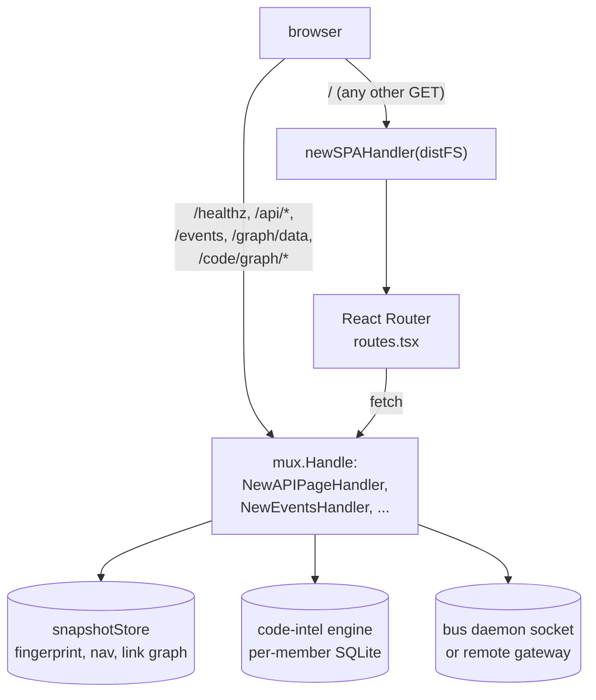
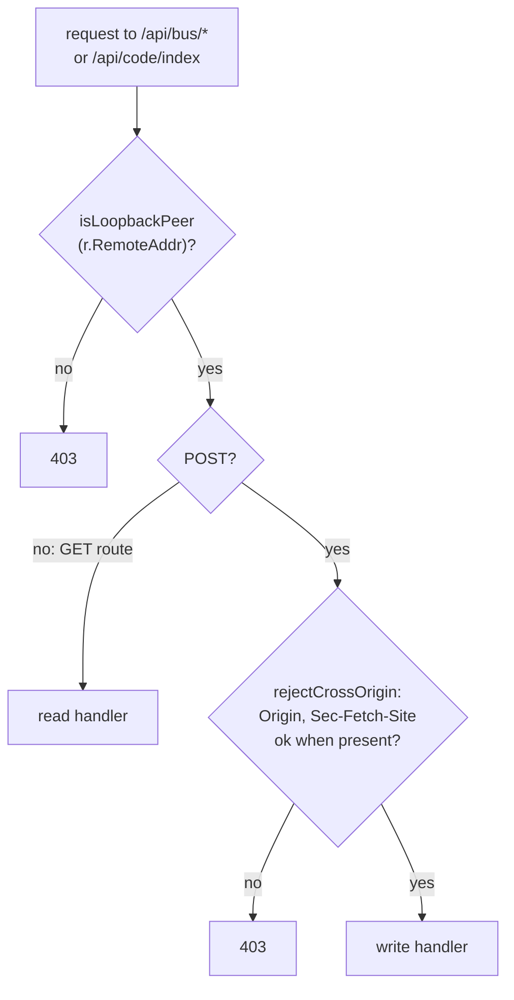
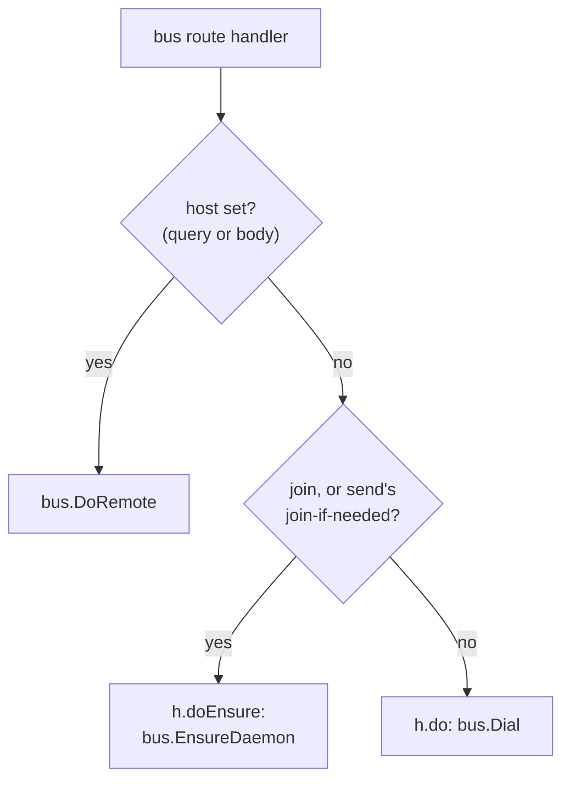
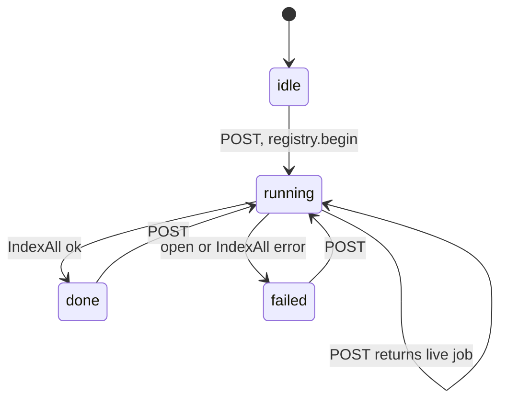
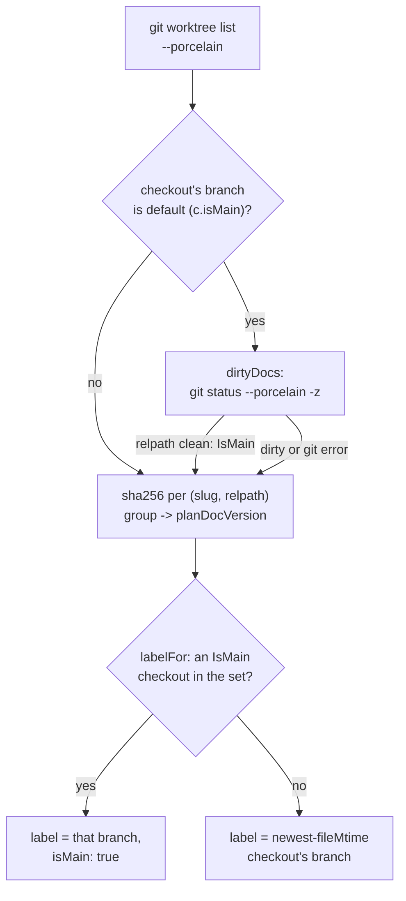
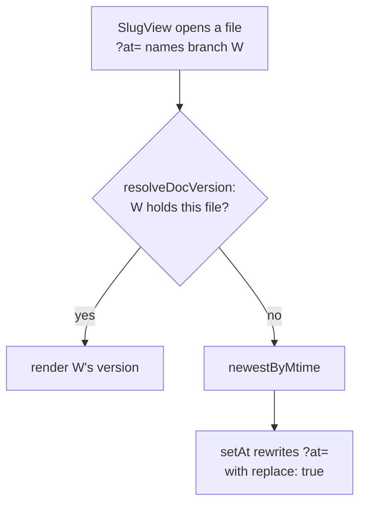
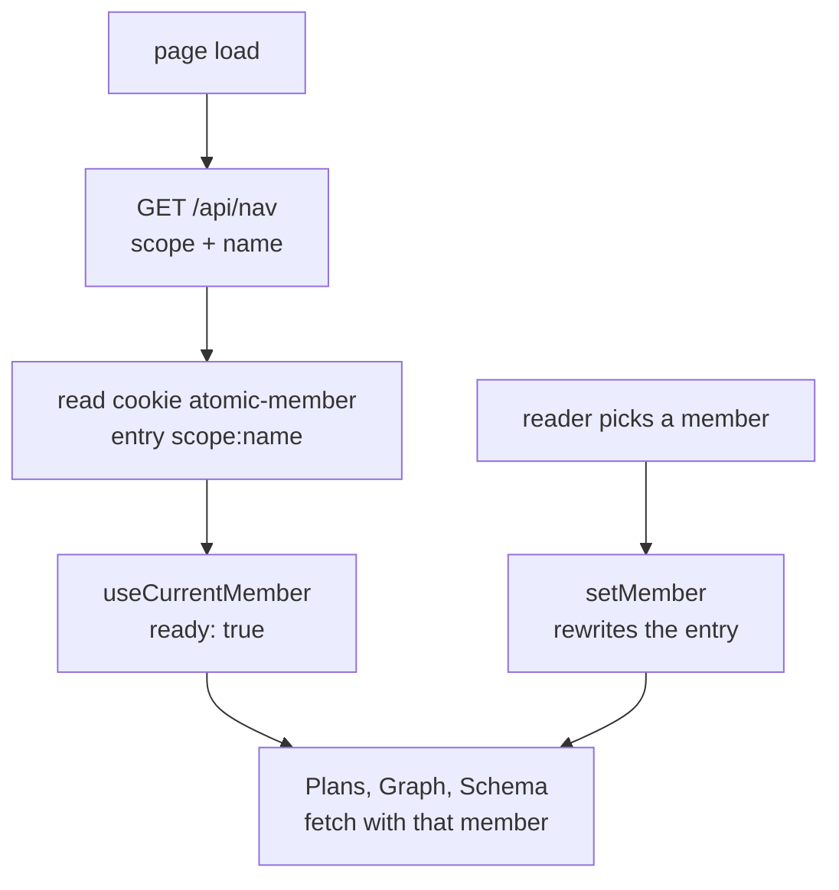
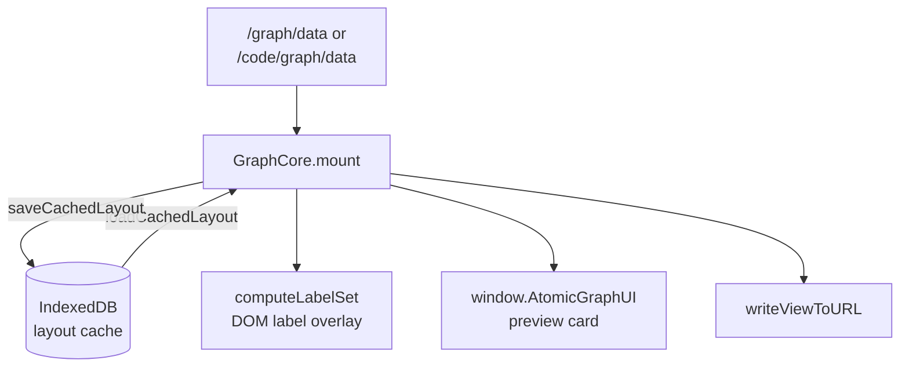
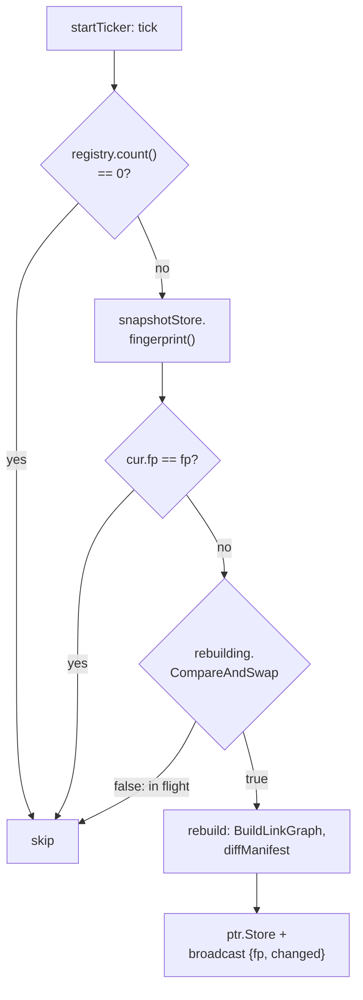
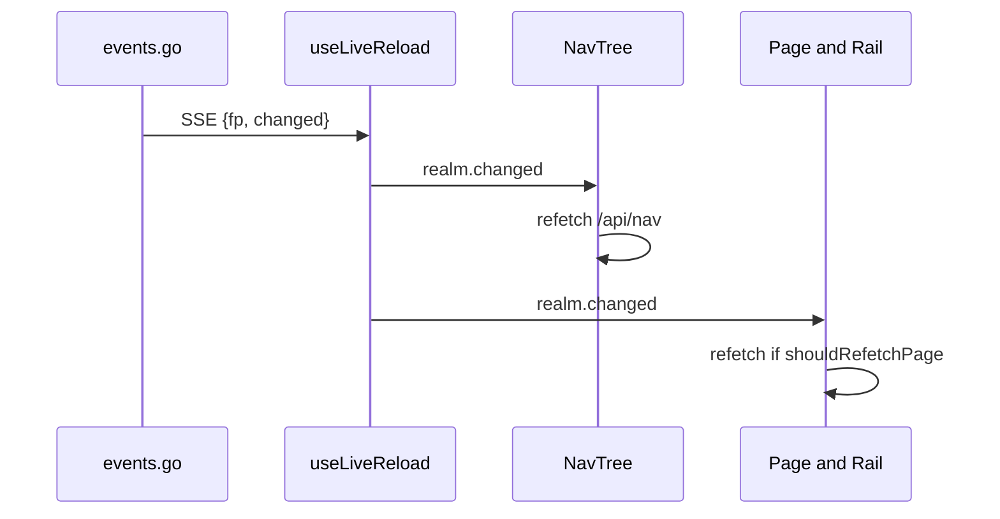

# serve

## What it does

A wiki realm is a set of markdown files and a set of SQLite symbol graphs. Read as files, the links between them stay invisible: nothing shows which pages reference each other, which members have drifted from the last wiki scan, or what a symbol connects to across members.

`atomic serve [path] [--port N] [--host H] [--open]` renders all of it in a browser (default port 4500, default bind `127.0.0.1`). Go serves a JSON API; the UI is a React + TypeScript SPA built by Bun into the gitignored `frontend/dist/` (`make -C atomic frontend`) and embedded with `go:embed`, so `go build` itself never invokes Bun or Node.

Plans exists because a plan is written on a feature branch in its own worktree, and a server rendering only the checkout it started in cannot see it. `/plans` aggregates every worktree's [`docs/design/`](../design), [`docs/spec/`](../spec), and scratchpad bundles into one row per slug, so the reader follows in-flight plans without checking out each branch.

`/bus` chat exists because the `atomic bus` operator verbs (`tail`, `say`, `chat`) work one room at a time in a terminal. The `/bus` page lists rooms, shows a room's transcript, sends as the human, halts and resumes a room, and opens the Claude Code session behind a member.

Serve does not modify realm or repo content. Its write routes all refuse a request whose TCP peer is not loopback:

- `POST /api/bus/{join,send,say,halt,resume,leave,close,end}` write the bus daemon's state (room membership and messages). `close` and `end` also clear the room from `~/.atomic/bus.json`.
- `POST /api/code/index` rewrites one SQLite index. For a matching member, `memberDB` (`code_members.go`) picks the realm federation DB if it exists, else the member's self-index at `config.IndexDBPath` under its harness dir if that exists, else the federation path verbatim (`<realm>/.atomic/<key>.db`). With no matching member, the target is the served root's own `config.IndexDBPath` (`localDBPath`, `api_reindex.go`).

## How it works

Every path that is not an API route returns the SPA shell, which is how a deep link works without a server-side route table.

### HTTP surface

| Route | Returns |
|-------|---------|
| `GET /healthz` | Liveness probe, plain text `ok` |
| `GET /api/page/<relpath>` | Rendered markdown as HTML-in-JSON, plus title, breadcrumb segments, `hasMermaid`. Empty relpath serves the scope landing (realm index, else [`README.md`](../../README.md)). A directory with no index file returns `{dir, entries}` |
| `GET /api/file/<relpath>` | Chroma line-table HTML for a source file |
| `GET /api/rail/<relpath>` | One payload: `properties`, `out`, `in`, `graphDataURL` |
| `GET /api/nav` | `scope`, plus the `name` and `branch` that `resolveScopeIdentity` derives (the origin remote's `owner/repo`, else the directory name). Realm scope: the Realm, Repos, Concerns, Buckets, and External groups, with a membership-drift badge on a repo that `wiki.Stale` reports as drifted. Repo scope: docs file tree plus a Code placeholder |
| `GET /api/search/md?q=` | Literal case-insensitive substring search over `*.md`, capped at 50 results |
| `GET /api/code/search?q=&only=&exclude=` | Federated symbol search, grouped per member. An unindexed member returns `indexed:false` with empty results, not an error |
| `GET /api/search/stream?q=&src=` | SSE: one `md` event, one `code` event per member as its search completes, terminal `end` |
| `GET /api/code/{node,callers,callees,impact,files,schema,file}` | Code-explorer JSON, backing the code modal and SQL schema view |
| `GET /api/code/capabilities` | `{schema, source}`: whether the shell offers the Schema mode. `source` is `config` when `[serve] schema` in [`.claude/atomic.toml`](../../.claude/atomic.toml) decides, else `detected` (some index holds a SQL table, view, or procedure). Memoized for 60s |
| `GET` or `POST /api/code/index[?member=]` | Loopback-only. `POST` starts a detached rebuild of one member's index; `GET` returns that job's `{state, startedAt, endedAt, error}` |
| `GET /api/status` | Realm health: wiki membership drift (`staleRepos`, `allFresh`) plus code-index health, and the process's `runId`, `version`, `commit`, `latestVersion`, `updateAvailable`, `uptimeSeconds` |
| `GET /api/external` | External-link registry with first-seen dates |
| `GET /api/plans[?member=<key>]` | One row per plan slug, aggregated across every git worktree of the target repo (realm root or a named member). `<key>` matches a member's `Prefix` first, its `Key` second (`findPlansMember`, `api_plans.go`) |
| `GET /api/plans/page?worktree=<id>&path=<relpath>[&raw=1]` | One committed doc or bundle file, resolved by worktree id rather than the served root. `raw=1` streams the file's own bytes with `Content-Security-Policy: sandbox` (`sandbox allow-scripts` for an `.html`/`.htm` file) |
| `GET /api/plans/members` | Every repo Plans can aggregate. Empty outside realm scope, where the page renders no picker |
| `GET`/`POST /api/bus/*` | Bus chat facade, loopback-only (routes below) |
| `GET /events` | Live-reload SSE, `{fp, changed}` |
| `GET /graph/data[?node=&depth=]` | Docs link graph as Cytoscape elements. `node=` gives a BFS subgraph, default depth 2. Edge classes: `md-link`, `wikilink` |
| `GET /code/graph/data[?member=]` | One member's entire symbol graph as flat JSON, plus a content fingerprint |
| `GET /code/graph/members` | Realm members with indexed state, for the code view's member picker |
| `GET /*` | Static file from `frontend/dist/`, else `index.html` |

Bus routes, all under `/api/bus/`:

| Method | Routes |
|--------|--------|
| `GET` | `status`, `rooms`, `who`, `sessions`, `transcript`, `log`, `tail` |
| `POST` | `join`, `send`, `say`, `halt`, `resume`, `leave`, `close`, `end` |

### Security model

Each guard sits at a different layer:

| Guard | Where | Rejects |
|-------|-------|---------|
| `isLoopbackPeer` | every `/api/bus/*` and `/api/code/index` request | a non-loopback TCP peer |
| `safeResolve` (`render.go`) | page, rail, file | a path escaping the served root |
| `requireRoom` | bus room names | a name that would escape `RoomLogPath` |
| `resolvePlansPath` (`api_plans_page.go`) | plans page and raw-file reads | a path escaping a worktree-issued root, or an unregistered worktree id |
| `rejectCrossOrigin` (`origin_guard.go`) | every `/api/bus/*` POST route, `/api/code/index` POST | a present `Origin` other than the server's own, or a present `Sec-Fetch-Site` other than `same-origin`; a request carrying neither header passes |

A write request passes both gates in order, and a request that fails either one never reaches daemon or index state:

**Write routes are loopback-only.** `isLoopbackPeer` parses `r.RemoteAddr` with `net.SplitHostPort` and `net.ParseIP(...).IsLoopback()`, never a header, so `--host 0.0.0.0` extends browsing to the LAN but never bus send, bus halt, or a reindex. It also cannot see through a reverse proxy that terminates LAN traffic locally, which is outside the gate's threat model rather than a gap in it. Unparseable addresses fail closed.

**`rejectCrossOrigin` keeps a bundle-mock script off the write routes.** A bundle-mock HTML file's iframe runs scripts (see Plans below), so a script served from this origin could otherwise POST to the loopback-gated bus and `/api/code/index` routes. A sandboxed frame has an opaque origin and sends `Origin: null`, which never equals the server's own `scheme://host`. `rejectCrossOrigin` checks each header only when the request carries it: a present `Origin` must equal the server's own, and a present `Sec-Fetch-Site` must be `same-origin`, else `403`. A browser sends these headers on a cross-origin POST, so the guard stops a script in the frame, while a headerless loopback client (curl, the CLI) passes through.

**Path traversal is rejected at the handler**, not by the filesystem. `safeResolve` and `resolvePlansPath` both delegate to `render.go`'s `resolveContained`, but against different allowed roots: `safeResolve` is fixed to the single served root at every existing call site (`api_handlers.go`, `context_handler.go`, `graph.go`); `resolvePlansPath` calls `resolveContained` directly against whichever worktree root the plans registry resolved the request's `worktree` id to, since a worktree can sit anywhere on disk. `requireRoom` is the equivalent guard for bus room names, which get spliced into a filesystem path.

**`webSessionID` is derived from the served directory**, as `serve-web-<first 8 hex of sha256(TargetDir)>`, not from the pid, so a restarted server reclaims its existing roster entry instead of minting a new member each time. One identity per serve instance, shared by every browser tab.

### Scope and serving

**`Run` versus `RunWithContext`.** `Run` owns signal handling and returns an exit code to `main`. `RunWithContext` is the testable seam that takes a context and `Options` directly.

**Flags may follow the directory.** `parseFlags` uses `cliutil.ParseInterspersed`, so `atomic serve <dir> --port N` listens on `N`. Serve takes at most one directory: a second positional is reported through `cliutil.UnexpectedArgs` and `Run` exits 2. Everything after `--` is positional, so in `atomic serve -- dir --port 4711` the `--port` and `4711` tokens are stray positionals and the run exits 2.

**`--port 0` asks the OS for a free port** and the chosen URL is printed to stdout, so tests and scripts can parse it. A wildcard bind also prints every reachable LAN address below the loopback URL.

**`DisplayScopeRepo` covers a repo with no code index.** Docs-only mode is valid; serve never requires an index to start.

**Walkers skip git-ignored paths, except a directory that is its own repository.** `walk.go`'s `gitIgnores` loads `git ls-files --others --ignored --exclude-standard` for the enclosing repo, and loads each nested repository's own ignore set on entry. A realm gitignores its member repos, and those are what it serves, so `skipDir` checks `isGitRepoRoot` before ignored-ness. The filter applies to enumeration only: an ignored file still renders by path.

**[`.claude`](../../.claude) is not skipped by the walkers.** It holds servable project docs that `atomic wiki linkify` cites across members; skipping it would render valid links as broken and 404 their rails. Nested dotdirs inside it are still skipped.

**Wikilink resolution happens once.** `wikilinkResolverFromGraph` reads the focused page's already-resolved outbound edges filtered to `mdlink.Wikilink`, so the page body and the right rail cannot disagree. Renaming that constant breaks the resolver.

### Bus facade

A bus request reaches a remote gateway, the local daemon, or a freshly spawned local daemon, decided by the request's own `host` and route:

**A remote host never spawns a local daemon.** `do` and `doEnsure` both hand a request carrying `host` to `bus.DoRemote` and skip `EnsureDaemon`, so a failed remote dial cannot split the bus. `rooms` fans out concurrently across the local daemon and every `[bus.remotes]` entry that `remote.Remotes` returns, tagging each room with its `host`; `running` reflects only the local daemon. `log` returns an empty backlog for a remote room, since no log file exists on this machine, and `tail` streams it through `handleTailRemote`.

**No bus read route spawns a daemon.** `status`, `rooms`, and `who` go through `h.do` to `bus.Dial`; `log` reads the room log file with no daemon involved; `tail` dials directly for a subscription. All degrade to a not-running or empty response. Only `join` and `send`'s join-if-needed path use `h.doEnsure` to `bus.EnsureDaemon`. Opening `/bus` never starts a daemon; sending into a room does.

**Transcript parsing is deliberately tolerant.** `api_bus_transcript.go` skips unknown line types, malformed JSON, and over-length lines rather than failing the read, bounds memory with a sliding window, and truncates each rendered block. A future change to Claude Code's `.jsonl` format degrades rendering quality, not availability. Session ids are validated against `^[A-Za-z0-9._-]{1,128}$` before being spliced into a glob.

**`close` and `end` clear persisted membership after the daemon acts.** `clearPersisted` drops the room, or one session's membership of it, from `~/.atomic/bus.json` for the same `host` the request reached, because daemon rehydrate would otherwise replay it. A failure there is ignored; `Prune` reaps the stale entry.

### Code-index rebuild

`reindexRegistry` holds one job per member key, so a repeated click reports the running job instead of starting a second SQLite writer:

The rebuild runs in a detached goroutine under a 30-minute context, since indexing outlives an HTTP timeout. `useReindex`, used by `GraphReindex` and `SchemaToolbar`, polls `GET /api/code/index` every 1200 ms until the state leaves `running`. The target member resolves through the same `memberResolver` the code explorer uses.

### Plans

`/plans` lists one row per slug, and `/plans/:slug/*` opens one. A slug is the shared filename stem of `docs/design/<slug>.md` and `docs/spec/<slug>.md`, or a scratchpad bundle's slug (`bundleSlugOrder` in `plans.go`), so a bundle with no committed doc still gets a row. A row aggregates across every git worktree `git worktree list --porcelain` reports for the repo, so a slug worked on in more than one worktree at once still reads as one row.

A committed document collapses across worktrees by content SHA-256, never by filename or branch name, so checkouts holding byte-identical bytes fold into one version, and checkouts holding different bytes each produce their own version. A scratchpad bundle never collapses this way: each worktree's `<harness dir>/.scratchpad/<slug>/` (`config.ScratchpadDir`) is its own `planBundle` entry, attributed to the checkout that holds it, because nothing merges an uncommitted directory.

A version is labeled merged only when the default-branch checkout holds that doc clean; a dirty or unreadable status in that checkout labels the version by its newest checkout instead:

Checkouts editing the same bytes read as one version, listing every matching checkout under it; a checkout that has diverged reads as its own version, never an additional row.

`resolveDefaultBranch` (`plans.go`) decides which branch counts as merged: `refs/remotes/origin/HEAD`, else `init.defaultBranch` from the shared git config, else `main` when some checkout holds it, else `master`. It reads those files directly and spawns no `git` subprocess. `dirtyDocs` runs `git status --porcelain -z` in the default-branch checkout only, scoped to [`docs/design`](../design) and [`docs/spec`](../spec); a doc it reports untracked or modified is not `IsMain`, and a failed status call marks every doc in that checkout unmerged and adds a warning. `checkoutID` derives each worktree's opaque id as the first 12 hex characters of `sha256(resolved checkout path)`, re-issued by `resolverFor` on every aggregator rebuild and never accepted from a client; `plansRegistry.resolveWorktree` looks an id up against the one aggregator that issued it and confirms it is still current before resolving.

**A root with no `.git` aggregates as one branchless checkout.** When `runGitWorktreeList` fails, `plansAggregator.worktrees` returns a single `checkoutInfo{id: checkoutID(root), path: root, branch: "", isMain: false}`, so a non-git root still surfaces its docs and bundles.

**`planBundle` carries `Path` and `OutsideRoot`** alongside `WorktreeID`/`Branch`. `checkoutDisplayPath(root, path)` renders a checkout's path relative to `root` when it lies inside it, or returns the absolute path with `OutsideRoot: true` when it does not. It reuses `walk.go`'s symlink-resolved comparison, so a root that resolves differently across mount points (macOS `/var` vs `/private/var`) never flags an in-root worktree as outside.

**A doc version's default is the newest by mtime, with no merged-branch preference.** When `at` matches no version, `resolve.ts`'s `resolveDocVersion` falls back to `newestByMtime`, so the reader lands on whichever checkout touched the file last.

A row's title and description come from `extractMeta` reading the representative version's content (the merged version when one exists, else the newest). The title is the first heading; the description is the `## Goal` paragraph, falling back to the document's first body paragraph. A bundle's `meta.toml` `description` field is never used for a row's display text; it is provenance only. The dot picker's count and merged state come from one document's version set (the spec doc's when present, else the design doc's), never a union of both.

Bundle files render by server classification, never by client-supplied extension:

| Kind | Render | `raw=1` CSP |
|------|--------|-------------|
| markdown (`.md`, `.markdown`) | Fetched through `/api/plans/page` and rendered server-side, identically to a committed doc | `sandbox` |
| html (`.html`, `.htm`) | `BundleFileViewer`'s `HtmlWindow`: the code-fence window chrome (dots bar, filename caption), filling the pane via the `mode-plans-frame` body class, in an `iframe` with `sandbox="allow-scripts"` so a mock such as an `atomic-visual-options` fixture runs its own scripts | `sandbox allow-scripts` |
| file (anything else) | Never fetched into the React tree; the client renders a download link to `/api/plans/page?...&raw=1` | `sandbox` |

The html frame's opaque origin keeps a running script from the app's cookies and storage, and `rejectCrossOrigin` (Security model, above) keeps it off the write routes.

**`usePlansScope` is the one place Plans code reads or writes `?at=` and the `/plans/:slug/*` route.** Every consumer reads a field (`at`, `slug`, `relpath`, `isPlansRoute`) or calls a writer (`openSlug`, `openFile`, `setAt`), never `react-router` directly. `setAt` navigates through `{ pathname, search, hash }` rather than `setSearchParams`, because `setSearchParams`'s `"?" + params` form drops a heading anchor open at the time of the write. Member selection is not a URL concern: `usePlansScope` carries no member field, and `plansHref` and `slugHref` carry no member query param.

A row's `updatedAt` is `rowUpdatedAt` (`plans.go`): the newest mtime across every doc version and every bundle file, never `meta.toml`'s own `updated` field (a Save-verb rewrite stamp, not a per-file one). `/api/plans` sorts rows by it, descending, with a slug tiebreak, so the list reads newest-touched first. `PlansView`'s toolbar is sticky and carries a client-side filter (`filterPlanRows` in `searchItems.ts`, case-insensitive substring over title/description/slug) shared with the ⌘K palette's plans tab, so the toolbar and the palette never disagree on a match; ⌘F/Ctrl+F focuses the filter input while `/plans` is mounted, unless focus already sits in a text field, and Escape clears it.

### Version resolution

A file's version resolves from the sticky `?at=` branch, and the URL follows whatever resolved:

Reading a slug means the body and the rail agreeing on one resolution. `SlugView` owns the sticky `?at=` query parameter, naming a checkout's branch, through `usePlansScope`'s `setAt`. `PlansRail` (mounted separately in the shell's aside) computes the identical resolution read-only through `components/plans/resolve.ts`'s `resolveDocVersion`, so the body and the rail's version picker can never show different versions. When the resolved checkout's branch does not match `at` (no selection yet, or the requested branch has no version for a newly opened file), `SlugView` rewrites the URL to match rather than blocking on it: navigation always wins over the sticky preference.

### Member selection

Every member-scoped page waits on one identity fetch, then reads and writes the same cookie entry:

**`utils/memberStore.ts` is the one module-level store for the reader's picked member.** It is cookie-backed (`atomic-member`, one JSON map keyed `<scope>:<name>` so a realm pick and a repo pick never collide) rather than URL-carried, so the selection survives a reload without living in every page's query string. `useCurrentMember()` (`useSyncExternalStore`, same pattern as `components/code-modal/store.ts`) resolves the scope identity from one `GET /nav` per page load. `ready` is false until that resolves, and Graph and Schema both hold their member-scoped fetch on `!ready` rather than fetching against an empty member and refetching once identity lands. `memberLabel(prefix, realmName)` renders the empty prefix (the realm root or bare-repo scope) as the realm's own name instead of blank; `graphEngineAdapter.ts`'s `pickerLabel(m, realmName)` composes it with the `— not indexed` suffix for the Graph and Schema member `<select>`s.

**Graph and Schema both read `member` from the store, not `?member=`.** `resolveMember(fetched, member)` picks the render and fetch fallback locally and never writes it back to the store, so a member missing from one page's own list does not leak into another page's pick. `SchemaView.tsx` follows the same shape (`resolveMember` computed inline, `setMember` from the store passed straight to `SchemaToolbar`). The `/graph` URL carries only `?view=`.

**The top bar names the checkout on screen.** `TopBar.tsx`'s `provenanceLabel` reads `utils/planViewStore.ts`'s `useOnScreenCheckout()`, a second module-level `useSyncExternalStore` store that `SlugView` sets to `{branch, path, outsideRoot}` for whichever checkout resolved onto the page. It renders `<branch> · <path>` after the breadcrumb's file crumb, gated on `scope.slug` rather than `isPlansRoute`, which also holds on bare `/plans` and would show the outgoing slug's provenance for a frame during unmount. The plans breadcrumb (`plansCrumbs`) inserts a member crumb between "plans" and the slug only when `member.scope === "realm"`, labeled through the same `memberLabel`.

### Graph pane

The carried scripts load as a dependency chain, and each stage reads the previous one's `window` global at its own top-level init: `graph-core.js` reads `window.Cosmos` from `cosmos-graph.js`, and both `system-graph.js` and `code-graph.js` read `window.GraphCore` from `graph-core.js`.

The rail mini-graph's `cytoscape.min.js` is an unrelated load; the rail never uses cosmos.gl.

A settled layout round-trips through IndexedDB keyed by content fingerprint, so a reopened graph replays positions instead of re-simulating:

**The docs graph is laid out in the background before the reader opens it.** `useGraphWarm` waits 2 seconds after a non-graph page mounts, reads `runId` from `/api/status`, and calls `warmDocsGraph`, which mounts the engine in an offscreen container to populate the layout cache. The warm record lives in its own IndexedDB database (`atomic-graph-warm`) keyed by `runId`, so a restarted server warms again. Opening `/graph` cancels a warm in flight.

**Graph fingerprints are content-derived**, from sorted node and edge tuples rather than counts and a timestamp, so a renamed symbol invalidates the cached layout. The code view namespaces its IndexedDB key as `code:<member>:<fingerprint>` to avoid colliding with the docs profile in the same store.

**`/code/graph/data` dedups parallel edges before responding.** The database stores one `calls` edge per call site, so a helper invoked from N places produces N identical `(source, target, kind)` rows that the client would draw as N stacked links. `dedupParallelEdges` collapses them preserving first-seen order, and `graphFingerprint` runs on the deduped set so a duplicate-count-only change does not churn the layout cache.

### Live reload

The expensive rebuild sits behind gates, so an idle server does no periodic filesystem work at all and a burst of edits rebuilds once rather than once per tick.

Gate 3 skips rather than blocks: a caller that finds a rebuild in flight gets the current snapshot back and picks up the change on a later pass. Every per-request handler shares this same `ensureFresh` path, so the ticker is a freshness nudge for subscribers rather than the only thing that rebuilds.

**The realm snapshot is swapped, never mutated.** `snapshot.go` publishes an immutable `realmSnapshot` through a single `atomic.Pointer` swap, so a torn read is structurally impossible. Page and rail handlers reach it through the `graphProvider` interface rather than holding a `*Graph`.

The ticker starts once at startup and stops on the same context that drives graceful shutdown.

### Client fan-out

On the client, one `EventSource` fans out to one in-app event, and each subscriber decides its own refetch:

**The `changed` list in an `/events` payload is capped at 100 entries** and omitted above the cap. The client treats an omitted list as "everything changed" and refetches.

**Live-reload does not patch the graph pane or Plans.** A subscribed tab refetches its nav tree unconditionally and its open page and rail conditionally, but the graph pane reflects a realm change only on its next `/graph/data` or `/code/graph/data` fetch. Plans has no live-reload wiring: `PlansView` and `SlugView` refetch `/api/plans` only on mount and on navigation.

## Where it lives

| Responsibility | Path | Role |
|----------------|------|------|
| **Server and routing** | [`atomic/internal/serve/serve.go`](../../atomic/internal/serve/serve.go) | `Run` / `RunWithContext`, `Options`, `DisplayScope`, `ResolveDisplayScope`, the whole mux (including the `/api/plans*` routes), `newSPAHandler`, listener and graceful shutdown |
| | [`atomic/internal/serve/api_handlers.go`](../../atomic/internal/serve/api_handlers.go) | The page, file, rail, nav, md-search, code-search, and search-stream handlers; `writeAPIJSON` / `writeAPIError` share one `{"error": "..."}` envelope |
| | [`atomic/internal/serve/context_handler.go`](../../atomic/internal/serve/context_handler.go) | Relpath resolution shared by page and rail (index files, directory listing) |
| | [`atomic/internal/serve/nav.go`](../../atomic/internal/serve/nav.go) | Realm and repo nav group builders, `computeStaleness` (the drifted-member set behind the repo badges) |
| | [`atomic/internal/serve/stale.go`](../../atomic/internal/serve/stale.go) | Sole parser for `wiki.Stale` output, reading `DRIFT` lines only |
| | [`atomic/internal/serve/staleness_cache.go`](../../atomic/internal/serve/staleness_cache.go) | `navStalenessCache`: one `wiki.Stale` walk shared by `/api/nav` and `/api/status`; an aged answer is served while a background refresh runs |
| | [`atomic/internal/serve/scope_identity.go`](../../atomic/internal/serve/scope_identity.go) | `resolveScopeIdentity`: the `name` and `branch` that `/api/nav` labels the served tree with |
| | [`atomic/internal/serve/walk.go`](../../atomic/internal/serve/walk.go) | `shouldSkipDir` and `gitIgnores`, shared by every file walker in the package |
| | [`atomic/internal/serve/health.go`](../../atomic/internal/serve/health.go) | `/api/status` realm health, build version, and update availability from the self-update state file |
| | [`atomic/internal/serve/external.go`](../../atomic/internal/serve/external.go) | `BuildExternalRegistry`, `GitOrMtimeDateFn` |
| | [`atomic/internal/serve/search_md.go`](../../atomic/internal/serve/search_md.go), `search_stream.go` | Markdown search and the SSE framing around it |
| | [`atomic/internal/serve/frontend/CLAUDE.md`](../../atomic/internal/serve/frontend/CLAUDE.md) | The frontend workspace's own conventions: Bun only, LogosDX for data, Ark UI for primitives, one folder per component |
| | [`atomic/internal/serve/frontend/src/routes.tsx`](../../atomic/internal/serve/frontend/src/routes.tsx) | `/`, `/page/*`, `/graph`, `/plans`, `/plans/:slug/*`, `/bus`, `/search`, `/status`, `/external`, `/code/schema` |
| | [`atomic/internal/serve/frontend/src/layouts/Shell/`](../../atomic/internal/serve/frontend/src/layouts/Shell) | Shell: top bar, nav tree, content, rail; installs `window.AtomicGraphUI` |
| | [`atomic/internal/serve/frontend/src/pages/`](../../atomic/internal/serve/frontend/src/pages) | Route screens, including `Graph/` (Docs and Code views), `Bus/`, `Plans.tsx` and `PlansSlug.tsx` (thin wrappers over `components/plans/`) |
| | [`atomic/internal/serve/frontend/src/components/`](../../atomic/internal/serve/frontend/src/components) | `nav`, `rail`, `search`, `code-modal`, `mermaid-lightbox`, `schema`, `plans`, `about`, and generic `ui` primitives |
| | [`atomic/internal/serve/frontend/src/components/nav/IconRail.tsx`](../../atomic/internal/serve/frontend/src/components/nav/IconRail.tsx) | The mode icons (Docs, Graph, Schema, Message Bus, Plans) routed below the Browse toggle; Schema shows only when `useCapabilities` reports `schema`, or while its route is open |
| | [`atomic/internal/serve/frontend/src/components/search/SearchPalette.tsx`](../../atomic/internal/serve/frontend/src/components/search/SearchPalette.tsx), `searchItems.ts` | Cmd-K palette; a `plans` source tab fetches the full `/api/plans` payload once and filters client-side (`planPaletteItems`, built on `filterPlanRows`, the same filter `PlansView`'s toolbar uses), since Plans has no search endpoint |
| | [`atomic/internal/serve/frontend/src/utils/api.ts`](../../atomic/internal/serve/frontend/src/utils/api.ts) | The single shared `FetchEngine` |
| | [`docs/spec/atomic-serve.md`](../spec/atomic-serve.md) | Success criteria, non-goals, the read-only contract and its bus-chat narrowing. The narrowing predates the reindex route, so it names only `POST /api/bus/*` |
| | [`docs/design/atomic-serve.md`](../design/atomic-serve.md) | The original scope model (one server over realm, wiki, and code-intel substrates). Its asset and route sections are superseded by [`docs/design/serve-react-frontend.md`](../design/serve-react-frontend.md) |
| | [`docs/reference/serve.md`](../reference/serve.md) | User-facing: flags, scope table, every route, graph mode, bus chat |
| | [`docs/spec/serve-react-frontend.md`](../spec/serve-react-frontend.md), [`docs/design/serve-react-frontend.md`](../design/serve-react-frontend.md) | The React SPA and the `/api/*` contract table |
| **Rendering and links** | [`atomic/internal/serve/render.go`](../../atomic/internal/serve/render.go) | goldmark + chroma renderer, mermaid fence pass-through, `RenderMarkdownWithGraph`, `safeResolve`, `resolveContained` (the shared containment algorithm both `safeResolve` and `api_plans_page.go` call) |
| | [`atomic/internal/serve/wikilink.go`](../../atomic/internal/serve/wikilink.go) | goldmark inline parser and renderer for `[[page]]` / `[[page\|alias]]` |
| | [`atomic/internal/serve/graph.go`](../../atomic/internal/serve/graph.go) | `BuildLinkGraph` plus the `Graph` queries: `Has`, `Outbound`, `Backlinks`, `IsOrphan`, `NodeType`, `Meta` |
| | [`atomic/internal/serve/rail_handler.go`](../../atomic/internal/serve/rail_handler.go) | Rail properties from key-ordered YAML frontmatter |
| | [`atomic/internal/mdlink/`](../../atomic/internal/mdlink) | `ExtractLinks` and the `Link`/`LinkKind` types (`Wikilink` among them) that `graph.go`, `graphoverlay.go`, `wikilink.go`, and `external.go` read. Also `Linkify` and its gitignore-aware `LinkifyFile` (`gitignore.go`), which `signals` and `wiki` call and serve does not |
| | [`atomic/internal/frontmatter/`](../../atomic/internal/frontmatter) | `Parse` (strips frontmatter before goldmark, and before Plans' `extractMeta` reads a doc's `## Goal`), `ParseOrdered` (rail properties, key order kept), and the emitters `Emit` (keys sorted, round-trips with `Parse`) and `EmitOrdered` (keys in `KV` order), which serve does not call |
| **Security guards** | [`atomic/internal/serve/origin_guard.go`](../../atomic/internal/serve/origin_guard.go) | `rejectCrossOrigin`, the same-origin check every bus POST route and the reindex POST route call before touching daemon or index state |
| **Plans** | [`atomic/internal/serve/plans.go`](../../atomic/internal/serve/plans.go) | `plansAggregator`: worktree enumeration, `resolveDefaultBranch`, `dirtyDocs`, content-SHA version grouping and `labelFor`, bundle collection via `scratchpad.List`, `rowUpdatedAt` (rows sorted newest first with a slug tiebreak), and the stat-only fingerprint cache the Plans surface reads from |
| | [`atomic/internal/serve/api_plans.go`](../../atomic/internal/serve/api_plans.go) | `/api/plans` and `/api/plans/members`; `plansRegistry` sharing one `plansAggregator` per root and indexing worktree ids across every aggregator built |
| | [`atomic/internal/serve/api_plans_page.go`](../../atomic/internal/serve/api_plans_page.go) | `/api/plans/page`; `resolvePlansPath`, `plansContentType`'s HTML/XML-sniff clamp for `raw=1` responses |
| | [`atomic/internal/serve/frontend/src/components/plans/PlansView.tsx`](../../atomic/internal/serve/frontend/src/components/plans/PlansView.tsx) | The `/plans` list: sticky toolbar, one row per slug with `updatedAt`, ⌘F-captured client-side filter (`filterPlanRows`), member picker, `chipsFor` (design/spec/brief/state/followups/findings/options chips from what a row carries) |
| | [`atomic/internal/serve/frontend/src/components/plans/SlugView.tsx`](../../atomic/internal/serve/frontend/src/components/plans/SlugView.tsx) | The opened slug: owns the sticky `?at=` write and its yield via `usePlansScope`, fetches the active doc or bundle file, mounts mermaid, emits page headings for the rail's Contents tab |
| | [`atomic/internal/serve/frontend/src/components/plans/usePlansScope.ts`](../../atomic/internal/serve/frontend/src/components/plans/usePlansScope.ts) | The one hook that reads and writes `?at=` and the `/plans/:slug/*` route; every other Plans component reads its fields or calls its writers instead of `react-router` directly |
| | [`atomic/internal/serve/frontend/src/components/plans/resolve.ts`](../../atomic/internal/serve/frontend/src/components/plans/resolve.ts) | `findDoc`, `resolveDocVersion`, `resolveBundleFile`: the one resolution algorithm `SlugView` and `PlansRail` both call, so they cannot compute different answers |
| | [`atomic/internal/serve/frontend/src/components/plans/VersionPicker.tsx`](../../atomic/internal/serve/frontend/src/components/plans/VersionPicker.tsx) | Right-rail type-ahead over a doc's version set (Ark `Combobox`), hidden when a doc has one version |
| | [`atomic/internal/serve/frontend/src/components/plans/BundleFileViewer.tsx`](../../atomic/internal/serve/frontend/src/components/plans/BundleFileViewer.tsx) | Renders a bundle file by kind: markdown through the page fetch, html through `HtmlWindow`'s code-fence chrome (`mode-plans-frame`), file through a raw-URL download link |
| | [`atomic/internal/serve/frontend/src/components/rail/PlansRail.tsx`](../../atomic/internal/serve/frontend/src/components/rail/PlansRail.tsx) | Right rail for an opened slug: version picker, the row's docs and bundle files as nav entries, the active file's headings. Mounted outside `SlugView`'s route subtree, it re-derives slug and path from the URL itself |
| | [`atomic/internal/serve/frontend/src/utils/plansApi.ts`](../../atomic/internal/serve/frontend/src/utils/plansApi.ts) | Typed shapes and fetchers for `/api/plans`, `/api/plans/members`, `/api/plans/page`; `bundleLocalPath` strips a bundle file's `relpath` down to its part after `.scratchpad/<slug>/` |
| | [`atomic/internal/serve/frontend/src/utils/memberStore.ts`](../../atomic/internal/serve/frontend/src/utils/memberStore.ts) | Module-level, cookie-backed store (`atomic-member`) for the reader's picked member; `useCurrentMember`, `setMember`, `memberLabel` |
| | [`atomic/internal/serve/frontend/src/utils/planViewStore.ts`](../../atomic/internal/serve/frontend/src/utils/planViewStore.ts) | Module-level store for the checkout `SlugView` has on screen; `useOnScreenCheckout`, read by `TopBar` for provenance |
| | [`docs/spec/serve-plans-page.md`](../spec/serve-plans-page.md), [`docs/design/serve-plans-page.md`](../design/serve-plans-page.md) | The Plans surface: aggregation model, worktree-id containment, and the `atomic scratchpad` and project-keyed state paths it shares a spec with |
| | [`docs/spec/serve-realm-ux.md`](../spec/serve-realm-ux.md), [`docs/design/serve-realm-ux.md`](../design/serve-realm-ux.md) | The member store, on-screen-checkout provenance, and non-git-root plan aggregation |
| **Bus** | [`atomic/internal/serve/api_bus.go`](../../atomic/internal/serve/api_bus.go) | `/api/bus/*` handler: loopback gate, dial-vs-ensure split, `requireRoom`, `writeBusError`, `rejectCrossOrigin` on every POST route |
| | [`atomic/internal/serve/api_bus_transcript.go`](../../atomic/internal/serve/api_bus_transcript.go) | `/api/bus/sessions` and `/api/bus/transcript` |
| | [`docs/spec/serve-bus-chat.md`](../spec/serve-bus-chat.md), [`docs/design/serve-bus-chat.md`](../design/serve-bus-chat.md) | The `/bus` page, loopback gate, session rail, transcript parsing |
| **Code explorer and reindex** | [`atomic/internal/serve/codeexplorer.go`](../../atomic/internal/serve/codeexplorer.go) | `CodeEngine` / `EngineProvider` seams and the `/api/code/*` handlers |
| | [`atomic/internal/serve/codesearch.go`](../../atomic/internal/serve/codesearch.go) | Federated symbol-search fan-out across members |
| | [`atomic/internal/serve/code_members.go`](../../atomic/internal/serve/code_members.go) | `memberResolver` (realm federation union self-index discovery), `memberDB`; `codeMember`, reused by `plansMembers` |
| | [`atomic/internal/serve/api_code_capabilities.go`](../../atomic/internal/serve/api_code_capabilities.go) | `/api/code/capabilities`: the `[serve] schema` override, else `hasSQLObjects` across indexes, behind `capabilitiesCache` |
| | [`atomic/internal/serve/api_reindex.go`](../../atomic/internal/serve/api_reindex.go) | `/api/code/index`: `reindexRegistry`, `NewAPIReindexHandler`; also `runID` and `Uptime` for `/api/status` |
| | [`atomic/internal/serve/frontend/src/hooks/useCapabilities.ts`](../../atomic/internal/serve/frontend/src/hooks/useCapabilities.ts), `useReindex.ts` | Fetch `/api/code/capabilities`; start and poll `/api/code/index` |
| **Graph pane** | [`atomic/internal/serve/graphoverlay.go`](../../atomic/internal/serve/graphoverlay.go) | `/graph/data` Cytoscape element assembly |
| | [`atomic/internal/serve/graphcache.go`](../../atomic/internal/serve/graphcache.go) | Fingerprint-invalidated cache for the whole-realm graph payload |
| | [`atomic/internal/serve/codegraph.go`](../../atomic/internal/serve/codegraph.go) | `/code/graph/data` export, `dedupParallelEdges`, `graphFingerprint` |
| | [`atomic/internal/serve/code_graph_members.go`](../../atomic/internal/serve/code_graph_members.go) | `/code/graph/members` |
| | [`atomic/internal/serve/frontend/src/utils/graphEngineAdapter.ts`](../../atomic/internal/serve/frontend/src/utils/graphEngineAdapter.ts) | Lazy-loads the carried scripts in dependency order, mounts a profile, owns member resolution, `pickerLabel` |
| | [`atomic/internal/serve/frontend/src/utils/typeColors.ts`](../../atomic/internal/serve/frontend/src/utils/typeColors.ts) | Single-source type-to-color derivation, exposed on `window` for the carried scripts |
| | [`atomic/internal/serve/frontend/src/hooks/useGraphWarm.ts`](../../atomic/internal/serve/frontend/src/hooks/useGraphWarm.ts), `src/utils/graphWarm.ts` | Background docs-graph layout warm, keyed by the `runId` from `/api/status` |
| | [`atomic/internal/serve/frontend/public/graph-core.js`](../../atomic/internal/serve/frontend/public/graph-core.js) | View-agnostic cosmos.gl engine: mount, teardown, retheme, WebGL2 detection, IndexedDB layout cache, label overlay, drag |
| | [`atomic/internal/serve/frontend/public/system-graph.js`](../../atomic/internal/serve/frontend/public/system-graph.js), `code-graph.js` | The docs and code profiles: data fetch, palette, cache key, hover and click hooks |
| | `atomic/internal/serve/frontend/public/vendor/` | `cosmos-graph.js` and `cytoscape.min.js`, each with a `*.provenance.txt` where one exists |
| | [`docs/spec/cosmos-system-graph.md`](../spec/cosmos-system-graph.md), [`docs/design/cosmos-system-graph.md`](../design/cosmos-system-graph.md) | The cosmos.gl rendering contract both graph views delegate to |
| | [`docs/spec/code-graph.md`](../spec/code-graph.md), [`docs/design/code-graph.md`](../design/code-graph.md) | The code graph view: granularity, palette, layout cache, member picker |
| **Live reload** | [`atomic/internal/serve/snapshot.go`](../../atomic/internal/serve/snapshot.go) | `snapshotStore`: fingerprint, nav paths, and link graph behind one `atomic.Pointer`; `ensureFresh`, `rebuild`, `diffManifest` |
| | [`atomic/internal/serve/events.go`](../../atomic/internal/serve/events.go) | `/events` SSE endpoint, `subscriberRegistry`, and the subscriber-gated `startTicker` |
| | [`atomic/internal/serve/frontend/src/hooks/useLiveReload.ts`](../../atomic/internal/serve/frontend/src/hooks/useLiveReload.ts) | `EventSource('/events')` to a `realm.changed` observer event; `shouldRefetchPage` decides page and rail refetch |
| | [`docs/spec/serve-live-reload.md`](../spec/serve-live-reload.md), [`docs/design/serve-live-reload.md`](../design/serve-live-reload.md) | Snapshot store, `/events`, page-mode reconcile |
| **Build** | [`atomic/internal/serve/frontend_dist.go`](../../atomic/internal/serve/frontend_dist.go) | `//go:embed all:frontend/dist` and `//go:generate bun run --cwd frontend build.ts` |
| | [`atomic/internal/serve/frontend/build.ts`](../../atomic/internal/serve/frontend/build.ts) | `Bun.build` into `dist/assets/`, copies `public/` verbatim, writes `dist/index.html`; copies `mermaid.min.js` from the pinned `mermaid` dependency and builds `@mermaid-js/layout-elk` into split ES module chunks, both into `dist/vendor/` |
| | [`atomic/internal/serve/frontend/index.html`](../../atomic/internal/serve/frontend/index.html) | SPA shell, loads the carried scripts |
| | [`atomic/internal/serve/frontend/mermaid-layout-elk.entry.ts`](../../atomic/internal/serve/frontend/mermaid-layout-elk.entry.ts) | Re-exports `@mermaid-js/layout-elk` as the ELK build's entry; `src/utils/mermaidElk.ts` imports the built entry at runtime |

## Constraints

**The SPA fallback returns 200, not 404**, so a typo in an asset path yields `index.html` where JavaScript was expected, which surfaces as a browser parse error rather than a missing-file error.

**Carried script load order matters, and getting it wrong fails silently.** Both graph profiles read `window.GraphCore` at their own top-level init, so loading a profile before `graph-core.js` produces no error, just a pane that never mounts.

**`code-graph.js`'s `KIND_GROUPS` table must track every value of `AllNodeKinds`** in [`atomic/internal/codeintel/types/types.go`](../../atomic/internal/codeintel/types/types.go), each mapped to a visual group. A kind missing from the table falls through to the `other` bucket instead of erroring, so a taxonomy gap is invisible until someone cross-checks `KIND_GROUPS` against `AllNodeKinds`.

**`public/` is copied verbatim into `dist/` by `build.ts`; `public/` is committed, `dist/` is gitignored.** Editing `public/code-graph.js` without re-running `make -C atomic frontend` leaves the served copy stale in a binary you built earlier. `make build|test|vet` rebuild it first, and a bare `go build` does not. On a fresh clone, a bare `go build` fails on `frontend_dist.go`'s `//go:embed all:frontend/dist` until `make frontend` or `go generate ./...` has run. Build wiring: [`docs/wiki/bundle.md`](bundle.md).

**The `main.js` build disables identifier minification on purpose.** At this dependency-graph size the renamer's tie-breaker is non-deterministic, which would make otherwise-identical builds differ byte-for-byte. Whitespace and syntax minification stay on.

**`bun:test` does not reset modules between test files.** `loadScript`'s `loaded` cache and `railCytoscapeStyle`'s `window.__railCy` global both leak across files, so `src/test/setup.testing.ts` resets them in a global `afterEach` on top of whatever individual suites do.

**A Plans row never reads a file inside the quiet window.** `plansAggregator.build` and `plansAggregator.fingerprint` both skip a [`docs/design`](../design)/[`docs/spec`](../spec) entry whose mtime is under 2 seconds old (`defaultQuietWindow`, shared with `snapshot.go`'s), so a file mid-write cannot tear a version's content SHA across the build and fingerprint reads.

**A symlink under [`docs/design/`](../design) or [`docs/spec/`](../spec) is never followed.** The docs walk spans every checkout including review-only worktrees, and a symlink there would hash and title-extract an arbitrary file from outside the repository into a row.

**The Schema mode can lag a reindex by up to 60 seconds.** `capabilitiesTTL` memoizes the SQL-object probe, since it opens every member index. A `[serve] schema` setting in [`.claude/atomic.toml`](../../.claude/atomic.toml) bypasses detection in either direction.

**`safeResolve`'s allowed root is never widened for Plans.** `api_plans_page.go` calls `resolveContained` directly against a worktree-issued root instead. Widening `safeResolve`'s root would let a worktree id open paths outside the served root through page, rail, and file.

## Coupling

- **wiki domain.** `serve` calls `wiki.Stale`, `wiki.ReadScanMembers`, and `wiki.ReadBucketEntries`. The `DRIFT added|removed <path>` / `DRIFT status <path> <old>→<new>` line grammar is a wire format between them: `parseStaleLines` keys on the third field, so a change to it breaks `stale.go`, and with it the nav badges and `/api/status`. `plansMembers` also calls `wiki.ReadScanMembers` to enumerate every wiki-scanned member Plans can aggregate, alongside `realm.Resolve`'s declared members.
- **code-intel domain.** `serve` calls `realm.Resolve` for scope, opens per-member indexes through `engine.NewWithDBPath`, and talks to the engine only through the `CodeEngine` interface in `codeexplorer.go`. Adding a method there means every fake in `codeexplorer_fakes_test.go` grows too. `api_plans.go` reuses `realm.Resolve` and the `codeMember` type from `code_members.go` to build its member list, rather than defining a second one.
- **bus domain.** `api_bus.go` imports `internal/bus` in-process, not as a subprocess, and uses `bus.JoinIdentity`, `bus.Dial`, `bus.EnsureDaemon`, and `bus.RoomLogPath`. The wire types `bus.Request`, `bus.Response`, `bus.Envelope`, `bus.RoomInfo`, `bus.Member`, and `bus.Error` cross the boundary with no translation layer, so their JSON shapes are also serve's contract with the `/bus` frontend. `bus.Error.Code` drives the HTTP status mapping. Remote rooms go through `bus.DoRemote`, `bus.DoRemoteTimeout`, and `remote.Remotes` (the `[bus.remotes]` table in `~/.atomic/config.toml`); `close` and `end` call `bus.Load`, `ClearRoom`, `Leave`, and `Save` on `~/.atomic/bus.json`.
- **doctor domain.** `health.go` calls `doctor.RunCheckCodeIndexRealmWith` and `doctor.RunCheckCodeIndexWith` for the code-index half of `/api/status`. Separately, `atomic validate artifacts` lints `atomic serve` citations against `cliusage.go`, so a new flag has to be registered there or valid citations start failing.
- **config domain.** `parseFlags` in `serve.go` parses argv through `cliutil.ParseInterspersed` and `cliutil.UnexpectedArgs` in [`atomic/internal/cliutil/args.go`](../../atomic/internal/cliutil/args.go), shared with `atomic code` and `atomic validate` (contract: [`docs/spec/cli-trailing-flags.md`](../spec/cli-trailing-flags.md)). `api_code_capabilities.go` reads `[serve] schema` through `config.LoadRepoConfig`, a three-state `*bool` override defined in [`atomic/internal/config/repo.go`](../../atomic/internal/config/repo.go). Member database paths resolve through `config.IndexDBPath`, which is harness-dir aware, so serve never hardcodes `.claude/.atomic-index/`. `plans.go` resolves each worktree's bundle root through `config.ScratchpadDir`, validates a doc's filename stem with `config.ValidateSegment` before it can become a path or row key, and calls `scratchpad.List` per worktree to enumerate `meta.toml`-bearing bundles. The write side of that bundle layout (`atomic scratchpad new/path/archive`) is never called from serve.
- **`frontmatter` importers.** `internal/wiki`, `internal/validate`, `internal/reminder`, and `internal/claudeinstall` import [`atomic/internal/frontmatter`](../../atomic/internal/frontmatter) alongside serve; `reminder` and `claudeinstall` are the `EmitOrdered` callers. A change to `Parse` or `ParseOrdered` semantics reaches all of them.
- **`mdlink.LinkifyFile` callers.** `internal/signals` (`signals.go`) and `internal/wiki` (`linkify.go`) call `mdlink.LinkifyFile`; serve calls only `ExtractLinks` and reads `Link`/`LinkKind`.
- **`/atomic-help`.** [`context/commands/atomic-help.md`](../../context/commands/atomic-help.md) lists `atomic serve` in its intent table and its verb list.
- **`/atomic-plan` and the implement loops.** `/atomic-plan` writes `docs/design/<topic>.md` and `docs/spec/<topic>.md` plus an `atomic scratchpad` bundle, and `/subagent-implementation` records its iterations in that bundle; Plans reads both.
- **`atomic-visual-options`.** The skill writes `options.html` into a scratchpad bundle. That HTML mock is why the bundle iframe carries `sandbox allow-scripts` and why `rejectCrossOrigin` guards the write routes.
- **`/refresh-wiki`.** In realm scope it runs `atomic wiki scan`, which writes the `<wiki-scan>` block in `wiki/index.md` that `wiki.Stale` compares against for the `/api/nav` drift badges and `/api/status`.
- **bundle domain.** `frontend_dist.go`'s `go:generate` directive runs the Bun frontend build, so `go generate ./...` depends on a populated `frontend/node_modules`. See [`docs/wiki/bundle.md`](bundle.md).
