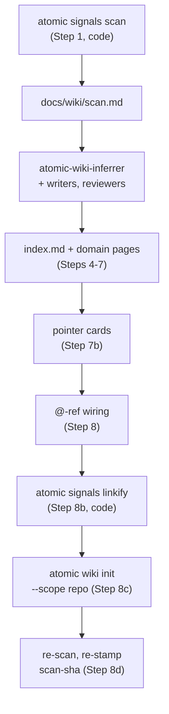
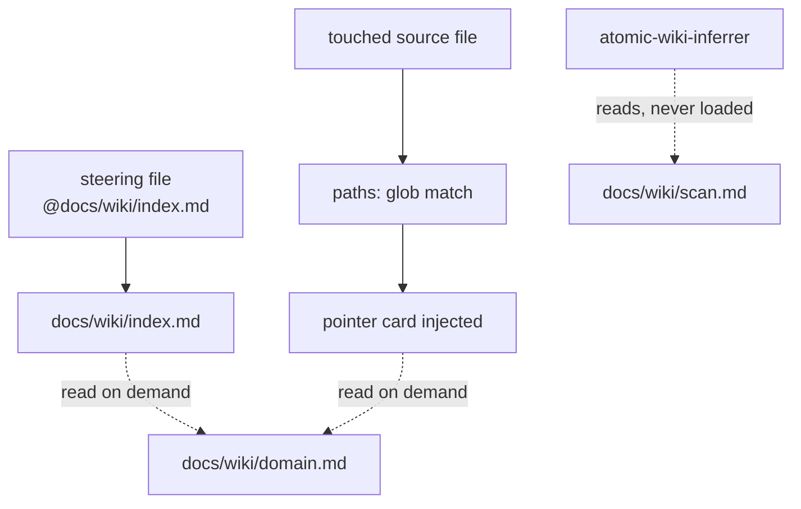
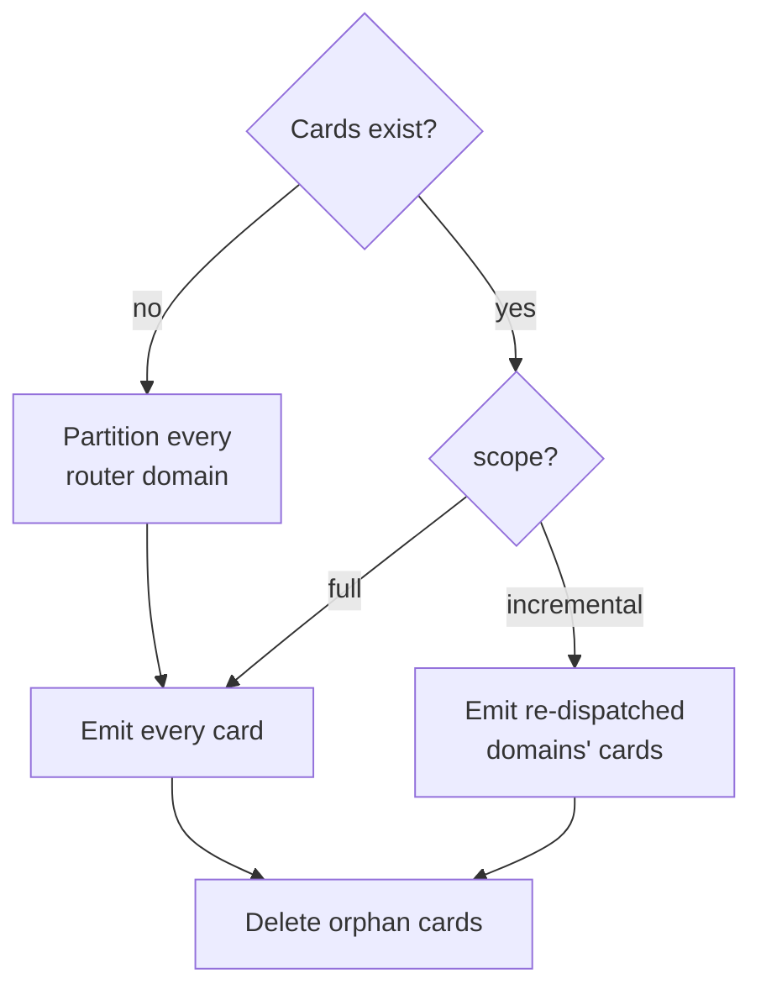
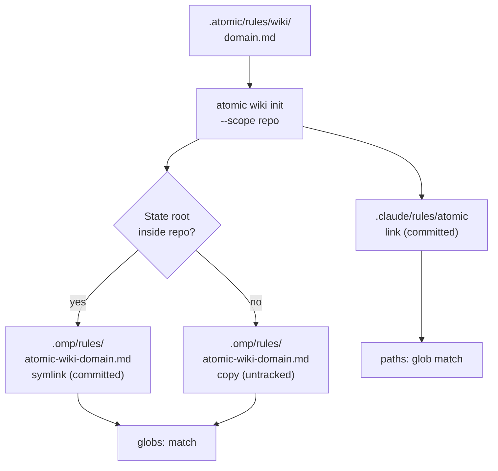
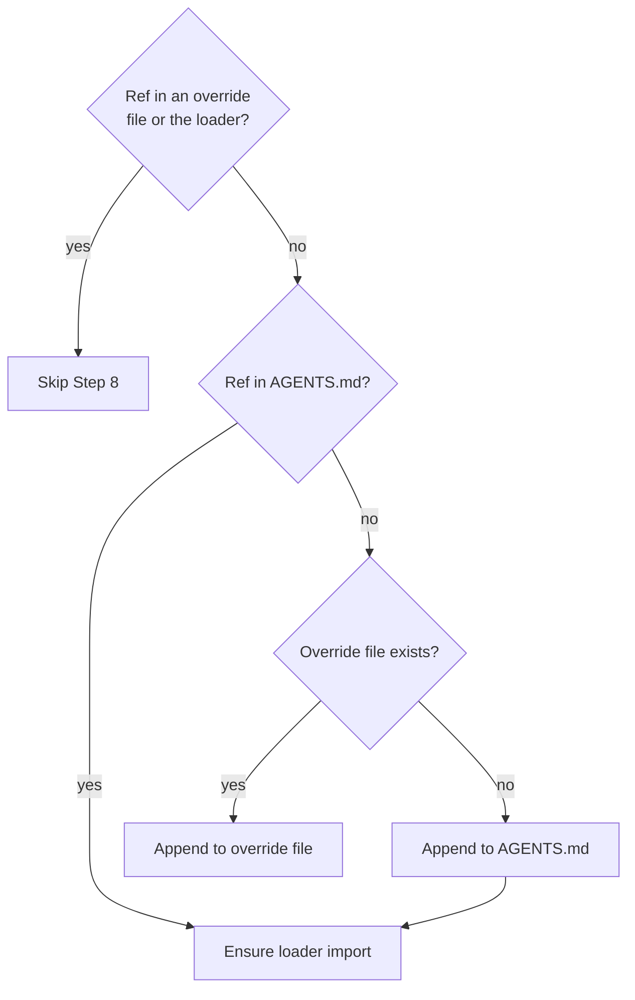

# signals

## What it does

A Claude or OMP session in this repo starts already knowing the repo's shape — languages, build commands, where each feature lives — instead of spending its first turns discovering it. This domain is what puts that knowledge in context, and keeps it true as the code moves.

The kinds of file it writes, and the difference between them, are the whole design:

| File | Written by | When it loads |
|------|-----------|---------------|
| [`docs/wiki/scan.md`](scan.md) | code | never — it runs to thousands of lines |
| [`docs/wiki/index.md`](index.md), the **router** | a model | every turn, via an `@`-ref in a project steering file (a project-local override, else `AGENTS.md` or [`CLAUDE.md`](../../CLAUDE.md), whichever the `[steering] claude` mode makes Claude load) |
| `docs/wiki/<domain>.md` | a model | on demand, when a task reaches that domain |
| `<state-root>/rules/wiki/<domain>.md`, a **pointer card** ([`.atomic/rules/wiki/`](../../.atomic/rules/wiki) by default) | a model; `atomic wiki init --scope repo` re-renders and projects it | on demand, whenever a session touches a file matching that domain's `paths:` glob. Claude reads the cards through the committed `.claude/rules/atomic -> ../../.atomic/rules` link; OMP reads one committed relative symlink `.omp/rules/atomic-wiki-<domain>.md` per card, or an untracked generated copy when the state root lies outside the repo |
| the **steering pair** under [`docs/wiki/`](.), shaped by the `[steering] claude` mode: `AGENTS.md` plus a [`docs/wiki/CLAUDE.md`](CLAUDE.md) loader (`loader`, the default), `AGENTS.md` alone (`agents-md`), or [`CLAUDE.md`](../../CLAUDE.md) alone (`claude-md`) | code (`atomic wiki init`, and the mode conversion `atomic repo init` and `atomic update` run); a human edits it after. In every mode, `initSteeringPair` leaves a user-written [`docs/wiki/CLAUDE.md`](CLAUDE.md) alone, so it stays the only steering file, as in this repo | whenever a session reads a file under [`docs/wiki/`](.), as nested memory |

Only the router is `@-ref`'d, so the router alone is what every turn pays for. It points; detail lives one hop away in a domain file — this page is one. `scan.md` is the raw substrate underneath both: committed, read on demand by the inferrer, never loaded into a session. The pointer card never carries wiki content, only a link to the domain page and the domain's related docs, delivered by the harness's native `paths:` glob match rather than an `@`-ref.

**The name does not match the paths.** The domain, the Go package, and the CLI verb are all called `signals`, but nothing lands in a path containing that word — output goes to [`docs/wiki/`](.) and [`.atomic/rules/wiki/`](../../.atomic/rules/wiki), and the command that drives it is `/refresh-wiki`. There is also a separate `wiki` domain: the same inferrer agent, pointed at a whole realm of repos instead of this one. See [`docs/wiki/wiki.md`](wiki.md).

## How it works

Which side owns a step is the contract: code does every deterministic transform, and the model only writes prose. The repo pipeline in [`context/skills/atomic-wiki/references/repo.md`](../../context/skills/atomic-wiki/references/repo.md) runs these steps in this order, and the last one exists because the steps before it can write files the scan reads.



Every scan that changes `scan.md` first copies the prior content to `tmp/.scan.prev.md` (gitignored), the fallback diff source where git is unavailable. Step 8d runs only when Step 7b appended to an ignore file, Step 8 wrote the `@-ref` or its steering pair, or Step 8c printed a `created` line or, on stderr, a `card link:` or `omp cards:` line. It runs `atomic signals scan` again and recomputes `<scan-sha>` with `git hash-object docs/wiki/scan.md`. A failed re-scan leaves `<scan-sha>` as Step 7 wrote it and the run continues to Step 9.

### What a session loads, and when

Only the router costs context on every turn; everything else is pulled by a read or a glob match.



### Staleness and the gate verbs

**Staleness is content-based, not mtime-based.** `Stale` reassembles the deterministic body exactly as `Scan` would (both go through `resolveScanOptions` and `assembleBody`) and compares bytes. An idempotent regeneration that only bumps mtimes stays fresh. `ScanWithOptions` reinforces this by skipping the write entirely when the body is unchanged.

Exit codes, shared by the gate verbs:

| Verb | 0 | 1 | 2 |
|------|---|---|---|
| `atomic signals stale` | fresh, silent | stale, prints evidence and directive | hard error, for example `scan.md` missing |
| `atomic signals diff` | no diff | diff present, written to stdout | no prior version, or hard error |

Exit 1 versus exit 2 is the distinction callers act on: "out of date" is a refresh trigger, "broken" is not. On exit 1 `stale` prints its evidence and a directive, imperative because the consumer is a model that can rationalize a bare exit code away. The line count comes from `lineDelta`, a multiset symmetric difference of body lines:

```
signals: STALE — a fresh scan would change the deterministic snapshot (~N lines)
→ refresh required; dispatch atomic-wiki-inferrer. do not skip.
```

**`<scan-sha>` has exactly one job.** It catches a `scan.md` committed without a matching re-infer, forcing `scope = full`. No other staleness decision consults it; routine scope decisions use `git diff HEAD -- docs/wiki/scan.md` directly.

**`scan.md` is committed; `tmp/.scan.prev.md` is not.** The committed blob is the diff baseline both the scope computation and the `<scan-sha>` tiebreaker read. The `tmp/` copy is a gitignored fallback for environments without git.

### What the scan walks

**Scan globs come from `[scan]` in the repo config, with a legacy `.signalsignore` as fallback.** `readSignalsIgnore` delegates to `config.ScanGlobs`, which reads `<state-root>/atomic.toml` ([`.atomic/atomic.toml`](../../.atomic/atomic.toml) by default). An `ignore` glob drops the file from the tree; a `generated` glob keeps it with metadata, marked `[generated]`, so the inferrer skips it for domain content. A `[scan]` table with a non-empty `ignore` or `generated` list wins whole; otherwise, or when the config is malformed, `.signalsignore` applies. In the legacy file a plain line excludes and a `+`-prefixed line marks generated. Each glob is matched against both the repo-relative path and the bare filename, so `gen.go` matches `gen.go` and `dir/gen.go` alike.

**Enumeration follows git when there is one.** Inside a git work tree, `enumGit` takes `git ls-files` plus untracked-but-not-ignored files; outside one, `enumWalk` walks the directory and skips the `skipDirs` names (`.git`, `node_modules`, `.worktrees`, `tmp`, `dist`, `build`, `target`, `vendor`). Both drop every path under `skippedPrefixes`. Tree depth comes from `output.signals.max_depth` in `~/.atomic/config.toml`, default 3.

**Language stats are extension-only and capped at ten.** No content sniffing, and a language absent from the table is either below the top ten by LOC or has no mapped extension.

### Pointer cards (Step 7b)

After [`docs/wiki/index.md`](index.md) is assembled (Step 7 of the repo pipeline), the inferrer emits one `<state-root>/rules/wiki/<domain>.md` card per domain (Step 7b; the state root is [`.atomic`](../../.atomic) by default), before it checks the `@-ref` wiring (Step 8). Each card is parsed through the `rules` package with identity `wiki:<project-key>:<domain>`. Which domains get a rewritten card, and which cards get deleted, follows a scope decision made once per run; every branch ends by deleting the cards of domains the router no longer lists:



A repo whose wiki predates pointer cards takes the bootstrap branch on its first post-upgrade refresh even if that refresh is otherwise incremental, so it never gets stranded with cards for only the domains that happened to be re-dispatched. The bootstrap branch runs Step 3's domain partition for every domain in the router table before emitting anything (classification only, no writer dispatch), so every domain has a `<source_paths>` block to derive its card's globs from. There is no fallback to the router table's Start-here directory or any other approximation; if `<source_paths>` is still unavailable for a domain after the partition, that is a pipeline error to report, not a guess.

**Card contract.** `paths:` frontmatter globs come from that domain's own Step 4 `<source_paths>` block only, never from the paths a page cites in its own `## Where it lives` table or `## Coupling` section (a directory becomes `dir/**`, a file stays a file). That partition is disjoint: each path belongs to exactly one primary domain, so a `dir/**` glob belongs to at most one card. A path whose behavior spans domains resolves through a tie-break: (1) the domain whose router "Start here" directory is the longest path prefix of the file wins, deterministic; (2) otherwise the domain whose page's `## How it works` section describes the file's behavior; (3) otherwise the domain with the narrower `source_paths` set. The generated-marker comment sits inside the frontmatter block, not the body, because the harness strips frontmatter from injection but re-injects the body on every matching read. Every collection, `paths:` included, is a label on its own line with one `- entry` per line beneath it, never a flow-style array, so an added glob or doc is a one-line diff. The body is a typed pointer index: the router's one-line domain description verbatim, including any inline code spans it carries (for example `~/.claude`), then one labeled block per non-empty category. `Map:` holds exactly one link, to that domain's wiki page. `Contracts:` ([`docs/spec/`](../spec)), `References:` ([`docs/reference/`](../reference)), `Guides:` ([`docs/guides/`](../guides)), `Research:` ([`docs/research/`](../research)), `Designs:` ([`docs/design/`](../design)), and `Related:` (catch-all) follow in that order. Candidates come from the domain page's own doc links plus doc surfaces the project's [`CLAUDE.md`](../../CLAUDE.md) couples to the domain; each is checked to exist on disk and dropped if missing, and links sort by path in `LC_ALL=C` byte order within each category. A fixed literal closing line ends every card. Body length is `5 + categories + links` lines, capped at twelve links. An unchanged domain regenerates byte-identical, so a refresh commit carries no wording churn.

**Ignore-file negation.** Before writing, the step runs `git check-ignore -v <state-root>/rules/wiki`. A match gets `!/rules/wiki/` and `!/rules/wiki/**` appended to the ignore file the probe names; once the negation lands, later probes report "not ignored" and skip the append. In this repo [`.atomic/rules/wiki`](../../.atomic/rules/wiki) matches no ignore rule, so the append step is a no-op. [`.claude/.gitignore`](../../.claude/.gitignore) ignores `/rules/*` and negates `/rules/authoring/` and `/rules/atomic`, which keeps the card link committed.

**Report.** Interactive mode folds cards emitted, cards deleted, and any ignore-file edit onto the same Step 9 summary line as the section counts; silent mode returns nothing, so `signals-gate` (see Coupling) detects the ignore-file edit itself rather than reading it from inferrer output.

### Card projection (Step 8c)

One canonical card directory reaches each harness through committed links, so a clone carries the projection; only the copies written when the state root lies outside the repo stay untracked.



`atomic wiki init --scope repo` runs on every repo-scope refresh. It writes the wiki steering pair in the `[steering] claude` mode, converting one left in another shape, and prints `created <path>` on stdout for each file it writes or changes, and for each file conversion removes. It then re-renders the Step 7b cards in canonical form and projects them to the enrolled Claude and OMP targets. A canonical card's frontmatter carries `description:` (the first non-blank body line, `rules.CardDescription`) and `globs:` for OMP beside the `paths:` globs Claude and Atomic read. A card that does not parse exits 1, and the pipeline quotes the error verbatim; a projection conflict prints a warning and still exits 0.

### Steering and the `@`-ref target

**Steering is read from the shared `AGENTS.md` first, and the `@`-ref lands in a project-local override before the shared file.** The inferrer reads `docs/wiki/AGENTS.md` as authoritative steering, falling back to the [`CLAUDE.md`](../../CLAUDE.md) beside it when the shared file is absent (here, [`docs/wiki/CLAUDE.md`](CLAUDE.md) is the only steering file: it holds user text, which `initSteeringPair` leaves alone under the default `loader` mode); `/refresh-wiki` R5 and the `signals-gate` silent dispatch both pass that content in a `<steering>` block. Step 8 then wires the router reference only when no file the session loads carries it, and a ref in `AGENTS.md` ends by checking the loader beside it:



- **Ref in an override file or the loader?**: `claude.local.md`, `CLAUDE.local.md` (project-local, gitignored), then the loader beside `AGENTS.md`, [`CLAUDE.md`](../../CLAUDE.md) or [`claude.md`](../../claude.md).
- **Append to AGENTS.md**: create `AGENTS.md` only if it is absent and the repo has [`docs/wiki/`](.); when no [`CLAUDE.md`](../../CLAUDE.md) or [`claude.md`](../../claude.md) exists either, also write the thin loader [`CLAUDE.md`](../../CLAUDE.md) (an `<atomic>` block holding `@AGENTS.md`) in the shape [`atomic`](../../atomic) writes.
- **Ensure loader import**: append `@AGENTS.md` to a [`CLAUDE.md`](../../CLAUDE.md) or [`claude.md`](../../claude.md) beside `AGENTS.md` that lacks it, changing nothing else; a loader that is a symlink to `AGENTS.md` is skipped.
- **Placement**: the `<atomic-signals>` block sits before behavioral instructions in the target file.
- **Steering mode**: the diagram draws `loader` mode. Step 8 reads `[steering] claude` (resolution order in [`docs/wiki/config.md`](config.md)), and the mode decides the ref target:

    | Mode | Ref target | Loader step |
    |------|-----------|-------------|
    | `loader` | shared `AGENTS.md` | "Ensure loader import" on the thin [`CLAUDE.md`](../../CLAUDE.md) beside it |
    | `agents-md` | shared `AGENTS.md` | skipped; no [`CLAUDE.md`](../../CLAUDE.md) is written, since one beside `AGENTS.md` stops Claude reading it |
    | `claude-md` | [`CLAUDE.md`](../../CLAUDE.md) | none; "Append to AGENTS.md" appends to [`CLAUDE.md`](../../CLAUDE.md) and no `AGENTS.md` is created |

- **Not referenced**: `scan.md` and the steering pair. The pair reaches the inferrer as nested memory when it reads under [`docs/wiki/`](.).

## Where it lives

### Scan and staleness

| Path | Role |
|------|------|
| [`atomic/internal/signals/signals.go`](../../atomic/internal/signals/signals.go) | `Scan` / `ScanWithOptions` / `Stale` / `Diff` / `Show` / `LinkifyFiles`. Owns the [`docs/wiki/scan.md`](scan.md) and `tmp/.scan.prev.md` paths, `assembleBody` (Tree, Manifests, Languages sections), `Diff`'s split between `git diff --exit-code` inside a repo and `diff -u` against `tmp/.scan.prev.md` outside one, the linkify skip-set (`scan.md`, [`CLAUDE.md`](../../CLAUDE.md), `AGENTS.md`, plus `index.md` handled as the router), and the `ErrStale` / `ErrDiffPresent` / `ErrNoPrior` sentinels. Scan globs resolve through `config.ScanGlobs` (`readSignalsIgnore`). |
| [`atomic/internal/signals/tree.go`](../../atomic/internal/signals/tree.go) | File enumeration and the depth-capped tree render. Owns `skippedPrefixes`, `skipDirs`, and the `git ls-files` versus `WalkDir` split. |
| [`atomic/internal/signals/languages.go`](../../atomic/internal/signals/languages.go) | Extension-to-language map and per-language LOC totals, top ten by LOC, tie-broken on file count. |
| [`atomic/internal/signals/manifests.go`](../../atomic/internal/signals/manifests.go) | Manifest parsers for `Cargo.toml`, `Gemfile`, `composer.json`, `go.mod`, [`package.json`](../../package.json), `pom.xml`, `pyproject.toml`, `requirements.txt`, found anywhere in the tree. |
| [`atomic/internal/signals/diff.go`](../../atomic/internal/signals/diff.go) | `ParseTreeSHAs`, `DiffSHAs`, and `DiffPaths`: a path-to-SHA diff between the stored prior and current scans, read from the `## Tree` section, dropping `[generated]` paths, using no git commands. |
| [`atomic/cmd/atomic/cmd_signals.go`](../../atomic/cmd/atomic/cmd_signals.go) (`runSignals`) | Verb dispatch and the process exit codes for `scan`, `show`, `stale`, `diff`, `linkify`. |
| [`atomic/internal/cliusage/cliusage.go`](../../atomic/internal/cliusage/cliusage.go) | The `signals` verb entries. `atomic validate artifacts` lints artifact citations against this table, so a verb or flag added here and nowhere else silently passes the lint. |
| [`docs/spec/wiki-storage-relocation.md`](../spec/wiki-storage-relocation.md) | The [`docs/wiki/`](.) layout and which staging steps include `scan.md`. |

### Inference pipeline

| Path | Role |
|------|------|
| [`context/commands/refresh-wiki.md`](../../context/commands/refresh-wiki.md) | `/refresh-wiki` — the only entry point, idempotent across first run and refresh. Repo scope runs R1-R8: R3 runs `atomic wiki init --scope repo`, R4 brings the code-intel index current, R5 dispatches the inferrer, and R8 folds the inferrer's card-emission summary onto its `cards:` line. Realm scope runs a separate pipeline. |
| [`context/agents/atomic-wiki-inferrer.md`](../../context/agents/atomic-wiki-inferrer.md) | The orchestrator. Detects repo vs realm scope, loads the matching pipeline reference from the `atomic-wiki` skill, sub-dispatches `atomic-wiki-writer` per domain and `atomic-reviewer` per domain file, then assembles the router and emits the pointer cards. Reads steering from `docs/wiki/AGENTS.md`, falling back to the [`CLAUDE.md`](../../CLAUDE.md) loader. Writes nothing outside the active wiki root, `<state-root>/rules/wiki/`, an ignore file's rules/wiki negation append, the single `@-ref` target, and the loader beside a shared `AGENTS.md`. Frontmatter declares `skills: [atomic-writing, atomic-wiki]`; its `## Contract` marks scoped writes as instruction-only. |
| [`context/agents/atomic-wiki-writer.md`](../../context/agents/atomic-wiki-writer.md) | Authors one domain page from source. Carries the `atomic-writing` skill in frontmatter rather than being asked to invoke it. Frontmatter declares no `tools:` list, so the single-page and no-fan-out rules are instruction-only, as its `## Contract` states. |
| [`context/skills/atomic-wiki/references/repo.md`](../../context/skills/atomic-wiki/references/repo.md) | The repo-scope pipeline the inferrer executes: Steps 1-9, including 7b (pointer cards), 8 (`@-ref` and loader wiring), 8b (linkify), 8c (`atomic wiki init --scope repo` and card projection), and 8d (re-scan). Also owns the domain page contract, the router shape, and the scoped-writes rule. |
| [`docs/spec/signals-workflow.md`](../spec/signals-workflow.md) | End-to-end lifecycle: files produced, the stale gate, inferrer dispatch, `@-ref` wiring rules, the `signals-gate` probe. Canonical for the agent and the command. |
| [`docs/spec/signals-router.md`](../spec/signals-router.md) | Router shape, domain file layout, incremental versus full mode, the domain split budget, naming continuity. |
| [`docs/design/signals-router.md`](../design/signals-router.md) | Why a flat eager-loaded file fails at scale, and the domain-partitioning answer. |
| [`docs/design/signals-wiki-unification.md`](../design/signals-wiki-unification.md) | Why the repo and realm pipelines share one inferrer and one `atomic-wiki` skill, and the order the unification landed in. |
| [`docs/spec/signals-wiki-linkify.md`](../spec/signals-wiki-linkify.md) | Linkify contract: disk resolution as the filter, the skip-set, gitignore layer, idempotence, fenced blocks untouched. |
| [`docs/reference/repo-wiki.md`](../reference/repo-wiki.md) | User-facing account of when a refresh fires, and the "Pointer rules" section covering card shape, location, and regeneration. |

### Pointer cards and projection

| Path | Role |
|------|------|
| [`docs/spec/wiki-pointer-rules.md`](../spec/wiki-pointer-rules.md) | Step 7b contract: scope branches (bootstrap, full, incremental), card frontmatter and typed-index shape, the ignore-file negation probe, the `.claude/rules/atomic -> ../../.atomic/rules` link, and the report line. |
| [`docs/design/wiki-pointer-rules.md`](../design/wiki-pointer-rules.md) | Why pointer cards ride the harness's `paths:`-scoped rules instead of a Go generator or a single catch-all rule, and the evidence behind Approach A. |

### `@`-ref wiring

| Path | Role |
|------|------|
| [`atomic/internal/doctor/checks_refs.go`](../../atomic/internal/doctor/checks_refs.go) | Doctor category 4 (`refs`). The only FAIL-severity check in this domain. |

### Gates and doctor

| Path | Role |
|------|------|
| [`context/_partials/signals-gate.md`](../../context/_partials/signals-gate.md) | The `signals-gate` partial composed into ship verbs. Owns the docs-only guard: a staged path is documentation when it sits under a [`docs/`](..) directory at any depth or is a top-level `README*` / `CHANGELOG*` / `CONTRIBUTING*` / `CODE_OF_CONDUCT*` / `SECURITY*` / `LICENSE*`; the project steering file (`AGENTS.md` or its [`CLAUDE.md`](../../CLAUDE.md) loader) and any bundled-artifact `.md` under `agents/`, `commands/`, `skills/`, `rules/`, or `output-styles/` count as source, because in a config repo those files are the product; the [`docs/wiki/`](.) steering pair sits under [`docs/`](..) and counts as docs. Also owns the `atomic signals stale` exit-code routing, the silent dispatch with a `<steering>` block, and the staging after a silent refresh: `docs/wiki/*.md`, `<state-root>/rules/wiki/` (guarded on the directory existing), and whichever of [`.gitignore`](../../.gitignore), `<state-root>/.gitignore`, [`.claude/.gitignore`](../../.claude/.gitignore), `.omp/.gitignore`, [`.claude/rules/atomic`](../../.claude/rules/atomic), `AGENTS.md`, [`CLAUDE.md`](../../CLAUDE.md) `git status --short` reports. It stages the `.omp/rules/atomic-wiki-*.md` symlinks (`find ... -type l`) and their pruned deletions (`git ls-files --deleted`), skipping any path `git check-ignore -q` reports, and never stages a regular file there. |
| [`atomic/internal/doctor/checks_signals.go`](../../atomic/internal/doctor/checks_signals.go) | Doctor category 3 (`signals`). Freshness plus router integrity. All WARN, never FAIL. Does not validate [`.atomic/rules/wiki/`](../../.atomic/rules/wiki) card files; tracked in [`.atomic/project/followups/wiki-rules-doctor-validation.md`](../../.atomic/project/followups/wiki-rules-doctor-validation.md). |
| [`docs/spec/signals-refresh-timing.md`](../spec/signals-refresh-timing.md) | When the refresh fires and how the inferrer is scoped. C1 `changed_range`, C2 docs-only guard, C3 implementation-loop finalize, C4 autopilot, C5 wiring surfaces. |
| [`docs/design/signals-refresh-timing.md`](../design/signals-refresh-timing.md) | Why the primary refresh sits at implementation finalize and why `atomic signals stale` is the coordinator instead of a marker file. |

## Constraints

**The scan excludes its own refresh output, and removing that exclusion wedges the stale gate permanently.** The inferrer writes a `<scan-sha>` of `scan.md` into `index.md`, which changes `index.md`'s blob SHA. If [`docs/wiki/`](.) were walked, that change would alter the scan tree, which would alter `scan.md`, which would make `atomic signals stale` return exit 1 forever. The pointer cards and their OMP links have the same loop. `skippedPrefixes` in `tree.go` holds the fixed [`docs/wiki/`](.) and `.omp/rules/atomic-wiki-` prefixes alongside the state-root-relative `ScratchpadDir`, `ProjectDir`, and `rules/wiki` prefixes.

**Write backtick paths, never markdown links and never `@-refs`.** `atomic signals linkify` renders resolvable tokens into relative links afterward, skipping `scan.md`, the [`docs/wiki/`](.) steering pair ([`CLAUDE.md`](../../CLAUDE.md), `AGENTS.md`), and fenced code blocks, and rewriting a file only when the content changed. A token that does not resolve on disk is left as plain text, which is how `` `git status` `` and `` `atomic signals scan` `` survive. A token built only from `.` and `/` is left alone too — it would otherwise resolve to the repo root and link there.

**The `--out` flag help names the wrong destination.** It reads `write substrate to <dir> instead of <root>/.claude/project/`, so a caller trusting the help looks under `.claude/project/` and finds nothing; the output lands in `<dir>/docs/wiki/scan.md`.

**Pointer cards are wholly pipeline-owned.** A hand edit to a `.atomic/rules/wiki/<domain>.md` file survives only until the next refresh, full or incremental, at which point the pipeline rewrites it (if the domain is in scope for that run) or leaves it stale (if not). There is no doctor check yet confirming a card's globs still match its domain's real `source_paths`, or that its links still resolve, between refreshes; that gap is the deferred [`.atomic/project/followups/wiki-rules-doctor-validation.md`](../../.atomic/project/followups/wiki-rules-doctor-validation.md) follow-up.

**The OMP card links are committed; an OMP card copy never is.** `atomic wiki init --scope repo` writes `.omp/rules/atomic-wiki-<domain>.md` as a relative symlink into the state root, and `signals-gate` and `loop-finalize` stage those symlinks, plus the deletion of a link pruned with its card. When the state root lies outside the repository, the file is a generated regular-file copy instead; both partials stage only `-type l` entries, so the copy stays untracked, since it would ship one machine's projection to every clone. The scan skips both forms.

**`paths:` frontmatter has no exclusion syntax, so the per-domain partition behind a card's globs has to be disjoint at build time, not enforced by excluding one domain's files from another's card.** Rung 1 of the tie-break (Start-here directory as longest path prefix) is mechanical and reproduces the same assignment on every refresh; rungs 2 and 3 (`## How it works` ownership, then narrower `source_paths`) are judgment calls the inferrer makes fresh each run, so a file resolved only by rung 2 or 3 is not guaranteed to land on the same domain's card across refreshes.

**Under `loader` mode, a ref in `AGENTS.md` is live only through its loader.** The doctor refs check walks `repoRefFiles` (`claude.local.md`, `CLAUDE.local.md`, `AGENTS.md`, [`CLAUDE.md`](../../CLAUDE.md), [`claude.md`](../../claude.md)) and skips an `AGENTS.md` hit when `bundlespec.ScopeSteering.LoaderWithoutImport` finds a [`CLAUDE.md`](../../CLAUDE.md) or [`claude.md`](../../claude.md) beside it without an `@AGENTS.md` import. A repo whose ref lives only in such an `AGENTS.md` gets a FAIL, which is why Step 8 ends with "Ensure loader import".

**A failed scan ends the run before inference, not the commit.** When `atomic signals scan` exits non-zero, the pipeline quotes its error and ends without inferring; the commit that triggered it proceeds.

## Coupling

**workflow** owns when the refresh fires. The `loop-finalize` partial runs a Signals step in `/implement`, `/subagent-implementation`, and `/autopilot` (`/quick-fix` composes the partial, but its Finalize policy row has no signals step). The step runs `atomic signals stale` and, on exit 1 only, dispatches the inferrer with `mode: silent`, `first_run: false`, and `changed_range: <loop-base>..HEAD`, committed as `chore(signals): refresh after <topic>`. It stages the same paths as the `signals-gate` partial (listed in that partial's row under Where it lives). Change the inferrer's dispatch interface and each of those refresh paths changes with it.

**doctor** consumes contracts from `checks_refs.go` and `checks_signals.go`. `checks_refs.go` hardcodes `signalsRef = "@docs/wiki/index.md"` and the `repoRefFiles` search order, which must stay in step with repo.md Step 8. `checks_signals.go` parses the router's Domains table to detect missing and orphan domain files, reading the **last** content column of each row; `excludedWikiFiles` keeps `index.md`, `scan.md`, [`CLAUDE.md`](../../CLAUDE.md), and `AGENTS.md` out of orphan detection. Changing the router's column layout breaks that parser. It does not parse [`.atomic/rules/wiki/`](../../.atomic/rules/wiki) at all.

**config** supplies `output.signals.max_depth` from `~/.atomic/config.toml`; `config.ScanGlobs` reads the `[scan]` globs from the file `config.RepoConfigPath` names (`<state-root>/atomic.toml`); `config.ScratchpadDir` / `config.ProjectDir` feed the scan's skip prefixes; and `config.ResolveSteeringMode` resolves the `[steering] claude` key that picks Step 8's ref target and the wiki steering pair's shape. The state root is `repositoryStateDir`, [`.atomic`](../../.atomic) by default (`stateDirDefault`), so changing `state.dir` changes what the scan walks; see [`docs/wiki/config.md`](config.md). [`docs/spec/signals-project-detection.md`](../spec/signals-project-detection.md), which lists config keys this domain would read, is stale. It specifies framework and dependency annotations on manifest bullets plus `[scan] tree_max_depth` and `exclude_dirs` keys, and none of them is implemented: `manifests.go` has no detection rules, the repo config's `[scan]` table carries only `ignore` and `generated`, and tree depth comes from `output.signals.max_depth` in the user config. The spec also names the substrate `deterministic-signals.md`.

**bundle** ships the inferrer, the command, the pipeline reference, and the `signals-gate` partial as source files directly under [`context/`](../../context) — [`context/agents/atomic-wiki-inferrer.md`](../../context/agents/atomic-wiki-inferrer.md), [`context/commands/refresh-wiki.md`](../../context/commands/refresh-wiki.md), [`context/skills/atomic-wiki/references/repo.md`](../../context/skills/atomic-wiki/references/repo.md), [`context/_partials/signals-gate.md`](../../context/_partials/signals-gate.md). A single `make bundle` expands any `{{ template ... }}` directive into the embedded bundle; nothing is written back into [`context/`](../../context), so editing any of them is editing the shipped source directly.

**harness** reads and projects the pointer cards. [`atomic/internal/rules/parse.go`](../../atomic/internal/rules/parse.go) (`ParseWiki`) parses each card into a `RuleRecord` with identity `wiki:<project-key>:<domain>`, and `atomic wiki init --scope repo` projects the records to the Claude card link and the per-card OMP symlinks. A card with an absolute, parent-escaping, or malformed `paths:` glob is rejected before any target write. See [`docs/wiki/harness.md`](harness.md).

**wiki** shares the inferrer and owns `atomic wiki init`, which writes the steering pair in the `[steering] claude` mode (`initSteeringPair` in [`atomic/internal/wiki/init.go`](../../atomic/internal/wiki/init.go); `ConvertSteeringPair` reshapes an existing one) and runs the card projection in Step 8c. The same agent serves repo scope here and realm scope there, branching on dispatch args. Pointer-card emission (Step 7b) is repo-scope only; realm scope has no equivalent.

**code-intel** is an optional input. `/refresh-wiki` R4 syncs a warm index or builds a cold one before dispatch, so domain clustering can use real import and call edges. Neither failure blocks the refresh. A failed warm sync prints a warning and the refresh proceeds on the stale index; a failed cold index prints a warning and the inferrer falls back to filename/path heuristics.
