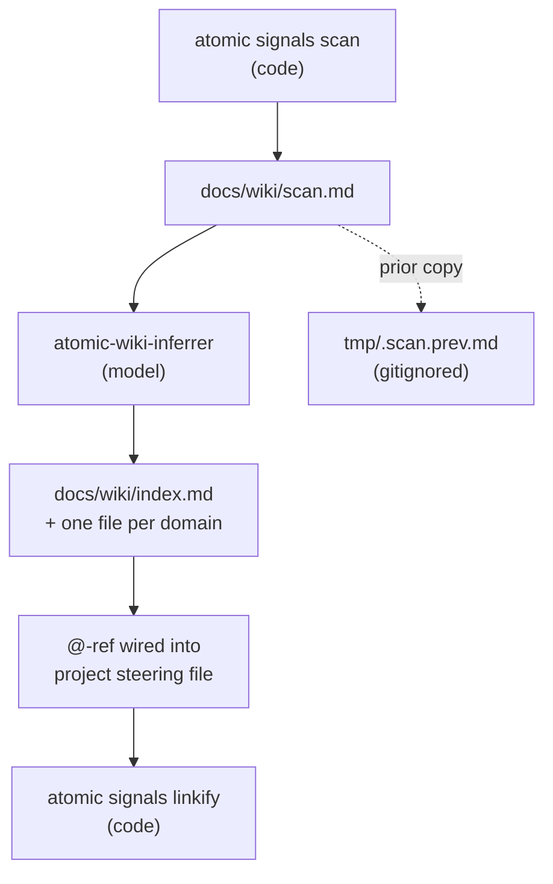
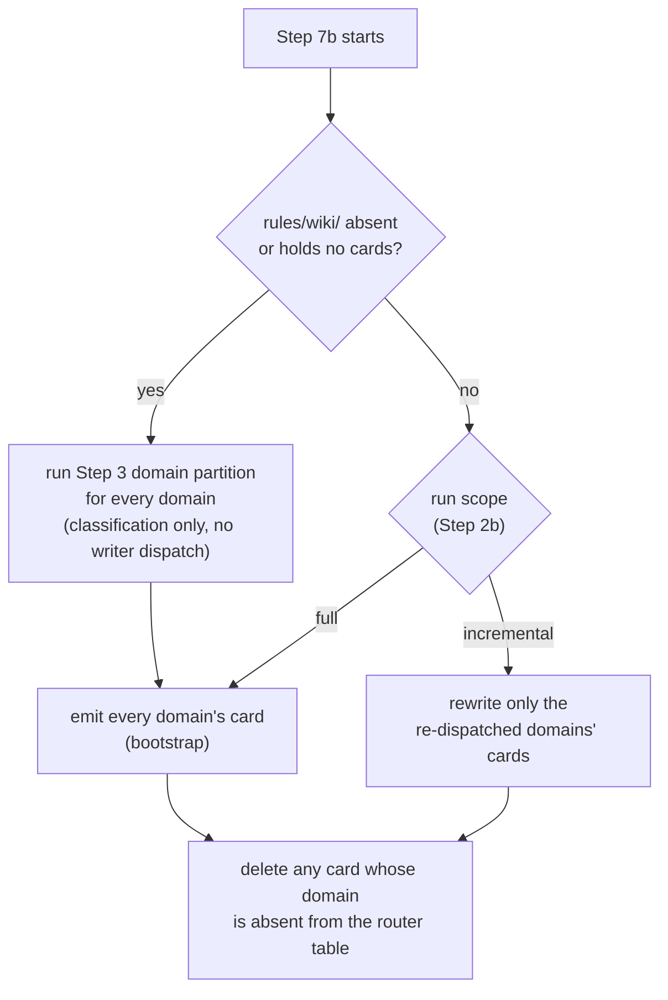
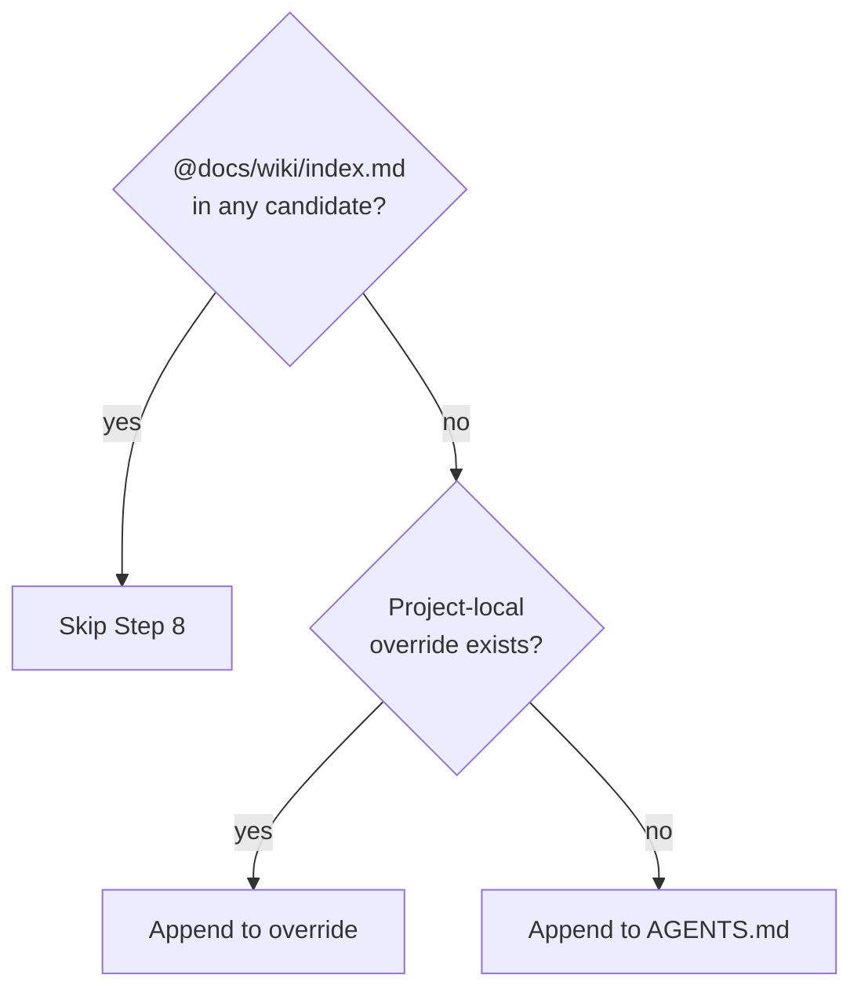

# signals

## What it does

A Claude session in this repo starts already knowing the repo's shape — languages, build commands, where each feature lives — instead of spending its first turns discovering it. This domain is what puts that knowledge in context, and keeps it true as the code moves.

The kinds of file it writes, and the difference between them, are the whole design:

| File | Written by | When it loads |
|------|-----------|---------------|
| [`docs/wiki/scan.md`](scan.md) | code | never — it runs to thousands of lines |
| [`docs/wiki/index.md`](index.md), the **router** | a model | every turn, via an `@`-ref in a project steering file (a project-local override, `AGENTS.md`, or [`CLAUDE.md`](../../CLAUDE.md)) |
| `docs/wiki/<domain>.md` | a model | on demand, when a task reaches that domain |
| `<state-root>/rules/wiki/<domain>.md`, a **pointer card** ([`.claude/rules/wiki/`](../../.claude/rules/wiki) by default) | a model | on demand, whenever a session touches a file matching that domain's `paths:` glob |
| `docs/wiki/AGENTS.md` plus the [`docs/wiki/CLAUDE.md`](CLAUDE.md) loader beside it, the **steering pair** | code (`atomic wiki init`), first run only; a human edits it after. `initSteeringPair` no-ops when [`docs/wiki/CLAUDE.md`](CLAUDE.md) already exists, so an existing [`CLAUDE.md`](../../CLAUDE.md) stays the only steering file, as in this repo | whenever a session reads a file under [`docs/wiki/`](.), as nested memory |

Only the router is `@-ref`'d, so the router alone is what every turn pays for. It points; detail lives one hop away in a domain file — this page is one. `scan.md` is the raw substrate underneath both: committed, read on demand by the inferrer, never loaded into a session. The pointer card never carries wiki content, only a link to the domain page and the domain's related docs, delivered by the harness's native `paths:` glob match rather than an `@`-ref.

**The naming is a trap worth knowing up front.** The domain, the Go package, and the CLI verb are all called `signals`, but nothing lands in a path containing that word — output goes to [`docs/wiki/`](.) and [`.claude/rules/wiki/`](../../.claude/rules/wiki), and the command that drives it is `/refresh-wiki`. There is also a separate `wiki` domain: the same inferrer agent, pointed at a whole realm of repos instead of this one. See [`docs/wiki/wiki.md`](wiki.md).

## How it works

Which side owns a step is the contract: code does every deterministic transform, and the model only writes prose.



### Staleness and the gate verbs

**Staleness is content-based, not mtime-based.** `Stale` reassembles the deterministic body exactly as `Scan` would and compares bytes. An idempotent regeneration that only bumps mtimes stays fresh. `Scan` reinforces this by skipping the write entirely when the body is unchanged.

Exit codes, shared by the gate verbs:

| Verb | 0 | 1 | 2 |
|------|---|---|---|
| `atomic signals stale` | fresh, silent | stale, prints evidence and directive | hard error, for example `scan.md` missing |
| `atomic signals diff` | no diff | diff present, written to stdout | no prior version, or hard error |

Exit 1 versus exit 2 is the distinction callers act on: "out of date" is a refresh trigger, "broken" is not. On exit 1 `stale` prints its evidence and a directive, imperative because the consumer is a model that can rationalize a bare exit code away:

```
signals: STALE — a fresh scan would change the deterministic snapshot (~N lines)
→ refresh required; dispatch atomic-wiki-inferrer. do not skip.
```

**`<scan-sha>` has exactly one job.** It catches a `scan.md` committed without a matching re-infer, forcing `scope = full`. No other staleness decision consults it; routine scope decisions use `git diff HEAD -- docs/wiki/scan.md` directly.

**`scan.md` is committed; `tmp/.scan.prev.md` is not.** The committed blob is the diff baseline both the scope computation and the `<scan-sha>` tiebreaker read. The `tmp/` copy is a gitignored fallback for environments without git.

### What the scan walks

**Scan globs come from `[scan]` in the repo config, with a legacy `.signalsignore` as fallback.** `readSignalsIgnore` delegates to `config.ScanGlobs`, which reads `<state-root>/atomic.toml` ([`.claude/atomic.toml`](../../.claude/atomic.toml) by default). An `ignore` glob drops the file from the tree; a `generated` glob keeps it with metadata, marked `[generated]`, so the inferrer skips it for domain content. A `[scan]` table with a non-empty `ignore` or `generated` list wins whole; otherwise, or when the config is malformed, `.signalsignore` applies. In the legacy file a plain line excludes and a `+`-prefixed line marks generated. Each glob is matched against both the repo-relative path and the bare filename, so `gen.go` matches `gen.go` and `dir/gen.go` alike.

**Language stats are extension-only and capped at ten.** No content sniffing, and a language absent from the table is either below the top ten by LOC or has no mapped extension.

### Pointer cards (Step 7b)

After [`docs/wiki/index.md`](index.md) is assembled (Step 7 of the repo pipeline), the inferrer emits one `<state-root>/rules/wiki/<domain>.md` card per domain (Step 7b; the state root is [`.claude`](../../.claude) by default), before it checks the `@-ref` wiring (Step 8). Which domains get a rewritten card, and which cards get deleted, follows a scope decision made once per run:



A repo whose wiki predates pointer cards takes the bootstrap branch on its first post-upgrade refresh even if that refresh is otherwise incremental, so it never gets stranded with cards for only the domains that happened to be re-dispatched. The bootstrap branch runs Step 3's domain partition for every domain in the router table before emitting anything (classification only, no writer dispatch), so every domain has a `<source_paths>` block to derive its card's globs from. There is no fallback to the router table's Start-here directory or any other approximation; if `<source_paths>` is still unavailable for a domain after the partition, that is a pipeline error to report, not a guess.

**Card contract.** `paths:` frontmatter globs come from that domain's own Step 4 `<source_paths>` block only, never from the paths a page cites in its own `## Where it lives` table (a directory becomes `dir/**`, a file stays a file). That partition is disjoint: each path belongs to exactly one primary domain, so a `dir/**` glob belongs to at most one card. A path whose behavior spans domains resolves through a tie-break: (1) the domain whose router "Start here" directory is the longest path prefix of the file wins, deterministic; (2) otherwise the domain whose page's `## How it works` section describes the file's behavior; (3) otherwise the domain with the narrower `source_paths` set. Only rung 1 guarantees byte-identical partitions across refreshes; `paths:` frontmatter has no exclusion syntax, so disjointness has to be won at partition time, not by excluding one domain's files from another's card. The generated-marker comment sits inside the frontmatter block, not the body, because the harness strips frontmatter from injection but re-injects the body on every matching read. The body is a typed pointer index, one entry per line: the router's one-line domain description verbatim, including any inline code spans it carries (for example `~/.claude`), then one labeled block per non-empty category with its links nested beneath it. `Map:` holds exactly one link, to that domain's wiki page. `Contracts:` ([`docs/spec/`](../spec)), `References:` ([`docs/reference/`](../reference)), `Guides:` ([`docs/guides/`](../guides)), `Research:` ([`docs/research/`](../research)), `Designs:` ([`docs/design/`](../design)), and `Related:` (catch-all) follow in that order. Candidates come from the domain page's own doc links plus doc surfaces the project's [`CLAUDE.md`](../../CLAUDE.md) couples to the domain; each is checked to exist on disk and dropped if missing, and links sort by path in `LC_ALL=C` byte order within each category. A fixed literal closing line ends every card. Body length is `5 + categories + links` lines, capped at twelve links. An unchanged domain regenerates byte-identical, so a refresh commit carries no wording churn.

**Ignore-file negation.** Before writing, the step runs `git check-ignore -v <state-root>/rules/wiki`. A match gets `!/rules/wiki/` and `!/rules/wiki/**` appended to the ignore file the probe names; once the negation lands, later probes report "not ignored" and skip the append. This repo's own [`.claude/.gitignore`](../../.claude/.gitignore) ignores `/rules/*` and already carries negation pairs for both `/rules/authoring/` and `/rules/wiki/`, so the probe reports "not ignored" here and the append step is a no-op.

**Report.** Interactive mode folds cards emitted, cards deleted, and any ignore-file edit onto the same Step 9 summary line as the section counts; silent mode returns nothing, so `signals-gate` (see Coupling) detects the ignore-file edit itself rather than reading it from inferrer output.

### Steering and the `@`-ref target

**Steering is read from the shared `AGENTS.md` first, and the `@`-ref lands in a project-local override before the shared file.** The inferrer reads `docs/wiki/AGENTS.md` as authoritative steering, falling back to the [`CLAUDE.md`](../../CLAUDE.md) beside it when the shared file is absent (here, [`docs/wiki/CLAUDE.md`](CLAUDE.md) is the only steering file, since `initSteeringPair` writes nothing when it already exists); `/refresh-wiki` R5 and the `signals-gate` silent dispatch both pass that content in a `<steering>` block. Step 8 then wires the router reference only when no candidate file carries it:



- **Candidates, in order**: a project-local override steering file (gitignored), the shared project `AGENTS.md`, then the native [`CLAUDE.md`](../../CLAUDE.md) loader alongside it.
- **Append to AGENTS.md**: create `AGENTS.md` only if it is absent and the repo has [`docs/wiki/`](.).
- **Placement**: the `@`-ref block sits before behavioral instructions in the target file.
- **Not referenced**: `scan.md` and the steering pair. The pair reaches the inferrer as nested memory when it reads under [`docs/wiki/`](.).

## Where it lives

### Artifacts

| Path | Role |
|------|------|
| [`context/agents/atomic-wiki-inferrer.md`](../../context/agents/atomic-wiki-inferrer.md) | The orchestrator. Detects repo vs realm scope, loads the matching pipeline reference, sub-dispatches `atomic-wiki-writer` per domain and `atomic-reviewer` per domain file, then assembles the router and emits the pointer cards. Reads steering from `docs/wiki/AGENTS.md`, falling back to the [`CLAUDE.md`](../../CLAUDE.md) loader. Writes nothing outside the active wiki root, `<state-root>/rules/wiki/`, an ignore file's rules/wiki negation append, and the single `@-ref` target. Frontmatter declares only `skills: [atomic-writing]`; its `## Contract` marks scoped writes as instruction-only. |
| [`context/agents/atomic-wiki-writer.md`](../../context/agents/atomic-wiki-writer.md) | Authors one domain page from source. Carries the `atomic-writing` skill in frontmatter rather than being asked to invoke it. Frontmatter declares no `tools:` list, so the single-page and no-fan-out rules are instruction-only, as its `## Contract` states. |
| [`context/commands/refresh-wiki.md`](../../context/commands/refresh-wiki.md) | `/refresh-wiki` — the only entry point, idempotent across first run and refresh. Repo scope runs R1-R8, and R8 folds the inferrer's card-emission summary onto its own report line. Realm scope runs a separate pipeline. |
| [`context/skills/atomic-wiki/references/repo.md`](../../context/skills/atomic-wiki/references/repo.md) | The repo-scope pipeline the inferrer executes (Steps 1-9, including 7b, the pointer-card step). The inferrer resolves the `atomic-wiki` skill's installed directory from the path the runtime reports and reads `references/repo.md` there, not from this repo. |
| [`context/_partials/signals-gate.md`](../../context/_partials/signals-gate.md) | The `signals-gate` partial composed into ship verbs. Owns the docs-only guard (the project steering file, `AGENTS.md` or its [`CLAUDE.md`](../../CLAUDE.md) loader, counts as source; the [`docs/wiki/`](.) steering pair sits under [`docs/`](..) and counts as docs), the `atomic signals stale` exit-code routing, the silent dispatch with a `<steering>` block, and staging `<state-root>/rules/wiki/` plus any modified [`.gitignore`](../../.gitignore) or `<state-root>/.gitignore` after a silent refresh. |

### Go packages

| Path | Role |
|------|------|
| [`atomic/internal/signals/signals.go`](../../atomic/internal/signals/signals.go) | `Scan` / `Stale` / `Diff` / `Show` / `LinkifyFiles`. Owns the [`docs/wiki/scan.md`](scan.md) and `tmp/.scan.prev.md` paths, the linkify skip-set (`scan.md`, [`CLAUDE.md`](../../CLAUDE.md), `AGENTS.md`, plus `index.md` handled as the router), and the `ErrStale` / `ErrDiffPresent` / `ErrNoPrior` sentinels. Scan globs resolve through `config.ScanGlobs` (`readSignalsIgnore`). |
| [`atomic/internal/signals/tree.go`](../../atomic/internal/signals/tree.go) | File enumeration and the depth-capped tree render. Owns `skippedPrefixes` and the `git ls-files` versus `WalkDir` split. |
| [`atomic/internal/signals/languages.go`](../../atomic/internal/signals/languages.go) | Extension-to-language map and per-language LOC totals. |
| [`atomic/internal/signals/manifests.go`](../../atomic/internal/signals/manifests.go) | Manifest parsers for `Cargo.toml`, `Gemfile`, `composer.json`, `go.mod`, [`package.json`](../../package.json), `pom.xml`, `pyproject.toml`, `requirements.txt`, found anywhere in the tree. |
| [`atomic/internal/signals/diff.go`](../../atomic/internal/signals/diff.go) | `atomic signals diff` — `git diff` inside a repo, unix `diff` against `tmp/.scan.prev.md` outside one. |
| [`atomic/cmd/atomic/cmd_signals.go`](../../atomic/cmd/atomic/cmd_signals.go) (`runSignals`) | Verb dispatch and the process exit codes for `scan`, `show`, `stale`, `diff`, `linkify`. |
| [`atomic/internal/doctor/checks_signals.go`](../../atomic/internal/doctor/checks_signals.go) | Doctor category 3 (`signals`). Freshness plus router integrity. All WARN, never FAIL. Does not yet validate [`.claude/rules/wiki/`](../../.claude/rules/wiki) card files; tracked in [`.claude/project/followups/wiki-rules-doctor-validation.md`](../../.claude/project/followups/wiki-rules-doctor-validation.md). |
| [`atomic/internal/doctor/checks_refs.go`](../../atomic/internal/doctor/checks_refs.go) | Doctor category 4 (`refs`). The only FAIL-severity check in this domain. |
| [`atomic/internal/cliusage/cliusage.go`](../../atomic/internal/cliusage/cliusage.go) | The `signals` verb entries. `atomic validate artifacts` lints artifact citations against this table, so a verb or flag added here and nowhere else silently passes the lint. |

### Docs

| Path | Covers |
|------|--------|
| [`docs/spec/signals-workflow.md`](../spec/signals-workflow.md) | End-to-end lifecycle: files produced, the stale gate, inferrer dispatch, `@-ref` wiring rules, the `signals-gate` probe. Canonical for the agent and the command. |
| [`docs/spec/signals-refresh-timing.md`](../spec/signals-refresh-timing.md) | When the refresh fires and how the inferrer is scoped. C1 `changed_range`, C2 docs-only guard, C3 implementation-loop finalize, C4 autopilot, C5 wiring surfaces. |
| [`docs/spec/signals-router.md`](../spec/signals-router.md) | Router shape, domain file layout, incremental versus full mode, the domain split budget, naming continuity. |
| [`docs/spec/signals-wiki-linkify.md`](../spec/signals-wiki-linkify.md) | Linkify contract: disk resolution as the filter, the skip-set, gitignore layer, idempotence, fenced blocks untouched. |
| [`docs/spec/wiki-storage-relocation.md`](../spec/wiki-storage-relocation.md) | The [`docs/wiki/`](.) layout and which staging steps include `scan.md`. |
| [`docs/spec/wiki-pointer-rules.md`](../spec/wiki-pointer-rules.md) | Step 7b contract: scope branches (bootstrap, full, incremental), card frontmatter and typed-index shape, the ignore-file negation probe, and the report line. |
| [`docs/design/wiki-pointer-rules.md`](../design/wiki-pointer-rules.md) | Why pointer cards ride Claude Code's `paths:`-scoped rules instead of a Go generator or a single catch-all rule, and the evidence behind Approach A. |
| [`docs/reference/repo-wiki.md`](../reference/repo-wiki.md) | User-facing account of when a refresh fires, and the "Pointer rules" section covering card shape, location, and regeneration. |
| [`docs/design/signals-router.md`](../design/signals-router.md) | Why a flat eager-loaded file fails at scale, and the domain-partitioning answer. |
| [`docs/design/signals-refresh-timing.md`](../design/signals-refresh-timing.md) | Why the primary refresh sits at implementation finalize and why `atomic signals stale` is the coordinator instead of a marker file. |
| [`docs/spec/signals-project-detection.md`](../spec/signals-project-detection.md) | Framework and dependency annotations on manifest bullets. Unimplemented: `manifests.go` has no detection rules, and the signals package reads [`.claude/atomic.toml`](../../.claude/atomic.toml) only for `[scan]` globs. The spec also predates the current layout, naming `deterministic-signals.md` and [`.claude/project/`](../../.claude/project). |

## Constraints

**[`docs/wiki/`](.) is excluded from its own scan, and removing that exclusion wedges the stale gate permanently.** The inferrer writes a `<scan-sha>` of `scan.md` into `index.md`, which changes `index.md`'s blob SHA. If [`docs/wiki/`](.) were walked, that change would alter the scan tree, which would alter `scan.md`, which would make `atomic signals stale` return exit 1 forever. `skippedPrefixes` in `tree.go` holds the fixed [`docs/wiki/`](.) prefix alongside the harness-relative `ScratchpadDir` and `ProjectDir` prefixes.

**Write backtick paths, never markdown links and never `@-refs`.** `atomic signals linkify` renders resolvable tokens into relative links afterward, skipping `scan.md`, the [`docs/wiki/`](.) steering pair ([`CLAUDE.md`](../../CLAUDE.md), `AGENTS.md`), and fenced code blocks, and rewriting a file only when the content changed. A token that does not resolve on disk is left as plain text, which is how `` `git status` `` and `` `atomic signals scan` `` survive. A token built only from `.` and `/` is left alone too — it would otherwise resolve to the repo root and link there.

**The `--out` flag help names the wrong destination.** It reads `write substrate to <dir> instead of <root>/.claude/project/`, while the flag actually writes `<dir>/docs/wiki/scan.md`.

**Pointer cards are wholly pipeline-owned.** A hand edit to a `.claude/rules/wiki/<domain>.md` file survives only until the next refresh, full or incremental, at which point the pipeline rewrites it (if the domain is in scope for that run) or leaves it stale (if not). There is no doctor check yet confirming a card's globs still match its domain's real `source_paths`, or that its links still resolve, between refreshes; that gap is the deferred [`wiki-rules-doctor-validation`](../../.claude/project/followups/wiki-rules-doctor-validation.md) follow-up.

**`paths:` frontmatter has no exclusion syntax, so the per-domain partition behind a card's globs has to be disjoint at build time, not enforced by excluding one domain's files from another's card.** Rung 1 of the tie-break (Start-here directory as longest path prefix) is mechanical and reproduces the same assignment on every refresh; rungs 2 and 3 (`## How it works` ownership, then narrower `source_paths`) are judgment calls the inferrer makes fresh each run, so a file resolved only by rung 2 or 3 is not guaranteed to land on the same domain's card across refreshes.

**An `AGENTS.md`-only `@`-ref fails the doctor refs check.** `repo.md` Step 8 may append the ref to `AGENTS.md`, but `candidateFiles` in [`atomic/internal/doctor/checks_refs.go`](../../atomic/internal/doctor/checks_refs.go) searches only `claude.local.md`, `CLAUDE.local.md`, [`CLAUDE.md`](../../CLAUDE.md), and [`claude.md`](../../claude.md) (see the doctor paragraph under Coupling), so a repo whose ref lives only in `AGENTS.md` gets a FAIL.

**A failed scan ends the run before inference, not the commit.** When `atomic signals scan` exits non-zero, the pipeline quotes its error and ends without inferring; the commit that triggered it proceeds.

## Coupling

**workflow** owns when the refresh fires. The `loop-finalize` partial, composed into `/implement`, `/quick-fix`, `/subagent-implementation`, and `/autopilot`, runs `atomic signals stale` and, on exit 1 only, dispatches the inferrer with `mode: silent`, `first_run: false`, and `changed_range: <loop-base>..HEAD`, committed as `chore(signals): refresh after <topic>`. It stages `docs/wiki/*.md`, the pointer cards under `<state-root>/rules/wiki/` (guarded on the directory existing), and any modified [`.gitignore`](../../.gitignore) or `<state-root>/.gitignore`, matching the `signals-gate` partial's own staging step, so pointer-card writes or deletions and ignore-file edits land in that path's own commit. Change the inferrer's dispatch interface and each of those refresh paths changes with it.

**doctor** consumes contracts from `checks_refs.go` and `checks_signals.go`. `checks_refs.go` hardcodes `signalsRef = "@docs/wiki/index.md"` and the `candidateFiles` search order ([`claude.local.md`](../../claude.local.md), [`CLAUDE.local.md`](../../CLAUDE.local.md), [`CLAUDE.md`](../../CLAUDE.md), [`claude.md`](../../claude.md)). `checks_signals.go` parses the router's Domains table to detect missing and orphan domain files, reading the **last** content column of each row; `excludedWikiFiles` keeps `index.md`, `scan.md`, [`CLAUDE.md`](../../CLAUDE.md), and `AGENTS.md` out of orphan detection. Changing the router's column layout breaks that parser. It does not yet parse [`.claude/rules/wiki/`](../../.claude/rules/wiki) at all.

**config** supplies `output.signals.max_depth` from `~/.atomic/config.toml`; `config.ScanGlobs` reads the `[scan]` globs from the file `config.RepoConfigPath` names; and `config.ScratchpadDir` / `config.ProjectDir` feed the scan's skip prefixes, so the resolved repository-state directory (`repositoryStateDir`) changes what the scan walks; see [`docs/wiki/config.md`](config.md).

**bundle** ships the inferrer, the command, and the `signals-gate` partial as source files directly under [`context/`](../../context) — [`context/agents/atomic-wiki-inferrer.md`](../../context/agents/atomic-wiki-inferrer.md), [`context/commands/refresh-wiki.md`](../../context/commands/refresh-wiki.md), [`context/_partials/signals-gate.md`](../../context/_partials/signals-gate.md). A single `make bundle` expands any `{{ template ... }}` directive into the embedded bundle; nothing is written back into [`context/`](../../context), so editing any of them is editing the shipped source directly.

**harness** reads the pointer cards. [`atomic/internal/rules/parse.go`](../../atomic/internal/rules/parse.go) parses each card into a `RuleRecord` with identity `wiki:<project-key>:<domain>`, and the record is projected into each harness's native rule form. A card with an absolute, parent-escaping, or malformed `paths:` glob is rejected before any target write. See [`docs/wiki/harness.md`](harness.md).

**wiki** shares the inferrer. The same agent serves repo scope here and realm scope there, branching on dispatch args. Pointer-card emission (Step 7b) is repo-scope only; realm scope has no equivalent.

**code-intel** is an optional input. `/refresh-wiki` R4 syncs a warm index or builds a cold one before dispatch, so domain clustering can use real import and call edges. Neither failure blocks the refresh. A failed warm sync prints a warning and the refresh proceeds on the stale index; a failed cold index prints a warning and the inferrer falls back to filename/path heuristics.
