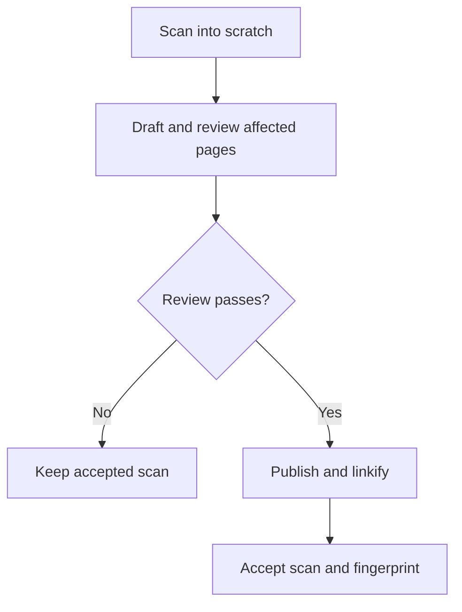
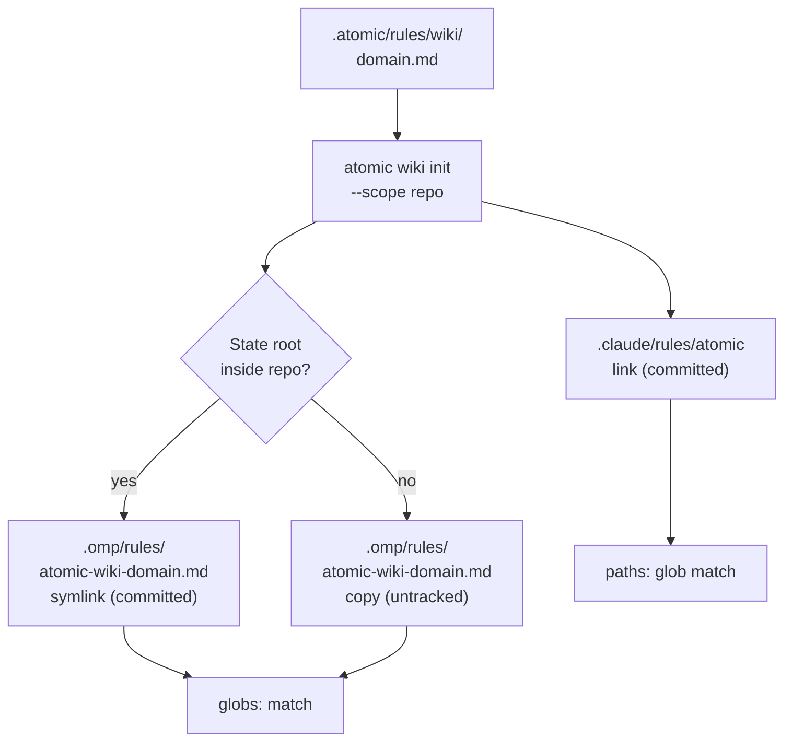
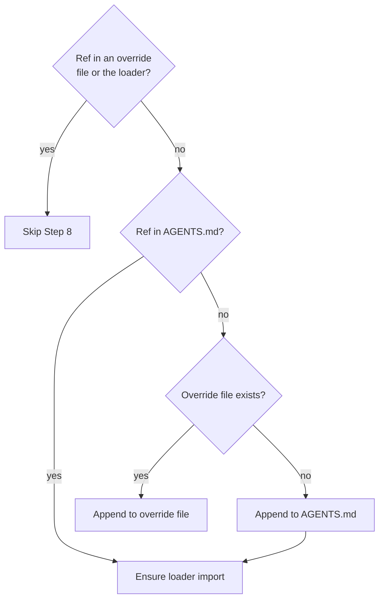

# signals

## What it does

A Claude or OMP session in this repo starts already knowing the repo's shape — languages, build commands, where each feature lives — instead of spending its first turns discovering it. This domain is what puts that knowledge in context, and keeps it true as the code moves.

The kinds of file it writes, and the difference between them, are the whole design:

| File | Written by | When it loads |
|------|-----------|---------------|
| [`docs/wiki/scan.md`](scan.md) | code | never — it runs to thousands of lines |
| [`docs/wiki/index.md`](index.md), the **router** | a model | every turn, via an `@`-ref in a project steering file (a project-local override, else `AGENTS.md` or [`CLAUDE.md`](../../CLAUDE.md), whichever the `[steering] claude` mode makes Claude load) |
| `docs/wiki/<domain>.md` | a model | on demand, when a task reaches that domain |
| `<state-root>/rules/wiki/<domain>.md`, a **pointer card** ([`.atomic/rules/wiki/`](../../.atomic/rules/wiki) by default) | a model; `atomic wiki init --scope repo` re-renders and projects it | on demand, whenever a session touches a file matching that domain's `paths:` glob. Claude reads the cards through the committed `.claude/rules/atomic -> ../../.atomic/rules` link; OMP reads one committed relative symlink `.omp/rules/atomic-wiki-<domain>.md` per card, or an untracked generated copy when the state root lies outside the repo |
| the **steering pair** under [`docs/wiki/`](.), shaped by the `[steering] claude` mode: `AGENTS.md` plus a [`docs/wiki/CLAUDE.md`](CLAUDE.md) loader (`loader`, the default), `AGENTS.md` alone (`agents-md`), or [`CLAUDE.md`](../../CLAUDE.md) alone (`claude-md`) | code (`atomic wiki init`, and the mode conversion `atomic repo init` and `atomic update` run); a human edits it after. In every mode, `initSteeringPair` leaves a user-written [`docs/wiki/CLAUDE.md`](CLAUDE.md) alone, so it stays the only steering file, as in this repo | whenever a session reads a file under [`docs/wiki/`](.), as nested memory |

Only the router is `@-ref`'d, so the router alone is what every turn pays for. It points; detail lives one hop away in a domain file — this page is one. `scan.md` is the raw substrate underneath both: committed, read on demand by the inferrer, never loaded into a session. The pointer card never carries wiki content, only a link to the domain page and the domain's related docs, delivered by the harness's native `paths:` glob match rather than an `@`-ref.

`atomic signals scan` writes the repo snapshot in `docs/wiki/`. On request, `/refresh-wiki` updates the repo's prose and path-scoped steering. [Realm capture and indexing](wiki.md) use separate commands.

## How it works
Manual refresh reviews drafts against source before publishing the new scan.



### Staleness and the gate verbs

**Staleness is content-based, not mtime-based.** `Stale` reassembles the deterministic body exactly as `Scan` would (both go through `resolveScanOptions` and `assembleBody`) and compares bytes. An idempotent regeneration that only bumps mtimes stays fresh. `ScanWithOptions` reinforces this by skipping the write entirely when the body is unchanged.

Exit codes, shared by the gate verbs:

| Verb | 0 | 1 | 2 |
|------|---|---|---|
| `atomic signals stale` | fresh, silent | stale, prints evidence and directive | hard error, for example `scan.md` missing |
| `atomic signals diff` | no diff | diff present, written to stdout | no prior version, or hard error |

Exit 1 versus exit 2 is the distinction callers act on: "out of date" is a refresh trigger, "broken" is not. On exit 1 `stale` prints its evidence and a directive, imperative because the consumer is a model that can rationalize a bare exit code away. The line count comes from `lineDelta`, a multiset symmetric difference of body lines:

```
signals: STALE — a fresh scan would change the deterministic snapshot (~N lines)
→ refresh required; dispatch atomic-wiki-inferrer. do not skip.
```

Manual refresh compares the scratch scan with `docs/wiki/scan.md`. A missing or mismatched `<scan-sha>` forces full refresh. A failed domain review leaves the accepted scan intact.

### What the scan walks

**Scan globs come from `[scan]` in the repo config, with a legacy `.signalsignore` as fallback.** `readSignalsIgnore` delegates to `config.ScanGlobs`, which reads `<state-root>/atomic.toml` ([`.atomic/atomic.toml`](../../.atomic/atomic.toml) by default). An `ignore` glob drops the file from the tree; a `generated` glob keeps it with metadata, marked `[generated]`, so the inferrer skips it for domain content. A `[scan]` table with a non-empty `ignore` or `generated` list wins whole; otherwise, or when the config is malformed, `.signalsignore` applies. In the legacy file a plain line excludes and a `+`-prefixed line marks generated. Each glob is matched against both the repo-relative path and the bare filename, so `gen.go` matches `gen.go` and `dir/gen.go` alike.

**Enumeration follows git when there is one.** Inside a git work tree, `enumGit` takes `git ls-files` plus untracked-but-not-ignored files; outside one, `enumWalk` walks the directory and skips the `skipDirs` names (`.git`, `node_modules`, `.worktrees`, `tmp`, `dist`, `build`, `target`, `vendor`). Both drop every path under `skippedPrefixes`. Tree depth comes from `output.signals.max_depth` in `~/.atomic/config.toml`, default 3.

**Language stats are extension-only and capped at ten.** No content sniffing, and a language absent from the table is either below the top ten by LOC or has no mapped extension.

### Pointer cards

Refresh emits cards for all domains on bootstrap or full refresh, and affected domains on incremental refresh. Derive globs from the disjoint source partition. The [output reference](../../context/skills/atomic-wiki/references/repo-output.md) defines the format and the [refresh workflow](../../context/skills/atomic-wiki/references/repo.md) defines publication.

### Card projection (Step 8c)

One canonical card directory reaches each harness through committed links, so a clone carries the projection; only the copies written when the state root lies outside the repo stay untracked.



`atomic wiki init --scope repo` runs on every repo-scope refresh. It writes the wiki steering pair in the `[steering] claude` mode, converting one left in another shape, and prints `created <path>` on stdout for each file it writes or changes, and for each file conversion removes. It then re-renders the Step 7b cards in canonical form and projects them to the enrolled Claude and OMP targets. A canonical card's frontmatter carries `description:` (the first non-blank body line, `rules.CardDescription`) and `globs:` for OMP beside the `paths:` globs Claude and Atomic read. A card that does not parse exits 1, and the pipeline quotes the error verbatim; a projection conflict prints a warning and still exits 0.

### Steering and the `@`-ref target

**Steering is read from the shared `AGENTS.md` first, and the `@`-ref lands in a project-local override before the shared file.** The inferrer reads `docs/wiki/AGENTS.md`, falling back to the adjacent `CLAUDE.md`. It wires the router reference only when no file the session loads carries it, and checks the loader beside an `AGENTS.md` ref:



- **Ref in an override file or the loader?**: `claude.local.md`, `CLAUDE.local.md` (project-local, gitignored), then the loader beside `AGENTS.md`, [`CLAUDE.md`](../../CLAUDE.md) or [`claude.md`](../../claude.md).
- **Append to AGENTS.md**: create `AGENTS.md` only if it is absent and the repo has [`docs/wiki/`](.); when no [`CLAUDE.md`](../../CLAUDE.md) or [`claude.md`](../../claude.md) exists either, also write the thin loader [`CLAUDE.md`](../../CLAUDE.md) (an `<atomic>` block holding `@AGENTS.md`) in the shape [`atomic`](../../atomic) writes.
- **Ensure loader import**: append `@AGENTS.md` to a [`CLAUDE.md`](../../CLAUDE.md) or [`claude.md`](../../claude.md) beside `AGENTS.md` that lacks it, changing nothing else; a loader that is a symlink to `AGENTS.md` is skipped.
- **Placement**: the `<atomic-signals>` block sits before behavioral instructions in the target file.
- **Steering mode**: the diagram draws `loader` mode. Step 8 reads `[steering] claude` (resolution order in [`docs/wiki/config.md`](config.md)), and the mode decides the ref target:

    | Mode | Ref target | Loader step |
    |------|-----------|-------------|
    | `loader` | shared `AGENTS.md` | "Ensure loader import" on the thin [`CLAUDE.md`](../../CLAUDE.md) beside it |
    | `agents-md` | shared `AGENTS.md` | skipped; no [`CLAUDE.md`](../../CLAUDE.md) is written, since one beside `AGENTS.md` stops Claude reading it |
    | `claude-md` | [`CLAUDE.md`](../../CLAUDE.md) | none; "Append to AGENTS.md" appends to [`CLAUDE.md`](../../CLAUDE.md) and no `AGENTS.md` is created |

- **Not referenced**: `scan.md` and the steering pair. The pair reaches the inferrer as nested memory when it reads under [`docs/wiki/`](.).

## Where it lives

### Scan and staleness

| Path | Role |
|------|------|
| [`atomic/internal/signals/signals.go`](../../atomic/internal/signals/signals.go) | `Scan` / `ScanWithOptions` / `Stale` / `Diff` / `Show` / `LinkifyFiles`. Owns the [`docs/wiki/scan.md`](scan.md) and `tmp/.scan.prev.md` paths, `assembleBody` (Tree, Manifests, Languages sections), `Diff`'s split between `git diff --exit-code` inside a repo and `diff -u` against `tmp/.scan.prev.md` outside one, the linkify skip-set (`scan.md`, [`CLAUDE.md`](../../CLAUDE.md), `AGENTS.md`, plus `index.md` handled as the router), and the `ErrStale` / `ErrDiffPresent` / `ErrNoPrior` sentinels. Scan globs resolve through `config.ScanGlobs` (`readSignalsIgnore`). |
| [`atomic/internal/signals/tree.go`](../../atomic/internal/signals/tree.go) | File enumeration and the depth-capped tree render. Owns `skippedPrefixes`, `skipDirs`, and the `git ls-files` versus `WalkDir` split. |
| [`atomic/internal/signals/languages.go`](../../atomic/internal/signals/languages.go) | Extension-to-language map and per-language LOC totals, top ten by LOC, tie-broken on file count. |
| [`atomic/internal/signals/manifests.go`](../../atomic/internal/signals/manifests.go) | Manifest parsers for `Cargo.toml`, `Gemfile`, `composer.json`, `go.mod`, [`package.json`](../../package.json), `pom.xml`, `pyproject.toml`, `requirements.txt`, found anywhere in the tree. |
| [`atomic/internal/signals/diff.go`](../../atomic/internal/signals/diff.go) | `ParseTreeSHAs`, `DiffSHAs`, and `DiffPaths`: a path-to-SHA diff between the stored prior and current scans, read from the `## Tree` section, dropping `[generated]` paths, using no git commands. |
| [`atomic/cmd/atomic/cmd_signals.go`](../../atomic/cmd/atomic/cmd_signals.go) (`runSignals`) | Verb dispatch and the process exit codes for `scan`, `show`, `stale`, `diff`, `linkify`. |
| [`atomic/internal/cliusage/cliusage.go`](../../atomic/internal/cliusage/cliusage.go) | The `signals` verb entries. `atomic validate artifacts` lints artifact citations against this table, so a verb or flag added here and nowhere else silently passes the lint. |
| [`docs/spec/wiki-storage-relocation.md`](../spec/wiki-storage-relocation.md) | The [`docs/wiki/`](.) layout and which staging steps include `scan.md`. |

### Inference pipeline

| Path | Role |
|------|------|
| [`context/commands/refresh-wiki.md`](../../context/commands/refresh-wiki.md) | Starts repo prose refresh on request. |
| [`context/agents/atomic-wiki-inferrer.md`](../../context/agents/atomic-wiki-inferrer.md) | Assigns repo domains, dispatches writers and reviewers, and publishes the router and cards. |
| [`context/agents/atomic-wiki-writer.md`](../../context/agents/atomic-wiki-writer.md) | Authors one domain page from source. Carries the `atomic-writing` skill in frontmatter rather than being asked to invoke it. Frontmatter declares no `tools:` list, so the single-page and no-fan-out rules are instruction-only, as its `## Contract` states. |
| [`context/skills/atomic-wiki/references/repo.md`](../../context/skills/atomic-wiki/references/repo.md) | Repo scan, domain assignment, page review, and publication. |
| [`docs/spec/signals-workflow.md`](../spec/signals-workflow.md) | Historical lifecycle and router wiring contract. |
| [`docs/spec/signals-router.md`](../spec/signals-router.md) | Router shape, domain file layout, incremental versus full mode, the domain split budget, naming continuity. |
| [`docs/design/signals-router.md`](../design/signals-router.md) | Why a flat eager-loaded file fails at scale, and the domain-partitioning answer. |
| [`docs/design/signals-wiki-unification.md`](../design/signals-wiki-unification.md) | Historical design for the earlier unified pipelines. |
| [`docs/spec/signals-wiki-linkify.md`](../spec/signals-wiki-linkify.md) | Linkify contract: disk resolution as the filter, the skip-set, gitignore layer, idempotence, fenced blocks untouched. |
| [`docs/reference/repo-wiki.md`](../reference/repo-wiki.md) | User-facing account of when a refresh fires, and the "Pointer rules" section covering card shape, location, and regeneration. |

### Pointer cards and projection

| Path | Role |
|------|------|
| [`docs/spec/wiki-pointer-rules.md`](../spec/wiki-pointer-rules.md) | Step 7b contract: scope branches (bootstrap, full, incremental), card frontmatter and typed-index shape, the ignore-file negation probe, the `.claude/rules/atomic -> ../../.atomic/rules` link, and the report line. |
| [`docs/design/wiki-pointer-rules.md`](../design/wiki-pointer-rules.md) | Why pointer cards ride the harness's `paths:`-scoped rules instead of a Go generator or a single catch-all rule, and the evidence behind Approach A. |

### `@`-ref wiring

| Path | Role |
|------|------|
| [`atomic/internal/doctor/checks_refs.go`](../../atomic/internal/doctor/checks_refs.go) | Doctor category 4 (`refs`). The only FAIL-severity check in this domain. |

### Gates and doctor

| Path | Role |
|------|------|
| [`context/commands/implement.md`](../../context/commands/implement.md) | Uses a scratch scan and task diff for documentation maintenance before audit and baseline acceptance. |
| [`atomic/internal/doctor/checks_signals.go`](../../atomic/internal/doctor/checks_signals.go) | Doctor category 3 (`signals`). Freshness plus router integrity. All WARN, never FAIL. Does not validate [`.atomic/rules/wiki/`](../../.atomic/rules/wiki) card files; tracked in [`.atomic/project/followups/wiki-rules-doctor-validation.md`](../../.atomic/project/followups/wiki-rules-doctor-validation.md). |
| [`docs/spec/signals-refresh-timing.md`](../spec/signals-refresh-timing.md) | When the refresh fires and how the inferrer is scoped. C1 `changed_range`, C2 docs-only guard, C3 implementation-loop finalize, C4 autopilot, C5 wiring surfaces. |
| [`docs/design/signals-refresh-timing.md`](../design/signals-refresh-timing.md) | Why the primary refresh sits at implementation finalize and why `atomic signals stale` is the coordinator instead of a marker file. |

## Constraints

**The scan excludes its own refresh output, and removing that exclusion wedges the stale gate permanently.** The inferrer writes a `<scan-sha>` of `scan.md` into `index.md`, which changes `index.md`'s blob SHA. If [`docs/wiki/`](.) were walked, that change would alter the scan tree, which would alter `scan.md`, which would make `atomic signals stale` return exit 1 forever. The pointer cards and their OMP links have the same loop. `skippedPrefixes` in `tree.go` holds the fixed [`docs/wiki/`](.) and `.omp/rules/atomic-wiki-` prefixes alongside the state-root-relative `ScratchpadDir`, `ProjectDir`, and `rules/wiki` prefixes.

**Write backtick paths, never markdown links and never `@-refs`.** `atomic signals linkify` renders resolvable tokens into relative links afterward, skipping `scan.md`, the [`docs/wiki/`](.) steering pair ([`CLAUDE.md`](../../CLAUDE.md), `AGENTS.md`), and fenced code blocks, and rewriting a file only when the content changed. A token that does not resolve on disk is left as plain text, which is how `` `git status` `` and `` `atomic signals scan` `` survive. A token built only from `.` and `/` is left alone too — it would otherwise resolve to the repo root and link there.

**The `--out` flag help names the wrong destination.** It reads `write substrate to <dir> instead of <root>/.claude/project/`, so a caller trusting the help looks under `.claude/project/` and finds nothing; the output lands in `<dir>/docs/wiki/scan.md`.

**Pointer cards are wholly pipeline-owned.** A hand edit to a `.atomic/rules/wiki/<domain>.md` file survives only until the next refresh, full or incremental, at which point the pipeline rewrites it (if the domain is in scope for that run) or leaves it stale (if not). There is no doctor check yet confirming a card's globs still match its domain's real `source_paths`, or that its links still resolve, between refreshes; that gap is the deferred [`.atomic/project/followups/wiki-rules-doctor-validation.md`](../../.atomic/project/followups/wiki-rules-doctor-validation.md) follow-up.

**OMP projections differ by state-root location.** `atomic wiki init --scope repo` writes `.omp/rules/atomic-wiki-<domain>.md` as a relative symlink when the state root is inside the repository, or a generated copy when it is outside. Commit the symlink, not a machine-specific copy. The scan skips both forms.

**`paths:` frontmatter has no exclusion syntax, so the per-domain partition behind a card's globs has to be disjoint at build time, not enforced by excluding one domain's files from another's card.** Rung 1 of the tie-break (Start-here directory as longest path prefix) is mechanical and reproduces the same assignment on every refresh; rungs 2 and 3 (`## How it works` ownership, then narrower `source_paths`) are judgment calls the inferrer makes fresh each run, so a file resolved only by rung 2 or 3 is not guaranteed to land on the same domain's card across refreshes.

**Under `loader` mode, a ref in `AGENTS.md` is live only through its loader.** The doctor refs check walks `repoRefFiles` (`claude.local.md`, `CLAUDE.local.md`, `AGENTS.md`, [`CLAUDE.md`](../../CLAUDE.md), [`claude.md`](../../claude.md)) and skips an `AGENTS.md` hit when `bundlespec.ScopeSteering.LoaderWithoutImport` finds a [`CLAUDE.md`](../../CLAUDE.md) or [`claude.md`](../../claude.md) beside it without an `@AGENTS.md` import. A repo whose ref lives only in such an `AGENTS.md` gets a FAIL, which is why Step 8 ends with "Ensure loader import".

**A failed scan cannot establish a new baseline.** Preserve the accepted scan when the scan or review fails.

## Coupling

**workflow** uses a scratch scan and task diff to update affected documentation before accepting the baseline. `/refresh-wiki` also supports an on-demand repo refresh.

**doctor** consumes contracts from `checks_refs.go` and `checks_signals.go`. `checks_refs.go` hardcodes `signalsRef = "@docs/wiki/index.md"` and the `repoRefFiles` search order, which must stay in step with repo.md Step 8. `checks_signals.go` parses the router's Domains table to detect missing and orphan domain files, reading the **last** content column of each row; `excludedWikiFiles` keeps `index.md`, `scan.md`, [`CLAUDE.md`](../../CLAUDE.md), and `AGENTS.md` out of orphan detection. Changing the router's column layout breaks that parser. It does not parse [`.atomic/rules/wiki/`](../../.atomic/rules/wiki) at all.

**config** supplies `output.signals.max_depth` from `~/.atomic/config.toml`; `config.ScanGlobs` reads the `[scan]` globs from the file `config.RepoConfigPath` names (`<state-root>/atomic.toml`); `config.ScratchpadDir` / `config.ProjectDir` feed the scan's skip prefixes; and `config.ResolveSteeringMode` resolves the `[steering] claude` key that picks Step 8's ref target and the wiki steering pair's shape. The state root is `repositoryStateDir`, [`.atomic`](../../.atomic) by default (`stateDirDefault`), so changing `state.dir` changes what the scan walks; see [`docs/wiki/config.md`](config.md). [`docs/spec/signals-project-detection.md`](../spec/signals-project-detection.md), which lists config keys this domain would read, is stale. It specifies framework and dependency annotations on manifest bullets plus `[scan] tree_max_depth` and `exclude_dirs` keys, and none of them is implemented: `manifests.go` has no detection rules, the repo config's `[scan]` table carries only `ignore` and `generated`, and tree depth comes from `output.signals.max_depth` in the user config. The spec also names the substrate `deterministic-signals.md`.

**bundle** embeds the inferrer, command, and pipeline reference from [`context/`](../../context).

**harness** reads and projects the pointer cards. [`atomic/internal/rules/parse.go`](../../atomic/internal/rules/parse.go) (`ParseWiki`) parses each card into a `RuleRecord` with identity `wiki:<project-key>:<domain>`, and `atomic wiki init --scope repo` projects the records to the Claude card link and the per-card OMP symlinks. A card with an absolute, parent-escaping, or malformed `paths:` glob is rejected before any target write. See [`docs/wiki/harness.md`](harness.md).

**wiki** owns `atomic wiki init`, which writes the steering pair in the `[steering] claude` mode and projects repo cards. Realm capture and indexing use separate commands.

**code-intel** is an optional source of import and call edges when an index is available. A wiki refresh does not require building or syncing an index.
