# wiki

## What it does

A realm index lists member repositories and capture buckets. `atomic wiki scan` maintains its generated regions without replacing prose. The [signals domain](signals.md) owns repo-only `/refresh-wiki`.

Realm sharing exchanges selected wiki pages and capture folders without relocating each collaborator's workspace. `atomic realm join` receives a shared definition; `atomic realm link` reviews and activates selected mappings.

## How it works

A realm scan discovers member repositories before updating their listing. Bucket indexing reads each capture folder without synthesizing its contents.

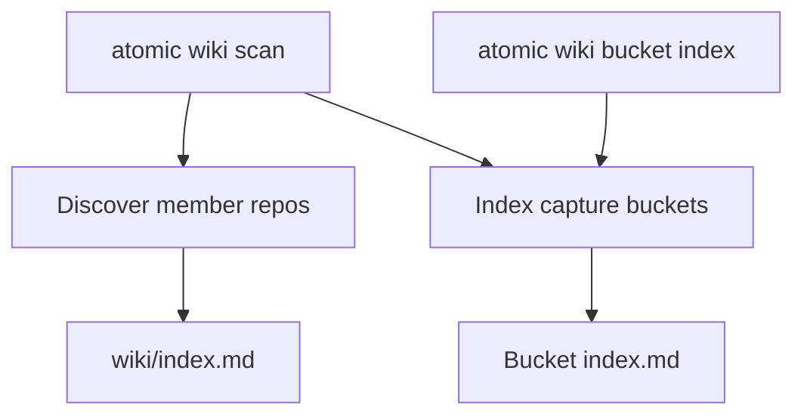

Existing realm summaries, concerns, and knowledge pages remain readable. Their inspection and link tools are explicit CLI operations.

### Verbs

`atomic wiki <verb>` is dispatched by `WikiAction` in [`atomic/internal/wiki/action.go`](../../atomic/internal/wiki/action.go). Unknown verbs exit 1. `runWiki` in [`atomic/cmd/atomic/cmd_wiki.go`](../../atomic/cmd/atomic/cmd_wiki.go) supplies the home and working directories, steering paths, and realm-sharing resolvers for scan, init, and bucket commands.

| Verb | Args and flags | Behavior |
|------|----------------|----------|
| `scan` | `--root` | Discover and classify local members, rebuild bucket indexes, write the realm scope marker, and register `wiki/index.md` locally and in enrolled steering. Scaffold and rewrite the wiki's scan and member regions only for an independent wiki. Warn on stderr about projected registry entries absent from the authority. Print a member handoff to stdout. |
| `stale` | `--root` | Read-only membership-drift report: `DRIFT added\|removed\|status` lines. Exit 0 no drift, 1 drift, 2 hard error. |
| `init` | `--scope repo\|realm`, `--root` | Write the scope marker in `<state-root>/atomic.toml`. Unless the realm wiki is already a verified shared link, write the scope's steering pair in the root's `[steering] claude` mode (see Steering pair modes). An unknown or unreadable mode fails the pair write. Report created or changed paths. Repo scope also re-renders the existing pointer cards and projects them to enrolled Claude and OMP targets. |
| `linkify` | `--root` | Rewrite path citations under `wiki/` as relative markdown links. Idempotent; never touches fenced code. |
| `bucket add <name>` | `--root` | Create or prepare a local bucket folder and build its index. An unbound realm uses its wiki's `<wiki-buckets>` registry and local steering; a bound realm records a private bucket in the binding instead. Refuses duplicate registrations. |
| `bucket list` | `--root` | Print a `<name>\t<path>` line for each usable registration. Exit 0 when the list is empty. |
| `bucket doc <bucket> <slug>` | `--root` | Scaffold the item folder `<bucket>/<slug>/index.md` plus its `<slug>/01_raw/index.md` stage, print the `<slug>/index.md` path, then rebuild the bucket's indexes. Refuses an existing `<slug>` path. |
| `bucket skill <bucket>` | `--root` | Scaffold `<realm>/.claude/skills/<bucket>-management/SKILL.md`. No-op if present. |
| `bucket index [<bucket>]` | `--root` | Rebuild `<bucket-docs>` in one bucket or each usable registered bucket. Refresh the realm `<wiki-bucket-list>` only when unbound. |

### Realm sharing topology

Each developer keeps a local workspace and a managed Git checkout. The remote exchanges content and definitions between checkouts; local symlinks expose selected content to each workspace.

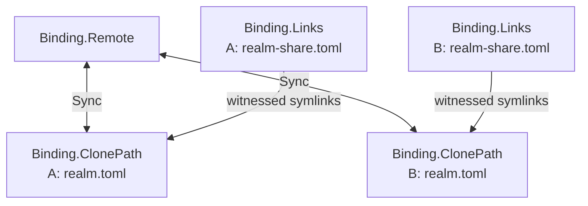

| Surface | What it records |
|---------|-----------------|
| Managed checkout, `~/.atomic/realms/<name>/` by default | Selected content and the shared Git history. `realm.toml` holds the format version, realm ID, clone-relative sources, realm-relative destinations and bucket registrations, and member definitions. Member definitions are not member repository contents. |
| `<state-root>/realm-share.toml` | The local binding to a checkout, remote, and branch; private bucket registrations, trust and activation records, link receipts, backups and restoration records, pending operations, and cached sync state. |
| Local realm | The workspace for member repos, private folders, and linked paths. `LinkedRoots` lists logical paths only when their declaration, source, and link witness agree. The backing checkout is storage, not the active realm. |

### Receiving a shared bucket

When a publisher adds a bucket mapping to an already-bound realm, `sync` gives the recipient the content and portable registration. The bucket becomes usable in the recipient's wiki commands only after the recipient reviews, approves, and installs the link.

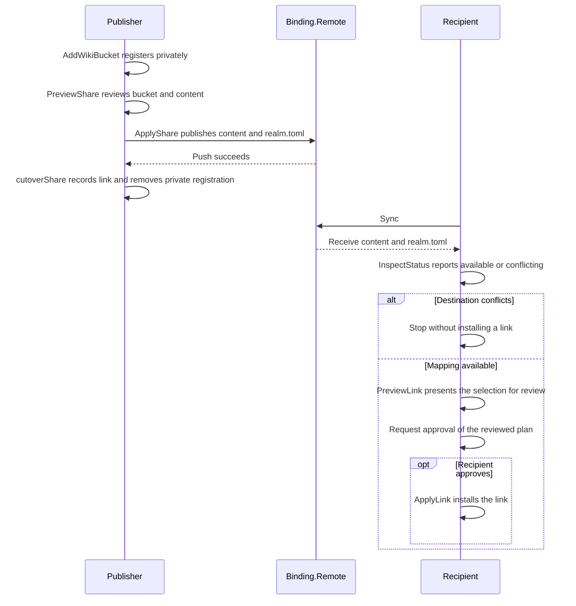

On a bound realm, `WikiBuckets` combines usable private directories with portable buckets covered by a verified directory link. It resolves shared bucket paths against the consuming realm and gives same-name private registrations precedence. An ordinary real parent directory without a private registration does not block a nested link. `link` refuses an overlapping private bucket registration or an occupied destination unless the destination is already an owned link or a verified restored original.

### Selected publication and local cutover

`ApplyShare` requires a successful publication before `cutoverShare` can replace originals. A completed push can outlive a failed local cutover.

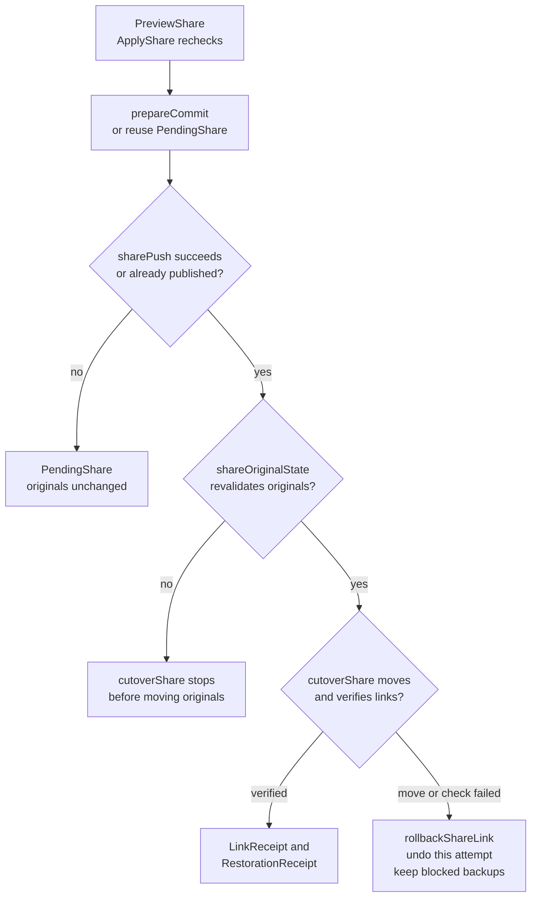

If a replacement blocks restoration during rollback, the original stays in the backup rather than overwriting the replacement.

Initial `share` requires an existing empty Git remote and defaults to `main`. It can seed portable member definitions from a local wiki scan. An addition reuses the recorded remote and branch and requires a clean checkout at the remote tip, except when resuming a recorded share. Selection is explicit: new siblings outside a mapping stay local, while changes within a shared directory go through `sync` if they are in scope and not Git-ignored. The share preview reports exclusions and includes any portable bucket registrations covered by the selected directories.

`share` and `link` both support interactive approval or an explicit path selection with `--dry-run` followed by `--yes --review <digest>`. The first noninteractive `share` also requires `--remote`. The dry run prints `Review digest: sha256:<hex>`, and apply rechecks the reviewed plan under the writer lock.

`sync` can publish a prepared `PendingShare`, but it does not perform local cutover. Resume with a fresh review of the same `share` selection. The recorded originals, bucket registrations, and checkout state must still pass revalidation. Both `link` and `unlink` refuse while a share is pending.

### Sync and conflicts

`Sync` exchanges commits in the managed checkout, even with no local links. Only a push rejected because the remote advanced leads to fetch and integration.

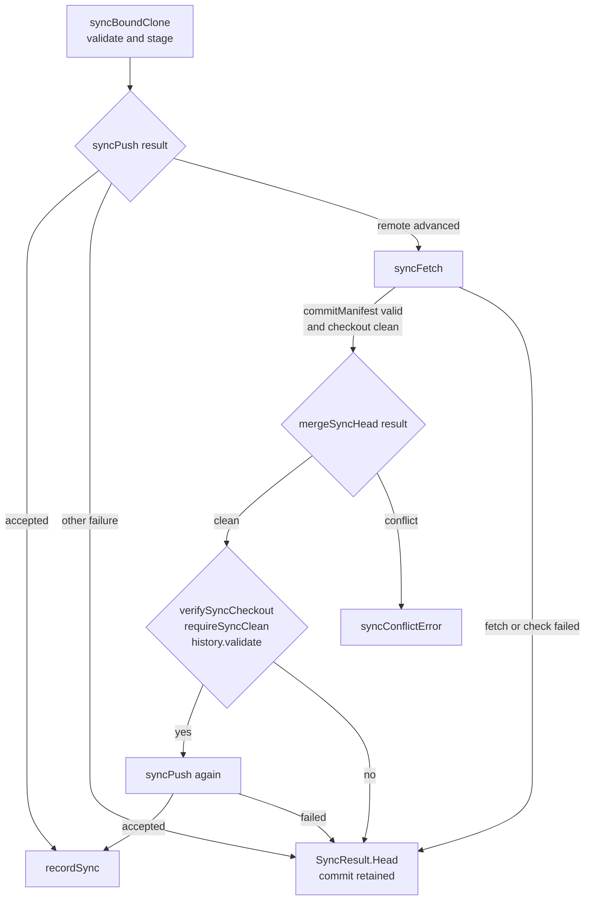

Sync stages only declared content and `realm.toml`. It rejects unrelated staged work, unfinished Git operations, and new or changed mappings that bypass `share`. It creates no commit for an unchanged tree. On conflict it preserves Git's merge state and reports clone-relative paths and their realm paths where mapped. Conflict resolution takes place in the checkout (`git -C <clone>`). A second remote advance returns a retry error with local work retained. Receiving a mapping never creates its local link.

At fresh session startup, `realmshare.ClaimSyncReminder` checks the bound checkout for declared worktree changes or commits ahead of the cached remote tip. It compares worktree changes with `HEAD` through an isolated Git index. The hook claims the local calendar day in private realm state, across harnesses, without writing to the managed checkout or contacting the remote.

### Local realm operations

| Command | Local effect |
|---------|--------------|
| `join <git-url>` | Download and validate a shared realm, record an untrusted binding, and preview mappings and collisions without installing links or cloning members. Use the advertised default branch if it contains the manifest; otherwise require an unambiguous branch with a manifest. Repeating `join` against the recorded remote inspects the existing checkout without fetching. |
| `link [<path>...]` | Review and apply selected mappings. Keep verified owned links. For a destination restored by `unlink`, require matching restoration evidence and a recoverable original before relinking; refuse other occupied destinations. |
| `status [--json]` | Report available, linked, conflicting, and pending paths, drift, clone changes, and merge conflicts. Any reported remote tip, divergence, or last successful sync comes from local observations. Status does not fetch or write. |
| `unlink` | Remove owned links and restore retained originals without overwriting replacements. Keep the binding, checkout, and recoverable work. A repeat with no links or pending work makes no path changes. |

### Independent and linked wiki Git

| Operation | Independent `wiki/` | Verified linked `wiki/` |
|-----------|--------------------|-------------------------|
| Git history | Lives in `wiki/.git` when the user initializes a repository there. | Lives in the managed checkout. Editing through the link changes the checkout; `atomic realm sync` exchanges those changes. |
| `atomic wiki scan` | Classifies members, scaffolds missing files, and writes the local scan and member regions. | Classifies local members for the handoff without using or rewriting the shared scan or member regions. Rebuilds usable bucket trees while protecting the shared wiki index, and still registers the local wiki path. |
| `atomic wiki init --scope realm` | Writes the steering scaffold. | Reuses the wiki without scaffolding it. |

The Git import exception applies only to an entire `wiki/` with a real `wiki/.git` directory. Atomic copies the current content without `.git` and keeps the original repository and history in the local backup. It rejects a wiki with a `.git` file, including a Git worktree, and rejects other nested Git repositories rather than flattening them. Publication strips the local scan and bucket regions from `wiki/index.md`; portable bucket definitions live in `realm.toml`.

### Member discovery

Only an unset, empty, or unloadable `[realm] repos`, or an entry matching `"."`, sends discovery through the whole-root walk; any other value walks only the directories its entries matched.

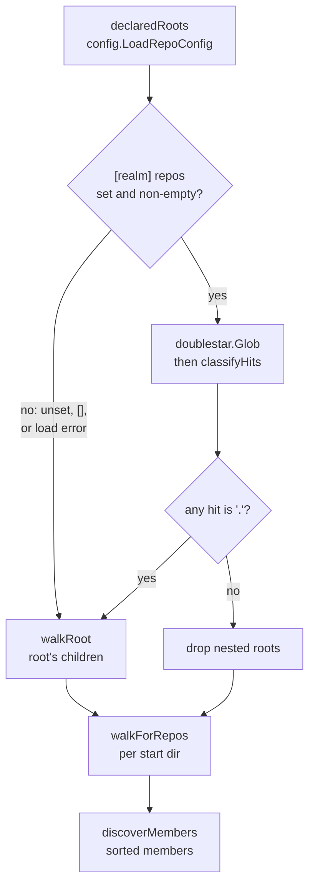

`declaredRoots` reads `[realm] repos` through `config.LoadRepoConfig`. Each entry is cleaned, rejected when empty, absolute, or leaving the root, and expanded with `doublestar.Glob` under `WithNoFollow`; an entry that is not a valid pattern or matches nothing is rejected too. `classifyHits` keeps directory hits and turns symbolic-link hits (the link itself or a path through one), unreadable hits, and file hits into at most one warning per kind for that entry. `skippedRoot` silently drops a hit that is the wiki directory, under it, or has a `skipDirs` segment, and a hit nested inside another declared root is dropped. When no entry yields a directory, discovery returns no members.

`walkForRepos` returns a git repo as a member without descending, so a declared root that is itself a repo is a member, and a declared root inside a member repo is still walked, unless another declared root contains it. Every walk stops at each `.git` boundary and skips `node_modules`, `dist`, `build`, `target`, `vendor`, `.worktrees`, `tmp`, `.git`, and the wiki directory. The root is never a member.

Every `[realm] repos` problem is a warning, never a failure: `Scan` prints each as `atomic wiki scan: warning: <msg>` and `Stale` as `atomic wiki stale: warning: <msg>`, both on stderr, and neither changes stdout or the exit code. A config load error and an unknown `realm.*` key warn too.

### Member classification

`classifyMembers` takes the first rule that matches, per member:

| Order | Test | Status |
|-------|------|--------|
| 1 | The prior scan block said `summarized` and that summary file is still on disk | `summarized`, preserved |
| 2 | `<member>/docs/wiki/index.md` exists, or the legacy `<state-root>/project/signals.md` exists under any of the member's state roots | `indexed` |
| 3 | `wiki/repos/<name>.md` exists, or `wiki/repos/<name>/` holds at least one `.md` | `summarized` |
| 4 | Nothing above matched | `pending` |

Once a scan records a member as `summarized`, rule 1 keeps it there while its summary file exists, even after the member gains its own [`docs/wiki/index.md`](index.md):

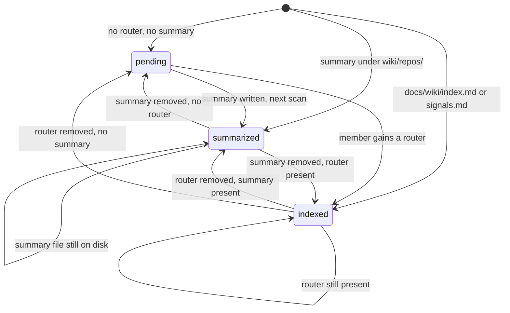

Rule 2 outranks rule 3 only for a member not already recorded `summarized`: with both a router and a summary on disk it classifies `indexed`, and its summary file stays on disk unreferenced by the `<wiki-scan>` block.

### Buckets

A bucket is a user-named capture folder, normally beside `wiki/`. Its doc index is derived; it has no freshness state. The registration source depends on whether the realm is bound.

For an unbound realm, Atomic scaffolds the folder and registers it in the wiki and local steering. The author supplies the purpose and conventions.

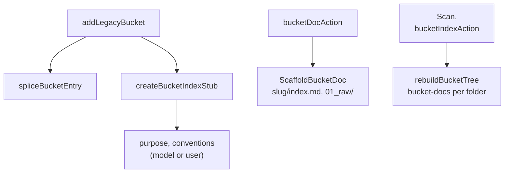

In an unbound realm, `addLegacyBucket` runs these writes in order, each gated on the one before:

1. `RegisterBucket` validates the name and refuses one already in the `<wiki-buckets>` registry in `wiki/index.md`, writing nothing.
2. The bucket folder and its `index.md` stub (`createBucketIndexStub`) are created.
3. `spliceBucketEntry` adds `<bucket name="…" path="…"/>` to the registry.
4. `captureSurfacesFile` picks the realm root's steering file, and `writeCaptureSurfacesSection` adds a `` - `<bucket>/index.md` `` bullet under `## Capture surfaces` there, or returns early when the section already names the bucket.
5. `RebuildBucketTree` fills the new folder's `<bucket-docs>` region.

`captureSurfacesFile` takes the first of `AGENTS.md`, [`CLAUDE.md`](../../CLAUDE.md), and [`claude.md`](../../claude.md) at the realm root that already holds a `## Capture surfaces` heading; otherwise a [`CLAUDE.md`](../../CLAUDE.md) that does not import `@AGENTS.md` (`bundlespec.ScopeSteering.LoaderWithoutImport`); otherwise `ScopeSteering.GuidanceFile(mode)`, which is [`CLAUDE.md`](../../CLAUDE.md) under `claude-md` and `AGENTS.md` otherwise. `addLegacyBucket` resolves the mode before the steering write and exits 1 if resolution fails. Under `loader`, when the capture section lands on `AGENTS.md`, the action calls `initSteeringPair` unless it finds a Claude loader without the `@AGENTS.md` import. In that case it warns that the loader needs the import.

`atomic wiki scan` and `atomic wiki bucket index` rebuild registered bucket trees and, in an unbound realm, refresh the realm `<wiki-bucket-list>`. In a bound realm, both use the private and verified linked bucket view; neither regenerates the wiki's bucket list. A named `bucket index` limits the tree rebuild to that bucket. Buckets get no inference pass.

An item is a folder, not a file. `atomic wiki bucket doc` (`ScaffoldBucketDoc`) writes `<slug>/index.md` and `<slug>/01_raw/index.md` from the embedded templates, and later stages are numbered folders the user adds (`02_findings/`, `10_publish/`):

    <bucket>/
      <slug>/
        index.md          bucket-doc.md: frontmatter keys below, created stamped
        01_raw/
          index.md        bucket-stage.md: title Raw, created stamped

`ScaffoldBucketDoc` creates `<slug>/` with `os.Mkdir`, so an existing path aborts before any write, and on a later failure it removes the folder it made, so a retry does not refuse a half-built item.

### Bucket-doc frontmatter

Every listed `.md` file and every folder's `index.md` (an item's `<slug>/index.md` included) is read for the same keys:

| Key | Writer | Fallback when absent |
|-----|--------|----------------------|
| `title` | author | first H1, then filename stem |
| `type` | author | none; free-form (`Research`, `Ticket`, …) |
| `description` | author | first non-structural prose line, truncated to 120 chars |
| `tags` | author | none; a bare string reads as a one-element list, any other malformed shape is ignored whole |
| `status` | author | none; free-form |
| `created` | code | stamped by `atomic wiki bucket doc` at scaffold time |

Every key is optional. A doc or folder carrying none of them is still listed, under an `### Unindexed` heading, rather than dropped. `deriveTitle` takes the frontmatter `title`, then the first H1 outside a fence, then the directory name for a folder whose `index.md` is absent or carries neither.

### Bucket tree index

Each directory's `index.md` is rebuilt before any of its subdirectories is visited, and a region that renders unchanged is not written, so a rebuild over an unchanged bucket writes no file.

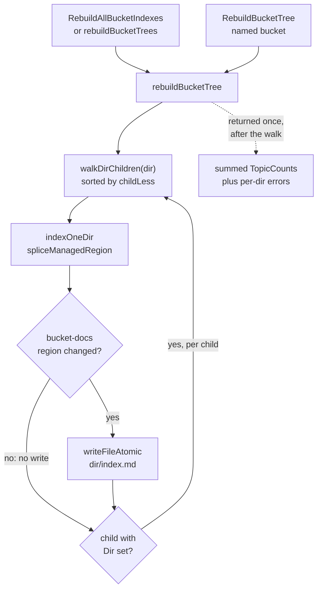

`walkDirChildren` lists a directory's direct children: each `.md` file other than `index.md`, and each subdirectory not in `skipDirs`. Dot-prefixed names of either kind are skipped, and their subtrees are never walked. A subdirectory entry reads its metadata from its own `index.md` and links to `<name>/index.md`. A `<slug>.md` beside a `<slug>/` lists as two separate entries.

`childLess` puts names with a leading digit run first, ordered by that number's value (`9_x` before `10_x`, compared as digit strings so a prefix past int64 still orders), ties broken by full name; names without a prefix follow in byte order. `indexOneDir` creates `index.md` holding only the region when none exists.

A directory that fails to list, read, splice, or write adds one error; a directory that cannot be listed is not descended into, and the walk continues with its siblings. `reportTreeErrors` prints each one; `bucket doc`, `bucket add`, and a named `bucket index` exit 1 on any error other than `errUnpairedRegion`, while `scan` and an all-bucket `bucket index` only report.

`IndexDir` is a different walk, kept for `atomic docs index`: `walkBucketTopics` lists one directory, collapsing a subdirectory beside a matching `<slug>.md` into that entry as a **router** and listing a subdirectory with no sibling file as an **orphan** subtree. Neither rule applies inside a bucket.

### Managed regions

XML-tag regions (`<tag>…</tag>`) delimit every code-generated splice in a wiki markdown file, because heading-bounded splicing cannot tell "the next heading" from a heading a user typed inside the generated block. Each region has one splicer:

| Region | Splicer | Malformed region |
|--------|---------|------------------|
| `wiki-member-list`, `<wiki-bucket-list>`, `<bucket-docs>` | `spliceManagedRegion` / `renderManagedRegion` in [`atomic/internal/wiki/managedregion.go`](../../atomic/internal/wiki/managedregion.go) | returns `errUnpairedRegion`, document unchanged |
| `<wiki-scan>` | `rewriteScanBlock` in [`atomic/internal/wiki/wiki.go`](../../atomic/internal/wiki/wiki.go) | absent or malformed open tag appends a fresh block; a missing close tag truncates from the open tag to EOF |
| `<wiki-buckets>` | `rewriteBucketsBlock` in [`atomic/internal/wiki/bucket_registry.go`](../../atomic/internal/wiki/bucket_registry.go) | a fresh block is appended |
| `<wikis>` | `setWikisBlock` (authority) and `addToWikisBlock` (projection) in [`atomic/internal/wiki/registry.go`](../../atomic/internal/wiki/registry.go) | located by `findBareLineBlock`, whole-line tags only; an absent block is inserted after `</atomic>`, or at EOF |

- A blank line on each side of the region content is mandatory, not cosmetic. CommonMark parses a tag alone on a line as an HTML block running to the next blank line, so unpadded content renders as raw text. `renderManagedRegion` is the only emitter of that padding; `rewriteScanBlock` adds none.
- An unpaired `wiki-member-list` fails the scan: `writeMembersSection` returns the `errUnpairedRegion`, and `Scan` errors with `wiki scan: write members section`. An unpaired `<bucket-docs>` or `<wiki-bucket-list>` warns to stderr and the run continues.
- The collision checks and scaffolding below apply to an independent wiki.
- `atomic wiki scan` is idempotent: it rewrites only the managed regions. Content outside them, and everything under `repos/` and `concerns/`, is untouched. A fresh scan scaffolds `index.md`, [`README.md`](../../README.md), the steering pair (through `InitRealmScope`, only when `wiki/` holds no `AGENTS.md` or [`CLAUDE.md`](../../CLAUDE.md), per `hasSteeringFiles`), `repos/`, and `concerns/`, and `git init`s `wiki/`; it overwrites none of them when present, and reshaping an existing pair is left to `atomic repo init` and `atomic update`. When `atomic.toml` is malformed, the scan has already warned about it and writes the pair in `loader` shape; a readable file with an invalid `[steering] claude` value fails the scan.
- Scan refuses a `wiki/` whose `index.md` lacks the `<wiki-scan>` marker, or which has no `index.md` and holds anything but what `wiki init --scope realm` writes, unedited. `onlyInitScaffold` accepts what `init` writes in any steering mode: an `AGENTS.md` equal to the realm scaffold beside a [`CLAUDE.md`](../../CLAUDE.md) equal to `bundlespec.ScopeSteering.LoaderDocument()` (`loader`), a lone `AGENTS.md` equal to the scaffold (`agents-md`), or a lone [`CLAUDE.md`](../../CLAUDE.md) equal to the scaffold wrapped in an Atomic block (`claude-md`) or to the bare scaffold, which an init from before the pair wrote. An empty `wiki/` is refused. The error names the path.

### Membership drift

`<wiki-scan>` carries `root` and `generated` on the open tag and records membership and status only. `generated` records the date of the last scan; nothing reads it as a freshness signal.

`Stale` compares that block against a live `discoverMembers` plus `classifyMembers` call with a nil prior map, so rule 1 never applies to it. Discovery honors `[realm] repos` here too, so a recorded member outside the declared roots prints as `DRIFT removed <path>`, the same as a deleted repo. It reads no frontmatter, hashes no files, and runs no git.

`<wiki-buckets>` carries `<bucket name="…" path="…"/>` entries; a `declined="true"` attribute on the open tag records that the user declined the one-time bucket offer, and `spliceBucketEntry` removes it when a real bucket is added.

### Wiki registry

`~/.atomic/wikis.md` is written first and every steering file is projected from it, so a realm registered once reaches every enrolled harness, and a line a user adds to a projected block is reported rather than imported or deleted.

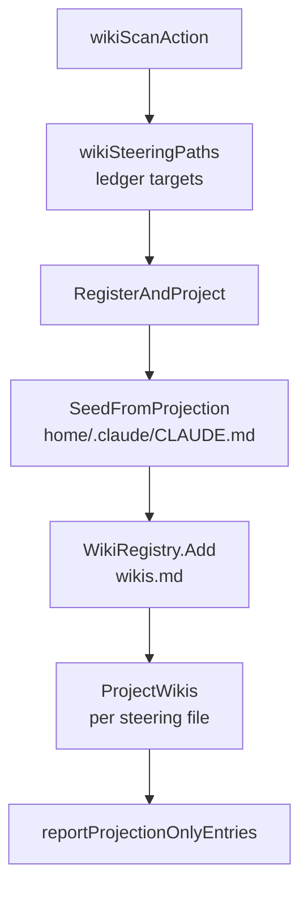

`wikiSteeringPaths` reads the install ledger and maps each target to its global steering file: `claude.GlobalSteeringPath` for Claude, `omp.SteeringPath` and `codex.SteeringPath` (each `<native-root>/AGENTS.md`) for OMP and Codex. With no target enrolled it returns [`CLAUDE.md`](../../CLAUDE.md) under `config.ClaudeConfigDir(home)` when that file exists, and nothing otherwise.

`WikiRegistry` (`NewWikiRegistry(home)`, path from `config.WikisPath`) holds `Load`, `Save`, `Add`, `Remove`, and `SeedFromProjection`:

- `Save` rewrites only the `<wikis>` block of `wikis.md`, writing a `# Wiki registry` header once when it creates the file, then reads the block back.
- `Add` dedups on the `normalizePath` form (Abs then Clean, no symlink resolution) and reports whether it changed anything.
- `SeedFromProjection` runs only while `wikis.md` is absent. It adopts the absolute, deduplicated entries of the given file's `<wikis>` block and drops relative ones; an empty result writes nothing.

`ProjectWikis` never replaces a projected block. It appends each authority path the block lacks before `</wikis>`, keeping the earlier entries first so a first-match resolver keeps its winner, and writes nothing when no path is missing. `ProjectionOnlyEntries` returns the projected entries that are relative or absent from the authority, and `reportProjectionOnlyEntries` prints each to stderr as `atomic wiki scan: warning: <steering> <wikis> block diverges from <wikis.md>: <entry> is not registered there; left in place, not imported`.

Readers resolve the registry through `RegisteredIndexPaths(claudeMDPath)`: the authority when `claudeMDPath` has the `<home>/.claude/CLAUDE.md` shape (`conventionalHome`) and `wikis.md` exists, otherwise the file's own `<wikis>` block through `ReadWikiIndexPaths` in [`atomic/internal/wiki/staleness.go`](../../atomic/internal/wiki/staleness.go). `ProjectionConflict` reports a conflict when the projection holds an entry the authority lacks or lacks one it holds; a missing authority or a missing projection file is not a conflict.

### Realm location

A directory belongs to a realm by its nearest marker first and by the registry only as a fallback.

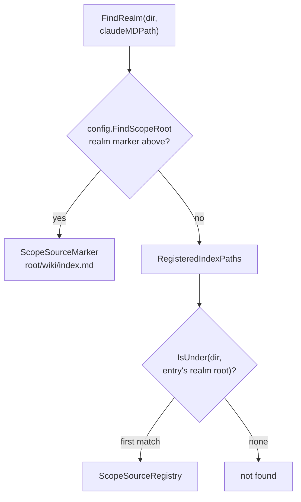

`FindRealm` returns a `RealmLocation` with `Root`, `IndexPath`, and `Source`. A registry entry's realm root is two directories above its `index.md`. `IsUnder` compares cleaned path prefixes and resolves no symlinks. [`atomic/internal/where/where.go`](../../atomic/internal/where/where.go) and [`atomic/internal/workflow/resolve.go`](../../atomic/internal/workflow/resolve.go) call it.

### Pointer cards

`atomic-wiki-inferrer` writes the per-domain pointer cards under `<state-root>/rules/wiki/` in [`context/skills/atomic-wiki/references/repo.md`](../../context/skills/atomic-wiki/references/repo.md) Step 7b: an incremental run over existing cards emits only the re-dispatched domains' cards, and every run deletes the cards of domains the router no longer lists. Step 8c then runs `atomic wiki init --scope repo`, which passes the cards on disk back through `Refresh` and projects them to the harnesses.

`init --scope repo` re-validates every card before any harness sees it, and a projection failure only warns because the canonical cards are already valid.

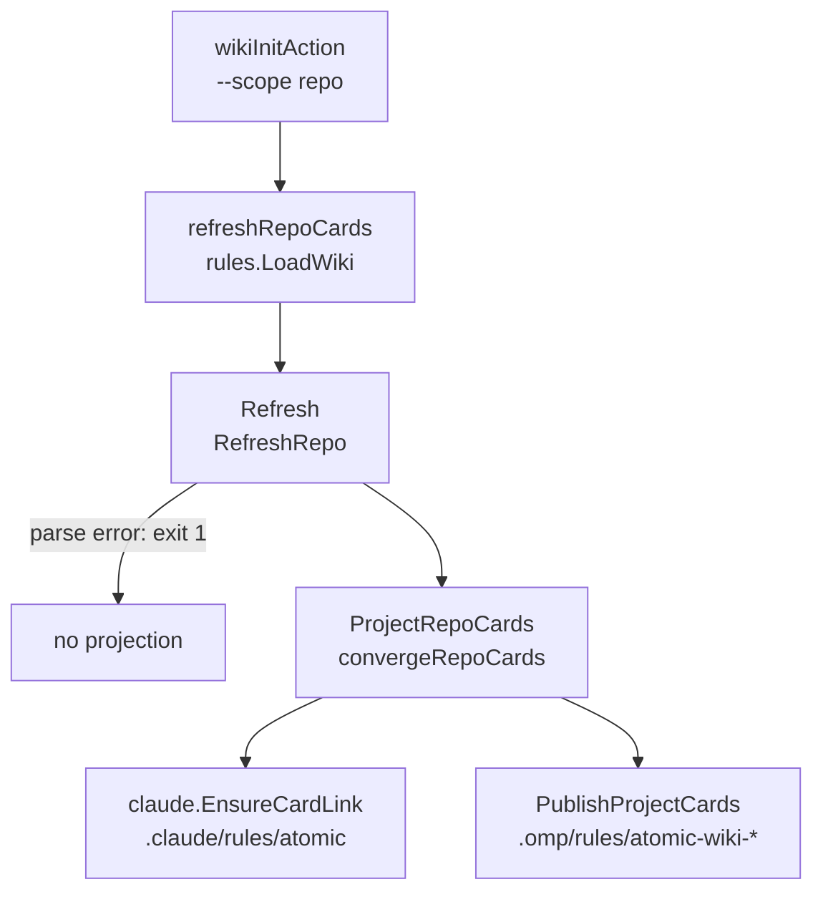

`Refresh(stateRoot, projectKey, scope, cards)` treats the cards it is given as the whole set, so it prunes every domain absent from them, and it renders and validates every card through `rules.ParseWiki` before it deletes or writes anything, so one malformed card leaves the existing set untouched. `RefreshRealm` writes nothing and returns no records: realm scope spans several repository bases, so it produces no cards. An unknown scope, an empty `stateRoot` or `projectKey`, or a card with no `Domain` returns an error.

A card's frontmatter holds the `# generated by /refresh-wiki` marker comment, a `description:` (`rules.CardDescription`: the first non-blank body line without heading marks, else `Atomic wiki card for <domain>`), and the same globs under both `globs:` (what OMP reads) and `paths:` (what Claude and `rules.ParseWiki` read), followed by the body; the card's record identity is `wiki:<project-key>:<domain>`. `ProjectRepoCards` is a package variable that [`atomic/cmd/atomic/cmd_cards.go`](../../atomic/cmd/atomic/cmd_cards.go) assigns in `init`. `convergeRepoCards` writes the Claude link when a Claude target is enrolled and, when an OMP target is enrolled, calls `omp.Adapter.PublishProjectCards`, which writes one `.omp/rules/atomic-wiki-<domain>.md` per card: a committed relative symlink, or a generated copy when the state root lies outside the repository (the harness domain owns that projection). Outside `init`, the OMP branch first runs the exported `RenderRepoCards`, since OMP lists a card only through the `description:` older cards lack. A realm-scope `init` stops after the steering pair and projects no cards.

### Steering pair modes

The `[steering] claude` key decides which file Claude reads in each steering pair, so a repo can keep `AGENTS.md` as its only steering file, keep [`CLAUDE.md`](../../CLAUDE.md) as its only one, or keep both with a loader. `config.ResolveSteeringMode` resolves it; the lookup order and its errors belong to [`docs/wiki/config.md`](config.md). `initSteeringPair(dir, scaffold, mode)` writes a pair in that shape and converts one left in another, and it never copies user text between files.

| Mode | Pair it writes | What it does to the other shape |
|------|----------------|---------------------------------|
| `loader` | `AGENTS.md` (the scaffold, when absent) plus a [`CLAUDE.md`](../../CLAUDE.md) whose Atomic block is `LoaderDocument()` | replaces an Atomic-owned block in [`CLAUDE.md`](../../CLAUDE.md) with the loader; a [`CLAUDE.md`](../../CLAUDE.md) with user text and no Atomic block is left alone |
| `agents-md` | `AGENTS.md` alone | removes Atomic's block from [`CLAUDE.md`](../../CLAUDE.md), and deletes the file when nothing else is left; a user [`CLAUDE.md`](../../CLAUDE.md) with no Atomic block stays |
| `claude-md` | [`CLAUDE.md`](../../CLAUDE.md) alone, the scaffold inside an Atomic block (`managedfile.BracketedBlockDocument`) | deletes an unedited `AGENTS.md`; an edited one leaves the pair in its current shape and returns a note |

A [`CLAUDE.md`](../../CLAUDE.md) is Atomic's own when its block equals the loader (`bundlespec.ScopeSteering.OwnsLoader`) or the wrapped scaffold. Under `loader`, a root [`CLAUDE.md`](../../CLAUDE.md) holding only a realm `<code-index>` block beside an `AGENTS.md` also counts, and gets the loader appended after the block.

#### Conversion on init and update

`atomic repo init` and `atomic update` convert the wiki pair and the root pair through `convergeSteeringMode`, after the realm code-index block moves. `atomic wiki init` converts the wiki pair only, through `initScopePair`. The `convergeSteeringMode` flow and its diagram belong to the harness domain ([`docs/wiki/harness.md`](harness.md)); the wiki-side steps are below.

- **claude.ConvertScope**: runs only with a home directory, and reshapes only pairs that carry an `<atomic>` block; the harness domain owns it ([`docs/wiki/harness.md`](harness.md)).
- **wiki.ConvertSteeringPair**: walks [`docs/wiki/`](.) (or `wiki/` in realm scope) and then the root, skipping a pair with neither file. The root pair has no scaffold, so under `claude-md` it never converts and only reports a note when `AGENTS.md` holds text. Under `loader` it is skipped when the root has no [`CLAUDE.md`](../../CLAUDE.md), so conversion never drops a loader into a repo that only has an `AGENTS.md`.
- **Output**: each changed path prints `steering (<mode>): updated <path>`, each note `steering (<mode>): <note>`.

## Where it lives

### Artifacts

| Path | Role |
|------|------|
| [`context/commands/refresh-wiki.md`](../../context/commands/refresh-wiki.md) | Starts the repo prose refresh on request. |
| [`context/agents/atomic-wiki-inferrer.md`](../../context/agents/atomic-wiki-inferrer.md) | Runs the repo pipeline and dispatches writers and reviewers. |
| [`context/agents/atomic-wiki-writer.md`](../../context/agents/atomic-wiki-writer.md) | Writes one repo domain page from source and redraws current design diagrams. |
| [`context/skills/atomic-wiki/SKILL.md`](../../context/skills/atomic-wiki/SKILL.md) | Resolves realms, registers and indexes capture buckets, and answers explicit wiki queries. |
| [`context/skills/atomic-wiki/references/repo.md`](../../context/skills/atomic-wiki/references/repo.md) | Repo scan, domain assignment, page contract, and review. |
| [`context/skills/atomic-wiki/references/realm.md`](../../context/skills/atomic-wiki/references/realm.md) | Capture bucket frontmatter and index ownership. |

### Realm scan and drift

| Path | Role |
|------|------|
| [`atomic/internal/wiki/wiki.go`](../../atomic/internal/wiki/wiki.go) | `Scan(root, Options)`: `discoverMembers`, `classifyMembers`, and bucket index rebuild. For an independent wiki it checks collisions, parses prior entries, scaffolds, and writes the scan block and member list. `Options.Clock` is injectable for deterministic tests. Also holds `onlyInitScaffold`, `DeriveMemberDescription`, and the legacy-marker migration. |
| [`atomic/internal/wiki/stale.go`](../../atomic/internal/wiki/stale.go) | `Stale(root, out)`: membership drift only, printing `discoverMembers` warnings to stderr, and the `StaleCode*` exit constants. |
| [`atomic/internal/wiki/scan_members.go`](../../atomic/internal/wiki/scan_members.go) | `ReadScanMembers`: lists members from the `<wiki-scan>` block without a filesystem walk. |
| [`atomic/internal/wiki/managedregion.go`](../../atomic/internal/wiki/managedregion.go) | The XML-tag region primitive behind the `wiki-member-list`, `<wiki-bucket-list>`, and `<bucket-docs>` splices. |
| [`atomic/internal/wiki/linkify.go`](../../atomic/internal/wiki/linkify.go) | `LinkifyWiki`. Base resolution: `repos/**` uses each summary's `repo:` frontmatter, `concerns/*.md` and `index.md` use the realm root. |

### Realm sharing

| Path | Role |
|------|------|
| [`atomic/cmd/atomic/cmd_realm.go`](../../atomic/cmd/atomic/cmd_realm.go) | Realm verbs, local realm resolution, and approval and review output. |
| [`atomic/internal/realmshare/manifest.go`](../../atomic/internal/realmshare/manifest.go), [`atomic/internal/realmshare/binding.go`](../../atomic/internal/realmshare/binding.go) | Validate the portable definition separately from the local binding and ownership receipts. |
| [`atomic/internal/realmshare/share.go`](../../atomic/internal/realmshare/share.go), [`atomic/internal/realmshare/recovery.go`](../../atomic/internal/realmshare/recovery.go), [`atomic/internal/realmshare/links.go`](../../atomic/internal/realmshare/links.go) | Seal and recheck selected publication, record and complete local cutover, review links, and restore originals on unlink. |
| [`atomic/internal/realmshare/join.go`](../../atomic/internal/realmshare/join.go), [`atomic/internal/realmshare/sync.go`](../../atomic/internal/realmshare/sync.go), [`atomic/internal/realmshare/status.go`](../../atomic/internal/realmshare/status.go) | Download and bind, exchange validated commits, and inspect clone and path state without fetching. |
| [`atomic/internal/realmshare/wiki_buckets.go`](../../atomic/internal/realmshare/wiki_buckets.go), [`atomic/internal/realmshare/orientation.go`](../../atomic/internal/realmshare/orientation.go) | Supply bucket registrations and declared, witnessed discovery roots. |
| [`docs/design/realm-sharing.md`](../design/realm-sharing.md) | Realm topology, bucket receipt, publication boundary, and sync design. |
| [`docs/spec/realm-sharing.md`](../spec/realm-sharing.md) | Contracts for publication, linking, sync, and native activation. |
| [`docs/guides/realm-sharing.md`](../guides/realm-sharing.md) | Publisher and recipient workflows for sharing selected realm content. |

### Buckets

| Path | Role |
|------|------|
| [`atomic/internal/wiki/bucket.go`](../../atomic/internal/wiki/bucket.go) | `validateBucketName` and `RegisterBucket`, the registry-backed duplicate check. |
| [`atomic/internal/wiki/bucket_registry.go`](../../atomic/internal/wiki/bucket_registry.go) | `<wiki-buckets>` registry splice and read (`readBucketEntries`, exported `ReadBucketEntries`), `captureSurfacesFile` and `writeCaptureSurfacesSection` for the realm steering file, and `createBucketIndexStub`. |
| [`atomic/internal/wiki/bucketindex.go`](../../atomic/internal/wiki/bucketindex.go) | The `<bucket-docs>` and `<wiki-bucket-list>` region renderers. `RebuildBucketTree` (`walkDirChildren`, `childLess`) indexes every directory of a bucket; `RebuildAllBucketIndexes` runs it per registered bucket and returns counts by name plus every error. `IndexDir` (`walkBucketTopics`) is the one-level router/orphan listing for `atomic docs index`, or with `check` reports without writing. |
| [`atomic/internal/wiki/bucketdoc.go`](../../atomic/internal/wiki/bucketdoc.go) | `ScaffoldBucketDoc` (item folder plus `01_raw/` stage) / `ScaffoldBucketSkill`, and `validateSlug`, backed by `//go:embed templates/*.md`. |
| [`atomic/internal/wiki/templates/`](../../atomic/internal/wiki/templates) | Scaffold templates (`bucket-doc.md`, `bucket-stage.md`, `bucket-skill.md`) with `{{TOKEN}}` placeholders. |

### Registry, location, steering, and cards

| Path | Role |
|------|------|
| [`atomic/internal/wiki/registry.go`](../../atomic/internal/wiki/registry.go) | `WikiRegistry`, the `~/.atomic/wikis.md` authority; `RegisterAndProject`; `ProjectWikis`, `ProjectionOnlyEntries`, `ProjectionConflict`, and `RegisteredIndexPaths`; `conventionalHome`; `findBareLineBlock`; `PrintHandoff`, the scan stdout contract. Also holds `writeFileAtomic`, the temp-file-and-rename writer behind the region splices, the bucket scaffolds, the steering pair, the registry, and the pointer cards. |
| [`atomic/internal/wiki/staleness.go`](../../atomic/internal/wiki/staleness.go) | `ReadWikiIndexPaths` and `blockEntries`: read the `<wikis>` block of any file (the authority or a projection) as written, matching whole-line tags only. |
| [`atomic/internal/wiki/realmroot.go`](../../atomic/internal/wiki/realmroot.go) | `FindRealm`, `RealmLocation`, and `IsUnder`: marker-first, registry-fallback realm lookup. |
| [`atomic/internal/wiki/init.go`](../../atomic/internal/wiki/init.go) | `InitRepoScope` and `InitRealmScope` over `initScopePair`, which resolves the steering mode, and `initSteeringPair`, which writes or converts the pair in that mode: called by `wiki init`, by `Scan`'s `scaffold`, and (loader only) by `bucket add`. `ConvertSteeringPair` reshapes the wiki and root pairs for `convergeSteeringMode`; `hasSteeringFiles` and `readSteeringFile` (which also tries the lowercase name) back both. |
| [`atomic/internal/wiki/codeindex.go`](../../atomic/internal/wiki/codeindex.go) | The realm `<code-index>` vocabulary shared with code-intel: `CodeIndexOpen`, `CodeIndexClose`, `CodeIndexStub`, `LegacyCodeIndexStub`, `FindCodeIndexBlock`, and `StripCodeIndex`, which removes the block, the blank line a splice put before it, and either stub. |
| [`atomic/internal/wiki/refresh.go`](../../atomic/internal/wiki/refresh.go) | `Refresh`, `PointerCard`, the `RefreshRepo`/`RefreshRealm` scopes, `refreshRepoCards` over the exported `RenderRepoCards`, `renderPointerCard`, and the `ProjectRepoCards` hook. |
| [`atomic/internal/wiki/action.go`](../../atomic/internal/wiki/action.go) | CLI dispatch, `resolveWikiRoot`, the per-verb actions, and `reportProjectionOnlyEntries`. |
| [`atomic/cmd/atomic/cmd_wiki.go`](../../atomic/cmd/atomic/cmd_wiki.go) | Cobra wiring for `atomic wiki` and `atomic wiki bucket`; every subcommand forwards to `wiki.WikiAction`. `wikiSteeringPaths` resolves the projection targets from the install ledger. |

### Docs

| Path | Covers |
|------|--------|
| [`docs/spec/wiki.md`](../spec/wiki.md) | Core contract: `scan`, `linkify`, `stale`, `signals scan --out`, and `/refresh-wiki` success criteria, classification rules, `<wiki-scan>` block format, `<wikis>` registry. |
| [`docs/spec/realm-wiki-drop-refresh.md`](../spec/realm-wiki-drop-refresh.md) | Historical contract for removing realm freshness tracking and bucket synthesis. |
| [`docs/spec/wiki-buckets.md`](../spec/wiki-buckets.md) | Bucket contract: `add`/`list`, `<wiki-buckets>` format, and capture surfaces. |
| [`docs/spec/bucket-doc-management.md`](../spec/bucket-doc-management.md) | Child of `wiki-buckets`. Frontmatter contract, both managed regions, the `doc`/`skill`/`index` verbs. |
| [`docs/spec/bucket-icm-structure.md`](../spec/bucket-icm-structure.md) | The bucket folder tree: an `index.md` in every directory, numeric-prefix ordering, item folders with `01_raw/`, removal of `--router`. |
| [`docs/spec/wiki-bucket-arg-hardening.md`](../spec/wiki-bucket-arg-hardening.md) | Help probes must never mutate state; bucket names must be safe path segments. |
| [`docs/spec/wiki-storage-relocation.md`](../spec/wiki-storage-relocation.md) | The [`docs/wiki/`](.) layout, OKF frontmatter, and the `<wiki-type>`/`<scan-sha>`/`<wiki-schema>` control blocks. |
| [`docs/spec/wiki-drift-scope.md`](../spec/wiki-drift-scope.md) | How a repo-scope refresh chooses incremental versus full re-infer. |
| [`docs/spec/wiki-deterministic-setup.md`](../spec/wiki-deterministic-setup.md) | The `atomic wiki init` verb. |
| [`docs/spec/signals-wiki-linkify.md`](../spec/signals-wiki-linkify.md) | The linkify contract shared by `signals linkify` and `wiki linkify`. |
| [`docs/spec/wiki-durable-facts.md`](../spec/wiki-durable-facts.md) | The no-counts ban and where each pipeline enforces it. |
| [`docs/design/wiki.md`](../design/wiki.md), [`docs/design/wiki-buckets.md`](../design/wiki-buckets.md), [`docs/design/bucket-doc-management.md`](../design/bucket-doc-management.md), [`docs/design/signals-wiki-unification.md`](../design/signals-wiki-unification.md), [`docs/design/wiki-durable-facts.md`](../design/wiki-durable-facts.md) | Rationale and rejected alternatives behind the specs above. The per-topic router walk in [`docs/design/bucket-doc-management.md`](../design/bucket-doc-management.md) is superseded by [`docs/spec/bucket-icm-structure.md`](../spec/bucket-icm-structure.md). |
| [`docs/reference/realm-wiki.md`](../reference/realm-wiki.md) | User-facing guide: realm mental model, disk layout, choosing members with `[realm] repos`, repo states, membership drift, re-authoring summaries and concerns, the inert leftovers on an upgraded realm, bucket authoring, bucket-name rules. |
| [`docs/reference/atomic-toml.md`](../reference/atomic-toml.md) | `## [realm] repos`: matching rules, nested-root and symlink behavior, and every warning. |
| [`docs/guides/knowledge-base.md`](../guides/knowledge-base.md) | The realm layout, capture surfaces, and how a session finds material. |
| [`docs/reference/concepts.md`](../reference/concepts.md) | `## Wikis` section: repo versus realm scope and the realm verbs. |

## Constraints

**The inferrer reads its pipeline from the installed copy of the `atomic-wiki` skill**, resolved through the base directory the runtime reports for that skill, not from the repo copy. Editing [`context/skills/atomic-wiki/references/`](../../context/skills/atomic-wiki/references) has no effect on a session until the bundle is rebuilt and reinstalled.

**A clean `atomic wiki stale` says nothing about prose content.** Exit 0 means the member set and statuses match the `<wiki-scan>` block. Existing summaries and concerns require manual updates.

**A destination symlink alone does not establish ownership.** `link` requires the matching receipt and witness to reuse a link; `unlink` refuses replacements. `scan` and realm `init` do not follow an unowned `wiki/` symlink.

**Older realms keep inert files.** A realm built by an earlier release may still hold `wiki/.dirty`, `wiki/.buckets/`, `wiki/knowledge/`, `reflects_*` frontmatter, and a `.dirty` line in `wiki/.gitignore`. The realm refresh no longer synthesizes these files.

**Bucket names must be safe single path segments:** not empty or whitespace, not `-`-prefixed, no `/` or `\`, not `.` or `..`, and not the reserved `wiki`. `validateBucketName` is the register-time backstop for programmatic callers; the CLI scanner rejects dash tokens first.

**Bucket-doc slugs must match `[a-z0-9-]+` and must not name a `skipDirs` folder** (`build`, `dist`, `target`, `tmp`, `vendor`); `validateSlug` fails hard on either, since the tree walk would never index such an item.

**A projected `<wikis>` block only grows.** `ProjectWikis` adds missing authority entries and never removes a line, so `WikiRegistry.Remove` changes `wikis.md` without touching any steering file, and a stale projected entry stays until a user deletes it. Until then `ProjectionConflict` reports it and `scan` warns about it on every run.

**Once `~/.atomic/wikis.md` exists, a hand-added `<wikis>` line is never imported.** `SeedFromProjection` adopts a projected block only while the authority is absent. After that, readers at a conventional root (`RegisteredIndexPaths`, and through it `FindRealm`, `atomic where`, code-intel, and the doctor check) see only the authority, and `claude.Verify` in [`atomic/internal/harness/claude/migration.go`](../../atomic/internal/harness/claude/migration.go) reports the difference as `<CLAUDE.md> <wikis> block diverges from <wikis.md>`. Run `atomic wiki scan` in the realm to register it.

**The authority exists only at a conventional root.** `conventionalHome` derives `<home>` only from a path shaped `<home>/.claude/CLAUDE.md`. For any other `claudeMDPath`, `RegisteredIndexPaths` and `FindRealm` read that file's own `<wikis>` block and `ProjectionConflict` reports no conflict. `RegisterAndProject` always seeds from `<home>/.claude/CLAUDE.md`, whatever `config.ClaudeConfigDir` resolves.

**`writeFileAtomic` keeps an existing file's permission bits** and gives a new file `0644`, so a region rebuild never resets the mode of a user's `index.md`.

**`initSteeringPair` never overwrites user text.** In every mode, a [`CLAUDE.md`](../../CLAUDE.md) or [`claude.md`](../../claude.md) holding user text and no Atomic block is left untouched, so an existing Claude-direct install never gains a second guidance file. Under `claude-md`, an `AGENTS.md` that differs from the scaffold keeps the pair in its current shape and comes back as a note rather than being merged into [`CLAUDE.md`](../../CLAUDE.md). An existing `AGENTS.md` is never rewritten (an unedited one may be deleted under `claude-md`).

**`resolveWikiRoot` is the single arg scanner behind every `bucket` verb.** It accepts `--root` in any position, recognizes `-h`/`-help`/`--help` anywhere and returns a sentinel that makes the verb print usage and exit 0 with no filesystem write, and rejects any other dash-prefixed token rather than letting it become a positional. `scan`, `stale`, `linkify`, and `init` use a plain `flag.FlagSet` and do not share this behavior.

**`ScaffoldBucketDoc` refuses an existing `<slug>` path; `ScaffoldBucketSkill` treats an existing file as a silent no-op.** A doc-slug collision usually means a naming mistake worth surfacing; re-running the skill scaffold on a realm that already has it is the expected outcome.

**Realm discovery:** Use the scope marker or registered realm root. The repo prose command does not route to a realm pipeline.

## Coupling

- **signals domain** owns repo scans, inference, and linkification. `atomic wiki linkify` handles existing realm pages separately.
- **docs-meta domain** owns the repo page shape and writing rules. `atomic docs index` calls `wiki.IndexDir`, which shares the bucket index machinery.
- **Design-doc ownership** is assigned per file in the repo pipeline and passed to the domain writer.
- **config domain** owns `config.WikisPath` (the `~/.atomic/wikis.md` location), `config.ClaudeConfigDir`, `config.LedgerPath`, `config.RepositoryStateDir`, `config.ProjectKey`, and the scope marker. `wikiInitAction` and `scanAction` call `config.EnsureScopeMarker`; `init` refuses a conflicting marker, while `scan` warns and leaves it unchanged. `FindRealm` prefers the marker (`config.FindScopeRoot`) over the registry. `config.ResolveSteeringMode` supplies the `[steering] claude` mode for `initScopePair`, `addLegacyBucket`, and the realm code-index writer. `declaredRoots` reads `[realm] repos` through `config.LoadRepoConfig` and forwards only the `realm.*` load warnings.
- **harness domain** owns the install ledger and the per-harness steering paths `wikiSteeringPaths` maps targets to (`claude.GlobalSteeringPath`, `omp.SteeringPath`, `codex.SteeringPath`); a new harness kind projects no `<wikis>` block until it gets a case there. It owns `bundlespec.ScopeSteering` (the `AGENTS.md` source, the [`CLAUDE.md`](../../CLAUDE.md) loader, `LoaderDocument()`, `LoaderWithoutImport`, `OwnsLoader`, `GuidanceFile`) and `claude.ConvertScope`, which `convergeSteeringMode` runs before `ConvertSteeringPair`; `ScopeSteering` is what `initSteeringPair`, `onlyInitScaffold`, and `captureSurfacesFile` use; a change to the loader bytes changes what `scan` accepts as an unedited init. `claude.Verify` calls `ProjectionConflict`. `convergeRepoCards` in [`atomic/cmd/atomic/cmd_cards.go`](../../atomic/cmd/atomic/cmd_cards.go) implements `ProjectRepoCards` with `claude.EnsureCardLink` and `omp.Adapter.PublishProjectCards`, and the `rules` package's `ParseWiki` and `LoadWiki` define the card format `Refresh` validates.
- **Native realm activation** belongs to [`docs/wiki/harness.md`](harness.md); publishing, receiving, and linking content are separate from native availability.
- **workflow domain** resolves realm workflow preferences through `realmPrefsPath` in [`atomic/internal/workflow/resolve.go`](../../atomic/internal/workflow/resolve.go). Repo `/refresh-wiki` does not synthesize realm pages.
- **doctor domain** owns [`atomic/internal/cliusage/cliusage.go`](../../atomic/internal/cliusage/cliusage.go). `main.go` calls `cliusage.SetRoot(rootCmd)`, so `--help` and the A1 citation lint read the live Cobra tree through `DeriveCommands`; the static `commands` slice is the golden table `TestDeriveCommandsGolden` checks. Register a `wiki` verb in [`atomic/cmd/atomic/cmd_wiki.go`](../../atomic/cmd/atomic/cmd_wiki.go), then update the golden slice in `cliusage.go`, or `TestDeriveCommandsGolden` fails. [`atomic/internal/doctor/checks_repo_config.go`](../../atomic/internal/doctor/checks_repo_config.go) reads the registry through `RegisteredIndexPaths`.
- **bundle domain** embeds [`context/commands/refresh-wiki.md`](../../context/commands/refresh-wiki.md), the wiki agents, and the `atomic-wiki` skill through `make bundle`, which expands the agents' `{{ template }}` partials. The files in [`atomic/internal/wiki/templates/`](../../atomic/internal/wiki/templates) are a separate `go:embed`, compiled into the binary and never installed.
- **serve domain** consumes `ReadBucketEntries` and the `Member` type ([`atomic/internal/serve/nav.go`](../../atomic/internal/serve/nav.go)), `ReadScanMembers` (`nav.go`, `code_members.go`, `api_plans.go`), and `Stale` plus `StaleCodeError` ([`atomic/internal/serve/stale.go`](../../atomic/internal/serve/stale.go), `staleness_cache.go`, `health.go`). Renaming any of them breaks `atomic serve`.
- **Shared document discovery** uses `DocumentView` from [`atomic/internal/realmshare/wiki_buckets.go`](../../atomic/internal/realmshare/wiki_buckets.go). Browser scope and path handling belong to [`docs/wiki/serve.md`](serve.md).
- **code-intel domain** reads realm membership through `ReadScanMembers` ([`atomic/internal/codeintel/realm/seed.go`](../../atomic/internal/codeintel/realm/seed.go)) and the registry through `RegisteredIndexPaths` ([`atomic/internal/codeintel/realm/resolver.go`](../../atomic/internal/codeintel/realm/resolver.go)). [`atomic/internal/where/where.go`](../../atomic/internal/where/where.go) locates the realm through `FindRealm` and places the cwd among members with `ReadScanMembers` and `IsUnder`. `realm.WriteCodeIndexBlock` and `realm.MoveCodeIndexBlock` ([`atomic/internal/codeintel/realm/codeindex_block.go`](../../atomic/internal/codeintel/realm/codeindex_block.go)) import the `<code-index>` markers, stub, `FindCodeIndexBlock`, and `StripCodeIndex` from `codeindex.go`, and `initSteeringPair`'s code-index-only check reads the same markers, so changing either side's block format breaks the other.
