# wiki

## What it does

A set of related repos has no shared description of itself. Answering "what does this system do" means opening each repo in turn, and a hand-written overview has no structure that says which repos it covers or where their own docs live.

A wiki is that description. Code owns structure (member discovery, classification, managed regions, bucket indexes, the realm registry); the model owns meaning (repo summaries and cross-cutting concerns). Nothing tracks whether a summary or concern is current: `atomic wiki stale` reports membership drift only, and `/refresh-wiki` re-authors only the summaries and concerns the user picks.

Repo scope and realm scope share almost no implementation. **Repo scope** lives at [`docs/wiki/`](.) inside one repo and is built by the signals domain; this package contributes only its steering pair and the pointer-card projection that `atomic wiki init --scope repo` runs. **Realm scope** lives at `<root>/wiki/`, its own git repo, spans the member repos found under `<root>`, and is built by [`atomic/internal/wiki/`](../../atomic/internal/wiki). `/refresh-wiki` is the single entry point and detects which applies.

The package also owns the list of realms a machine knows about: `~/.atomic/wikis.md` is the authority, and every enrolled harness's global steering file carries a derived `<wikis>` block. Without that registry, `atomic where`, the workflow resolver, and code-intel realm fan-out cannot place a directory inside a realm that has no `scope = "realm"` marker above it.

## How it works

One command, but the scopes share no Go pipeline, only the agent that runs between their steps. The realm pipeline scans twice, so the committed `index.md` records the statuses the run itself produced.

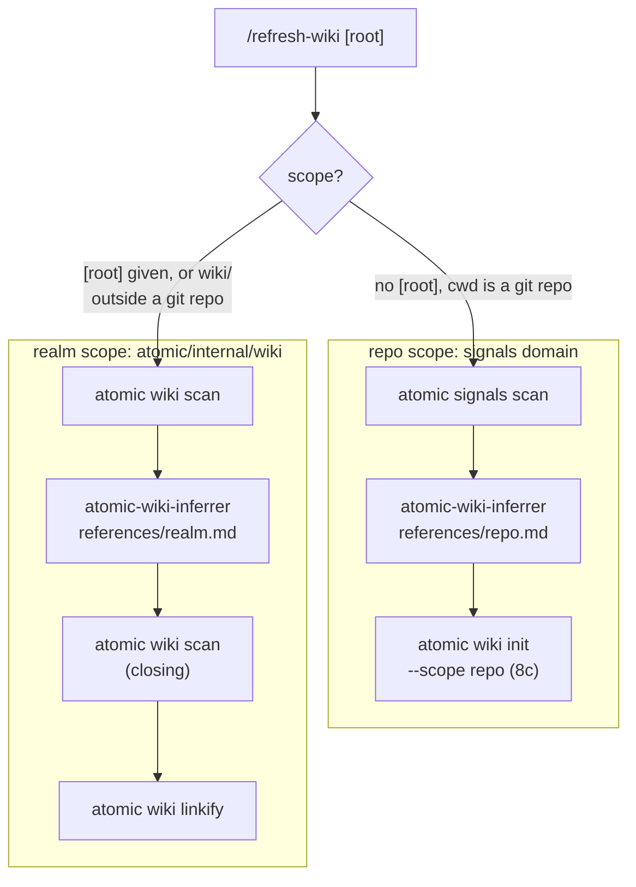

Most of [`atomic/internal/wiki/`](../../atomic/internal/wiki) is realm scope. The repo-scope pipeline exists as prompt text in [`context/skills/atomic-wiki/references/repo.md`](../../context/skills/atomic-wiki/references/repo.md); its Step 8b linkify belongs to the signals domain, and its Step 8c calls `atomic wiki init --scope repo` to scaffold steering and project the pointer cards (see Pointer cards below).

### Realm refresh

Only pending repos get a summary without asking; an existing summary or concern changes only when the user picks it, and the closing scan runs after every write.

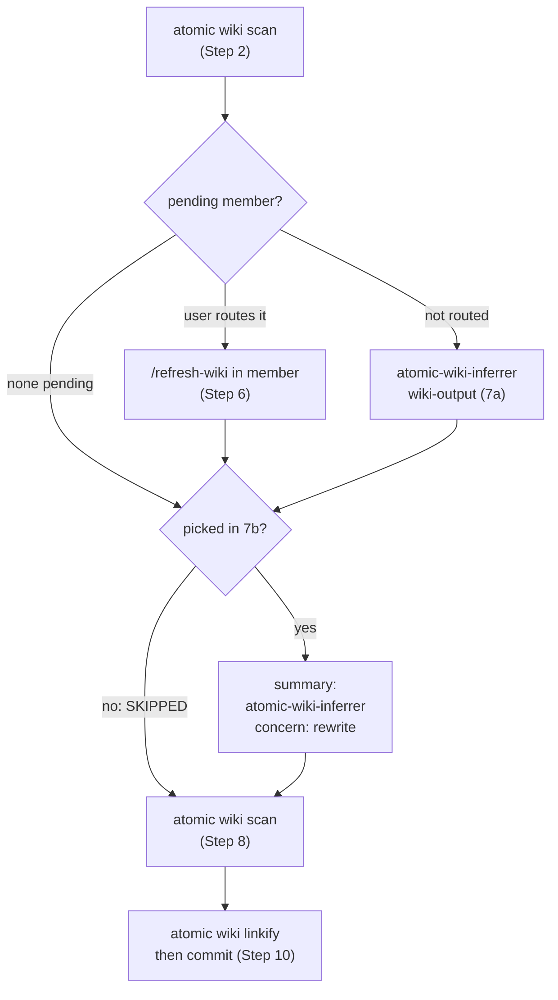

Step 7b lists every existing `repos/` summary (leaving out the ones 7a just wrote and any whose repo is not a member) and every `concerns/*.md` file as one numbered list, and accepts indices, ranges, `all`, `none`, or `all except N`. A selected summary re-runs the inferrer in wiki-output mode for that member; a selected concern is re-synthesized in place from the signals files and summaries it cites. No step creates a concern. Step 5 stops early, printing `nothing to refresh.` and skipping to the commit, when nothing is pending, no bucket was just created, and `repos/` and `concerns/` hold nothing to offer. Step 3's one-time bucket offer and Step 4's placeholder fill run between the first scan and Step 5. The run calls no `atomic wiki stale`, since the scan it would compare against has just been rewritten.

### Design-doc diagrams carried into pages

Inside A3 and B2, the writer dispatch a domain receives carries a `<design_docs>` block: `repo.md` Step 3 assigns every `docs/design/*.md` file to a domain (the domain named by its `domain:` frontmatter, or otherwise the domain whose paths it describes), and `realm.md` W3/W4 do the same for `target_repo`'s design docs in wiki-output mode. `atomic-wiki-writer` then decides, per Mermaid block in a listed design doc, whether it belongs on the page.

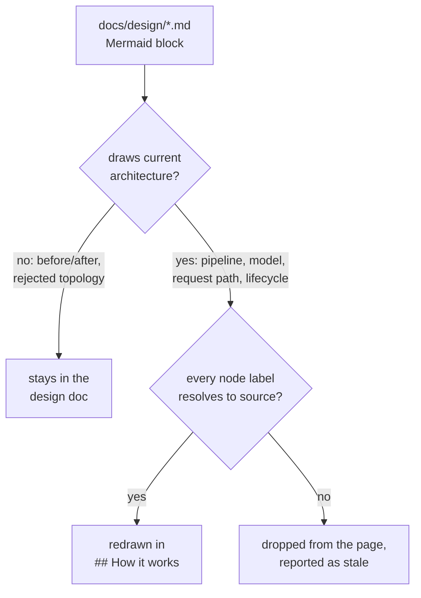

A design diagram lands on the page only when it draws current architecture and every node still resolves to source. The redrawn block's node labels resolve to a file or symbol in the domain's source paths, checked with `atomic code search <label>` when the code index exists, grep otherwise. The reviewer dispatched in Step 5 / W5 checks that the diagram either landed on the page or was named as stale, and that every Mermaid block on the page passes `~/.claude/skills/atomic-writing/references/mermaid.md`.

### No-counts ban

The ban on counting things in the repo is stated once, in `atomic-writing` rule 17, and every page-writing surface carries it as one line, so the reviewer in each pipeline can fail a page that breaks it.

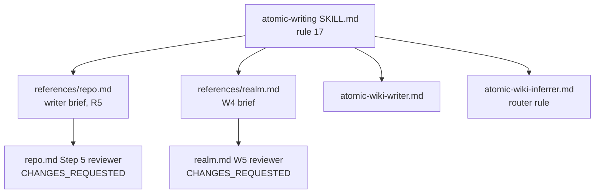

A version and a documented contract value are the only carve-out. This repo's [`docs/wiki/CLAUDE.md`](CLAUDE.md) steering file carries the same line.

### Verbs

`atomic wiki <verb>`, dispatched by `wikiAction` in [`atomic/internal/wiki/action.go`](../../atomic/internal/wiki/action.go). Any other verb exits 1 with `unknown verb`. `runWiki` in [`atomic/cmd/atomic/cmd_wiki.go`](../../atomic/cmd/atomic/cmd_wiki.go) injects the home directory, the cwd, and `wikiSteeringPaths`, the resolver for the files `scan` projects into.

| Verb | Args and flags | Behavior |
|------|----------------|----------|
| `scan` | `--root` | Discover members, classify, scaffold `wiki/`, rewrite the managed regions, rebuild bucket indexes, write the realm scope marker, register `wiki/index.md` in `~/.atomic/wikis.md` and add it to the `<wikis>` block of every enrolled target's global steering file. Warns on stderr for each projected entry the authority lacks. Prints a member handoff to stdout. |
| `stale` | `--root` | Read-only membership-drift report: `DRIFT added\|removed\|status` lines. Exit 0 no drift, 1 drift, 2 hard error. |
| `init` | `--scope repo\|realm`, `--root` | Writes the scope marker in `<state-root>/atomic.toml` and the scope's steering pair in the root's `[steering] claude` mode (see Steering pair modes). The guidance is the fixed-content repo scaffold under [`docs/wiki/`](.), or only the `@index.md` self-reference under `wiki/`. An unknown or unreadable mode fails the write. Prints `created <path>` per file written or changed, and per file conversion removes. Repo scope then re-renders the existing pointer cards and projects them to enrolled Claude and OMP targets. |
| `linkify` | `--root` | Rewrite path citations under `wiki/` as relative markdown links. Idempotent; never touches fenced code. |
| `bucket add <name>` | `--root` | Register a bucket: folder, `index.md` stub, `<wiki-buckets>` registry entry, capture-surfaces bullet in the realm root's steering file, then a `RebuildBucketTree` pass. Refuses a name already in the registry. |
| `bucket list` | `--root` | One `<name>\t<path>` line per registered bucket. Exit 0 even when none are registered. |
| `bucket doc <bucket> <slug>` | `--root` | Scaffold the item folder `<bucket>/<slug>/index.md` plus its `<slug>/01_raw/index.md` stage, print the `<slug>/index.md` path, then rebuild the bucket's indexes. Refuses an existing `<slug>` path. |
| `bucket skill <bucket>` | `--root` | Scaffold `<realm>/.claude/skills/<bucket>-management/SKILL.md`. No-op if present. |
| `bucket index [<bucket>]` | `--root` | Force a rebuild of the `<bucket-docs>` region in every directory of one bucket (or every registered bucket) and the `<wiki-bucket-list>` region outside a scan, printing `<name>: N indexed, M unindexed` per bucket, summed over the whole tree. |

### Member discovery

Only an unset, empty, or unloadable `[realm] repos`, or an entry matching `"."`, sends discovery through the whole-root walk; any other value walks only the directories its entries matched.

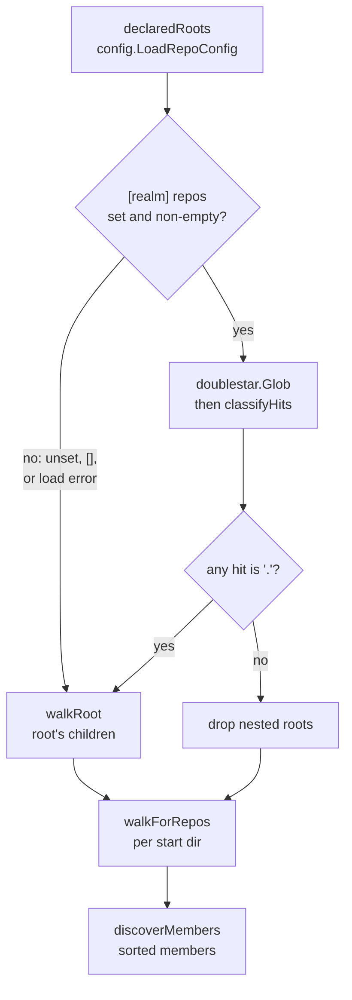

`declaredRoots` reads `[realm] repos` through `config.LoadRepoConfig`. Each entry is cleaned, rejected when empty, absolute, or leaving the root, and expanded with `doublestar.Glob` under `WithNoFollow`; an entry that is not a valid pattern or matches nothing is rejected too. `classifyHits` keeps directory hits and turns symbolic-link hits (the link itself or a path through one), unreadable hits, and file hits into at most one warning per kind for that entry. `skippedRoot` silently drops a hit that is the wiki directory, under it, or has a `skipDirs` segment, and a hit nested inside another declared root is dropped. When no entry yields a directory, discovery returns no members.

`walkForRepos` returns a git repo as a member without descending, so a declared root that is itself a repo is a member, and a declared root inside a member repo is still walked, unless another declared root contains it. Every walk stops at each `.git` boundary and skips `node_modules`, `dist`, `build`, `target`, `vendor`, `.worktrees`, `tmp`, `.git`, and the wiki directory. The root is never a member.

Every `[realm] repos` problem is a warning, never a failure: `Scan` prints each as `atomic wiki scan: warning: <msg>` and `Stale` as `atomic wiki stale: warning: <msg>`, both on stderr, and neither changes stdout or the exit code. A config load error and an unknown `realm.*` key warn too.

### Member classification

`classifyMembers` takes the first rule that matches, per member:

| Order | Test | Status |
|-------|------|--------|
| 1 | The prior scan block said `summarized` and that summary file is still on disk | `summarized`, preserved |
| 2 | `<member>/docs/wiki/index.md` exists, or the legacy `<state-root>/project/signals.md` exists under any of the member's state roots | `indexed` |
| 3 | `wiki/repos/<name>.md` exists, or `wiki/repos/<name>/` holds at least one `.md` | `summarized` |
| 4 | Nothing above matched | `pending` |

Once a scan records a member as `summarized`, rule 1 keeps it there while its summary file exists, even after the member gains its own [`docs/wiki/index.md`](index.md):

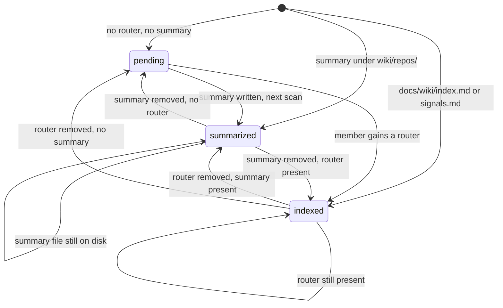

Rule 2 outranks rule 3 only for a member not already recorded `summarized`: with both a router and a summary on disk it classifies `indexed`, and its summary file stays on disk unreferenced by the `<wiki-scan>` block.

### Buckets

A bucket is a user-named capture folder at the realm root, beside `wiki/`. It has no manifest and no freshness state; its only derived output is its doc index.

Code writes every bucket structure; only the purpose line and conventions in the bucket's `index.md` come from the model or the user.

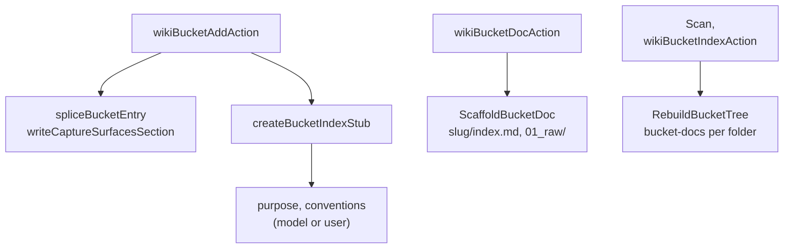

`bucket add` runs these writes in order, each gated on the one before:

1. `RegisterBucket` validates the name and refuses one already in the `<wiki-buckets>` registry in `wiki/index.md`, writing nothing.
2. The bucket folder and its `index.md` stub (`createBucketIndexStub`) are created.
3. `spliceBucketEntry` adds `<bucket name="…" path="…"/>` to the registry.
4. `captureSurfacesFile` picks the realm root's steering file, and `writeCaptureSurfacesSection` adds a `` - `<bucket>/index.md` `` bullet under `## Capture surfaces` there, or returns early when the section already names the bucket.
5. `RebuildBucketTree` fills the new folder's `<bucket-docs>` region.

`captureSurfacesFile` takes the first of `AGENTS.md`, [`CLAUDE.md`](../../CLAUDE.md), and [`claude.md`](../../claude.md) at the realm root that already holds a `## Capture surfaces` heading; otherwise a [`CLAUDE.md`](../../CLAUDE.md) that does not import `@AGENTS.md` (`bundlespec.ScopeSteering.LoaderWithoutImport`); otherwise `ScopeSteering.GuidanceFile(mode)`, which is [`CLAUDE.md`](../../CLAUDE.md) under `claude-md` and `AGENTS.md` otherwise. `bucket add` resolves the mode first and exits 1 when it cannot. Only under `loader`, when it lands on `AGENTS.md` and no Claude loader exists, does `bucket add` write the [`CLAUDE.md`](../../CLAUDE.md) loader through `initSteeringPair`. When a [`CLAUDE.md`](../../CLAUDE.md) exists that does not import it, `bucket add` warns that the loader needs an `@AGENTS.md` line.

`atomic wiki scan` and an all-bucket `atomic wiki bucket index` rebuild every directory of each registered bucket through `RebuildAllBucketIndexes`, then the realm `<wiki-bucket-list>` region. A named `atomic wiki bucket index <bucket>` runs `RebuildBucketTree` on that bucket alone, then `rebuildRealmBucketList`. Buckets get no inference pass.

An item is a folder, not a file. `atomic wiki bucket doc` (`ScaffoldBucketDoc`) writes `<slug>/index.md` and `<slug>/01_raw/index.md` from the embedded templates, and later stages are numbered folders the user adds (`02_findings/`, `10_publish/`):

    <bucket>/
      <slug>/
        index.md          bucket-doc.md: frontmatter keys below, created stamped
        01_raw/
          index.md        bucket-stage.md: title Raw, created stamped

`ScaffoldBucketDoc` creates `<slug>/` with `os.Mkdir`, so an existing path aborts before any write, and on a later failure it removes the folder it made, so a retry does not refuse a half-built item.

### Bucket-doc frontmatter

Every listed `.md` file and every folder's `index.md` (an item's `<slug>/index.md` included) is read for the same keys:

| Key | Writer | Fallback when absent |
|-----|--------|----------------------|
| `title` | author | first H1, then filename stem |
| `type` | author | none; free-form (`Research`, `Ticket`, …) |
| `description` | author | first non-structural prose line, truncated to 120 chars |
| `tags` | author | none; a bare string reads as a one-element list, any other malformed shape is ignored whole |
| `status` | author | none; free-form |
| `created` | code | stamped by `atomic wiki bucket doc` at scaffold time |

Every key is optional. A doc or folder carrying none of them is still listed, under an `### Unindexed` heading, rather than dropped. `deriveTitle` takes the frontmatter `title`, then the first H1 outside a fence, then the directory name for a folder whose `index.md` is absent or carries neither.

### Bucket tree index

Each directory's `index.md` is rebuilt before any of its subdirectories is visited, and a region that renders unchanged is not written, so a rebuild over an unchanged bucket writes no file.

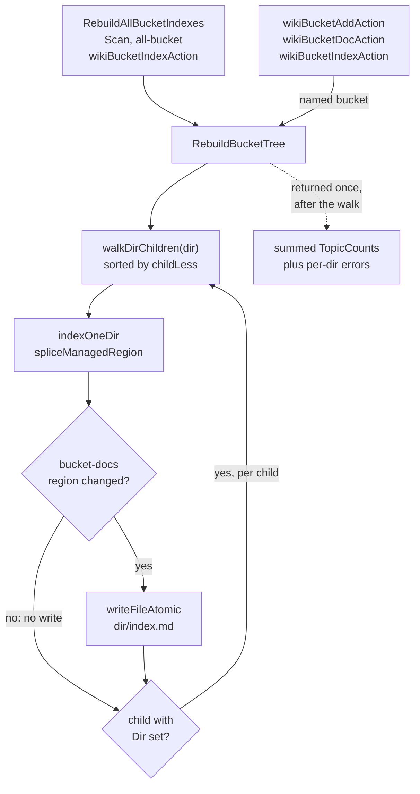

`walkDirChildren` lists a directory's direct children: each `.md` file other than `index.md`, and each subdirectory not in `skipDirs`. Dot-prefixed names of either kind are skipped, and their subtrees are never walked. A subdirectory entry reads its metadata from its own `index.md` and links to `<name>/index.md`. A `<slug>.md` beside a `<slug>/` lists as two separate entries.

`childLess` puts names with a leading digit run first, ordered by that number's value (`9_x` before `10_x`, compared as digit strings so a prefix past int64 still orders), ties broken by full name; names without a prefix follow in byte order. `indexOneDir` creates `index.md` holding only the region when none exists.

A directory that fails to list, read, splice, or write adds one error; a directory that cannot be listed is not descended into, and the walk continues with its siblings. `reportTreeErrors` prints each one; `bucket doc`, `bucket add`, and a named `bucket index` exit 1 on any error other than `errUnpairedRegion`, while `scan` and an all-bucket `bucket index` only report.

`IndexDir` is a different walk, kept for `atomic docs index`: `walkBucketTopics` lists one directory, collapsing a subdirectory beside a matching `<slug>.md` into that entry as a **router** and listing a subdirectory with no sibling file as an **orphan** subtree. Neither rule applies inside a bucket.

### Managed regions

XML-tag regions (`<tag>…</tag>`) delimit every code-generated splice in a wiki markdown file, because heading-bounded splicing cannot tell "the next heading" from a heading a user typed inside the generated block. Each region has one splicer:

| Region | Splicer | Malformed region |
|--------|---------|------------------|
| `wiki-member-list`, `<wiki-bucket-list>`, `<bucket-docs>` | `spliceManagedRegion` / `renderManagedRegion` in [`atomic/internal/wiki/managedregion.go`](../../atomic/internal/wiki/managedregion.go) | returns `errUnpairedRegion`, document unchanged |
| `<wiki-scan>` | `rewriteScanBlock` in [`atomic/internal/wiki/wiki.go`](../../atomic/internal/wiki/wiki.go) | absent or malformed open tag appends a fresh block; a missing close tag truncates from the open tag to EOF |
| `<wiki-buckets>` | `rewriteBucketsBlock` in [`atomic/internal/wiki/bucket_registry.go`](../../atomic/internal/wiki/bucket_registry.go) | a fresh block is appended |
| `<wikis>` | `setWikisBlock` (authority) and `addToWikisBlock` (projection) in [`atomic/internal/wiki/registry.go`](../../atomic/internal/wiki/registry.go) | located by `findBareLineBlock`, whole-line tags only; an absent block is inserted after `</atomic>`, or at EOF |

- A blank line on each side of the region content is mandatory, not cosmetic. CommonMark parses a tag alone on a line as an HTML block running to the next blank line, so unpadded content renders as raw text. `renderManagedRegion` is the only emitter of that padding; `rewriteScanBlock` adds none.
- An unpaired `wiki-member-list` fails the scan: `writeMembersSection` returns the `errUnpairedRegion`, and `Scan` errors with `wiki scan: write members section`. An unpaired `<bucket-docs>` or `<wiki-bucket-list>` warns to stderr and the run continues.
- `atomic wiki scan` is idempotent: it rewrites only the managed regions. Content outside them, and everything under `repos/` and `concerns/`, is untouched. A fresh scan scaffolds `index.md`, [`README.md`](../../README.md), the steering pair (through `InitRealmScope`, only when `wiki/` holds no `AGENTS.md` or [`CLAUDE.md`](../../CLAUDE.md), per `hasSteeringFiles`), `repos/`, and `concerns/`, and `git init`s `wiki/`; it overwrites none of them when present, and reshaping an existing pair is left to `atomic repo init` and `atomic update`. When `atomic.toml` is malformed, the scan has already warned about it and writes the pair in `loader` shape; a readable file with an invalid `[steering] claude` value fails the scan.
- Scan refuses a `wiki/` whose `index.md` lacks the `<wiki-scan>` marker, or which has no `index.md` and holds anything but what `wiki init --scope realm` writes, unedited. `onlyInitScaffold` accepts what `init` writes in any steering mode: an `AGENTS.md` equal to the realm scaffold beside a [`CLAUDE.md`](../../CLAUDE.md) equal to `bundlespec.ScopeSteering.LoaderDocument()` (`loader`), a lone `AGENTS.md` equal to the scaffold (`agents-md`), or a lone [`CLAUDE.md`](../../CLAUDE.md) equal to the scaffold wrapped in an Atomic block (`claude-md`) or to the bare scaffold, which an init from before the pair wrote. An empty `wiki/` is refused. The error names the path.

### Membership drift

`<wiki-scan>` carries `root` and `generated` on the open tag and records membership and status only. `generated` records the date of the last scan; nothing reads it as a freshness signal.

`Stale` compares that block against a live `discoverMembers` plus `classifyMembers` call with a nil prior map, so rule 1 never applies to it. Discovery honors `[realm] repos` here too, so a recorded member outside the declared roots prints as `DRIFT removed <path>`, the same as a deleted repo. It reads no frontmatter, hashes no files, and runs no git.

`<wiki-buckets>` carries `<bucket name="…" path="…"/>` entries; a `declined="true"` attribute on the open tag records that the user declined the one-time bucket offer, and `spliceBucketEntry` removes it when a real bucket is added.

### Wiki registry

`~/.atomic/wikis.md` is written first and every steering file is projected from it, so a realm registered once reaches every enrolled harness, and a line a user adds to a projected block is reported rather than imported or deleted.

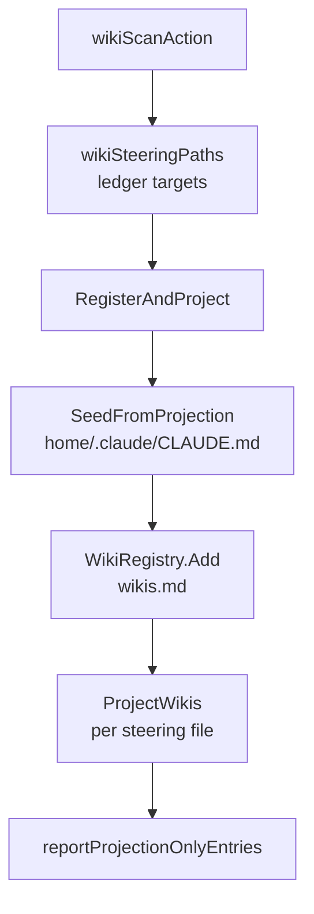

`wikiSteeringPaths` reads the install ledger and maps each target to its global steering file: `claude.GlobalSteeringPath` for Claude, `omp.SteeringPath` and `codex.SteeringPath` (each `<native-root>/AGENTS.md`) for OMP and Codex. With no target enrolled it returns [`CLAUDE.md`](../../CLAUDE.md) under `config.ClaudeConfigDir(home)` when that file exists, and nothing otherwise.

`WikiRegistry` (`NewWikiRegistry(home)`, path from `config.WikisPath`) holds `Load`, `Save`, `Add`, `Remove`, and `SeedFromProjection`:

- `Save` rewrites only the `<wikis>` block of `wikis.md`, writing a `# Wiki registry` header once when it creates the file, then reads the block back.
- `Add` dedups on the `normalizePath` form (Abs then Clean, no symlink resolution) and reports whether it changed anything.
- `SeedFromProjection` runs only while `wikis.md` is absent. It adopts the absolute, deduplicated entries of the given file's `<wikis>` block and drops relative ones; an empty result writes nothing.

`ProjectWikis` never replaces a projected block. It appends each authority path the block lacks before `</wikis>`, keeping the earlier entries first so a first-match resolver keeps its winner, and writes nothing when no path is missing. `ProjectionOnlyEntries` returns the projected entries that are relative or absent from the authority, and `reportProjectionOnlyEntries` prints each to stderr as `atomic wiki scan: warning: <steering> <wikis> block diverges from <wikis.md>: <entry> is not registered there; left in place, not imported`.

Readers resolve the registry through `RegisteredIndexPaths(claudeMDPath)`: the authority when `claudeMDPath` has the `<home>/.claude/CLAUDE.md` shape (`conventionalHome`) and `wikis.md` exists, otherwise the file's own `<wikis>` block through `ReadWikiIndexPaths` in [`atomic/internal/wiki/staleness.go`](../../atomic/internal/wiki/staleness.go). `ProjectionConflict` reports a conflict when the projection holds an entry the authority lacks or lacks one it holds; a missing authority or a missing projection file is not a conflict.

### Realm location

A directory belongs to a realm by its nearest marker first and by the registry only as a fallback.

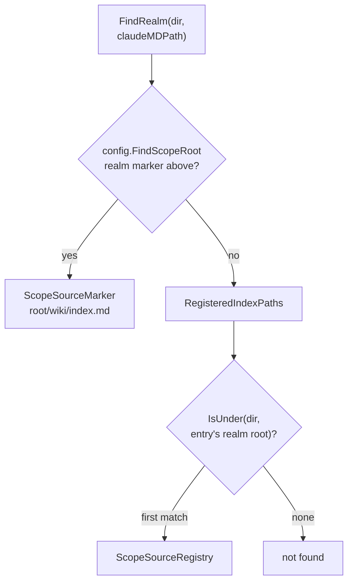

`FindRealm` returns a `RealmLocation` with `Root`, `IndexPath`, and `Source`. A registry entry's realm root is two directories above its `index.md`. `IsUnder` compares cleaned path prefixes and resolves no symlinks. [`atomic/internal/where/where.go`](../../atomic/internal/where/where.go) and [`atomic/internal/workflow/resolve.go`](../../atomic/internal/workflow/resolve.go) call it.

### Pointer cards

`atomic-wiki-inferrer` writes the per-domain pointer cards under `<state-root>/rules/wiki/` in [`context/skills/atomic-wiki/references/repo.md`](../../context/skills/atomic-wiki/references/repo.md) Step 7b: an incremental run over existing cards emits only the re-dispatched domains' cards, and every run deletes the cards of domains the router no longer lists. Step 8c then runs `atomic wiki init --scope repo`, which passes the cards on disk back through `Refresh` and projects them to the harnesses.

`init --scope repo` re-validates every card before any harness sees it, and a projection failure only warns because the canonical cards are already valid.

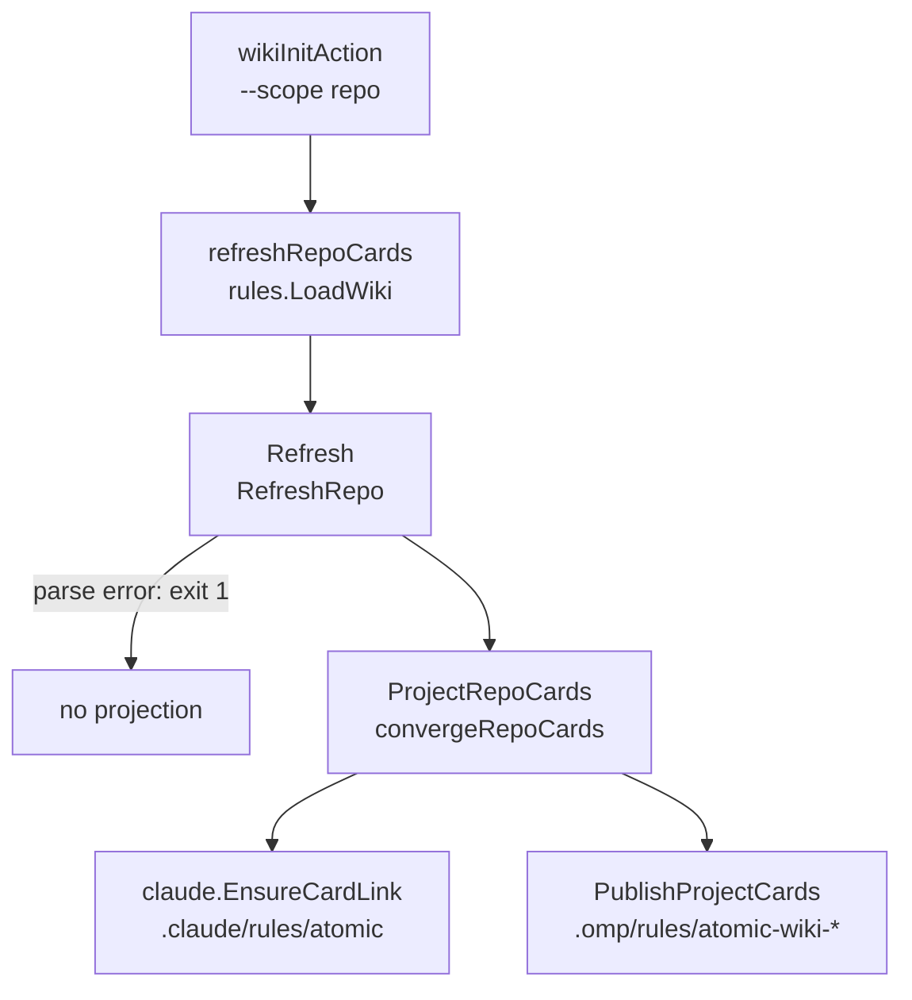

`Refresh(stateRoot, projectKey, scope, cards)` treats the cards it is given as the whole set, so it prunes every domain absent from them, and it renders and validates every card through `rules.ParseWiki` before it deletes or writes anything, so one malformed card leaves the existing set untouched. `RefreshRealm` writes nothing and returns no records: realm scope spans several repository bases, so it produces no cards. An unknown scope, an empty `stateRoot` or `projectKey`, or a card with no `Domain` returns an error.

A card's frontmatter holds the `# generated by /refresh-wiki` marker comment, a `description:` (`rules.CardDescription`: the first non-blank body line without heading marks, else `Atomic wiki card for <domain>`), and the same globs under both `globs:` (what OMP reads) and `paths:` (what Claude and `rules.ParseWiki` read), followed by the body; the card's record identity is `wiki:<project-key>:<domain>`. `ProjectRepoCards` is a package variable that [`atomic/cmd/atomic/cmd_cards.go`](../../atomic/cmd/atomic/cmd_cards.go) assigns in `init`. `convergeRepoCards` writes the Claude link when a Claude target is enrolled and, when an OMP target is enrolled, calls `omp.Adapter.PublishProjectCards`, which writes one `.omp/rules/atomic-wiki-<domain>.md` per card: a committed relative symlink, or a generated copy when the state root lies outside the repository (the harness domain owns that projection). Outside `init`, the OMP branch first runs the exported `RenderRepoCards`, since OMP lists a card only through the `description:` older cards lack. A realm-scope `init` stops after the steering pair and projects no cards.

### Steering pair modes

The `[steering] claude` key decides which file Claude reads in each steering pair, so a repo can keep `AGENTS.md` as its only steering file, keep [`CLAUDE.md`](../../CLAUDE.md) as its only one, or keep both with a loader. `config.ResolveSteeringMode` resolves it; the lookup order and its errors belong to [`docs/wiki/config.md`](config.md). `initSteeringPair(dir, scaffold, mode)` writes a pair in that shape and converts one left in another, and it never copies user text between files.

| Mode | Pair it writes | What it does to the other shape |
|------|----------------|---------------------------------|
| `loader` | `AGENTS.md` (the scaffold, when absent) plus a [`CLAUDE.md`](../../CLAUDE.md) whose Atomic block is `LoaderDocument()` | replaces an Atomic-owned block in [`CLAUDE.md`](../../CLAUDE.md) with the loader; a [`CLAUDE.md`](../../CLAUDE.md) with user text and no Atomic block is left alone |
| `agents-md` | `AGENTS.md` alone | removes Atomic's block from [`CLAUDE.md`](../../CLAUDE.md), and deletes the file when nothing else is left; a user [`CLAUDE.md`](../../CLAUDE.md) with no Atomic block stays |
| `claude-md` | [`CLAUDE.md`](../../CLAUDE.md) alone, the scaffold inside an Atomic block (`managedfile.BracketedBlockDocument`) | deletes an unedited `AGENTS.md`; an edited one leaves the pair in its current shape and returns a note |

A [`CLAUDE.md`](../../CLAUDE.md) is Atomic's own when its block equals the loader (`bundlespec.ScopeSteering.OwnsLoader`) or the wrapped scaffold. Under `loader`, a root [`CLAUDE.md`](../../CLAUDE.md) holding only a realm `<code-index>` block beside an `AGENTS.md` also counts, and gets the loader appended after the block.

#### Conversion on init and update

`atomic repo init` and `atomic update` convert the wiki pair and the root pair through `convergeSteeringMode`, after the realm code-index block moves. `atomic wiki init` converts the wiki pair only, through `initScopePair`. The `convergeSteeringMode` flow and its diagram belong to the harness domain ([`docs/wiki/harness.md`](harness.md)); the wiki-side steps are below.

- **claude.ConvertScope**: runs only with a home directory, and reshapes only pairs that carry an `<atomic>` block; the harness domain owns it ([`docs/wiki/harness.md`](harness.md)).
- **wiki.ConvertSteeringPair**: walks [`docs/wiki/`](.) (or `wiki/` in realm scope) and then the root, skipping a pair with neither file. The root pair has no scaffold, so under `claude-md` it never converts and only reports a note when `AGENTS.md` holds text. Under `loader` it is skipped when the root has no [`CLAUDE.md`](../../CLAUDE.md), so conversion never drops a loader into a repo that only has an `AGENTS.md`.
- **Output**: each changed path prints `steering (<mode>): updated <path>`, each note `steering (<mode>): <note>`.

## Where it lives

### Artifacts

| Path | Role |
|------|------|
| [`context/commands/refresh-wiki.md`](../../context/commands/refresh-wiki.md) | `/refresh-wiki [root]`. Detects scope, then runs the repo branch or the realm branch (Steps 1-10). |
| [`context/agents/atomic-wiki-inferrer.md`](../../context/agents/atomic-wiki-inferrer.md) | The orchestrator. Reads the pipeline reference from the `atomic-wiki` skill's base directory, which the runtime reports because the skill is preloaded through `skills:`, executes it, and dispatches the writer and reviewer per domain. Authors no page itself. Realm scope runs only wiki-output mode, activated by `target_repo` plus `wiki_dir`. Composes the `agent-atomic-voice`, `agent-code-intel`, and `agent-where` partials from [`context/_partials/`](../../context/_partials). |
| [`context/agents/atomic-wiki-writer.md`](../../context/agents/atomic-wiki-writer.md) | The page author, one dispatch per domain. Carries the `atomic-writing` skill, so the page contract loads as context, and dispatches no other agents. Redraws every current-architecture diagram from the domain's `<design_docs>` list into the page, checked against source, as its own workflow step ("Redraw the design diagrams") ahead of the concerns step. Composes the `agent-atomic-voice` and `agent-code-intel` partials. |
| [`context/skills/atomic-wiki/SKILL.md`](../../context/skills/atomic-wiki/SKILL.md) | Conversational entry point: realm resolution from the `<wikis>` block (named as a projection of `~/.atomic/wikis.md`), bucket creation, bucket-doc authoring, membership-drift queries. |
| [`context/skills/atomic-wiki/references/repo.md`](../../context/skills/atomic-wiki/references/repo.md) | Repo-scope pipeline: the domain-page shape, the reviewer checklist, the incremental-vs-full scope rule, the router shape, the per-domain `<design_docs>` assignment (Step 3), the pointer-card contract (Step 7b), and the `atomic wiki init --scope repo` projection step (Step 8c). |
| [`context/skills/atomic-wiki/references/realm.md`](../../context/skills/atomic-wiki/references/realm.md) | Realm-scope wiki-output pipeline (W1-W7), the bucket-doc frontmatter contract and the per-folder `index.md` listing, and (W3/W4) the same design-doc-to-domain assignment and writer redraw responsibility for `target_repo`'s design docs. |

### Realm scan and drift

| Path | Role |
|------|------|
| [`atomic/internal/wiki/wiki.go`](../../atomic/internal/wiki/wiki.go) | `Scan(root, Options)`: collision check, parse prior entries, `discoverMembers` (with `declaredRoots`, `classifyHits`, `skippedRoot`, `walkRoot`, `walkForRepos`), `classifyMembers`, `scaffold`, write scan block, write member list, rebuild bucket indexes. `Options.Clock` is injectable for deterministic tests. Also holds `onlyInitScaffold`, `DeriveMemberDescription`, and the legacy-marker migration. |
| [`atomic/internal/wiki/stale.go`](../../atomic/internal/wiki/stale.go) | `Stale(root, out)`: membership drift only, printing `discoverMembers` warnings to stderr, and the `StaleCode*` exit constants. |
| [`atomic/internal/wiki/scan_members.go`](../../atomic/internal/wiki/scan_members.go) | `ReadScanMembers`: lists members from the `<wiki-scan>` block without a filesystem walk. |
| [`atomic/internal/wiki/managedregion.go`](../../atomic/internal/wiki/managedregion.go) | The XML-tag region primitive behind the `wiki-member-list`, `<wiki-bucket-list>`, and `<bucket-docs>` splices. |
| [`atomic/internal/wiki/linkify.go`](../../atomic/internal/wiki/linkify.go) | `LinkifyWiki`. Base resolution: `repos/**` uses each summary's `repo:` frontmatter, `concerns/*.md` and `index.md` use the realm root. |

### Buckets

| Path | Role |
|------|------|
| [`atomic/internal/wiki/bucket.go`](../../atomic/internal/wiki/bucket.go) | `validateBucketName` and `RegisterBucket`, the registry-backed duplicate check. |
| [`atomic/internal/wiki/bucket_registry.go`](../../atomic/internal/wiki/bucket_registry.go) | `<wiki-buckets>` registry splice and read (`readBucketEntries`, exported `ReadBucketEntries`), `captureSurfacesFile` and `writeCaptureSurfacesSection` for the realm steering file, and `createBucketIndexStub`. |
| [`atomic/internal/wiki/bucketindex.go`](../../atomic/internal/wiki/bucketindex.go) | The `<bucket-docs>` and `<wiki-bucket-list>` region renderers. `RebuildBucketTree` (`walkDirChildren`, `childLess`) indexes every directory of a bucket; `RebuildAllBucketIndexes` runs it per registered bucket and returns counts by name plus every error. `IndexDir` (`walkBucketTopics`) is the one-level router/orphan listing for `atomic docs index`, or with `check` reports without writing. |
| [`atomic/internal/wiki/bucketdoc.go`](../../atomic/internal/wiki/bucketdoc.go) | `ScaffoldBucketDoc` (item folder plus `01_raw/` stage) / `ScaffoldBucketSkill`, and `validateSlug`, backed by `//go:embed templates/*.md`. |
| [`atomic/internal/wiki/templates/`](../../atomic/internal/wiki/templates) | Scaffold templates (`bucket-doc.md`, `bucket-stage.md`, `bucket-skill.md`) with `{{TOKEN}}` placeholders. |

### Registry, location, steering, and cards

| Path | Role |
|------|------|
| [`atomic/internal/wiki/registry.go`](../../atomic/internal/wiki/registry.go) | `WikiRegistry`, the `~/.atomic/wikis.md` authority; `RegisterAndProject`; `ProjectWikis`, `ProjectionOnlyEntries`, `ProjectionConflict`, and `RegisteredIndexPaths`; `conventionalHome`; `findBareLineBlock`; `PrintHandoff`, the scan stdout contract. Also holds `writeFileAtomic`, the temp-file-and-rename writer behind the region splices, the bucket scaffolds, the steering pair, the registry, and the pointer cards. |
| [`atomic/internal/wiki/staleness.go`](../../atomic/internal/wiki/staleness.go) | `ReadWikiIndexPaths` and `blockEntries`: read the `<wikis>` block of any file (the authority or a projection) as written, matching whole-line tags only. |
| [`atomic/internal/wiki/realmroot.go`](../../atomic/internal/wiki/realmroot.go) | `FindRealm`, `RealmLocation`, and `IsUnder`: marker-first, registry-fallback realm lookup. |
| [`atomic/internal/wiki/init.go`](../../atomic/internal/wiki/init.go) | `InitRepoScope` and `InitRealmScope` over `initScopePair`, which resolves the steering mode, and `initSteeringPair`, which writes or converts the pair in that mode: called by `wiki init`, by `Scan`'s `scaffold`, and (loader only) by `bucket add`. `ConvertSteeringPair` reshapes the wiki and root pairs for `convergeSteeringMode`; `hasSteeringFiles` and `readSteeringFile` (which also tries the lowercase name) back both. |
| [`atomic/internal/wiki/codeindex.go`](../../atomic/internal/wiki/codeindex.go) | The realm `<code-index>` vocabulary shared with code-intel: `CodeIndexOpen`, `CodeIndexClose`, `CodeIndexStub`, `LegacyCodeIndexStub`, `FindCodeIndexBlock`, and `StripCodeIndex`, which removes the block, the blank line a splice put before it, and either stub. |
| [`atomic/internal/wiki/refresh.go`](../../atomic/internal/wiki/refresh.go) | `Refresh`, `PointerCard`, the `RefreshRepo`/`RefreshRealm` scopes, `refreshRepoCards` over the exported `RenderRepoCards`, `renderPointerCard`, and the `ProjectRepoCards` hook. |
| [`atomic/internal/wiki/action.go`](../../atomic/internal/wiki/action.go) | CLI dispatch, `resolveWikiRoot`, the per-verb actions, and `reportProjectionOnlyEntries`. |
| [`atomic/cmd/atomic/cmd_wiki.go`](../../atomic/cmd/atomic/cmd_wiki.go) | Cobra wiring for `atomic wiki` and `atomic wiki bucket`; every subcommand forwards to `wiki.WikiAction`. `wikiSteeringPaths` resolves the projection targets from the install ledger. |

### Docs

| Path | Covers |
|------|--------|
| [`docs/spec/wiki.md`](../spec/wiki.md) | Core contract: `scan`, `linkify`, `stale`, `signals scan --out`, and `/refresh-wiki` success criteria, classification rules, `<wiki-scan>` block format, `<wikis>` registry. |
| [`docs/spec/realm-wiki-drop-refresh.md`](../spec/realm-wiki-drop-refresh.md) | The removal of realm freshness tracking and bucket synthesis, and the pick-list realm `/refresh-wiki` flow. |
| [`docs/spec/wiki-buckets.md`](../spec/wiki-buckets.md) | Bucket contract: `add`/`list`, `<wiki-buckets>` format, capture surfaces, the one-time `/refresh-wiki` bucket offer. |
| [`docs/spec/bucket-doc-management.md`](../spec/bucket-doc-management.md) | Child of `wiki-buckets`. Frontmatter contract, both managed regions, the `doc`/`skill`/`index` verbs. |
| [`docs/spec/bucket-icm-structure.md`](../spec/bucket-icm-structure.md) | The bucket folder tree: an `index.md` in every directory, numeric-prefix ordering, item folders with `01_raw/`, removal of `--router`. |
| [`docs/spec/wiki-bucket-arg-hardening.md`](../spec/wiki-bucket-arg-hardening.md) | Help probes must never mutate state; bucket names must be safe path segments. |
| [`docs/spec/wiki-storage-relocation.md`](../spec/wiki-storage-relocation.md) | The [`docs/wiki/`](.) layout, OKF frontmatter, and the `<wiki-type>`/`<scan-sha>`/`<wiki-schema>` control blocks. |
| [`docs/spec/wiki-drift-scope.md`](../spec/wiki-drift-scope.md) | How a repo-scope refresh chooses incremental versus full re-infer. |
| [`docs/spec/wiki-deterministic-setup.md`](../spec/wiki-deterministic-setup.md) | The `atomic wiki init` verb. |
| [`docs/spec/signals-wiki-linkify.md`](../spec/signals-wiki-linkify.md) | The linkify contract shared by `signals linkify` and `wiki linkify`. |
| [`docs/spec/wiki-durable-facts.md`](../spec/wiki-durable-facts.md) | The no-counts ban and where each pipeline enforces it. |
| [`docs/design/wiki.md`](../design/wiki.md), [`docs/design/wiki-buckets.md`](../design/wiki-buckets.md), [`docs/design/bucket-doc-management.md`](../design/bucket-doc-management.md), [`docs/design/signals-wiki-unification.md`](../design/signals-wiki-unification.md), [`docs/design/wiki-durable-facts.md`](../design/wiki-durable-facts.md) | Rationale and rejected alternatives behind the specs above. The per-topic router walk in [`docs/design/bucket-doc-management.md`](../design/bucket-doc-management.md) is superseded by [`docs/spec/bucket-icm-structure.md`](../spec/bucket-icm-structure.md). |
| [`docs/reference/realm-wiki.md`](../reference/realm-wiki.md) | User-facing guide: realm mental model, disk layout, choosing members with `[realm] repos`, repo states, membership drift, re-authoring summaries and concerns, the inert leftovers on an upgraded realm, bucket authoring, bucket-name rules. |
| [`docs/reference/atomic-toml.md`](../reference/atomic-toml.md) | `## [realm] repos`: matching rules, nested-root and symlink behavior, and every warning. |
| [`docs/guides/knowledge-base.md`](../guides/knowledge-base.md) | The realm layout, capture surfaces, and how a session finds material. |
| [`docs/reference/concepts.md`](../reference/concepts.md) | `## Wikis` section: repo versus realm scope and the realm verbs. |

## Constraints

**The inferrer reads its pipeline from the installed copy of the `atomic-wiki` skill**, resolved through the base directory the runtime reports for that skill, not from the repo copy. Editing [`context/skills/atomic-wiki/references/`](../../context/skills/atomic-wiki/references) has no effect on a session until the bundle is rebuilt and reinstalled.

**A clean `atomic wiki stale` says nothing about content.** Exit 0 means the member set and statuses match the `<wiki-scan>` block. A summary or concern describing a repo that has since changed is invisible to every verb; only a user pick in `/refresh-wiki` Step 7b, or a hand edit, updates it.

**Older realms keep inert files.** A realm built by an earlier release may still hold `wiki/.dirty`, `wiki/.buckets/`, `wiki/knowledge/`, `reflects_*` frontmatter, and a `.dirty` line in `wiki/.gitignore`. No code reads or removes them, and `/refresh-wiki` Step 7b does not offer `wiki/knowledge/` pages.

**Bucket names must be safe single path segments:** not empty or whitespace, not `-`-prefixed, no `/` or `\`, not `.` or `..`, and not the reserved `wiki`. `validateBucketName` is the register-time backstop for programmatic callers; the CLI scanner rejects dash tokens first.

**Bucket-doc slugs must match `[a-z0-9-]+` and must not name a `skipDirs` folder** (`build`, `dist`, `target`, `tmp`, `vendor`); `validateSlug` fails hard on either, since the tree walk would never index such an item.

**A projected `<wikis>` block only grows.** `ProjectWikis` adds missing authority entries and never removes a line, so `WikiRegistry.Remove` changes `wikis.md` without touching any steering file, and a stale projected entry stays until a user deletes it. Until then `ProjectionConflict` reports it and `scan` warns about it on every run.

**Once `~/.atomic/wikis.md` exists, a hand-added `<wikis>` line is never imported.** `SeedFromProjection` adopts a projected block only while the authority is absent. After that, readers at a conventional root (`RegisteredIndexPaths`, and through it `FindRealm`, `atomic where`, code-intel, and the doctor check) see only the authority, and `claude.Verify` in [`atomic/internal/harness/claude/migration.go`](../../atomic/internal/harness/claude/migration.go) reports the difference as `<CLAUDE.md> <wikis> block diverges from <wikis.md>`. Run `atomic wiki scan` in the realm to register it.

**The authority exists only at a conventional root.** `conventionalHome` derives `<home>` only from a path shaped `<home>/.claude/CLAUDE.md`. For any other `claudeMDPath`, `RegisteredIndexPaths` and `FindRealm` read that file's own `<wikis>` block and `ProjectionConflict` reports no conflict. `RegisterAndProject` always seeds from `<home>/.claude/CLAUDE.md`, whatever `config.ClaudeConfigDir` resolves.

**`writeFileAtomic` keeps an existing file's permission bits** and gives a new file `0644`, so a region rebuild never resets the mode of a user's `index.md`.

**`initSteeringPair` never overwrites user text.** In every mode, a [`CLAUDE.md`](../../CLAUDE.md) or [`claude.md`](../../claude.md) holding user text and no Atomic block is left untouched, so an existing Claude-direct install never gains a second guidance file. Under `claude-md`, an `AGENTS.md` that differs from the scaffold keeps the pair in its current shape and comes back as a note rather than being merged into [`CLAUDE.md`](../../CLAUDE.md). An existing `AGENTS.md` is never rewritten (an unedited one may be deleted under `claude-md`).

**`resolveWikiRoot` is the single arg scanner behind every `bucket` verb.** It accepts `--root` in any position, recognizes `-h`/`-help`/`--help` anywhere and returns a sentinel that makes the verb print usage and exit 0 with no filesystem write, and rejects any other dash-prefixed token rather than letting it become a positional. `scan`, `stale`, `linkify`, and `init` use a plain `flag.FlagSet` and do not share this behavior.

**`ScaffoldBucketDoc` refuses an existing `<slug>` path; `ScaffoldBucketSkill` treats an existing file as a silent no-op.** A doc-slug collision usually means a naming mistake worth surfacing; re-running the skill scaffold on a realm that already has it is the expected outcome.

**Realm scope has no `<wiki-type>` sentinel.** `atomic-wiki-inferrer` and `/refresh-wiki` Step 0 both name `<wiki-type>realm</wiki-type>` in `wiki/index.md` as a realm signal, but no Go code writes that block. Repo scope gets `<wiki-type>repo</wiki-type>` in [`docs/wiki/index.md`](index.md) from `references/repo.md` Step 7, and from [`atomic/internal/migrate/`](../../atomic/internal/migrate) on upgrade. Realm scope is reached through Step 0's other tests: a supplied `[root]`, or a `wiki/` directory at a cwd outside any git repo. The inferrer itself picks realm scope from the `target_repo`/`wiki_dir` dispatch args.

**A stale design diagram is reported differently by scope.** Repo scope surfaces it in the writer's concerns block (`docs/design/<file>.md:<line> — diagram no longer matches source (severity: risk)`), collected by the orchestrator's Step 6b. Realm scope has no concerns channel, so `realm.md`'s W4 instructs the writer to name it instead as one `## Constraints` line on the page itself.

## Coupling

- **signals domain** owns the repo-scope scan, inference, and linkify. `atomic signals scan --out <dir>` is a direct dependency of realm wiki-output mode: the inferrer redirects the scan so it never writes into the member repo. A change to that flag or to `scan.md`'s format breaks member summarization. `atomic signals linkify` handles [`docs/wiki/`](.); `atomic wiki linkify` handles `wiki/`. Neither covers the other's tree.
- **docs-meta domain** owns the page shape both pipeline references encode. The domain-page order in `references/repo.md` and the realm summary shape in `references/realm.md` are the `atomic-writing` skill's `## Structure before sentences` order applied to each. The same domain owns `~/.claude/skills/atomic-writing/references/mermaid.md`, which the writer and the reviewer both apply, and rule 17, the no-counts ban both reviewers enforce. `atomic docs index` in [`atomic/cmd/atomic/cmd_docs.go`](../../atomic/cmd/atomic/cmd_docs.go) calls `wiki.IndexDir`, which shares `indexOneDir` and `writeFileAtomic` with the bucket tree walk.
- **Design-doc ownership is decided per file, at partition time.** `repo.md` Step 3 assigns each `docs/design/*.md` file to a domain and hands that list to the domain's writer dispatch as `<design_docs>`; `realm.md` W3/W4 do the same for a member repo's design docs. A design doc's owning domain is whatever that assignment produces, not its directory.
- **config domain** owns `config.WikisPath` (the `~/.atomic/wikis.md` location), `config.ClaudeConfigDir`, `config.LedgerPath`, `config.RepositoryStateDir`, `config.ProjectKey`, and the scope marker. `wikiInitAction` and `wikiScanAction` call `config.EnsureScopeMarker`; under `init` a root already marked with the other scope exits 1 without touching either file, and under `scan` it only warns. `FindRealm` prefers that marker (`config.FindScopeRoot`) over the registry. `config.ResolveSteeringMode` supplies the `[steering] claude` mode that `initScopePair`, `wikiBucketAddAction`, and the realm code-index writer resolve before writing. `declaredRoots` reads `[realm] repos` through `config.LoadRepoConfig` and forwards only the `realm.*` load warnings.
- **harness domain** owns the install ledger and the per-harness steering paths `wikiSteeringPaths` maps targets to (`claude.GlobalSteeringPath`, `omp.SteeringPath`, `codex.SteeringPath`); a new harness kind projects no `<wikis>` block until it gets a case there. It owns `bundlespec.ScopeSteering` (the `AGENTS.md` source, the [`CLAUDE.md`](../../CLAUDE.md) loader, `LoaderDocument()`, `LoaderWithoutImport`, `OwnsLoader`, `GuidanceFile`) and `claude.ConvertScope`, which `convergeSteeringMode` runs before `ConvertSteeringPair`; `ScopeSteering` is what `initSteeringPair`, `onlyInitScaffold`, and `captureSurfacesFile` use; a change to the loader bytes changes what `scan` accepts as an unedited init. `claude.Verify` calls `ProjectionConflict`. `convergeRepoCards` in [`atomic/cmd/atomic/cmd_cards.go`](../../atomic/cmd/atomic/cmd_cards.go) implements `ProjectRepoCards` with `claude.EnsureCardLink` and `omp.Adapter.PublishProjectCards`, and the `rules` package's `ParseWiki` and `LoadWiki` define the card format `Refresh` validates.
- **workflow domain** owns the ship verbs; no ship verb touches a realm wiki, and `/refresh-wiki` Step 10 commits the wiki through the `atomic-git-discipline` skill. `realmPrefsPath` in [`atomic/internal/workflow/resolve.go`](../../atomic/internal/workflow/resolve.go) locates realm workflow preferences through `FindRealm`.
- **doctor domain** owns [`atomic/internal/cliusage/cliusage.go`](../../atomic/internal/cliusage/cliusage.go). `main.go` calls `cliusage.SetRoot(rootCmd)`, so `--help` and the A1 citation lint read the live Cobra tree through `DeriveCommands`; the static `commands` slice is the golden table `TestDeriveCommandsGolden` checks. Register a `wiki` verb in [`atomic/cmd/atomic/cmd_wiki.go`](../../atomic/cmd/atomic/cmd_wiki.go), then update the golden slice in `cliusage.go`, or `TestDeriveCommandsGolden` fails. [`atomic/internal/doctor/checks_repo_config.go`](../../atomic/internal/doctor/checks_repo_config.go) reads the registry through `RegisteredIndexPaths`.
- **bundle domain** embeds [`context/commands/refresh-wiki.md`](../../context/commands/refresh-wiki.md), the wiki agents, and the `atomic-wiki` skill through `make bundle`, which expands the agents' `{{ template }}` partials. The files in [`atomic/internal/wiki/templates/`](../../atomic/internal/wiki/templates) are a separate `go:embed`, compiled into the binary and never installed.
- **serve domain** consumes `ReadBucketEntries` and the `Member` type ([`atomic/internal/serve/nav.go`](../../atomic/internal/serve/nav.go)), `ReadScanMembers` (`nav.go`, `code_members.go`, `api_plans.go`), and `Stale` plus `StaleCodeError` ([`atomic/internal/serve/stale.go`](../../atomic/internal/serve/stale.go), `staleness_cache.go`, `health.go`). Renaming any of them breaks `atomic serve`.
- **code-intel domain** reads realm membership through `ReadScanMembers` ([`atomic/internal/codeintel/realm/seed.go`](../../atomic/internal/codeintel/realm/seed.go)) and the registry through `RegisteredIndexPaths` ([`atomic/internal/codeintel/realm/resolver.go`](../../atomic/internal/codeintel/realm/resolver.go)). [`atomic/internal/where/where.go`](../../atomic/internal/where/where.go) locates the realm through `FindRealm` and places the cwd among members with `ReadScanMembers` and `IsUnder`. `realm.WriteCodeIndexBlock` and `realm.MoveCodeIndexBlock` ([`atomic/internal/codeintel/realm/codeindex_block.go`](../../atomic/internal/codeintel/realm/codeindex_block.go)) import the `<code-index>` markers, stub, `FindCodeIndexBlock`, and `StripCodeIndex` from `codeindex.go`, and `initSteeringPair`'s code-index-only check reads the same markers, so changing either side's block format breaks the other.
