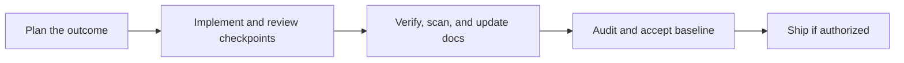

# Workflow

## What it does

Atomic's commands describe the work an agent does and where it needs independent review or user authorization. They ship as Markdown. The runtime does not enforce how an agent follows them.

## How it works

The final audit checks the delivered result after independent checkpoint reviews.

- `/atomic-plan` records the visible outcome, what is out of scope, and the proof for the whole task. It chooses evidence gathering for a factual claim, a pressure test for a decision, or a challenge swarm for a written plan. Separate challenger and respondent agents can run a challenge when requested.
- Full plans keep decisions in `docs/design/` and the working spec in the task scratchpad. The spec links to design flows and is discarded only after the end result and review are accepted.
- `/implement` can write directly or delegate. A checkpoint commits only on a fresh reviewer's `PASS`. Unknown causes go to `atomic-debug`; a known, small fix can proceed as one checkpoint.
- `/autopilot` uses the same gates, fixes every finding, and consults a strategist when stuck. It defaults to a PR when a remote is configured; merging or rewriting published history needs explicit authorization.
- `/cleanup` defaults to the work done in the session or its current worktree. It archives scratchpads before removing a selected worktree and preserves dirty or unpushed work. `/retro` examines the current session; historical drift checks are opt-in.

## Start here

| Source | Responsibility |
|---|---|
| [`context/commands/atomic-plan.md`](../../context/commands/atomic-plan.md) | Planning routes, end-result proof, and spec review. |
| [`context/commands/implement.md`](../../context/commands/implement.md) | Checkpoint review, final audit, and source scan. |
| [`context/skills/atomic-planning/SKILL.md`](../../context/skills/atomic-planning/SKILL.md) | Planning method selection and references. |
| [`context/skills/atomic-git-discipline/references/shipping.md`](../../context/skills/atomic-git-discipline/references/shipping.md) | On-demand actions for commit, push, PR, merge, and squash. |
| [`context/commands/retro.md`](../../context/commands/retro.md) | Session retrospectives and optional historical evidence. |
| [`context/skills/atomic-retro/SKILL.md`](../../context/skills/atomic-retro/SKILL.md) | Retrospective scope and findings. |
| [`context/commands/cleanup.md`](../../context/commands/cleanup.md) | Scope and guards for artifact and worktree removal. |
| [`atomic/cmd/atomic/cmd_scratchpad.go`](../../atomic/cmd/atomic/cmd_scratchpad.go) | Scratchpad creation, listing, and archive. |
| [`atomic/cmd/atomic/cmd_retro.go`](../../atomic/cmd/atomic/cmd_retro.go) | Extraction when the user asks for cross-session retro evidence. |

## Coupling

The docs step uses a scratch scan and the task diff to find affected pages and rules. Accept the baseline only after review. `/refresh-wiki` also supports an on-demand repo refresh. Edit bundled prompts in `context/`.
