# workflow


## What it does


A long task run in one context degrades. The model accumulates its own reasoning, stops seeing earlier choices as choices, and reviews its own work against the rationalizations that produced it.

This domain is the lifecycle a change moves through, built to prevent that. The writer and the reviewer are always separate contexts, and every write is gated by a fresh-context reviewer before it commits. Orchestrator commands dispatch subagents, parse their verdicts, and commit between rounds. The domain is prompt artifacts under [`context/commands/`](../../context/commands), [`context/agents/`](../../context/agents), [`context/skills/`](../../context/skills), and [`context/_partials/`](../../context/_partials). Its only Go code is the `atomic retro extract` utility that `/retrospective-learning` shells out to.


## How it works


The lifecycle runs in this order, with `/subagent-implementation` and `/implement` as alternative build steps; `/autopilot` drives plan, loop, and ship unattended.

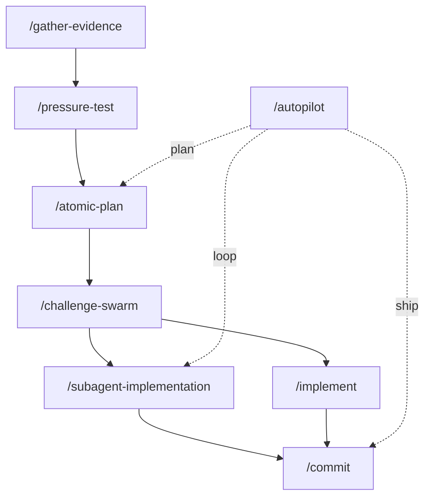

`/implement` re-enters the pipeline at the same step as `/subagent-implementation`, skipping only the subagent dispatch, never the gate.

Which verb to reach for:

| Situation | Verb |
|---|---|
| A factual hunch the design would rest on | `/gather-evidence` |
| A decision you want challenged in dialogue | `/pressure-test` |
| Non-trivial work with no contract yet | `/atomic-plan` |
| A written design, spec, plan, or non-software proposal you want attacked from many angles at once | `/challenge-swarm` |
| An approved spec to build | `/subagent-implementation` |
| The context is already loaded in this conversation — files read, approach settled | `/implement` |
| Known cause, one obvious fix, any file count | `/quick-fix` |
| Unknown cause: CI is red, or a bug reproduces | `/subagent-diagnose ci` / `/subagent-diagnose bug` |
| A branch you want reviewed once, no loop | `/review-branch` |
| From nothing to shipped, unattended | `/autopilot` |
| Standing code nobody is changing has gathered slop | `/deslop`, then `/deslop apply <ids \| tier>` |
| Ship it | `/commit [push \| pr \| merge \| squash \| squash merge]` |
| CI needs unattended watching outside the loop | `/watch-ci` |
| Lost | `/atomic-help` |

### The loop

The same shared `implement-loop` and `loop-finalize` partials drive `/subagent-implementation`, `/quick-fix`, `/autopilot`, and `/implement`. Each of those commands opens on a `## Policy` table, and the partials read their branch points from it rather than from per-command prose. `/subagent-diagnose` is not part of this composition. It runs its own hand-written Phase 0-4 flow with a different stuck check (3 consecutive iterations producing the same normalized top-level error, not 2 rounds of the same blocking signal) and a different cap (`min(memory override, 5)` iterations, not none). Every loop that does compose the shared partials cannot spin quietly: a blocking signal that survives two rounds goes through the stuck check rather than straight into another iteration.

One checkpoint is one iteration, and it commits only on a PASS with nothing left open:

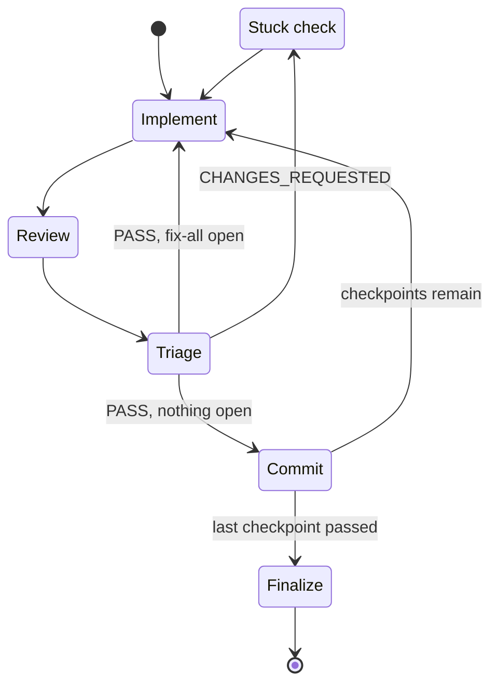

- **Implement**: the policy's Writer. `atomic-implementer` is dispatched in `surgical` mode when the iteration touches at most 2 non-test files and is mechanically obvious, else `feature`; the main agent writes the checkpoint itself under `atomic-tdd`.
- **Review**: `atomic-reviewer`, fresh context, code mode, diffing the uncommitted working tree against `{BASE_SHA}`.
- **Stuck check**: two consecutive `CHANGES_REQUESTED` on the same underlying blocking signal. Stuck `ask` offers continue, `/pressure-test`, or an `atomic-strategist` dispatch; stuck `auto` dispatches the strategist without asking and folds its findings into the next `BRIEF.md`. The check resets when the blocking signal changes.
- **Commit**: skipped when the iteration produced no diff; otherwise staged by explicit path, committed via HEREDOC, SHA recorded in `STATE.md`, then `atomic code sync` when the index exists.

The policy table is where those commands differ:

| Setting | `/subagent-implementation` | `/quick-fix` | `/implement` | `/autopilot` |
|---|---|---|---|---|
| Writer | `atomic-implementer` | `atomic-implementer` | main agent | `atomic-implementer` |
| Entry | hand-off table, plus no spec and more than a small obvious change → `/atomic-plan` | hand-off table | hand-off table, plus context not already here or work would crowd it out → `/subagent-implementation` | none; autopilot plans it |
| Worktree | ask, skipped when the work is small | none, work in place | ask, only on a clean tree | auto |
| Stuck | ask | ask | ask | auto |
| Non-blockers | ledger | ledger | ledger | fix-all |
| Finalize | verify, docs, audit, follow-ups, log, signals, report | verify, audit, follow-ups, report | verify, docs, audit, follow-ups, log, signals, report | verify, docs, audit, log, signals, report |
| Scratchpad purpose | `implement` | `fix` | `implement` | `implement` |
| Ship | no | no | no | the merge verb from `$ARGUMENTS`, else ask once |

**The orchestrator never implements, except under `/implement`.** It writes the scratchpad bundle, updates state, commits per `PASS`, and runs final verification. Implementer and reviewer are always separate contexts, never combined: under `/implement` the main agent writes and a fresh-context `atomic-reviewer` reads.

**Nothing the reviewer finds is dropped silently.** Non-blocking 🟡 risk, 🔵 nit, and ❓ question findings are harvested into `FOLLOWUPS.md` even on a `PASS`, and every entry gets an explicit disposition at finalize: `fix-now`, `defer`, `issue`, or `drop`. `/autopilot` is the exception, and inverts it: every finding is fixed in-iteration, so its `FOLLOWUPS.md` ends empty.

**Readability is a defect class, and it skips the ledger in every loop, not just `/autopilot`.** The shared `agent-readability.md` partial, composed into `atomic-implementer`, `atomic-reviewer`, and `atomic-auditor`, floors comment noise, over-engineering, and repetition at 🟡 risk and makes any one of them enough to drive `CHANGES_REQUESTED`:

| Defect | What triggers a finding |
|---|---|
| Comment noise | A comment that restates the lines under it, narrates the diff, or carries process residue |
| Over-engineering | Code the YAGNI ladder would have stopped: a helper the codebase already has, a one-use abstraction, a dependency for what the platform does, a general solution where the spec asked for one case |
| Repetition | The same logic, explanation, or name-with-a-twist repeated elsewhere; comments, docstrings, messages, or docs that don't read as plain, concise English |

The Triage step of the shared `implement-loop` partial folds every readability 🟡 into the next round alongside the 🔴 findings, so none reaches `FOLLOWUPS.md`.

### `/implement`: the fit gate before any code is written

`/implement` is the one loop where the main agent writes the code. Its premise is that the context the task needs is already in the conversation: files read, cause known, approach settled. A fresh-context implementer would discard that context and pay to rebuild it. The policy's Entry row and the shared hand-off table test that premise before any code is written.

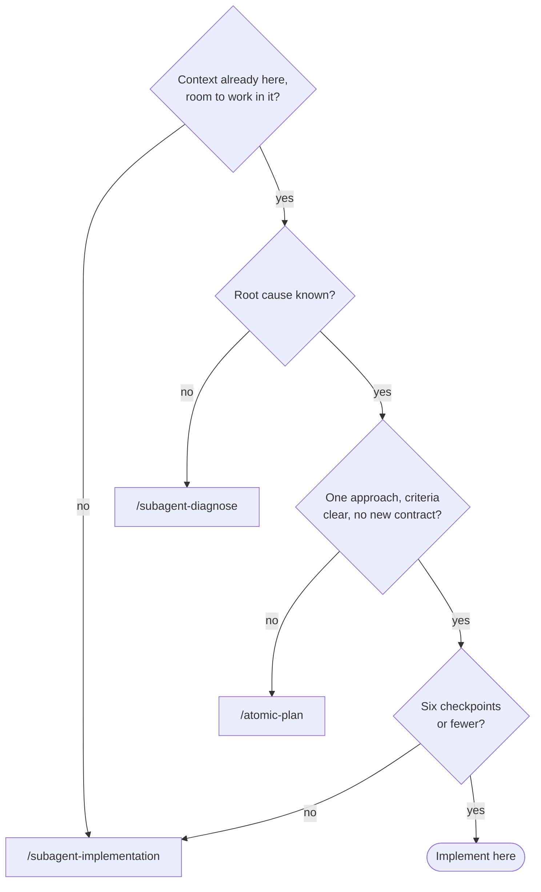

- **Context already here, room to work in it?**: a cold start, a resumed session, or an unread surface is not here; work that would crowd the context out has no room.
- **One approach, criteria clear, no new contract?**: two viable approaches, open success criteria, or an implied public API, schema migration, or cross-service contract hands off to `/atomic-plan`.
- **Six checkpoints or fewer?**: checkpoints are declared and stated to the user before any code; more than six belongs in `/subagent-implementation`.

On a match the command names the signal in one line, prints the handoff, keeps `$SCRATCH`, and stops. The hand-off table is checked again whenever an implementer report or reviewer finding surfaces a signal, and mid-loop, little remaining context or a checkpoint list grown past its declaration hands off to `/subagent-implementation`, with `STATE.md` carrying the checkpoints and SHAs.

Past the gate, each checkpoint runs the shared loop with the main agent as Writer. The main agent runs the project's suite as evidence, not review. It then dispatches `atomic-reviewer` once per checkpoint, never batched to the end, attaching `main agent wrote this` in place of an implementer report.

Finalize is the shared `loop-finalize` sequence, which dispatches `atomic-auditor` once over `<loop-base>..HEAD`. A `CHANGES_REQUESTED` audit earns one more implement, review, and commit iteration against its findings, then finalize continues. The signals refresh runs after this gate, so that fix round is inside the scanned range.

### Ad-hoc direct edits: reviewer-gated without a loop

Editing code in the main agent with no command around it is the one implementation path with no loop. `/implement` also skips the implementer subagent, but it keeps the checkpoint loop. Ad-hoc edits have no round to gate, so `atomic-reviewer` runs at both the readiness check and the commit gate.

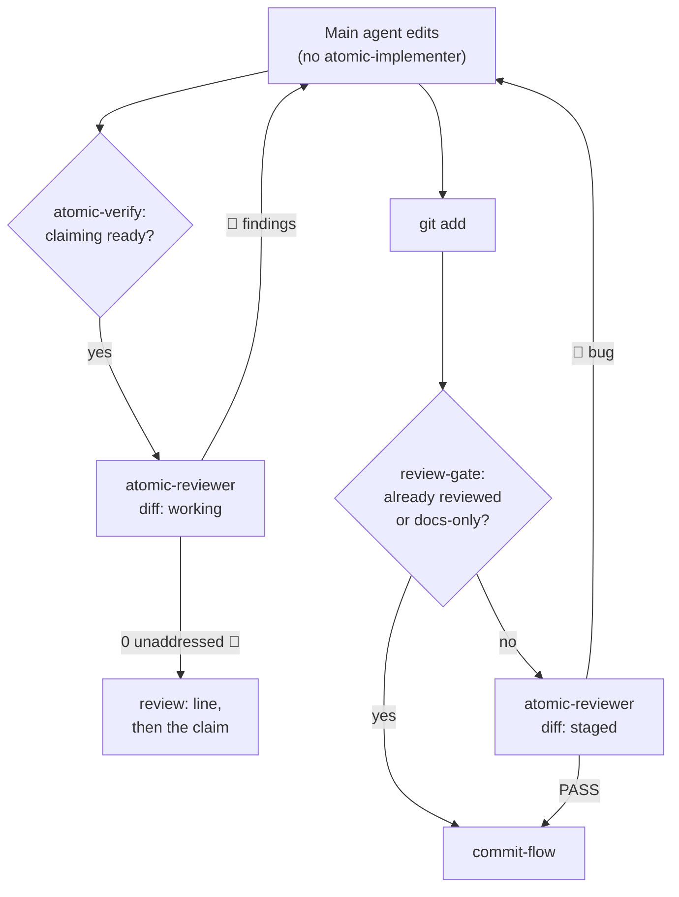

`atomic-verify` enforces the `<completion_claim>` block in [`context/CLAUDE.md`](../../context/CLAUDE.md) at the readiness check. [`context/_partials/review-gate.md`](../../context/_partials/review-gate.md) runs in `commit-flow` and `squash-flow-steps`, immediately before `doc-impact`. Both share one set of skip conditions and one verdict rule, stated under Constraints.

### Commit message: drafted once, checked once, committed unchanged

The message is written by the agent that knows why the change is shaped this way, not reconstructed downstream from the diff.

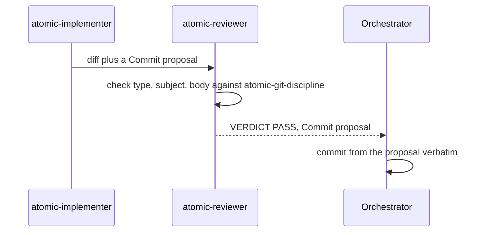

The implementer's report ends with a `## Commit` section in `atomic-git-discipline` format. The reviewer flags a misstated type or a diff-restating body as 🟡 risk under Code quality before passing. The shared Commit step in `implement-loop` starts from that proposal and invokes the skill directly only when the proposal is missing. Under `/implement` the main agent is the implementer and writes no report, so the skill runs at every checkpoint.

### Caps and stop conditions

| Orchestrator | Cap | Early stop |
|---|---|---|
| `/subagent-implementation` | none | Stuck check (The loop) |
| `/implement` | none | Stuck check (The loop), per checkpoint |
| `/quick-fix` | none | Stuck check (The loop); hand-off fires on approach fork, fuzzy criteria, an unforeseen contract choice, a shifted root cause, or implementer `BLOCKED` / `NEEDS_CONTEXT` |
| `/subagent-diagnose` | `min(memory override, 5)` iterations | 3 consecutive iterations producing the same normalized top-level error |
| `/atomic-plan` spec loop | 5 iterations (memory-configurable) | none |
| `/autopilot` | none | Stuck check (The loop) in `auto`, safe unattended because the strategist never writes |

**`/quick-fix` routes out on uncertainty, never on file count.** An unknown root cause goes to `/subagent-diagnose`; multiple viable approaches, fuzzy success criteria, or an architectural or contract choice goes to `/atomic-plan`; implementer `BLOCKED` or `NEEDS_CONTEXT` fires the hatch unconditionally. The `surgical`-versus-`feature` choice inside the loop picks the implementer mode per iteration; it never decides whether the task belongs in `/quick-fix`.

### `/subagent-diagnose`: the same pair, its own bail

Every verdict passes through triage, and the loop leaves only on a reviewer `PASS`, an implementer hand-back, or the same-failure bail.

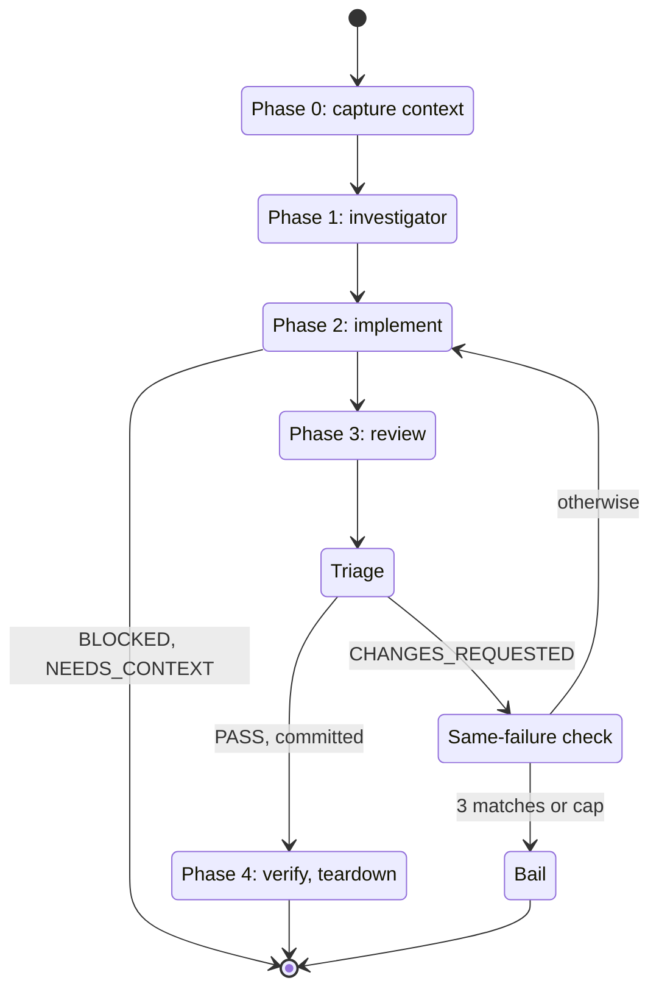

- **Phase 0: capture context**: `ci` mode seeds `CONTEXT.md` from a failed GitHub Actions run, `bug` mode from a freeform symptom via `atomic template diagnose-context`; either records the `top_level_error` baseline in `STATE.md`. The bundle topic is `diagnose-ci-<run-id>` or `diagnose-bug-<slug>`, and a concurrent run on an existing topic refuses with `scratchpad already exists for <topic>; atomic scratchpad archive it or pick a different topic suffix.`
- **Phase 1: investigator**: classifies the fix `tight` (`atomic-implementer` `mode: surgical`) or `loose` (`mode: feature`); a surgical `OUT OF SCOPE: needs N files` bounce re-dispatches the same scope in `feature` mode immediately.
- **Same-failure check**: the normalized top-level error compared across iterations, stored as the first 12 characters of its sha256.
- **Bail**: retains `$SCRATCH`, prints the iterations tried, and surfaces the stuck-fix escalation block, then waits for the user.
- **Phase 4: verify, teardown**: `ci` mode pushes after the user confirms and launches a background Haiku watcher, never relaunching on a new failure; `bug` mode reruns the repro and asks the user when it still fails.

### `/challenge-swarm`: profile before seating a lens

`/challenge-swarm` answers profile questions about the artifact (who can reach it, whose data flows through it, what does being wrong cost, is money moving, is a claim made from data), then seats 3 to 6 lenses from a catalog spanning engineering, data/ML, business, finance, communication/market, and operations/delivery. Each seated lens carries a one-line citation to the design section or source path where its stake lives; a lens that fits the artifact's genre but fails its gate is benched with a printed line rather than silently dropped.

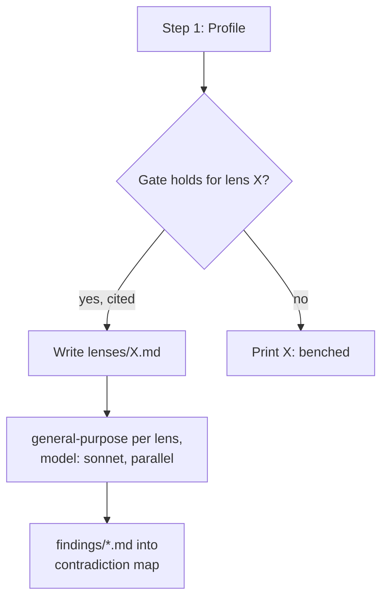

The workspace for the run is a scratchpad bundle at `$(atomic scratchpad new <slug> --purpose review)`. It is the same bundle a plan or implementation phase already opened for that slug, extended rather than duplicated. The closing menu's `done` option leaves it in place.

### `/deslop` audit: read-only fan-out, stop at the report

`/deslop` is the one review surface aimed at code as it stands rather than at a diff. Phase 1 touches no source file. It shards the repo by wiki domain (else by top-level directory, merging the smallest until at most 8 remain), fans out one read-only `atomic-deslopper` per shard in a single message, and stops once the merged report is written.

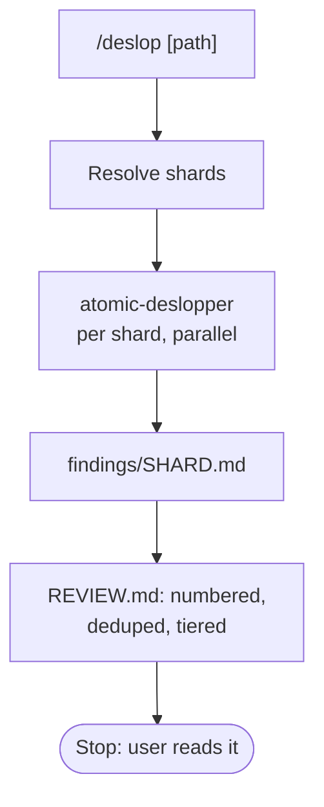

- **Resolve shards**: vendored and generated trees, build output, lockfiles, and anything `[code] ignore` in [`.claude/atomic.toml`](../../.claude/atomic.toml) or [`.gitignore`](../../.gitignore) excludes are left out of every shard.
- **atomic-deslopper per shard, parallel**: Sonnet-backed at `effort: high`; writes its one findings file into `$SCRATCH/findings/` and replies with counts only.
- **REVIEW.md: numbered, deduped, tiered**: ids `D-1` upward, ordered by tier, path, then line; a duplicate `path:line` keeps the more conservative tier; with no runnable test suite every `guarded` finding is demoted to `report-only`.
- **Stop: user reads it**: the terminal gets the counts table, the `REVIEW.md` path, and the `/deslop apply <ids or tier>` line, and nothing else.

Each finding carries a safety tier, and the tier alone decides what Phase 2 may touch:

| Tier | Assigned when | Phase 2 |
|---|---|---|
| `safe` | The change cannot alter behavior: a comment, shipped prose, an unused import | Fixed directly |
| `guarded` | Behavior should be unchanged but the compiler cannot prove it | Fixed only behind a green suite, before and after |
| `report-only` | Blast radius not established: an exported symbol, a dynamic reference, a generated file, a failed caller lookup | Never selectable, whatever the user types |

### `/deslop` dead code: `guarded` only by proof

`dead-code` is the one category backed by evidence rather than judgment, and a candidate reaches `guarded` only through an empty caller set, a clean literal sweep across the whole repo, and a non-exported symbol.

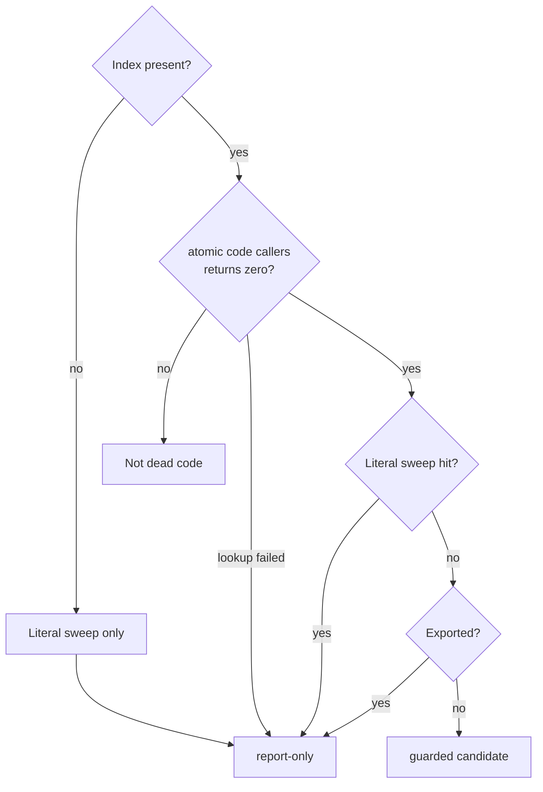

### `/deslop apply`: one surgical batch at a time, stop on the first red suite

Phase 2 is a separate invocation over findings the user selected by id or tier.

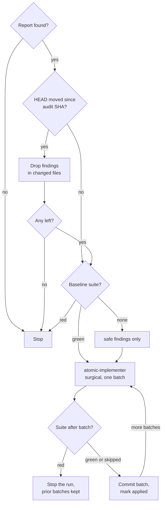

- **Report found?**: the most recent `deslop-*` bundle from `atomic scratchpad list`. No bundle or no `REVIEW.md` stops with `no deslop report found. run /deslop first.`
- **Drop findings in changed files**: `git diff --name-only <audit-sha>..HEAD`; findings in untouched files stand, and each dropped one is named in one line.
- **Baseline suite?**: a red baseline stops with `baseline is red — <N> failures before any deslop change. fix or stash first.`
- **atomic-implementer surgical, one batch**: a single file or a few files sharing one category, never across tiers; the brief is the findings verbatim from `REVIEW.md`. The run goes through the shared `worktree-setup` partial first.
- **Stop the run, prior batches kept**: the failing batch's output is reported verbatim and the tree is left as the implementer left it; no retry.
- **Commit batch, mark applied**: `refactor:` for code batches, `docs:` for prose batches, staging only the files the implementer reported.

### `atomic-visual-options`: one file, rewritten until the pick settles

One HTML file is overwritten in place on every change request, and the loop ends only when the user stops asking for changes.

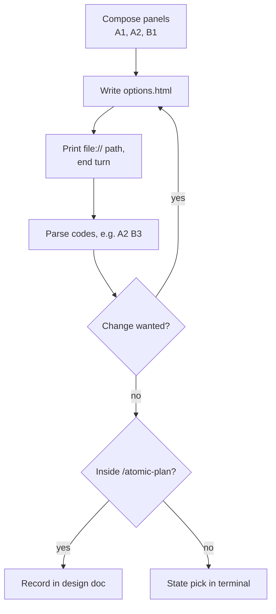

Each decision dimension is a lettered panel with 2 to 4 options (`A1`, `A2`). The HTML is self-contained, with no external requests and no client-side JavaScript, and the user replies with codes such as `A2 B3`. Only the chosen codes and their meanings are recorded.

### Finalize and ship

Finalize order is fixed. A command's policy Finalize row names which steps run; the rest are skipped, never reordered:

```
atomic-verify → /documentation → atomic-auditor → FOLLOWUPS triage → implementation log → signals refresh → report to user
```

Docs are written before the signals refresh so a new page exists when the scan runs. `doc-impact` runs before `signals-gate` inside `/commit` for the same reason. Finalize leaves the scratchpad bundle in place; Constraints covers how it is retired.

### `/commit`: commit first, then the token picks the ship partials

The commit always runs first when there is something to commit, and the token, or the answer to the ship-further prompt, decides which escalation partials run after it.

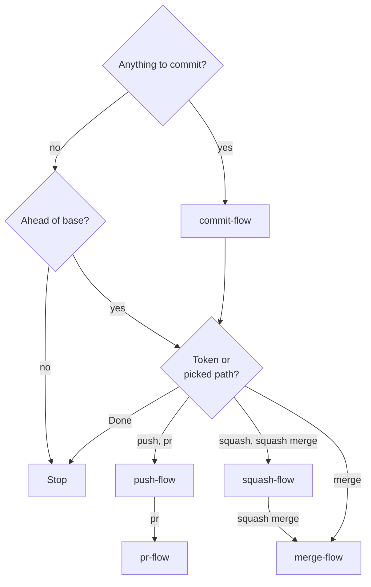

- **commit-flow**: stage by explicit path, `review-gate`, `doc-impact`, `signals-gate`, commit via HEREDOC, then delete the branch's session reports.
- **Token or picked path?**: with no token, `AskUserQuestion` offers Done, Push to remote, Open PR, Merge to base, or Squash + merge.
- **push-flow**: pushes when the remote branch is missing or HEAD is ahead of it, skips when they match, and stops on behind, diverged, or a rejected push. `<ref>` is `@{u}` when it names `<remote>/<branch>`, else `origin/<branch>`.
- **squash-flow**: skips on a branch carrying a single commit; on the squash + merge path, `merge-flow` still runs.
- **merge-flow**: `gh pr merge --merge --delete-branch` when a PR is open and `gh` is usable, else a local merge; then implementation logs, signals refresh, local branch deletion, and the worktree cleanup prompt.

A `Stop` node ends the verb. A `Skip` inside a gate (review, doc impact, signals refresh) stays inside that gate; any other `Skip` ends its whole ship step, and the path's next ship step runs.

### `atomic retro extract`: session rows in, numbered markdown out

Only user text, slash commands, and `Skill`/`Agent` calls survive extraction, so a retrospective subagent reads intent rather than tool output.

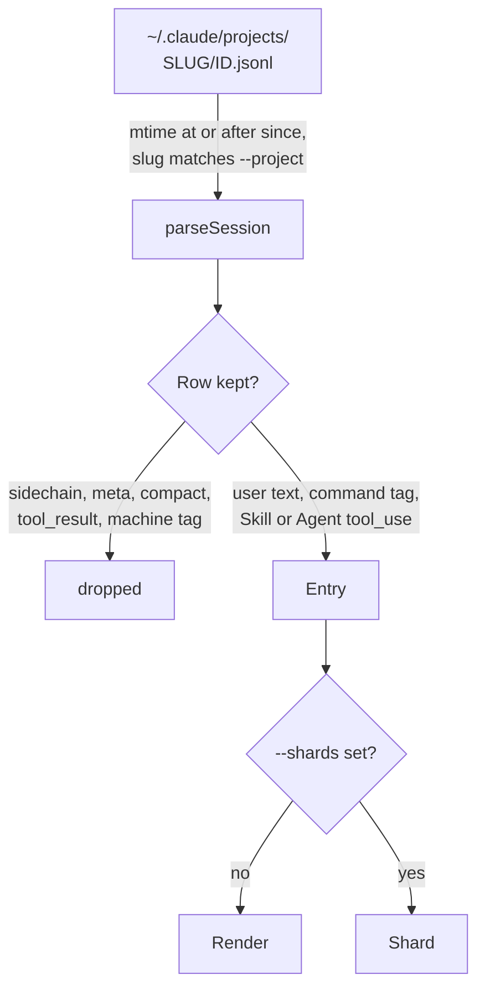

- **~/.claude/projects/SLUG/ID.jsonl**: direct-child `*.jsonl` files only; `--since` defaults through `resolveSince` to the last run in `~/.atomic/retro-runs/`, else 30 days back.
- **dropped**: an `isSidechain` row of either type; a user row that is `isMeta`, a compact summary, carries a `tool_result` block, or opens with a machine tag such as `<local-command-stdout>` or `<task-notification>`.
- **Entry**: a `<command-name>` or `<command-message>` row becomes `/verb args`; an assistant `tool_use` named `Skill` or `Agent` becomes a skill or agent line.
- **Render**: one document, every physical line prefixed with its line number. **Shard**: size-balanced files, never splitting a session.


## Where it lives


Shared partials are expanded into the embedded bundle by `make bundle` (see Coupling); [`docs/wiki/bundle.md`](bundle.md) carries the full partial pool. The Retro rows are the only Go code in this domain, and `/retrospective-learning`'s pre-flight is their only caller.

| Path | Role |
|---|---|
| **Plan** | |
| [`context/commands/gather-evidence.md`](../../context/commands/gather-evidence.md) | Chases a hypothesis through primary sources; returns `SUPPORTED` / `UNSUPPORTED` / `MIXED` / `INCONCLUSIVE` with a cited trail. Tier rule: community-level-only evidence caps the verdict at `MIXED` or `INCONCLUSIVE`. |
| [`context/commands/pressure-test.md`](../../context/commands/pressure-test.md) | Socratic challenger session. Questions only, no code, no agents, no artifacts. |
| [`context/commands/atomic-plan.md`](../../context/commands/atomic-plan.md) | Triviality gate (trivial / borderline / non-trivial), then design doc plus spec. Non-trivial runs a spec-authoring subagent loop capped at 5 iterations. Its scratchpad bundle is opened via `atomic scratchpad new <topic> --purpose plan`. |
| [`context/commands/challenge-swarm.md`](../../context/commands/challenge-swarm.md) | Profiles the target artifact, seats 3-6 cited lenses from a catalog spanning engineering, data/ML, business, finance, communication/market, and operations/delivery, dispatches them in isolation, merges findings into a contradiction map. Report-only, never edits the target. |
| [`context/skills/atomic-visual-options/`](../../context/skills/atomic-visual-options) | Renders 2 to 4 variants per decision dimension as a throwaway HTML file at `$(atomic scratchpad path <topic>)/options.html`; the user picks by typing codes. Invoked by `/atomic-plan` when a design question is visual. |
| [`context/agents/atomic-strategist.md`](../../context/agents/atomic-strategist.md) | Read-only "is this the right approach?" reasoning at `effort: xhigh`. Dispatched by the stuck check (The loop). Its output is never parsed for a `VERDICT:` line. |
| **Loop** | |
| [`context/commands/subagent-implementation.md`](../../context/commands/subagent-implementation.md) | The full loop: investigator, spec gate, worktree gate, implement to review to commit, then the finalize ceremony. |
| [`context/commands/implement.md`](../../context/commands/implement.md) | Fit-gated main-agent implementation for work whose context is already in the conversation. Checkpoints are declared up front; `atomic-reviewer` is dispatched after each one, never batched to the end; a checkpoint commits only on `VERDICT: PASS`. Finalizes with the shared loop-finalize sequence. Never pushes, merges, or opens a PR. |
| [`context/commands/quick-fix.md`](../../context/commands/quick-fix.md) | The same loop with no spec and no worktree; its finalize runs verify, audit, follow-ups, and report only. Never writes [`docs/spec/`](../spec) or [`docs/design/`](../design). Hand-off table at entry, escape hatch mid-loop. |
| [`context/commands/subagent-diagnose.md`](../../context/commands/subagent-diagnose.md) | Failure-driven loop. `ci` mode seeds from a failed GitHub Actions run, `bug` mode from a freeform symptom. Topic slugs are `diagnose-ci-<run-id>` and `diagnose-bug-<slug>`. |
| [`context/commands/autopilot.md`](../../context/commands/autopilot.md) | Runs plan to loop to ship unattended. The merge method is the only human decision. Its Ship step deletes `tmp/trash/` only. |
| [`context/agents/atomic-implementer.md`](../../context/agents/atomic-implementer.md) | Writes the code. `mode: feature` is cohesion-bounded, any file count; `mode: surgical` hard-caps at 2 non-test files and bounces anything larger. Both write TDD and report in the `agent-signals-output.md` skeleton. Composes `agent-readability` (The loop) as a self-check before the reviewer sees the diff. |
| [`context/agents/atomic-investigator.md`](../../context/agents/atomic-investigator.md) | Read-only locator. Returns a `file:line — what` table, no prose. Haiku-backed at `effort: low`, so it is cheap enough to dispatch by default. |
| [`context/skills/atomic-tdd/`](../../context/skills/atomic-tdd) | Failing test before production code. Owns writing or changing code once the cause is known. |
| [`context/skills/atomic-debug/`](../../context/skills/atomic-debug) | Hypothesis-driven diagnosis of an unknown root cause. Complements `/subagent-diagnose`. |
| [`context/_partials/worktree-setup.md`](../../context/_partials/worktree-setup.md) | The whole worktree gate: isolation detection, branch resolution, spec carry-forward, `git worktree add`, `EnterWorktree`, setup and baseline test detection. An existing branch name refuses with `branch <name> already exists. pick a different name or checkout existing.`; a permission or sandbox error prints `sandbox blocked worktree creation. working in place.` and the run continues in place with no setup or baseline tests. Composed into `subagent-implementation`, `autopilot`, `/implement` (run only when the working tree is clean), and `/deslop apply`. |
| [`context/_partials/handoff.md`](../../context/_partials/handoff.md) | The shared hand-off table, checked at entry and whenever an implementer report or a reviewer finding surfaces a signal (unknown or shifted root cause, "Two viable approaches, or success criteria still open", an implied public API/schema/cross-service contract, implementer `BLOCKED`/`NEEDS_CONTEXT`); on a match, names the signal, prints the target verb, keeps `$SCRATCH`, and stops. Composed into `/subagent-implementation`, `/quick-fix`, and `/implement`. |
| [`context/_partials/implement-loop.md`](../../context/_partials/implement-loop.md) | The shared implement to review loop: code-index sync, scratchpad-trio seeding from `atomic template`, per-checkpoint Implement / Review / Triage / Commit, and the same-blocking-signal stuck check. Composed into `/subagent-implementation`, `/quick-fix`, `/autopilot`, and `/implement`; `/subagent-diagnose` runs its own Phase-based flow. |
| [`context/_partials/loop-finalize.md`](../../context/_partials/loop-finalize.md) | The shared finalize sequence: verify, docs, one `atomic-auditor` dispatch over `<loop-base>..HEAD`, follow-up dispositions, implementation log, signals refresh, report, run once after the last checkpoint passes, skipping whatever the policy table's Finalize row omits. Composed into `/subagent-implementation`, `/quick-fix`, `/autopilot`, and `/implement`. |
| [`context/_partials/agent-implementer-workflow.md`](../../context/_partials/agent-implementer-workflow.md) | The entire `<workflow>` block for `atomic-implementer`; itself composes `agent-search-tooling`, `agent-tdd-signals`, `agent-code-intel`, `agent-where`. |
| [`context/_partials/agent-signals-output.md`](../../context/_partials/agent-signals-output.md) | The implementer's report skeleton: `## Did` / `## Tests` / `## Signals` / `## Failed` / `## Commit` / `## Status`, the `## Commit` section a proposed Conventional Commits message the orchestrator commits from directly, and `## Status` (`DONE` / `DONE_WITH_CONCERNS` / `BLOCKED` / `NEEDS_CONTEXT`) the line the orchestrator triages on. |
| [`context/_partials/agent-shared-rules.md`](../../context/_partials/agent-shared-rules.md) | Match file style, leave git state untouched, quote errors exactly. Composed into `atomic-implementer`. |
| [`context/_partials/agent-where.md`](../../context/_partials/agent-where.md) | The `atomic where --json` orientation call: repo-scope wiki, realm position, code-index scope, plus the project-keyed `reports`, `reports_root`, `reminders`, and `archive` paths every workflow artifact resolves from rather than hand-building. |
| **Review gates** | |
| [`context/agents/atomic-reviewer.md`](../../context/agents/atomic-reviewer.md) | Gates each iteration. Code-mode diffs against the spec, verifies TDD signals ran, checks the implementer's `## Commit` proposal against `atomic-git-discipline`, and gates readability at a 🟡 floor; spec-mode reviews a draft spec against its design. Ends with `VERDICT: PASS` or `VERDICT: CHANGES_REQUESTED`, no third option. Also dispatched once per checkpoint by `/implement`, and outside any loop by `atomic-verify`'s readiness check and the ship verbs' review gate. |
| [`context/agents/atomic-auditor.md`](../../context/agents/atomic-auditor.md) | Gates the whole task once, after the loop goes green. Its passes cover cumulative spec compliance, cross-iteration coherence (including comment drift and repetition accumulated across iterations, exempt from the single-checkpoint drop rule), commit soundness (plus a PR title/body judgment when an optional `pr:` path is passed), and documentation adherence. Never edits the repo; findings also written to `$SCRATCH/AUDIT.md`. Fresh context. |
| [`context/commands/review-branch.md`](../../context/commands/review-branch.md) | One `atomic-reviewer` pass over `<base>..HEAD`. Pre-flight before `/commit pr` or `/commit merge`. |
| [`context/skills/atomic-verify/`](../../context/skills/atomic-verify) | No completion claim without a verification command run in this turn. Invoked explicitly at every finalize. Enforces the `<completion_claim>` rule on ad-hoc main-agent code; see Constraints. |
| [`context/skills/atomic-review/`](../../context/skills/atomic-review) | One-line-per-finding review comments. Over-engineering and comment noise both floor at 🟡 risk, never 🔵; a comment that misdescribes the code is 🔴 bug. |
| [`context/_partials/review-gate.md`](../../context/_partials/review-gate.md) | Already-reviewed guard, docs-only guard, then `atomic-reviewer` in code mode on the staged diff, acting on the verdict before the commit; skip conditions are under Constraints. Composed into `commit-flow` (step 4) and `squash-flow-steps` (step 4), both immediately before `doc-impact`. |
| [`context/_partials/agent-readability.md`](../../context/_partials/agent-readability.md) | The readability floor (The loop); escalates to 🔴 on a misdescribing comment or a repeat finding across iterations. Composed into `atomic-implementer`, `atomic-reviewer`, `atomic-auditor`. |
| [`context/_partials/agent-yagni.md`](../../context/_partials/agent-yagni.md) | The simplicity ladder, composed into `atomic-implementer`, `atomic-reviewer`, `atomic-auditor`, `atomic-strategist`, and `atomic-deslopper`. |
| [`context/_partials/agent-comment-discipline.md`](../../context/_partials/agent-comment-discipline.md) | The comment rules, ending in `atomic code comments --diff <range>` as a worklist walked to zero. Composed into `atomic-implementer`, `atomic-reviewer`, `atomic-auditor`, and `atomic-deslopper`. |
| [`context/_partials/agent-atomic-voice.md`](../../context/_partials/agent-atomic-voice.md) | The `## Response voice` block: findings only, no preamble or recap, identifiers and error strings exact. Composed into every agent under [`context/agents/`](../../context/agents). |
| **Ship** | |
| [`context/commands/commit.md`](../../context/commands/commit.md) | The single ship verb. Escalation tokens `push`, `pr`, `merge`, `squash`, `squash merge`; no token commits then prompts. With nothing to commit and commits ahead of base, it ships the existing commits. |
| [`context/commands/undo-commit.md`](../../context/commands/undo-commit.md) | Soft-resets the last commit. Refuses on merge commits, the initial commit, and an already-pushed HEAD. |
| [`context/commands/session-report.md`](../../context/commands/session-report.md) | Writes branch-scoped why-context to the `reports` path `atomic where --json` reports (`~/.atomic/<project-key>/reports/<branch>/`, outside the repository). Read by `/commit`, deleted after a successful commit. |
| [`context/commands/git-cleanup.md`](../../context/commands/git-cleanup.md) | Scans and cleans stale worktrees, branches, and registrations. Archives a departing worktree's scratchpad bundle(s) before `git worktree remove`, and reaps session-report directories for branches gone from `git branch -a`, with no grace window. |
| [`context/commands/watch-ci.md`](../../context/commands/watch-ci.md) | Dispatches a background, Haiku-backed `general-purpose` subagent to poll CI to a terminal state and report back; provider detection (GitHub Actions, GitLab CI, CircleCI, etc.) lives in the subagent, sourced from [`docs/wiki/index.md`](index.md) first, file-tree heuristics second. Read-only, never reruns or cancels a workflow. Returns immediately. |
| [`context/skills/atomic-git-discipline/`](../../context/skills/atomic-git-discipline) | Conventional Commits messages, PR titles, and PR bodies. Every ship path delegates message format here; session-report content passed in as why-context is resolved by the invoking ship verb via `atomic where --json`, not by this skill. Composed into `atomic-implementer` (drafts the `## Commit` proposal) and `atomic-reviewer` (checks it); `pr-flow` invokes it for PR title and body. |
| [`context/_partials/commit-flow.md`](../../context/_partials/commit-flow.md) | Stage, review-gate, doc-impact, signals-gate, commit, session-report cleanup; the report dir is resolved via `agent-where`'s `reports` field, never constructed. |
| [`context/_partials/push-flow.md`](../../context/_partials/push-flow.md), `pr-flow.md`, `merge-flow.md`, `squash-flow.md` | The escalation paths `/commit` routes into. |
| [`context/_partials/doc-impact.md`](../../context/_partials/doc-impact.md) | Matches the staged diff against the `## Documentation surfaces` table, walks each match with Yes / Later / Remind / Skip. |
| [`context/_partials/signals-gate.md`](../../context/_partials/signals-gate.md) | Docs-only guard, `atomic signals stale`, silent `atomic-wiki-inferrer` dispatch, then stages `docs/wiki/*.md`, the [`.claude/rules/wiki/`](../../.claude/rules/wiki) pointer cards, and [`.gitignore`](../../.gitignore) / [`.claude/.gitignore`](../../.claude/.gitignore) / [`CLAUDE.md`](../../CLAUDE.md) (the inferrer's `@-ref` append target) when modified or untracked. |
| [`context/_partials/worktree-cleanup-prompt.md`](../../context/_partials/worktree-cleanup-prompt.md) | Offers to remove a linked worktree after a merge, archiving its scratchpad bundle(s) via `atomic scratchpad list`/`archive` before `git worktree remove`. Composed into `merge-flow` only. |
| [`context/_partials/git-safety.md`](../../context/_partials/git-safety.md) | Explicit staging, one git command per Bash call, never `--amend` after a hook failure, no force-push on base. Composed into `/commit` and `/deslop`. |
| [`context/_partials/base-resolution.md`](../../context/_partials/base-resolution.md) | The base-branch lookup: the `gh repo view` default branch, else `init.defaultBranch`, else `main`. Composed into the `merge-flow` and `squash-flow` preflights. |
| **Deslop** | |
| [`context/commands/deslop.md`](../../context/commands/deslop.md) | Standing-code audit, not a diff. Phase 1 fans out `atomic-deslopper` per shard and writes `REVIEW.md` into a `deslop-<date>` scratchpad bundle; `/deslop apply <ids or tier>` is the separate Phase 2 that fixes accepted findings through the surgical implementer, one committed batch at a time. |
| [`context/agents/atomic-deslopper.md`](../../context/agents/atomic-deslopper.md) | Read-only auditor for one `/deslop` shard. Every finding binds to a rule atomic already carries (`comment-noise`, `doc-slop`, `speculative-abstraction`, `reinvented-wheel`, `duplicate-helper`, `dead-code`, `error-as-control-flow`, `convention-drift`) and carries a `safe` / `guarded` / `report-only` tier. Writes one findings file and nothing else. Sonnet-backed at `effort: high`. |
| **Retro** | |
| [`context/commands/retrospective-learning.md`](../../context/commands/retrospective-learning.md) | Pre-flight runs `atomic retro extract --shards 4 --out $SCRATCH/history.md` to turn session `.jsonl` history into numbered markdown shards; one Sonnet-backed `general-purpose` subagent scans each shard and cites `file:line` findings instead of retyping quotes, which Step 4 recovers with `sed` before categorizing. Its working dir is `tmp/<date>-retro/`, not a scratchpad bundle. |
| [`atomic/internal/retro/extract.go`](../../atomic/internal/retro/extract.go) | Walks `~/.claude/projects/*/`, reads direct-child `*.jsonl` session files, and reduces each row to a kept `Entry` (user text, slash command, `Skill`/`Agent` tool call) per a fixed keep/drop rule set; returns `Session`s ordered by first timestamp. |
| [`atomic/internal/retro/lastrun.go`](../../atomic/internal/retro/lastrun.go) | `LastRunSince` reads `run_ts` from the newest `~/.atomic/retro-runs/*.json` by filename, the default `--since` date when the flag is omitted. Returns `ok=false, err=nil` only when the dir is missing or holds no `*.json` file; a newest file that exists but fails to unmarshal or fails `time.Parse` returns a non-nil `err` instead. `resolveSince` in `cmd_retro.go` folds both outcomes into the same 30-day fallback. |
| [`atomic/internal/retro/render.go`](../../atomic/internal/retro/render.go) | `Render` turns sessions into one numbered markdown document, every physical line prefixed with its own line number so `sed -n '<N>p'` recovers a cited entry; `Shard` assigns sessions to K = min(N, session count) size-balanced files, largest session into the lightest bin, never splitting a session across files; `truncate` caps a message at 800 runes with a `…[+N chars]` marker. |
| [`atomic/cmd/atomic/cmd_retro.go`](../../atomic/cmd/atomic/cmd_retro.go) | Cobra dispatch: `retro extract` parses `--since`, `--project`, `--shards`, `-o`/`--out`, resolves the effective `--since` via `resolveSince` (flag value, else the last run, else 30 days back), calls `retro.Extract`, then `retro.Render` or `retro.Shard`, and writes the output plus a stderr summary (files/projects/sessions scanned, unparsable rows, read errors, per-file byte and line counts). |
| **Help, reminders, and issue reports** | |
| [`context/commands/atomic-help.md`](../../context/commands/atomic-help.md) | Routes a lost user to one next action. Bare, topic keyword, freeform intent, or `tour`. |
| [`context/commands/setup-wiki.md`](../../context/commands/setup-wiki.md) | Repo bootstrap. Audits [`.gitignore`](../../.gitignore), [`docs/`](..) layout, and [`CLAUDE.md`](../../CLAUDE.md) presence; proposes only what is absent. |
| [`context/commands/follow-up.md`](../../context/commands/follow-up.md), [`context/commands/remind-me.md`](../../context/commands/remind-me.md) | Reminder lifecycle. Reads and writes the `reminders` path `atomic where --json` reports (`~/.atomic/<project-key>/reminders/`); legacy-path handling is in [`docs/wiki/config.md`](config.md). |
| [`context/commands/report-issue.md`](../../context/commands/report-issue.md) | Opens a GitHub issue against the current repo via `gh`. |
| [`context/commands/report-issue-with-atomic.md`](../../context/commands/report-issue-with-atomic.md) | Same flow, target hardcoded to `damusix/atomic-claude`, never inferred from `gh repo view` or cwd. |
| [`context/_partials/report-issue-privacy.md`](../../context/_partials/report-issue-privacy.md) | PII and secret redaction plus a preview-and-confirm gate, composed into both issue commands. |
| **Docs** | |
| [`docs/reference/workflow.md`](../reference/workflow.md) | Human-facing lifecycle reference. |
| [`docs/reference/commands.md`](../reference/commands.md), `agents.md`, `skills.md` | Roster tables. |
| [`docs/spec/atomic-plan.md`](../spec/atomic-plan.md) | Contract for the triviality gate, design and spec split, and the spec-authoring loop. |
| [`docs/spec/spec-change-tree-flows.md`](../spec/spec-change-tree-flows.md) | Why every spec body carries `## Change tree`, `## Outline`, and `## Flows`. |
| [`docs/spec/subagent-diagnose.md`](../spec/subagent-diagnose.md), [`docs/design/diagnose-orchestrators.md`](../design/diagnose-orchestrators.md) | Contract and rationale for the `ci` and `bug` diagnose modes. |
| [`docs/spec/implement.md`](../spec/implement.md) | Contract for the fit gate, checkpoint declaration, per-checkpoint reviewer dispatch, the reviewer-brief and scratchpad-trio contract `/implement` co-consumes with `/subagent-implementation` and `/quick-fix`, and the single `atomic-auditor` final gate plus range-scoped signals refresh at finalize. |
| [`docs/spec/quick-fix.md`](../spec/quick-fix.md) | Hand-off table signals, the no-file-threshold constraint, the shared-partial composition, the same-blocking-signal stuck check in place of an iteration cap. |
| [`docs/spec/autopilot.md`](../spec/autopilot.md) | The autonomous overrides. |
| [`docs/spec/atomic-auditor.md`](../spec/atomic-auditor.md) | The audit passes and the once-per-task dispatch rule. |
| [`docs/spec/stuck-fix-escalation.md`](../spec/stuck-fix-escalation.md), [`docs/design/stuck-fix-escalation.md`](../design/stuck-fix-escalation.md) | Stuck-fix escalation and reviewer suppression-pattern awareness. |
| [`docs/spec/signals-refresh-timing.md`](../spec/signals-refresh-timing.md), [`docs/design/signals-refresh-timing.md`](../design/signals-refresh-timing.md) | When signals refresh fires in the loop, in autopilot, and in the ship verbs. |
| [`docs/spec/challenge-swarm.md`](../spec/challenge-swarm.md) | Lens roster, workspace layout, isolated dispatch, contradiction-map aggregation. |
| [`docs/spec/document-templates.md`](../spec/document-templates.md), [`docs/design/document-templates.md`](../design/document-templates.md) | The `atomic template <name>` verb these commands seed from. |
| [`docs/spec/session-report.md`](../spec/session-report.md), [`docs/spec/setup-wiki.md`](../spec/setup-wiki.md) | Contracts for those commands. |
| [`docs/spec/comment-discipline.md`](../spec/comment-discipline.md) | Comment rules the implementer, reviewer, and auditor all enforce; readability floor under The loop. |
| [`docs/spec/visual-options.md`](../spec/visual-options.md), [`docs/design/visual-options.md`](../design/visual-options.md) | Contract and rationale for the visual-options skill. |
| [`docs/reference/retro.md`](../reference/retro.md) | Reference for the `atomic retro extract` verb: flags and defaults, output shape and the `file:line` convention, the drop-row table, exit codes. |
| [`docs/design/retro-extract.md`](../design/retro-extract.md) | Rationale for extracting session history via a Go verb instead of scanner-applied filtering; the row-shape table is verified against real transcripts. |
| [`docs/spec/retro-extract.md`](../spec/retro-extract.md) | Contract for `atomic retro extract` and how `/retrospective-learning` consumes it. |
| [`docs/spec/deslop.md`](../spec/deslop.md), [`docs/design/deslop.md`](../design/deslop.md) | Contract and rationale for the two-phase standing-code audit and its safety tiers. |
| [`docs/design/implement-loop-consolidation.md`](../design/implement-loop-consolidation.md) | Rationale for the shared `implement-loop` / `loop-finalize` partials and the per-command policy table. |
| [`docs/spec/main-agent-review-gate.md`](../spec/main-agent-review-gate.md), [`docs/design/main-agent-review-gate.md`](../design/main-agent-review-gate.md) | Contract and rationale for reviewer-gating ad-hoc main-agent edits at `atomic-verify` and at the ship verbs. |
| [`docs/spec/comment-counter.md`](../spec/comment-counter.md), [`docs/design/comment-counter.md`](../design/comment-counter.md) | The `atomic code comments` counter the implementer, reviewer, and auditor run on their diff. |


## Constraints


**The spec body is read verbatim by subagents.** `/subagent-implementation`'s currency gate exists because the `BRIEF.md` points fresh agents straight at `docs/spec/<topic>.md`. If a decision in the conversation superseded any part of that body, rewrite the body before dispatching. The test: could a fresh subagent reading only the spec body build something a later decision already cut? Papering over it in the brief does not work.

**Every spec body carries `## Change tree`, `## Outline`, and `## Flows`.** The change tree marks files `A` / `M` / `D`; the outline names the pieces per file as `name — responsibility`, one level of nesting, no signatures; flows are numbered actor-to-step sequences. `## Outline` is what `atomic-reviewer` walks the delivered diff against in its outline pass; an omitted or empty section makes that pass silently no-op instead of failing loud. An empty section is written `None — <reason>`, never omitted.

**The auditor is dispatched exactly once per task.** A `CHANGES_REQUESTED` verdict earns one more implementer and reviewer iteration, then the run continues regardless of what a second audit would say. Re-auditing turns finalize into an unbounded loop, which never terminates under `/autopilot`.

**The review gate runs once per change, not once per step.** [`context/_partials/review-gate.md`](../../context/_partials/review-gate.md) skips when any of these holds:

- The staged work came from `/implement`, `/subagent-implementation`, `/quick-fix`, `/autopilot`, or `/subagent-diagnose`, each of which dispatches `atomic-reviewer` per iteration or per checkpoint.
- This same gate already reviewed the change earlier in the flow, such as a squash of what commit-time already reviewed.
- `atomic-verify`'s gate already reviewed the change this session, with no edits since.
- Every staged path is documentation, by the same test the signals gate uses.

Without the guard, a squash of already-reviewed commits would re-review the identical diff. Outside those commands, a completion claim on main-agent code needs the `<completion_claim>` line from [`context/CLAUDE.md`](../../context/CLAUDE.md): `review: <PASS|CHANGES_REQUESTED> (<agent> on <model>)`, from `atomic-reviewer` dispatched with the session's model, `diff: working` or `diff: staged`, and a one-line `intent:`. Both gates act on the verdict the same way: 🔴 is fixed before the claim or commit, 🟡 is fixed or justified in one line, and 🔵 is mentioned, never blocking.

**A squash merge makes the PR title the commit subject; a merge commit does not.** `gh pr merge --merge` keeps every commit on the branch, so release-please reads their conventional subjects and the title is free-form. `--squash` collapses them into one commit whose subject is the PR title, and the branch's own `feat:`/`fix:` lines survive only as body bullets that release-please does not parse for a type. A prose title on that path drops the PR from the release with no error, and the repair is a force-push of the base branch. `merge-flow` checks the title before any `--squash` for this reason.

**Worktree cleanup fires on `merge` and `squash merge`, not on plain `squash`.** `worktree-cleanup-prompt` is composed into `merge-flow` only, so a branch squashed without merging leaves its worktree in place, and its scratchpad bundle un-archived.

**Scratchpad bundles are never deleted by the loop that created them.** `/subagent-implementation`, `/quick-fix`, `/subagent-diagnose`, `/implement`, `/autopilot`, and `/challenge-swarm` all leave `$SCRATCH` in place at close-out, whether the run succeeded or was bailed. A bundle is retired only by `atomic scratchpad archive <slug>`: `/git-cleanup` drives it when it reaps the bundle's worktree or branch, the `merge`/`squash merge` worktree-cleanup prompt drives it, or the user runs it directly. The worktree is the only link from a bundle to its branch, since `meta.toml` has no branch field, so archiving runs before `git worktree remove`.

**Session reports live outside the repository.** `/session-report` writes to `~/.atomic/<project-key>/reports/<branch>/`, resolved via `atomic where --json`'s `reports` field, so there is nothing to stage or gitignore for it. `/git-cleanup` reaps a branch's reports as soon as that branch is gone from `git branch -a`, with no grace window. A reused branch name would otherwise inherit a stale predecessor's report as its own why-context ([`context/commands/git-cleanup.md`](../../context/commands/git-cleanup.md)).

**The signals docs-only guard treats artifact markdown as source.** A path is documentation when it is under a [`docs/`](..) directory at any depth, or is a top-level `README*` / `CHANGELOG*` / `CONTRIBUTING*` / `CODE_OF_CONDUCT*` / `SECURITY*` / `LICENSE*`, and a commit touching only such paths skips the refresh. Anything under [`context/agents/`](../../context/agents), [`context/commands/`](../../context/commands), [`context/skills/`](../../context/skills), [`context/rules/`](../../context/rules), or [`context/output-styles/`](../../context/output-styles), plus [`context/CLAUDE.md`](../../context/CLAUDE.md) and the root [`CLAUDE.md`](../../CLAUDE.md), counts as source, because in a config repo those files are the product. Classifying artifact `.md` as docs would skip the refresh on a commit that changes the product, and the wiki would go stale ([`context/_partials/signals-gate.md`](../../context/_partials/signals-gate.md)).

**Commands never improvise a document skeleton.** Every design doc, spec, brief, state, follow-ups ledger, diagnose context, session report, and implementation log is seeded from `atomic template <name>`, then filled. An improvised skeleton drifts from the section contract that `atomic validate spec` and the implementer and reviewer briefs depend on.

**`/autopilot` avoids `rm` and shell chaining mid-run.** Both trigger permission prompts that stall an unattended session. Scratch experiments (not the task's scratchpad bundle) are quarantined into `tmp/trash/` and deleted once, in its Ship step.

**`/deslop` keeps a human between audit and fix.** Without that stop, an unreviewed behavior change lands on code nobody asked to touch. Phase 1 writes only inside its scratchpad bundle, and Phase 2 never applies a `report-only` finding, never widens a fix beyond the finding, and stops on the first red suite without retrying.

**`/challenge-swarm` seats a minimum of 3 lenses and requires a citation per seat.** Below 3 lenses the contradiction map has no triangulation ([`context/commands/challenge-swarm.md`](../../context/commands/challenge-swarm.md)). A lens without a one-line pointer to the design section or source path where its stake lives is benched, printed as `<lens>: benched — <reason>`, not silently dropped.

**`atomic retro extract` degrades to a scope narrowing, not a failure.** `/retrospective-learning`'s pre-flight runs the extractor before Step 1; when it exits non-zero, the command announces `history extract unavailable — history scan skipped` and narrows the run to current-conversation-only scope rather than failing; a failure would turn a retrospective with no history into no retrospective.

**A session row past 16 MiB truncates that session's scan, not the whole extract.** `parseSession` grows `bufio.Scanner`'s buffer from its 64 KiB default to 16 MiB, since a `tool_result` row threaded into a user message can be large; a row exceeding 16 MiB ends the scan for that file, counts as one unparsable row in the stderr summary, and the session's remaining rows are lost.


## Coupling


**bundle** owns the pipeline that turns [`context/`](../../context) into the installed artifact set: [`context/commands/`](../../context/commands), [`context/agents/`](../../context/agents), [`context/skills/`](../../context/skills), [`context/output-styles/`](../../context/output-styles), [`context/rules/`](../../context/rules), and [`context/CLAUDE.md`](../../context/CLAUDE.md) are the sources; a source may compose a `{{ template "<name>" . }}` directive resolved against [`context/_partials/`](../../context/_partials); `make bundle` expands everything directly into [`atomic/internal/embedded/`](../../atomic/internal/embedded) in one step. Editing this domain's prompt artifacts means editing the [`context/`](../../context) file directly, then running `make -C atomic bundle` before the change is visible to the embedded binary. Full inventory and per-artifact composition tables: [`docs/wiki/bundle.md`](bundle.md).

**config** owns state-path resolution and the verbs this domain calls to reach it, never constructing a path by hand:

| Verb | Called by | On failure |
|---|---|---|
| `atomic template <name>` | `/atomic-plan`, `/subagent-implementation`, `/autopilot`, `/subagent-diagnose`, `/quick-fix`, `/implement`, `/session-report` | No failure path named. |
| `atomic repo init` | `worktree-setup` partial, `implement-loop` partial, `/deslop`, `/subagent-diagnose`, each before the bundle or worktree is created; `/setup-wiki` only proposes it | No failure path named. |
| `atomic scratchpad new \| path \| list \| archive` | Every orchestrator that opens or extends a bundle, `/git-cleanup`, `atomic-visual-options` | No fallback for `new`/`path`; the command cannot proceed without a resolved path. |
| `atomic where --json` | `agent-where` partial, session-report and reminder path resolution, `/git-cleanup`'s report-reaping step | When `atomic where` errors, `agent-where` falls back silently to detection heuristics (walk for [`docs/wiki/index.md`](index.md), check [`CLAUDE.md`](../../CLAUDE.md) for a `<wikis>` block) and never blocks. |
| `atomic followups add` | Finalize, on a `defer` disposition, which commits a successful add as `docs(followups): defer <id>` | No failure path named. |

Config also owns the paths this domain writes to: `.claude/.scratchpad/<slug>/` (repo-local, worktree-local bundle; retained, not deleted, until archived), `~/.atomic/<project-key>/reports/<branch>/` and `~/.atomic/<project-key>/reminders/` (project-keyed, outside the repository), `.claude/project/followups/<id>.md`, and `.claude/worktrees/<branch>/`. When a bundle's on-disk shape doesn't match what an artifact expects, `atomic migrate --show-log` is the change history to check, per the note repeated across `/atomic-plan`, `/quick-fix`, `/subagent-diagnose`, `/subagent-implementation`, `/autopilot`, `/follow-up`, `/remind-me`, `/session-report`, and `atomic-visual-options`.

**signals** owns refresh timing. The short version for a session working here: the implementation phase refreshes once at finalize over `<loop-base>..HEAD`, and the ship verbs are the ad-hoc fallback that skips when the loop already refreshed. `/implement` follows the same rule: its own finalize runs the refresh over its own loop-base range, after the final gate. Full contract in [`docs/spec/signals-refresh-timing.md`](../spec/signals-refresh-timing.md).

**docs-meta** owns `/documentation` and the `atomic-documentation` skill, which finalize invokes and which `doc-impact` calls per matched surface. Design docs and specs are written in the `atomic-writing` voice.

**doctor** owns `atomic validate spec` and `atomic validate config`, which finalize runs when the change touched `docs/spec/**`, `docs/design/**`, or a bundled artifact. It also owns `cliusage.go`, the source of truth for the [`atomic`](../../atomic) command surface, which is the reverse dependency worth knowing: every `atomic template <name>` variant a command cites must have a matching `cliusage.go` entry or `atomic validate artifacts` flags the citation as an unknown verb.

**code-intel** is queried, never driven, from inside the loop. At task start, orchestrators run `atomic code sync` when the index is present and `atomic code index` after a one-line notice when it is absent, then sync after each green commit. The loop never blocks on the index. Subagents never trigger indexing, and fall back to `sg` and `grep` on a missing DB or query error.

Contracts that change in lockstep:

- The YAGNI ladder in [`context/_partials/agent-yagni.md`](../../context/_partials/agent-yagni.md) is kept verbatim identical to the ladder in [`context/CLAUDE.md`](../../context/CLAUDE.md)'s Principles block. [`context/CLAUDE.md`](../../context/CLAUDE.md) is copied byte-for-byte (not expanded) into the bundle, so that duplication is manual.
- The ship verbs must agree on message format, worktree detection, the review gate, and the signals gate. Changing one path's behavior on a shared concern means changing all of them.
- A new command, agent, or skill needs a row in the `/atomic-help` topic table before it is done.
- `/subagent-implementation`, `/quick-fix`, and `/implement` are co-consumers of the same `atomic prompt reviewer` brief and the same scratchpad trio contract (`BRIEF.md` / `STATE.md` / `FOLLOWUPS.md`), so a shape change to any one needs updating the others.
- `agent-comment-discipline.md` is the one comment rule set `atomic-implementer`, `atomic-reviewer`, `atomic-auditor`, and `atomic-deslopper` all compose; the reviewer's and the deslopper's comment findings are measured against the same text.
- `agent-readability.md`'s 🟡 floor for over-engineering and comment noise is kept in step with the same sections of `atomic-review`.
- Every artifact citing a hand-built scratchpad, report, reminder, or archive path instead of resolving it through `atomic scratchpad` or `atomic where --json` is a regression against that convention.
